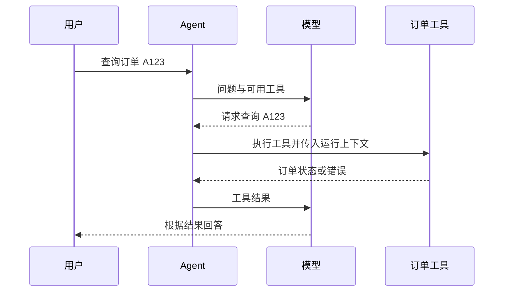

# 🛠️ 第一个 Agent 与工具调用

> [!abstract] 一句话总结
> 工具调用由模型提出请求，由应用执行 Java 方法并把结果反馈给模型；框架负责组织调用流程，业务系统负责身份、权限和数据正确性。

## 🎯 订单查询为什么需要工具？

用户问“订单 A123 到哪了”。模型本身不知道实时订单状态，Agent 需要把订单号交给查询工具；工具查到“配送中”后，模型才能根据结果回答。模型可能不调用工具，也可能给错参数，因此要检查工具调用和最终回答。



## 🧩 定义并注册工具

`@Tool` 描述能力，`@ToolParam` 描述模型可以提供的参数。`RuntimeContext` 由框架注入，应用应确保其中的身份来自服务端认证。下面假设 `orderService` 已提供按用户校验订单归属的查询方法；代码是片段，未在本机运行。

```java
@Tool(name = "query_order", description = "查询当前用户的订单状态", readOnly = true)
public String queryOrder(@ToolParam(name = "orderId", description = "订单号") String orderId,
                         RuntimeContext context) {
    return orderService.queryStatus(context.getUserId(), orderId);
}
```

```java
Toolkit toolkit = new Toolkit();
toolkit.registerTool(orderTools);
```

工具描述应说清何时使用和参数含义，但描述不是权限校验。即使工具声明 `readOnly = true`，也需要检查调用者是否有权读取订单。

## ⚙️ 构建 Agent 并传入会话

假设 `model`、`toolkit` 已配置，`userId` 是认证后从服务端取得的身份，`sessionId` 已验证归属；下面省略 imports 和模型连接配置。

```java
ReActAgent agent = ReActAgent.builder().name("order_agent")
        .sysPrompt("根据订单工具结果回答用户。")
        .model(model).toolkit(toolkit).build();
RuntimeContext ctx = RuntimeContext.builder().userId(userId).sessionId(sessionId).build();
Mono<Msg> reply = agent.call(new UserMessage("查询订单 A123"), ctx);
```

`call` 返回响应式结果，订阅后执行；命令行可使用 `block()`，WebFlux 应避免阻塞事件循环。生产应用还需要检查超时、异常、工具调用次数和日志脱敏。

## 🔐 为什么身份不能只靠模型提供？

模型可根据用户输入生成 `orderId`，但用户可以在提问中声称自己是管理员。服务端需要从认证信息取得用户身份，并在订单服务中验证订单归属；`RuntimeContext` 只是传递信息的载体，不会自动完成鉴权。
写入、退款等有副作用的工具还需要权限、幂等和必要的人工审批，不能依赖提示词保证安全。

> [!question]- 工具返回“无权访问”，模型是不是一定会正确告诉用户？
> 不一定。需要检查工具结果及最终输出；对于敏感操作，应由程序执行明确的权限判断，不依赖模型转述作为唯一防线。

## 🔗 关联与资料

- [[09-实战-订单查询Agent]]：订单查询、权限和验证场景。
- [AgentScope Java：工具定义和注册](https://github.com/agentscope-ai/agentscope-java/blob/v2.0.4/docs/v2/en/docs/building-blocks/tool.md)
- [AgentScope Java：Agent 调用](https://github.com/agentscope-ai/agentscope-java/blob/v2.0.4/docs/v2/en/docs/building-blocks/agent.md)
