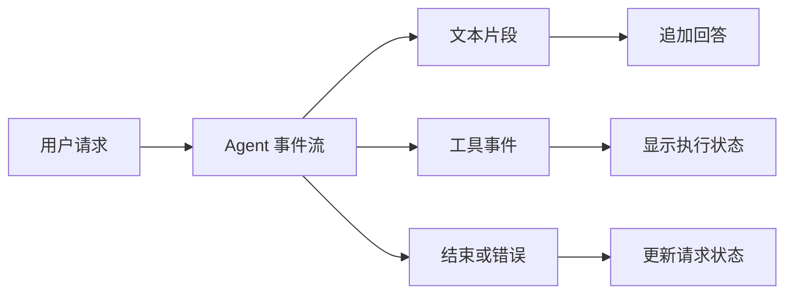

# 🌊 流式输出与事件驱动

> [!abstract] 一句话总结
> Agent 的流式响应除了文本片段，还可能包括工具调用、审批和结束事件；前端需要按事件类型处理，而不是把所有事件都当作正文。

## 🎯 为什么要区分事件？

用户提问后，Agent 可能先查询订单，再把结果交给模型生成回答。仅显示最终文本，用户不知道系统仍在等待工具；区分文本与工具事件后，可以显示进度，同时避免把内部工具参数直接当成回答。



## 💻 接收事件

假设 `agent` 和认证后的 `ctx` 已配置。以下片段展示官方 `streamEvents` 入口；事件解析、SSE 封装与错误处理省略，未实际运行。

```java
Flux<AgentEvent> events = agent.streamEvents(new UserMessage("查询订单 A123"), ctx);
return events.doOnNext(event -> log.info("事件类型：{}", event.getType()));
```

WebFlux 可以将事件映射为 SSE 返回，订阅由 Web 框架完成；日志不要泄漏工具输入或用户数据。

## 🧩 一个请求会收到哪些事件？

以“查询订单 A123”为例，事件流可能先报告工具调用开始，再报告工具返回，最后输出回答的文本片段并结束。顺序和事件种类取决于调用过程：简单问答可能没有工具事件，失败或取消时也不应假定一定会收到正常结束事件。
下面只演示提取文本增量，假设 `event` 是上面流中的事件；其他类型仍需要分别处理。字段和事件名以使用的 AgentScope Java 版本为准。

```java
if (event.getType() == AgentEventType.TEXT_BLOCK_DELTA) {
    String text = ((TextBlockDeltaEvent) event).getDelta();
    // 将 text 追加到本次回答
}
```

`Flux` 描述的是异步事件序列；订阅后才开始消费。WebFlux 返回该流时由框架负责订阅；在独立命令行程序里才考虑阻塞等待结束，不要在 Web 事件循环线程阻塞。

## ⏸️ 审批和恢复

需要用户批准的工具可以使执行暂停，前端接收到审批事件后展示待确认操作。批准或拒绝时，服务端应校验审批人、会话、操作内容和有效期，再按照所用版本的官方接口恢复；并发重复提交和外部工具副作用需要单独处理。

## 🧪 如何验证？

分别测试正常文本流、工具调用、工具失败、审批拒绝、客户端断连和超时。不能因为收到了开始事件就假设操作已经成功；应以最终结果事件或业务系统状态为准。

> [!question]- 把 Agent 的所有事件都原样拼成字符串发给用户可以吗？
> 不建议。不同事件语义不同，工具参数和内部错误还可能包含敏感信息；应按类型转换并控制可见范围。

## 🔗 关联与资料

- [[05-状态管理与会话持久化]]；[[08-Spring整合与生产部署]]。
- [AgentScope Java：快速开始与流式事件](https://github.com/agentscope-ai/agentscope-java/blob/v2.0.4/docs/v2/en/docs/quickstart.md)
