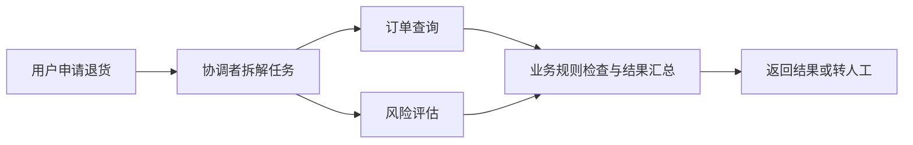

# 🤝 多 Agent 协作与工作流

> [!abstract] 一句话总结
> 多 Agent 协作是把任务交给不同角色处理，再由程序或主 Agent 汇总结果；它可以缩小各角色的职责和工具范围，也会增加通信、延迟和调试成本。

## 🎯 用退款问题理解分工

用户申请退货时，可以先查订单与退货期限，再检查风险，最后汇总结果。订单查询和风险评估可以分工，但退款是否真正执行，应由业务服务根据权限与规则决定，不能只凭模型回复“可以退款”。



## 🧩 常见的协作方式

| 方式 | 工作过程 | 适合什么情况 |
| :--- | :--- | :--- |
| 顺序执行 | 上一步结果作为下一步输入 | 后一步必须依赖前一步的输出 |
| 并行执行 | 独立任务同时执行，再等待汇总 | 多路任务没有前后依赖，但要考虑超时和部分失败 |
| 主从委派 | 主 Agent 按需要派发任务、接收结果 | 任务路径不固定，需要动态选择角色 |

程序可以固定顺序或并行分支，也可以让模型选择下一步；前者更容易预测，后者更灵活但需要额外评测。两者可以组合。

## ⚙️ 在 AgentScope 中理解子 Agent

AgentScope 的 Harness 支持子 Agent 委派：为子 Agent 配置角色与工具，主 Agent 发起任务并接收结果。具体注册、消息、权限和生命周期配置应以所用版本的官方文档为准；子 Agent 并不自动拥有与主 Agent 相同的数据访问权。
任务输入要说明目标、必要上下文与预期结果；返回值最好包含结论、来源和失败原因，便于主流程判断是否继续。对不能自动判断的高风险动作，要由应用明确转人工或停止。

## 💻 如何声明一个子 Agent？

假设已配置 Harness 的工作区，可以在该工作区的 `subagents/order-checker.md` 中声明一个角色。文件名 `order-checker` 是角色 ID，`description` 告诉主 Agent 什么时候适合委派；文件正文说明子 Agent 的任务。

```markdown
---
description: 检查订单状态和退货期限
---
查询获授权的订单，返回状态、时间和来源；不要执行退款。
```

框架可以发现该声明，由主 Agent 在需要时委派。能否读取订单仍由实际注册的工具、用户身份和服务端授权决定；写了角色说明不代表权限已经收紧，也不保证模型一定选择它。具体声明字段和加载规则以所用版本文档为准。

## ⚠️ 控制成本和边界

- 限制子任务数量、并发、执行时间和重试次数；取消父任务时也要检查子任务如何结束。
- 为各角色授予完成任务所需的工具权限，并验证用户与租户身份如何传递。
- 记录任务 ID、父子关系、工具结果和错误；避免把敏感内容直接写进日志。
- 拆分前先做单 Agent 或固定流程基线，多 Agent 不一定更快、更准。

> [!question]- 多 Agent 都判断可以退款，能直接执行退款吗？
> 不能。模型判断可能出错，退款仍需由业务服务校验订单状态、金额、用户权限和幂等性；必要时等待人工批准。

## 🔗 关联与资料

- [[08-Spring整合与生产部署]]：服务接入与运行边界。
- [AgentScope Java：Subagent](https://github.com/agentscope-ai/agentscope-java/blob/v2.0.4/docs/v2/en/docs/harness/subagent.md)
