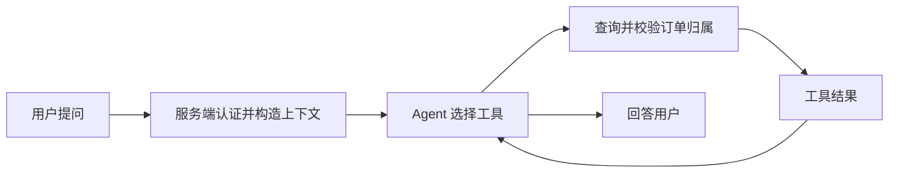

# 🛒 实战：订单查询 Agent

> [!abstract] 实战目标
> 让 Agent 根据用户问题调用订单查询工具，使用服务端认证身份检查订单归属，再根据查询结果回答。这里是设计与关键片段，不是已验证的完整工程。

## 🎯 需求与流程

用户问“订单 A123 到哪了？”系统应查出该用户有权查看的订单状态并回答；查不到、无权限或服务异常时，返回对应提示，而不是编造订单状态。



## 🛠️ 定义订单工具

假设 `orderService` 根据订单号和服务端认证用户查询，并在不存在或无权访问时返回适当结果。下面仅展示工具方法，省略类、依赖注入及异常处理；`RuntimeContext` 必须由可信服务端构造。

```java
@Tool(name = "query_order", description = "查询当前用户的订单状态", readOnly = true)
public String queryOrder(@ToolParam(name = "orderId", description = "订单号") String orderId,
                         RuntimeContext context) {
    return orderService.queryStatus(context.getUserId(), orderId);
}
```

`orderId` 是模型传入的参数，仍需校验格式；`context` 由框架注入，但身份可信与否取决于应用怎样构造它。实际服务应在数据库或业务层验证订单所属用户和租户。

## ⚙️ 注册和调用

假设 `orderTools` 已创建、Agent 和模型扩展已配置，先注册工具，再在构建 Agent 时传入工具箱。此处不展开连接数据库、SSE 或完整项目配置。

```java
Toolkit toolkit = new Toolkit();
toolkit.registerTool(orderTools);
ReActAgent agent = ReActAgent.builder().name("order_agent")
        .sysPrompt("先查询订单，再依据结果回答。")
        .model(model).toolkit(toolkit).build();
```

按官方文档构造用户消息和包含认证身份的 `RuntimeContext` 后调用 Agent。模型是否选择工具及最后的表述具有不确定性，应用可以记录工具调用结果并对敏感操作增加确定性的规则控制。

## 🧪 怎么验证？

| 场景 | 应检查的结果 |
| :--- | :--- |
| 用户查询自己的订单 | 工具使用服务端身份，回答与实际订单状态一致 |
| 用户查询其他人的订单 | 拒绝或返回无权访问，不泄漏订单详情 |
| 订单号不存在或缺失 | 提示查不到或请求补充订单号，不编造 |
| 订单服务超时 | 返回明确失败信息，日志保留可追踪的请求 ID |
| 重复请求或取消请求 | 验证服务端的超时和取消行为；写操作还要验证幂等性 |

> [!question]- 工具参数里的 userId 为什么不能由模型生成？
> 模型生成的参数来自用户输入，不能证明身份。应由服务端认证后放入运行上下文，再由业务层验证订单归属。

## 🔗 关联与资料

- [[02-第一个Agent与工具调用]]：工具定义与注册。
- [[08-Spring整合与生产部署]]：服务接入和运行边界。
- [AgentScope Java：工具](https://github.com/agentscope-ai/agentscope-java/blob/v2.0.4/docs/v2/en/docs/building-blocks/tool.md)
