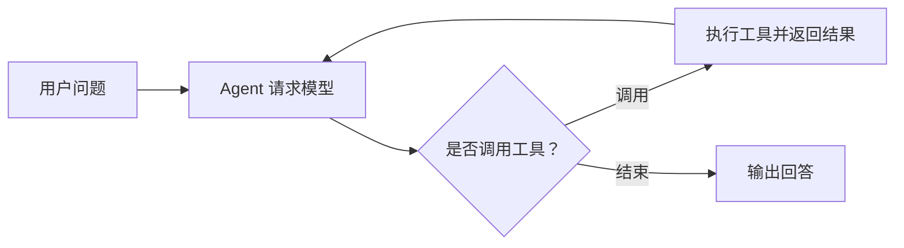

# 🧭 AgentScope Java 总结与复习

> [!abstract] 一句话回顾
> 先理解模型、工具与 ReAct 循环，再根据项目需要加入会话、流式事件、工作区和子 Agent，并在应用侧验证权限和运行结果。

## 🗺️ 一次 Agent 调用

## 📌 关键概念速查

| 概念 | 主要作用 |
| :--- | :--- |
| `ReActAgent` | 组织模型调用、工具执行与结果反馈 |
| `Toolkit` | 注册和管理可调用工具 |
| `RuntimeContext` | 为请求传递用户、会话等运行信息 |
| `AgentStateStore` | 保存和恢复 Agent 状态 |
| `HarnessAgent` | 结合工作区、会话、记忆与子 Agent 等能力 |

## ❓ 折叠自测

> [!question]- 模型提出了工具调用请求，是谁真正执行订单查询？
> 应用中注册的工具执行查询，模型接收工具结果并生成后续响应。

> [!question]- `RuntimeContext` 里有 userId，就一定完成鉴权了吗？
> 不是。身份需要由服务端认证后写入，订单服务也需要验证该用户是否有权访问目标订单。

> [!question]- 返回 `Mono` 是否保证所有操作都不阻塞？
> 不能保证。内部仍可能使用阻塞驱动或调用 `block()`，需要检查整个链路的线程模型。

> [!question]- 会话状态、长期记忆与 RAG 有什么不同？
> 会话状态保存当前交互，长期记忆保留可跨会话使用的信息，RAG 按问题检索外部资料；三者的存储和权限要求可能不同。

> [!question]- 多 Agent 一定比单 Agent 更好用吗？
> 不一定。任务分工可能改善上下文组织，但会增加调用成本和失败点，应先与单 Agent 或固定流程比较。

> [!question]- 审批通过后，为什么仍要检查工具执行结果？
> 批准只表示允许尝试操作；工具可能失败、超时或重复执行，需要以业务系统的实际结果为准。

## 🔗 继续学习

- [[01-AgentScope定位与核心概念]]、[[02-第一个Agent与工具调用]]。
- [[09-实战-订单查询Agent]]：通过订单场景复习工具调用与权限。
- [AgentScope Java 官方文档](https://github.com/agentscope-ai/agentscope-java/blob/v2.0.4/docs/v2/en/docs/quickstart.md)
