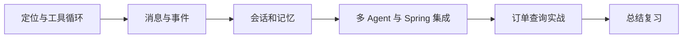

# 🤖 AgentScope Java 学习索引

> [!abstract] 学习目标
> 先理解 Agent 如何调用模型与工具，再学习会话状态、流式事件、记忆和多 Agent 协作，最后用订单查询场景串起来。

## 🗺️ 学习路线

## 📚 课程目录

- [ ] [[01-AgentScope定位与核心概念|01 · 定位与核心概念]]：ReActAgent、Toolkit、Harness 与框架选型。
- [ ] [[02-第一个Agent与工具调用|02 · 第一个 Agent 与工具调用]]：工具注册、调用循环与服务端身份。
- [ ] [[03-消息系统与Prompt工程|03 · 消息系统与 Prompt]]：用户消息、工具结果、提示词和结构化输出。
- [ ] [[04-流式输出与事件驱动|04 · 流式输出与事件]]：文本、工具、审批事件与响应式调用。
- [ ] [[05-状态管理与会话持久化|05 · 状态与会话]]：状态保存、恢复和多用户隔离。
- [ ] [[06-高级特性-长短期记忆与RAG|06 · 记忆与 RAG]]：会话记忆、长期记忆、检索与工作区边界。
- [ ] [[07-多Agent协作与工作流|07 · 多 Agent 协作]]：任务拆分、并行、委派与成本。
- [ ] [[08-Spring整合与生产部署|08 · Spring 整合与部署]]：组件装配、线程模型、权限和验证。
- [ ] [[09-实战-订单查询Agent|09 · 订单查询 Agent]]：订单工具、身份校验和测试场景。
- [ ] [[99-本章总结与复习|99 · 总结与复习]]：概念速查和折叠自测。

> [!tip] 从哪里开始？
> 如果已经熟悉 Spring AI，先读 01–02 理解 Agent 和工具，再按需要学习会话、多 Agent 和实战。学习时应以实际项目使用的版本文档为准，示例片段没有在本机连接模型运行。

## 🔗 资料与上级目录

- [AgentScope Java 官方仓库](https://github.com/agentscope-ai/agentscope-java)
- [AgentScope Java 官方开发文档](https://github.com/agentscope-ai/agentscope-java/blob/main/docs/v2/en/docs/quickstart.md)
- [版本发布记录](https://github.com/agentscope-ai/agentscope-java/releases)
- [[../_index|Java AI 框架总览与学习路线]]
