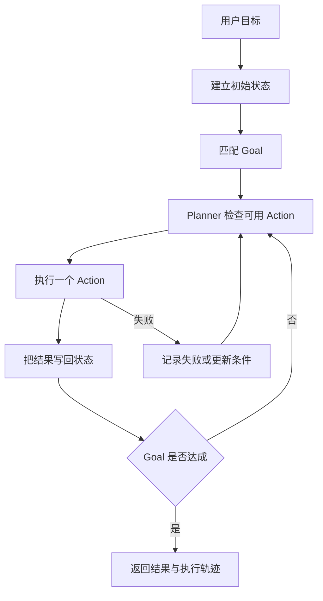
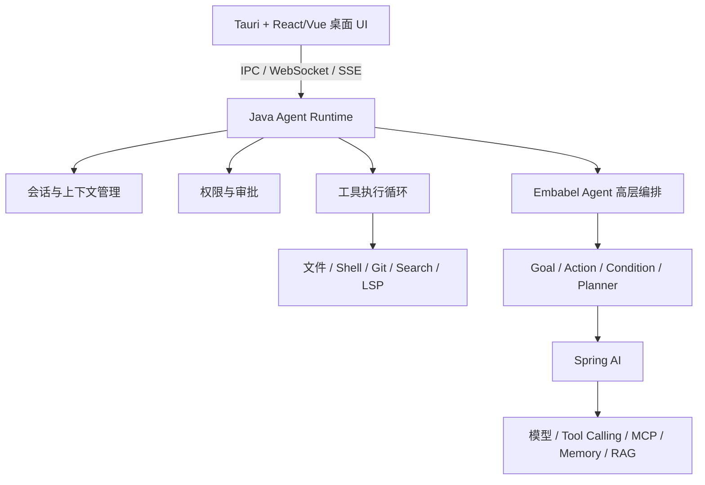

# Embabel Agent 概览与桌面 Agent 选型

> [!abstract] 一句话总结
> Embabel Agent 是 JVM 上用强类型 `Action`、`Goal` 和条件描述任务、再由框架动态规划执行路径的 Agent 编排框架；它能承担桌面 Agent 的高层决策，但不能替代工具执行、权限、会话和桌面 UI 等完整产品运行时。

## 白话版

Spring AI 更像是把模型、提示词、记忆和工具接入 Spring 应用的“基础设施”；Embabel Agent 更像是拿到这些能力后，根据目标和当前状态决定“下一步做什么”的“任务调度员”。

因此两者不是简单的二选一。一个 Java Agent 项目可以使用 Spring AI 连接模型和工具，同时使用 Embabel Agent 规划多个动作如何组合。

## 版本与项目状态

截至 **2026-08-13**，Maven Central 和 GitHub Releases 显示的最新稳定版是 **1.5.0**，发布于 **2026-08-11**。

| 项目 | 当前信息 |
| ---- | -------- |
| Maven 坐标 | `com.embabel.agent:embabel-agent-starter:1.5.0` |
| 许可证 | Apache License 2.0 |
| 主要语言与生态 | Java / Kotlin、Spring Boot |
| 主要基础版本 | Spring Boot 4.1.0、Spring AI 2.0.0；发布 POM 中 Kotlin 依赖为 2.2.21 |
| 协议集成 | MCP Client、A2A Java SDK |

消费工程的 Spring Boot BOM 可能把 Kotlin 运行时统一到更新版本，因此排查依赖冲突时以自己项目的 `mvn dependency:tree` 为准，不要只看 Embabel 发布 POM。

> [!warning] 版本信息的判断方法
> 官方 README 的部分安装示例可能仍停留在旧版本，不能只看 README 中的一段版本号。应依次检查 Maven Central 元数据、GitHub Releases 和目标版本的依赖清单。

### Maven 依赖

```xml
<dependency>
    <groupId>com.embabel.agent</groupId>
    <artifactId>embabel-agent-starter</artifactId>
    <version>1.5.0</version>
</dependency>
```

实际项目应统一由 BOM 或构建属性管理版本，避免多个 Embabel 模块版本不一致。

## 它解决什么问题

普通的工具调用通常只解决一次决策：模型判断要不要调用某个工具。复杂任务则可能有多个可选动作，动作之间还存在前置条件、产出和失败后的替代路径。

例如，用户要求“修复项目中的登录错误并提交代码”，系统可能需要：

1. 先定位项目和读取规则。
2. 搜索登录实现并复现错误。
3. 根据错误原因选择修改动作。
4. 运行测试；失败时回到分析或修改。
5. 检查差异，满足条件后才允许提交。

如果把这条路径完全写死成工作流，遇到测试失败、缺少环境或无需修改时就会产生大量分支。Embabel 的思路是声明“有哪些动作、动作需要什么、会产生什么、最终目标是什么”，再根据当前状态规划可执行路径。

## 核心概念

| 概念 | 作用 | 可以怎样理解 |
| ---- | ---- | ------------ |
| `Action` | 描述一个可执行步骤及其输入、输出 | 读取项目、生成方案、验证结果 |
| `Goal` | 描述希望达到的结果 | 得到已经验证的修复结果 |
| `Condition` | 限制动作或目标何时成立 | 测试通过后才能进入交付 |
| 状态 / 世界模型 | 保存当前已知事实和动作产物 | 已找到项目、已有诊断结果 |
| Planner | 根据当前状态、动作和目标选择路径 | 决定接下来应该执行哪个 Action |
| Agent 模式 | 控制可用动作的开放程度 | Focused、Closed、Open |

它的关键价值不是“让模型多调用几次工具”，而是把 Agent 的业务状态和可执行动作建模成 JVM 类型，让编排更容易测试、观测和约束。

## 一次任务如何执行



这里的因果关系是：Action 的结果改变状态，状态变化又决定哪些 Action 可以执行；Planner 因而能够在运行过程中调整路径，而不是机械执行启动前生成的一份固定清单。

## 与 Spring AI 的关系

Embabel Agent **不是 Spring AI，也不是 Spring AI 的同类替代品**。两者关注的层次不同：

| 维度 | Spring AI | Embabel Agent |
| ---- | --------- | ------------- |
| 核心定位 | Java AI 应用基础抽象与模型接入 | Agent 目标、动作和动态规划 |
| 主要问题 | 如何调用模型、模板、工具、记忆和向量库 | 为了达到目标，下一步选择哪个动作 |
| 典型抽象 | `ChatModel`、`ChatClient`、Advisor、`ChatMemory`、`VectorStore`、Tool | `Action`、`Goal`、`Condition`、Planner |
| 控制粒度 | 一次调用或一条增强调用链 | 多步骤任务的状态演进和执行路径 |
| 使用关系 | 可独立使用 | 可以建立在 Spring AI 等模型能力之上 |

可以用下面这条分层关系记忆：

```text
模型供应商 API
      ↓
Spring AI：模型、Prompt、Tool、Memory、RAG 接入
      ↓
Embabel Agent：Action、Goal、Condition、动态规划
      ↓
业务应用：客服、研究助手、运维 Agent、编码 Agent
```

因此，简单聊天、RAG 或少量工具调用通常只用 Spring AI 就够了。只有当任务确实存在多种执行路径、状态依赖和动态重规划时，才需要考虑 Embabel。

## 成熟度判断

### 可以肯定的部分

- 已进入 `1.x` 正式版本，并发布到 Maven Central。
- 强类型状态、Action 和 Goal 适合 JVM 团队维护复杂业务 Agent。
- 与 Spring Boot、Spring AI 的组合适合现有 Java 企业项目。
- 已具备 MCP、A2A、可观测性等面向实际集成的能力。
- Apache 2.0 许可证允许商业项目采用和二次开发。

### 仍需谨慎的部分

- `1.x` 代表正式版本，不代表生态规模已经达到 Spring Framework 的成熟程度。
- Agent 框架整体仍在快速演进，升级时要检查 API 和行为变化。
- 官方文档存在版本滞后，部分测试或集成说明仍不完整。
- 社区案例、第三方扩展和长期生产经验少于 Spring AI、LangChain 等主流生态。
- 它提供的是通用 Agent 编排，不是开箱即用的编码 Agent 产品内核。

> [!tip] 结论
> 适合在边界清晰、可回退的正式项目中试点，并用实际任务集做评估；暂不适合因为“已经 1.x”就直接把关键系统全部绑定上去。

## 能否开发 Claude Code 或 Codex Desktop 类产品

**可以使用，但 Embabel 只覆盖整个产品的一部分。**

### Embabel 适合负责

- 把用户目标映射为业务 `Goal`。
- 描述分析、修改、验证、交付等高层 `Action`。
- 根据当前状态选择下一步，并在 Action 正常更新状态或显式请求时重新规划。
- 编排多个模型、MCP 服务或领域 Agent。
- 记录高层执行路径，供测试和观测使用。

### 仍需自行实现

| 子系统 | 关键能力 |
| ------ | -------- |
| 编码执行循环 | 工具调用、观察结果、继续推理、终止判断、最大步数 |
| 本地工具 | 文件读取、搜索、补丁编辑、Shell、Git、测试、浏览器、LSP |
| 权限与隔离 | 命令分级、用户审批、沙箱、目录边界、密钥保护 |
| 会话与上下文 | 历史持久化、恢复、压缩、Token 预算、项目规则装配 |
| 任务管理 | 取消、重试、并发任务、子 Agent、工作树隔离 |
| 交付验证 | Diff、测试结果、回滚、提交和 PR |
| 桌面产品 | Tauri/Electron UI、终端、Diff 视图、流式事件和通知 |

这也是为什么“能用 Embabel 做”不等于“引入 Embabel 就能做出来”。Claude Code 和 Codex Desktop 的主要工程量集中在受控工具执行、上下文治理、会话生命周期和产品交互上。

## 推荐架构



推荐让 **Embabel 负责高层业务规划**，让自研的 Coding Agent Runtime 负责细粒度工具循环、权限、会话和上下文治理。这样不会把桌面产品的基础设施职责强行塞进业务 Action。

## 最小可行产品路线

1. **先做单 Agent 工具闭环**：实现 `read_file`、`search_files`、`apply_patch`、`shell`，验证模型能完成“读取—修改—测试”。
2. **补齐产品底座**：增加流式事件、取消、审批、目录限制、会话持久化和 Git Diff。
3. **建立评测集**：用 20～50 个真实仓库任务衡量成功率、耗时、Token、误操作和可恢复性。
4. **再引入 Embabel**：只把跨阶段、存在多路径的任务提升为 `Goal` 和 `Action`，对比引入前后的成功率与复杂度。
5. **最后扩展多任务和子 Agent**：在单任务工具闭环稳定后，再做并发、工作树隔离和任务调度。

这个顺序能回答一个关键问题：项目真正缺的是高层动态规划，还是底层编码工具与上下文质量。不要在基础执行链尚未跑通时，先用复杂编排掩盖底层问题。

## 什么时候选择它

| 场景 | 建议 |
| ---- | ---- |
| Spring Boot 企业应用，需要多步骤业务 Agent | 值得试点 |
| 强调领域类型、可测试性和动态动作规划 | 比纯 Prompt 编排更合适 |
| 简单聊天、RAG、少量固定工具调用 | 先用 Spring AI，通常不需要 Embabel |
| 希望快速获得完整 Claude Code 克隆 | 不适合单独承担，需要现成 Coding Agent Runtime 或大量自研 |
| 团队不是 JVM 技术栈 | 先比较现有语言生态的 Agent Runtime |
| 关键生产链路准备全面采用 | 先做版本锁定、升级验证和真实任务评测 |

## 自测题

> [!question]- Q1：Embabel Agent 和 Spring AI 是替代关系吗？
> 不是。Spring AI 主要提供模型、工具、记忆和 RAG 等基础接入能力；Embabel 主要提供 Action、Goal、条件和动态规划。复杂 Java Agent 可以组合使用两者。

> [!question]- Q2：为什么 Embabel 1.5.0 仍不能直接等同于成熟的编码 Agent Runtime？
> 正式版本号主要说明项目已经进入稳定发布线，不能证明它具备 Shell、文件编辑、Git、权限、沙箱、会话、上下文压缩、LSP 和桌面交互等编码 Agent 专用能力。

> [!question]- Q3：开发桌面编码 Agent 时，Embabel 最合适放在哪一层？
> 放在 Java 后端的高层 Goal/Action 编排层。底层工具循环、权限隔离、会话上下文和桌面 UI 仍由专门的产品运行时负责。

## 记忆钩子

> **Spring AI 管“能力怎么接”，Embabel 管“下一步做什么”，Coding Runtime 管“怎样安全地做完”。**

## 关联笔记

- [[02-环境搭建与第一个Agent]] — 从选型判断进入可运行的 `1.5.0` Java Agent。
- [[../SpringAI/_index|Spring AI 子区]] — 模型、工具、记忆和 RAG 基础能力。
- [[10-AI应用开发/05-Agent-MCP-Skills/01-Agent设计模式详解|Agent 设计模式详解]] — 对比 ReAct、Plan-and-Execute 与动态规划。
- [[10-AI应用开发/05-Agent-MCP-Skills/03-ReAct-Spring-AI实现|ReAct：Spring AI 实现]] — 理解细粒度工具调用循环。
- [[10-AI应用开发/09-标杆产品拆解/02-编程Agent通用架构图|编程 Agent 通用架构图]] — 查看桌面编码 Agent 的完整产品分层。
- [[_index|Embabel Agent 子区索引]]

## 参考资料

- [Embabel Agent GitHub](https://github.com/embabel/embabel-agent)
- [Embabel Agent v1.5.0 Release](https://github.com/embabel/embabel-agent/releases/tag/v1.5.0)
- [Maven Central: embabel-agent-starter metadata](https://repo1.maven.org/maven2/com/embabel/agent/embabel-agent-starter/maven-metadata.xml)
- [Embabel Agent 官方文档](https://docs.embabel.com/embabel-agent/guide/1.5.0-SNAPSHOT/)
- [Spring AI Reference](https://docs.spring.io/spring-ai/reference/)
