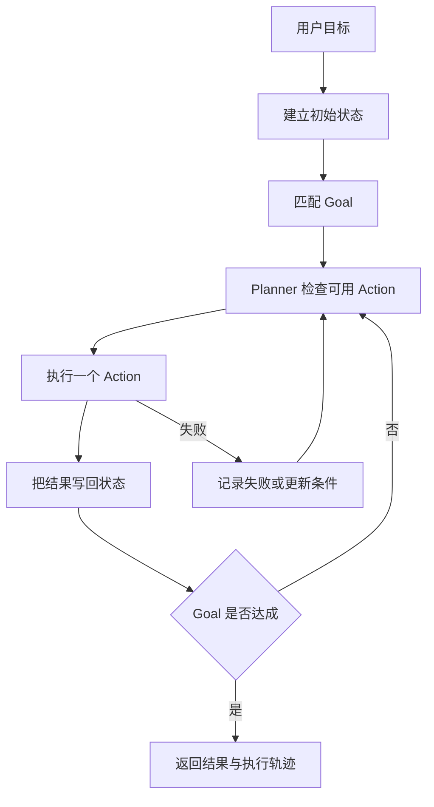
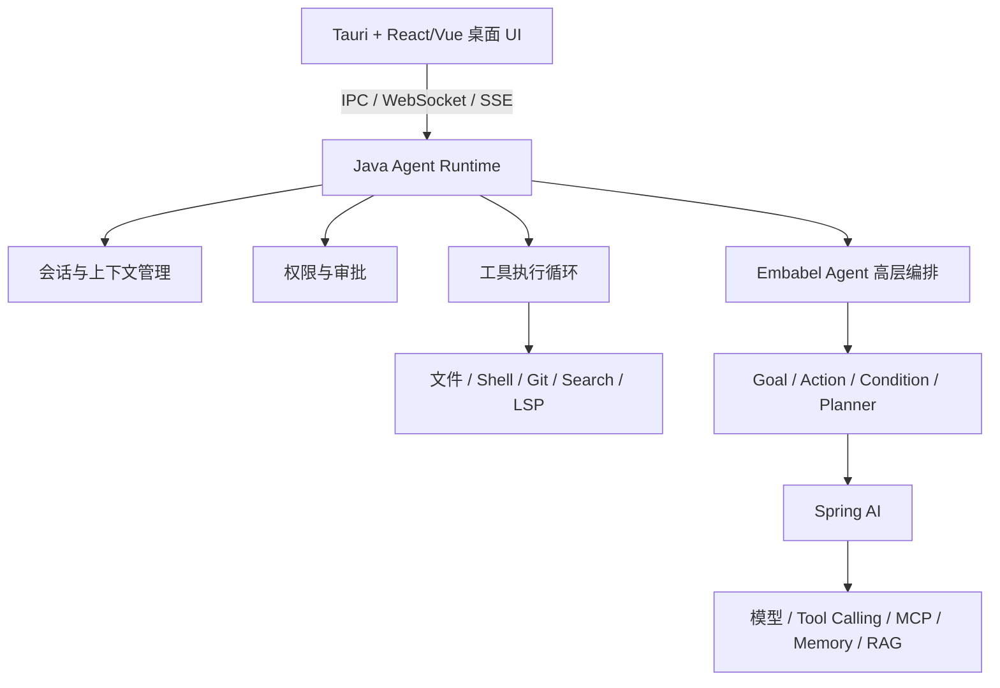

# Embabel Agent 概览与桌面 Agent 选型

> [!abstract] 一句话总结
> Embabel Agent 是 JVM 上用强类型 `Action`、`Goal` 和条件描述任务、再由框架动态规划执行路径的 Agent 编排框架；它能承担桌面 Agent 的高层决策，但不能替代工具执行、权限、会话和桌面 UI 等完整产品运行时。

## 核心定位

Spring AI 负责将大模型、提示词、会话记忆与工具调用接入 Spring 应用；Embabel Agent 则在模型与工具能力之上，根据目标（`Goal`）和当前状态（`Blackboard`）动态规划下一步执行的动作（`Action`）。

因此两者处于不同架构层次，可组合使用：底层通过 Spring AI 连接模型和工具，上层通过 Embabel Agent 编排多步骤任务的状态演进与路径选择。

## 版本与项目状态

截至 **2026-08-13**，Maven Central 和 GitHub Releases 显示的最新稳定版是 **1.5.0**，发布于 **2026-08-11**。

| 项目 | 当前信息 |
| ---- | -------- |
| Maven 坐标 | `com.embabel.agent:embabel-agent-starter:1.5.0` |
| 许可证 | Apache License 2.0 |
| 主要语言与生态 | Java / Kotlin、Spring Boot |
| 主要基础版本 | Spring Boot 4.1.0、Spring AI 2.0.0；发布 POM 中 Kotlin 依赖为 2.2.21 |
| 协议集成 | MCP Client、A2A Java SDK |

消费工程的 Spring Boot BOM 可能把 Kotlin 运行时统一到更新版本，因此排查依赖冲突时以自己项目的 `mvn dependency:tree` 为准，不要只看 Embabel 发布 POM。

> [!warning] 版本信息的判断方法
> 官方 README 的部分安装示例可能仍停留在旧版本，不能只看 README 中的一段版本号。应依次检查 Maven Central 元数据、GitHub Releases 和目标版本的依赖清单。

### Maven 依赖

```xml
<dependency>
    <groupId>com.embabel.agent</groupId>
    <artifactId>embabel-agent-starter</artifactId>
    <version>1.5.0</version>
</dependency>
```

实际项目应统一由 BOM 或构建属性管理版本，避免多个 Embabel 模块版本不一致。

## 它解决什么问题

普通的工具调用通常只解决一次决策：模型判断要不要调用某个工具。复杂任务则可能有多个可选动作，动作之间还存在前置条件、产出和失败后的替代路径。

例如，用户要求“修复项目中的登录错误并提交代码”，系统可能需要：

1. 先定位项目和读取规则。
2. 搜索登录实现并复现错误。
3. 根据错误原因选择修改动作。
4. 运行测试；失败时回到分析或修改。
5. 检查差异，满足条件后才允许提交。

如果把这条路径完全写死成工作流，遇到测试失败、缺少环境或无需修改时就会产生大量分支。Embabel 的思路是声明“有哪些动作、动作需要什么、会产生什么、最终目标是什么”，再根据当前状态规划可执行路径。

## 核心概念

| 概念 | 作用 | 典型示例 |
| ---- | ---- | ------------ |
| `Action` | 描述一个可执行步骤及其输入、输出 | 读取项目、生成方案、验证结果 |
| `Goal` | 描述希望达到的结果 | 得到已经验证的修复结果 |
| `Condition` | 限制动作或目标何时成立 | 测试通过后才能进入交付 |
| 状态 / 世界模型 | 保存当前已知事实和动作产物 | 已找到项目、已有诊断结果 |
| Planner | 根据当前状态、动作和目标选择路径 | 决定接下来应该执行哪个 Action |
| Agent 模式 | 控制可用动作的开放程度 | Focused、Closed、Open |

它的关键价值是将 Agent 的业务状态和可执行动作建模为 JVM 强类型，使多步编排更易于测试、观测和约束。

## 一次任务如何执行



这里的因果关系是：Action 的结果改变状态，状态变化又决定哪些 Action 可以执行；Planner 因而能够在运行过程中动态调整路径。

## 与 Spring AI 的关系

Embabel Agent 与 Spring AI 关注的架构层次不同：

| 维度 | Spring AI | Embabel Agent |
| ---- | --------- | ------------- |
| 核心定位 | Java AI 应用基础抽象与模型接入 | Agent 目标、动作和动态规划 |
| 主要问题 | 如何调用模型、模板、工具、记忆和向量库 | 为了达到目标，下一步选择哪个动作 |
| 典型抽象 | `ChatModel`、`ChatClient`、Advisor、`ChatMemory`、`VectorStore`、Tool | `Action`、`Goal`、`Condition`、Planner |
| 控制粒度 | 一次调用或一条增强调用链 | 多步骤任务的状态演进和执行路径 |
| 使用关系 | 可独立使用 | 建立在 Spring AI 等模型能力之上 |

可以用下面这条分层关系记忆：

```text
模型供应商 API
      ↓
Spring AI：模型、Prompt、Tool、Memory、RAG 接入
      ↓
Embabel Agent：Action、Goal、Condition、动态规划
      ↓
业务应用：客服、研究助手、运维 Agent、编码 Agent
```

因此，单轮对话、标准 RAG 或少量固定工具调用使用 Spring AI 即可满足需求；当任务存在多种执行路径、状态依赖和动态重规划需求时，可引入 Embabel Agent。

## 成熟度判断

### 核心优势

- 已发布 `1.x` 正式版本并同步至 Maven Central。
- 强类型状态、Action 和 Goal 适合 JVM 团队维护复杂业务 Agent。
- 与 Spring Boot、Spring AI 紧密集成，易于融入现有 Java 企业工程。
- 支持 MCP、A2A 与 OpenTelemetry 可观测性集成。
- 采用 Apache 2.0 许可证，便于商业项目使用。

### 工程选型注意事项

- 虽已进入 `1.x` 稳定发布线，但第三方扩展生态与长期生产案例仍在持续积累中。
- Agent 领域演进较快，跨版本升级时需结合集成测试验证 API 与规划行为。
- 部分在线文档示例可能滞后于最新 Release，应以对应版本的源码和 Maven POM 为准。
- 框架定位于通用 Agent 编排层，不包含桌面编码产品的专用工具沙箱与 UI 运行时。

> [!tip] 选型结论
> 适合在边界清晰、需要多步状态规划的 Java 业务场景中采用，并配合任务评测集验证效果。

## 在桌面编码 Agent（如 Claude Code / Codex Desktop）中的定位

**Embabel 可承担高层任务规划，但完整产品还需配合专用的编码运行时（Coding Runtime）。**

### Embabel 适合负责的模块

- 将用户目标映射为业务 `Goal`。
- 声明需求分析、代码修改、测试验证、结果交付等高层 `Action`。
- 根据当前状态选择下一步动作，并在状态更新后重新规划路径。
- 协调多个模型角色、MCP 服务或子领域 Agent。
- 记录高层执行轨迹，供测试验证与链路观测使用。

### 需由产品运行时（Runtime）实现的子系统

| 子系统 | 关键能力 |
| ------ | -------- |
| 编码执行循环 | 细粒度工具调用、观察结果、继续推理、终止判断、最大步数控制 |
| 本地工具集 | 文件读取、搜索、补丁编辑、Shell 执行、Git 操作、测试运行、浏览器、LSP |
| 权限与隔离 | 命令风险分级、用户审批、沙箱隔离、目录边界控制、密钥保护 |
| 会话与上下文 | 历史持久化、断点恢复、上下文压缩、Token 预算管理、项目规则加载 |
| 任务管理 | 任务取消、重试、并发控制、子 Agent 调度、Git worktree 隔离 |
| 交付验证 | Diff 展示、测试报告解析、修改回滚、提交与 PR 生成 |
| 桌面客户端 | Tauri/Electron UI、内置终端、Diff 视图、SSE 流式事件与系统通知 |

构建桌面编码 Agent 时，高层规划只是整体架构的一环，核心工程量同样集中在受控工具执行、上下文治理、会话生命周期与桌面交互体验上。

## 推荐架构



推荐由 **Embabel 负责高层业务阶段规划**，由专用的 Coding Agent Runtime 负责细粒度工具循环、权限控制、会话恢复与上下文治理，保持职责边界清晰。

## 演进路线建议

1. **先打通基础工具闭环**：实现 `read_file`、`search_files`、`apply_patch`、`shell` 等核心工具，验证模型完成“读取—修改—测试”的基础能力。
2. **完善运行时底座**：补齐流式事件、任务取消、命令审批、目录边界限制、会话持久化与 Git Diff。
3. **建立基准评测集**：使用 20～50 个真实仓库任务量化成功率、耗时、Token 消耗与异常恢复能力。
4. **引入 Embabel 高层编排**：将跨阶段、存在分支路径的复杂任务建模为 `Goal` 和 `Action`，对比引入前后的可维护性与任务成功率。
5. **扩展并发与多 Agent 协作**：在单任务闭环稳定后，进一步支持多任务并发、Git worktree 隔离与子 Agent 调度。

## 适用场景总结

| 场景 | 建议 |
| ---- | ---- |
| Spring Boot 企业应用，需要多步骤业务 Agent | 推荐使用 |
| 强调领域类型约束、可测试性和动态动作规划 | 比纯提示词拼接更易维护 |
| 单轮问答、标准 RAG、少量固定工具调用 | 直接使用 Spring AI 即可 |
| 构建完整桌面编码 Agent 产品 | 作为高层编排层使用，需搭配自研或开源 Coding Runtime |
| 非 JVM 技术栈团队 | 优先评估对应语言生态的原生 Agent 框架 |

## 自测题

> [!question]- Q1：Embabel Agent 和 Spring AI 是什么关系？
> 两者属于上下游协作关系。Spring AI 提供模型、工具、记忆和 RAG 等基础接入能力；Embabel 在此基础上提供 Action、Goal、Condition 和动态路径规划。

> [!question]- Q2：为什么构建桌面编码 Agent 时，除了 Embabel 还需要专门的产品运行时？
> Embabel 聚焦于高层状态规划与 Action 编排；而编码 Agent 所需的 Shell 沙箱、文件补丁编辑、Git 工作树管理、命令审批、上下文压缩、LSP 集成及桌面 UI 属于产品运行时基础设施，需要独立实现。

> [!question]- Q3：在桌面编码 Agent 架构中，Embabel 最适合放在哪一层？
> 适合放在 Java 后端的高层 Goal/Action 编排层，负责阶段级任务规划；底层工具执行循环、权限隔离、会话上下文和桌面 UI 由专门的 Runtime 层负责。

## 记忆钩子

> **Spring AI 管“能力怎么接”，Embabel 管“下一步做什么”，Coding Runtime 管“怎样安全地做完”。**

## 关联笔记

- [[02-环境搭建与第一个Agent]] — 从选型判断进入可运行的 `1.5.0` Java Agent。
- [[../SpringAI/_index|Spring AI 子区]] — 模型、工具、记忆和 RAG 基础能力。
- [[../../05-Agent-MCP-Skills/01-Agent设计模式详解|Agent 设计模式详解]] — 对比 ReAct、Plan-and-Execute 与动态规划。
- [[../../05-Agent-MCP-Skills/03-ReAct-Spring-AI实现|ReAct：Spring AI 实现]] — 理解细粒度工具调用循环。
- [[../../09-标杆产品拆解/02-编程Agent通用架构图|编程 Agent 通用架构图]] — 查看桌面编码 Agent 的完整产品分层。
- [[_index|Embabel Agent 子区索引]]

## 参考资料

- [Embabel Agent GitHub](https://github.com/embabel/embabel-agent)
- [Embabel Agent v1.5.0 Release](https://github.com/embabel/embabel-agent/releases/tag/v1.5.0)
- [Maven Central: embabel-agent-starter metadata](https://repo1.maven.org/maven2/com/embabel/agent/embabel-agent-starter/maven-metadata.xml)
- [Embabel Agent 官方文档](https://docs.embabel.com/embabel-agent/guide/1.5.0-SNAPSHOT/)
- [Spring AI Reference](https://docs.spring.io/spring-ai/reference/)
