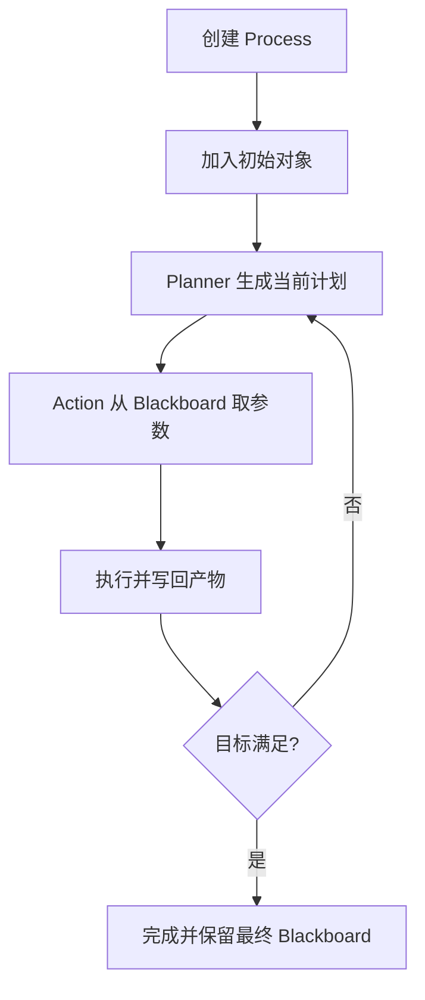

# Embabel Agent 领域对象与 Blackboard 状态模型

> [!abstract] 一句话总结
> Embabel 用 Blackboard 保存任务运行中已经得到的类型化事实，Action 的非基础设施参数是它的输入依赖，返回值是写回 Blackboard 的新事实；类型关系因此同时承担状态管理和规划图边的作用。

## 1. 先建立正确心智

不要先把 Blackboard 理解为 `Map<String, Object>`。实现层可能提供按名称和类型取值的能力，但对应用开发者更重要的是：

> Blackboard 是一次 Agent Process 的“当前世界状态”。

以学习计划任务为例：

```text
初始：UserInput
  ↓ understand
UserInput + LearningRequest
  ↓ draft
UserInput + LearningRequest + DraftPlan
  ↓ review
UserInput + LearningRequest + DraftPlan + ReviewedPlan
  ↓ finish
... + LearningPlan
```

每执行一个 Action，Blackboard 就多出一个可供后续 Action 使用的事实。Planner 每轮读取当前事实，重新判断下一步能执行什么。

## 2. 用领域类型描述阶段结果

```java
public record LearningRequest(
        String topic,
        int days,
        String currentLevel
) {}

public record DailyTask(
        int day,
        String objective,
        String exercise
) {}

public record DraftPlan(
        LearningRequest request,
        List<DailyTask> tasks
) {}

public record ReviewedPlan(
        DraftPlan draft,
        boolean approved,
        List<String> issues
) {}

public record LearningPlan(
        String topic,
        List<DailyTask> tasks,
        String reviewSummary
) {}
```

这些类型不是为了“面向对象形式感”。它们解决四个具体问题：

1. **规划**：`DraftPlan` 不存在时，需要它的 `review(DraftPlan)` 就不可执行。
2. **约束**：模型输出必须绑定到字段，而不是返回一段无法验证的自由文本。
3. **测试**：每个阶段可用普通 Java 对象作为 fixture。
4. **观测**：执行轨迹可以明确展示状态从什么类型变成什么类型。

## 3. Action 参数如何变成依赖

```java
@Action
public DraftPlan draft(
        LearningRequest request,
        OperationContext context) {
    // ...
}
```

这里两类参数的来源不同：

| 参数 | 来源 | 是否构成规划依赖 |
| ---- | ---- | ---------------- |
| `LearningRequest request` | Blackboard | 是 |
| `OperationContext context` | Embabel 运行时注入 | 否 |

框架读取方法签名后得到：

```text
前置事实：LearningRequest
执行动作：draft
新增事实：DraftPlan
```

`OperationContext`、`Ai`、`ProcessContext` 等属于基础设施参数，由框架解析器注入，不要求 Blackboard 预先存在。

## 4. 返回类型如何成为效果

```java
@Action
public ReviewedPlan review(DraftPlan draft) {
    boolean complete = draft.tasks().size() == draft.request().days();
    return new ReviewedPlan(
            draft,
            complete,
            complete ? List.of() : List.of("每天应有一个任务"));
}
```

方法返回 `ReviewedPlan` 后，框架将其作为一个新的 artifact 放入 Blackboard。后续方法：

```java
@Action
public LearningPlan finish(ReviewedPlan reviewedPlan) {
    // ...
}
```

只有在 `ReviewedPlan` 已存在时才具备输入条件。

这形成了 Embabel 最核心的因果链：

```text
方法参数类型 → 前置事实
方法返回类型 → 执行效果
前置事实 + 执行效果 → Planner 中的有向边
```

## 5. Planner 怎样反推路径

假设目标输出是 `LearningPlan`，目前只有 `UserInput`：


Planner 可以从目标向前反推：

1. 要得到 `LearningPlan`，需要执行 `finish`。
2. `finish` 需要 `ReviewedPlan`。
3. 要得到 `ReviewedPlan`，需要执行 `review`。
4. 继续反推直到发现起点 `UserInput` 已存在。
5. 得到可执行路径 `understand → draft → review → finish`。

这不是 LLM 在 Prompt 中猜出来的步骤，而是由类型和条件构成的规划图计算出来的。

## 6. 同类型对象与 binding 名称

下面的方法需要两个 `String`：

```java
@Action
public Comparison compare(String original, String revised) {
    // ...
}
```

只有类型信息时，框架无法可靠判断哪个 `String` 应传给哪个参数。更好的做法是使用不同领域类型：

```java
record OriginalText(String value) {}
record RevisedText(String value) {}

@Action
public Comparison compare(OriginalText original, RevisedText revised) {
    // ...
}
```

优先级建议：

1. 首选不同领域类型，直接表达语义。
2. 确实需要同类型多个对象时，使用 `outputBinding` 和 `@RequireNameMatch`。
3. 不要让大量裸 `String`、`Map`、`Object` 进入规划图。

命名 binding 示例：

```java
@Action(outputBinding = "draftText")
public String createDraft(UserInput input) {
    return input.getContent();
}

@Action
public Review review(
        @RequireNameMatch("draftText") String draftText) {
    return new Review(draftText.length() > 20);
}
```

Java 编译时必须保留参数名，因此项目中显式设置 `-parameters` 是有意义的。

## 7. Blackboard 不是对话历史

| 概念 | 保存什么 | 用途 |
| ---- | -------- | ---- |
| Blackboard | 当前 Process 的领域对象、条件和执行产物 | 规划和 Action 参数绑定 |
| Chat history | User/Assistant/Tool 消息 | 连续对话和模型上下文 |
| 长期记忆 | 跨 Process 保存的用户或业务信息 | 个性化、历史检索 |
| 数据库 | 权威业务状态 | 事务、查询和持久化 |

常见误区是把所有聊天消息都塞进 Blackboard，或反过来把 Blackboard 当成数据库。Blackboard 负责的是“一次执行目前已经知道什么”，不自动替代长期持久化。

## 8. 状态生命周期

一次 `AgentProcess` 通常经历：



注意两点：

- Planner 不是只在最开始运行一次；状态变化后可以重新规划。
- Action 的外部副作用不会因为 Blackboard 存在就自动回滚，文件、数据库、邮件仍需自行设计幂等和补偿。

## 9. `clearBlackboard` 什么时候用

`@Action(clearBlackboard = true)` 会在 Action 完成后清除旧状态，只保留本次输出。适合：

- 循环状态要重新产生相同类型。
- 中间产物很大，后续阶段明确不再需要。
- 希望切断旧事实对新一轮规划的影响。

不适合一上来就用。过早清理可能让后续 Action 缺少依赖，也会降低调试时的可解释性。官方还特别提示：不要随便在实现 Goal 的 Action 上清 Blackboard，因为可能影响目标满足跟踪。

## 10. 类型设计原则

### 好的类型

```java
record RepositoryPath(Path value) {}
record Diagnosis(String rootCause, List<Path> relatedFiles) {}
record VerifiedPatch(String diff, List<String> passedTests) {}
```

它们表达“业务阶段已经完成到哪里”。

### 不好的类型

```java
Map<String, Object> state;
String step1Result;
String step2Result;
Object finalData;
```

这些类型让 Planner 看不到真实语义，也把结构校验推迟到运行时。

### 判断问题

给每个类型问三句话：

1. 它是否代表一个明确的业务事实？
2. 产生它是否意味着某一阶段真的完成？
3. 后续 Action 能否仅凭这个类型判断自己是否具备执行条件？

如果答案都是否，可能只是临时变量，不应该进入 Blackboard。

## 最小验证

把上一章的单 Action 拆成三个纯 Java Action：

```java
@Action
public LearningRequest understand(UserInput input) { /* ... */ }

@Action
public DraftPlan draft(LearningRequest request) { /* ... */ }

@AchievesGoal(description = "Return a learning plan")
@Action
public LearningPlan finish(DraftPlan draft) { /* ... */ }
```

运行 `actions` 和 `x`，然后用 `blackboard` 检查三个阶段对象是否出现。再故意删除 `draft`，观察为什么目标变得不可达。

## 自测题

> [!question]- Q1：为什么 Action 参数可以决定执行顺序？
> 普通领域参数必须从 Blackboard 取得；参数类型不存在时 Action 不具备前置事实。上一个 Action 的返回类型成为新事实后，下一个 Action 才可执行。

> [!question]- Q2：为什么不建议所有中间结果都用 `String`？
> 多个同类型值难以绑定，Planner 看不到业务阶段语义，结构校验也会丢失。领域类型能同时改善规划、测试和观测。

> [!question]- Q3：Blackboard 与 ChatMemory 的区别是什么？
> Blackboard 是单次 Agent Process 的类型化世界状态，用于规划和参数绑定；ChatMemory 保存对话消息，用于给模型提供连续会话上下文。

## 关联阅读

- 上一篇：[[02-环境搭建与第一个Agent]]
- 下一篇：[[04-Action-Goal-Condition核心注解]]
- Spring AI 记忆：[[../SpringAI/08-ChatMemory记忆]]
- 子区索引：[[_index]]

## 参考资料

- [Embabel Annotation Model](https://docs.embabel.com/embabel-agent/guide/1.5.0-SNAPSHOT/#reference.annotations)
- [Embabel Agent Process](https://docs.embabel.com/embabel-agent/guide/1.5.0-SNAPSHOT/#reference.agent-process)
- [Embabel Types](https://docs.embabel.com/embabel-agent/guide/1.5.0-SNAPSHOT/#reference.types)

