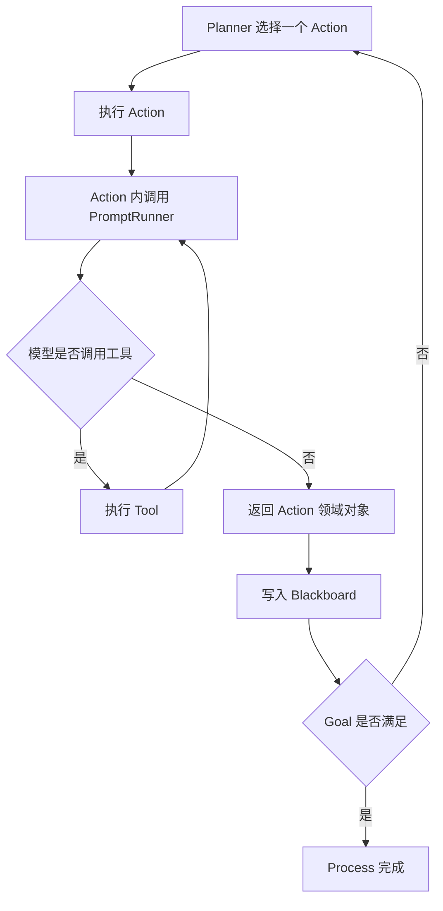

# Embabel Agent OperationContext、模型调用与工具集成

> [!abstract] 一句话总结
> `OperationContext` 是 Action 访问当前 Process、Blackboard、模型和工具的运行时入口；通过 `context.ai()` 选择模型，再用 `PromptRunner` 完成文本生成、结构化对象创建和受控工具调用，而 Planner 循环与 LLM Tool Loop 是两个不同层次。

## 1. `OperationContext` 在哪一层

```java
@Action
public LearningRequest understand(
        UserInput input,
        OperationContext context) {
    // ...
}
```

参数来源：

- `UserInput` 从 Blackboard 取得，是领域依赖。
- `OperationContext` 由 Embabel 运行时注入，是基础设施上下文。

它提供当前 Operation/Process 相关能力，包括：

- `context.ai()`：进入模型与 PromptRunner API。
- `context.processContext()`：访问当前 Process 信息。
- Blackboard 读写与当前状态能力。
- 当前 Action、ToolGroup 等运行元数据。

旧示例中直接注入 `Ai` 仍受 `1.5.0` 参数解析器支持：

```java
@Action
public LearningRequest understand(UserInput input, Ai ai) {
    return ai.withAutoLlm().createObject(
            input.getContent(), LearningRequest.class);
}
```

本章主线使用 `OperationContext`，因为它保留完整运行上下文；如果 Action 只需要模型能力，直接用 `Ai` 也可以。

## 2. 从 `Ai` 到 `PromptRunner`

```text
OperationContext
  → ai()
  → 选择 LLM
  → PromptRunner
  → 添加 Prompt contributor / Tool / ToolGroup
  → generateText 或 createObject
```

常见模型选择：

```java
// 根据当前交互自动选择
context.ai().withAutoLlm();

// 使用配置中的默认模型
context.ai().withDefaultLlm();

// 按模型名选择
context.ai().withLlm("gpt-4.1-mini");

// 按业务角色选择，角色映射在配置中维护
context.ai().withLlmByRole("cheap");

// 按顺序选择第一个可用模型
context.ai().withFirstAvailableLlmOf("gpt-4.1-mini", "gpt-4.1");
```

`withAutoLlm()` 和 `withDefaultLlm()` 不完全相同：前者使用自动选择条件，可能结合 Prompt 和工具；后者使用 `embabel.models.default-llm` 指定的默认模型。

生产代码优先按默认或角色解耦，不要让每个 Action 到处硬编码供应商模型名。

```yaml
embabel:
  models:
    default-llm: gpt-4.1-mini
    llms:
      cheap: gpt-4.1-mini
      best: gpt-4.1
```

## 3. 结构化输出

```java
public record LearningRequest(
        String topic,
        int days,
        String currentLevel
) {}

@Action(readOnly = true)
public LearningRequest understand(
        UserInput input,
        OperationContext context) {
    String prompt = """
            Extract a learning request from the user text.
            Use days=7 only when the user did not specify a duration.

            User text:
            %s
            """.formatted(input.getContent());

    return context.ai()
            .withAutoLlm()
            .withId("understand-learning-request")
            .createObject(prompt, LearningRequest.class);
}
```

`createObject` 的因果链：

1. Embabel 根据 `LearningRequest` 生成输出 schema。
2. 模型返回结构化结果。
3. 数据绑定为 Java record。
4. 若反序列化绑定失败，框架先执行数据绑定重试；持续失败则交由 Action 重试策略处理，重试耗尽后终止当前 Process。
5. 成功对象写入 Blackboard。

这比让模型返回 JSON 字符串再手动解析更稳，因为类型、绑定和测试都由统一 API 管理。

### `createObject` 与 `createObjectIfPossible`

| API | 无法创建时 | 适用 |
| --- | ---------- | ---- |
| `createObject` | 抛出异常，触发绑定或 Action 重试；耗尽后失败 | 该对象是完成任务的必要事实 |
| `createObjectIfPossible` | 返回 `null` | 合法结果可以是“没有识别到” |

不要为了“避免异常”一律用 `IfPossible`。如果后续 Action 必须依赖这个对象，静默 `null` 只会把错误推迟。

## 4. 文本生成

```java
@Action(readOnly = true)
public ReviewText review(
        DraftPlan draft,
        OperationContext context) {
    String text = context.ai()
            .withLlmByRole("best")
            .withId("review-learning-plan")
            .generateText("Review this plan and identify gaps:\n" + draft);

    return new ReviewText(text);
}
```

如果结果会参与规划，优先返回领域对象；只有纯展示内容才直接生成 `String`。

## 5. Prompt 应由领域对象构造

差的写法：

```java
createObject("Do the task", DraftPlan.class);
```

好的写法明确输入、约束和输出语义：

```java
String prompt = """
        Create exactly one practical task for each day.
        Each task must include an objective and a verifiable exercise.

        Topic: %s
        Days: %d
        Current level: %s
        """.formatted(
        request.topic(),
        request.days(),
        request.currentLevel());
```

Embabel 的类型系统不能弥补模糊业务约束。类型负责“形状正确”，Prompt 和普通 Java 校验负责“内容正确”。

## 6. 两层循环不要混淆



外层 Planner 循环选择的是 **Action**；内层 Tool Loop 中模型选择的是 **Tool**。例如：

- `researchTopic` 是一个 Action。
- 这个 Action 内的模型可以多次调用 `web_search` Tool。
- Tool Loop 最终产出一个 `ResearchNotes`。
- Planner 拿到 `ResearchNotes` 后再选择 `draftPlan` Action。

如果把每个文件读取都建成高层 Action，规划图会过细；如果把完整业务流程全塞进一个 Tool Loop，类型化规划又失去价值。

## 7. 使用 Embabel `@LlmTool`

```java
import com.embabel.agent.api.annotation.LlmTool;

public class ProgressCalculator {

    @LlmTool(description = "Calculate the completion percentage of a learning plan")
    public int percentage(
            @LlmTool.Param(description = "Completed task count") int completed,
            @LlmTool.Param(description = "Total task count") int total) {
        if (total <= 0) {
            return 0;
        }
        return completed * 100 / total;
    }
}
```

把工具只提供给需要它的 Prompt：

```java
return context.ai()
        .withDefaultLlm()
        .withToolObject(new ProgressCalculator())
        .createObject(prompt, ProgressReport.class);
```

也可以转为框架无关的 `Tool`：

```java
List<Tool> tools = Tool.fromInstance(new ProgressCalculator());

return context.ai()
        .withDefaultLlm()
        .withTools(tools)
        .createObject(prompt, ProgressReport.class);
```

工具描述必须回答：何时调用、参数是什么意思、返回什么。模型看不到你的方法实现意图，只能依据名称、描述和 schema 做选择。

## 8. ToolGroup

一组部署期可替换的工具可以注册为 ToolGroup：

```java
return context.ai()
        .withDefaultLlm()
        .withToolGroup(CoreToolGroups.WEB)
        .createObject(
                "Use web tools to find authoritative learning resources for " + request.topic(),
                ResourceList.class);
```

ToolGroup 的意义：

- Action 声明需要“Web 能力”，不绑定具体 MCP Server。
- 部署配置决定该角色由哪些真实工具实现。
- 可以附加权限，例如互联网访问。
- 测试中可以替换为假实现。

工具应最小暴露：一个只做摘要的 Action 不应顺便拿到文件删除、数据库写入或 Shell 权限。

## 9. MCP 在哪里接入

Embabel 有两个方向：

### 作为 MCP Client 消费远程工具

```text
Spring AI MCP Client 配置
  → 创建 McpSyncClient
  → McpToolGroup 过滤并分组远程工具
  → Action 的 PromptRunner 选择 ToolGroup
  → 模型调用远程 MCP Tool
```

关键不在“连上 MCP Server”，而在过滤哪些 Tool 能进入哪个 Action。

### 作为 MCP Server 暴露 Goal

依赖：

```xml
<dependency>
    <groupId>com.embabel.agent</groupId>
    <artifactId>embabel-agent-starter-mcpserver</artifactId>
    <version>${embabel-agent.version}</version>
</dependency>
```

Goal 显式允许远程导出：

```java
@AchievesGoal(
        description = "Create a reviewed learning plan",
        export = @Export(
                remote = true,
                name = "createLearningPlan",
                startingInputTypes = {UserInput.class}
        )
)
@Action
public LearningPlan finish(ApprovedPlan approved) {
    // ...
}
```

默认 `remote=false`。不要把内部 Goal 因为“以后可能会用”全部远程暴露。

> [!warning] 官方文档版本混杂
> 某些 MCP Reference 片段仍出现旧的 `@Goal` 风格。`1.5.0` 注解源码和当前 Agent 示例使用 `@AchievesGoal(..., export=@Export(...))`；本章以标签源码为准。

## 10. ToolCallContext

租户、关联 ID、临时凭据等横切数据不应混入领域参数，可以在 Process 边界设置：

```java
var options = new ProcessOptions()
        .withToolCallContext(Map.of(
                "tenantId", tenantId,
                "correlationId", correlationId));

var invocation = AgentInvocation.builder(agentPlatform)
        .options(options)
        .build(LearningPlan.class);
```

该上下文可传播到本地 Tool 和远程 MCP `_meta`。生产中必须过滤哪些字段允许跨 MCP 边界，尤其不要默认转发所有认证信息给第三方 Server。

## 11. 工具安全边界

| 风险 | 控制 |
| ---- | ---- |
| 模型调用不相关工具 | 每个 Prompt 只添加必要 Tool/ToolGroup |
| 参数含义模糊 | 精确描述和 JSON schema |
| 重复调用写工具 | 幂等键、审批、最大 Tool Loop 次数 |
| MCP 泄露上下文 | 转换/过滤 `_meta`，区分可信 Server |
| 工具返回不可信文本 | 当作数据，不当作系统指令 |
| Shell/文件越界 | Sandbox、目录白名单、命令分级 |

Embabel Tool API 负责“如何暴露和调用”，不会替你完成桌面 Agent 的全部沙箱和审批系统。

## 最小验证

1. 把 `understand` 改为 `OperationContext + createObject`。
2. 用 `withId("understand-learning-request")` 给交互命名。
3. 编写一个无副作用的 `@LlmTool` 计算学习完成率。
4. 仅在生成进度报告的 PromptRunner 中加入该工具。
5. 在测试中确认 Prompt、返回类型和工具列表，而不是只看最终文本。

## 自测题

> [!question]- Q1：Planner 循环和 Tool Loop 有什么区别？
> Planner 根据 Blackboard 和 Goal 选择高层 Action；Tool Loop 发生在某个 Action 的一次模型交互内部，由模型调用细粒度工具直到形成该 Action 的结果。

> [!question]- Q2：为什么结构化输出仍需要普通 Java 校验？
> Schema 主要保证字段和类型形状，不能保证任务数一定等于天数、URL 一定可访问等业务语义；这些约束仍需代码或验证 Action。

> [!question]- Q3：为什么 MCP 工具要先组成受控 ToolGroup？
> 这样 Action 依赖能力角色而非具体 Server，并可在部署层过滤工具、附加权限和替换实现，避免把所有远程工具无差别暴露给模型。

## 关联阅读

- 上一篇：[[05-规划器与三种执行模式]]
- 下一篇：[[07-AgentInvocation与Process生命周期]]
- Spring AI 工具：[[../SpringAI/06-Function-Calling工具调用]]
- MCP 协议：[[../../05-Agent-MCP-Skills/09-MCP协议详解]]
- 子区索引：[[_index]]

## 参考资料

- [Embabel Tools](https://docs.embabel.com/embabel-agent/guide/1.5.0-SNAPSHOT/#reference.tools)
- [Embabel LLMs](https://docs.embabel.com/embabel-agent/guide/1.5.0-SNAPSHOT/#reference.llms)
- [Embabel Integrations](https://docs.embabel.com/embabel-agent/guide/1.5.0-SNAPSHOT/#reference.integrations)
