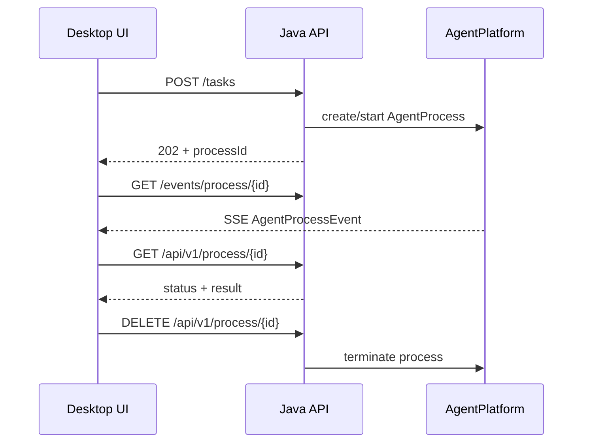

# Embabel Agent AgentInvocation 与 Process 生命周期

> [!abstract] 一句话总结
> `AgentInvocation` 是业务代码发起类型化 Agent 任务的高层入口，`AgentProcess` 才是一次真实运行；同步调用适合短任务，异步 Process ID、状态、事件和终止能力才适合 Web 或桌面 Agent。

## 1. 三个核心对象

| 对象 | 生命周期 | 责任 |
| ---- | -------- | ---- |
| `AgentPlatform` | 应用级单例 | 注册 Agent/Tool，创建、启动、查询 Process |
| `AgentInvocation<T>` | 一次调用配置 | 选择结果类型、设置 `ProcessOptions`、发起运行 |
| `AgentProcess` | 一次任务运行 | 保存 Blackboard、计划、事件、状态和结果 |

不要把 Agent 类本身当成一次任务。`@Agent` 描述可复用能力，`AgentProcess` 才是“用户这一次请求”的状态容器。

## 2. 类型化同步调用

```java
@Service
public class LearningPlanService {

    private final AgentPlatform agentPlatform;

    public LearningPlanService(AgentPlatform agentPlatform) {
        this.agentPlatform = agentPlatform;
    }

    public LearningPlan create(String request) {
        var invocation = AgentInvocation.create(
                agentPlatform,
                LearningPlan.class);

        return invocation.invoke(new UserInput(request));
    }
}
```

内部过程：

```text
期待 LearningPlan.class
  → 查找 Goal 输出类型兼容 LearningPlan 的 Agent
  → 创建 Blackboard 并放入 UserInput
  → 创建 AgentProcess
  → Planner/Action 循环执行
  → 从最终 Blackboard 取最后一个 LearningPlan
```

如果平台中没有任何 Goal 产出 `LearningPlan`，调用会失败，而不是由模型临时想办法返回一个同名 JSON。

## 3. 多个初始输入

```java
LearningPlan plan = invocation.invoke(
        new LearningRequest("Embabel", 7, "Java backend"),
        new UserPreferences(90, false));
```

所有对象都会加入初始 Blackboard。需要同类型命名输入时使用 Map：

```java
LearningPlan plan = invocation.invoke(Map.of(
        "request", request,
        "preferences", preferences));
```

输入对象应该是调用方已知的事实。不要在入口层先用 LLM 生成一堆不确定中间状态，再交给 Planner。

## 4. `ProcessOptions`

```java
var options = new ProcessOptions()
        .withContextId("user-42-learning")
        .withVerbosity(new Verbosity()
                .withShowPrompts(true)
                .withShowLlmResponses(false)
                .withShowPlanning(true))
        .withToolCallContext(Map.of(
                "tenantId", "demo",
                "correlationId", UUID.randomUUID().toString()))
        .withAdditionalEarlyTerminationPolicy(
                EarlyTerminationPolicy.maxActions(12));

var invocation = AgentInvocation.builder(agentPlatform)
        .options(options)
        .build(LearningPlan.class);
```

重要选项：

| 选项 | 作用 |
| ---- | ---- |
| `contextId` | 关联上下文/会话标识，不等同于 Process ID |
| `blackboard` | 从既有状态继续或注入自定义状态 |
| `verbosity` | Prompt、响应、规划和 debug 输出 |
| `budget` | Token、成本、Action 数限制 |
| `processControl` | 延迟与提前终止策略 |
| `plannerType` | 按 Process 覆盖 Planner |
| `toolCallContext` | 给本地/MCP 工具的横切元数据 |
| `listeners` | 订阅本次 Process 事件 |
| `ephemeral` | 控制是否保留 Process |

生产环境不要默认打印完整 Prompt/响应，其中可能包含代码、用户数据和凭据。

## 5. `invoke`、`invokeAsync`、`runAsync`

| API | 返回 | 适用 |
| --- | ---- | ---- |
| `invoke(input)` | 最终 `T`，阻塞 | CLI、短任务、测试 |
| `invokeAsync(input)` | `CompletableFuture<T>` | 只关心异步最终结果 |
| `run(input)` | 完整 `AgentProcess`，阻塞 | 调试和读取轨迹 |
| `runAsync(input)` | `CompletableFuture<AgentProcess>` | 异步等待完整 Process 执行结束 |

示例：

```java
CompletableFuture<LearningPlan> future =
        invocation.invokeAsync(new UserInput(request));

future.thenAccept(plan -> saveResult(plan));
```

如果桌面 UI 需要过程事件、取消和状态恢复，仅拿 `CompletableFuture<T>` 通常不够，应把 Process ID 作为一等业务标识。

还要注意：`runAsync(input)` 虽然返回 `CompletableFuture<AgentProcess>`，但这个 Future 也是在 Process 执行结束后才完成，不能用它在创建任务时立即取得 Process ID。需要立即向前端返回 ID 时，应先显式创建 Process，再异步启动：

```java
Agent agent = agentPlatform.agents().stream()
        .filter(candidate -> candidate.getName().equals("learning-plan-agent"))
        .findFirst()
        .orElseThrow(() -> new IllegalStateException(
                "learning-plan-agent is not registered"));

AgentProcess process = agentPlatform.createAgentProcessFrom(
        agent,
        options,
        new UserInput(request));

agentPlatform.start(process);

return Map.of(
        "processId", process.getId(),
        "statusUrl", "/api/v1/process/" + process.getId(),
        "sseUrl", "/events/process/" + process.getId());
```

这里 `createAgentProcessFrom` 只创建一个 `NOT_STARTED` Process，`start` 才把它放到后台执行。因此接口可以先返回 ID，前端再订阅 SSE 或轮询状态。

## 6. 桌面/Web Agent 的异步协议

推荐协议：



Embabel WebMVC 能提供：

- `GET /api/v1/process/{id}`：查询状态和最后结果。
- `DELETE /api/v1/process/{id}`：终止 Process。
- `GET /events/process/{id}`：SSE 事件流。

对应开关：

```yaml
embabel:
  agent:
    platform:
      rest:
        process-status-enabled: true
        process-kill-enabled: true
        process-events-enabled: true
```

要使用内置 Web 端点，需要选择包含 WebMVC 能力的 Starter/模块，而不是只加入 Shell Starter。

## 7. Process 状态与事件

一次执行至少要区分：

```text
已创建 → 运行中 → 已完成
                ↘ 失败
                ↘ 已终止
```

UI 不应该根据“最后一条文本消息”猜状态。状态、Action 事件、LLM 事件、Tool 事件和最终结果要分字段传输。

典型事件消费：

- Process 创建/开始。
- Planner 生成或调整计划。
- Action 开始/成功/失败。
- LLM 调用与 Token/成本。
- Tool 开始/返回/异常。
- Goal 达成。
- Process 完成/失败/终止。

这套事件流也是后续可观测性和桌面时间线的共同事实源。

## 8. 终止与取消

用户点击“取消”时，不能只让前端停止显示。后端必须：

1. 通过 Process ID 找到真实任务。
2. 请求终止 Process。
3. 停止后续 Planner/Action 调度。
4. 尽可能取消正在进行的模型或工具调用。
5. 把状态更新为终止，并发送事件。
6. 对已发生外部副作用进行审计或补偿。

内置接口：

```http
DELETE /api/v1/process/{id}
```

取消不能保证撤销已经执行完的 Git commit、文件写入或外部 API 操作。这些要在 Action 设计中提供事务、备份或补偿。

## 9. Process 持久化边界

默认的内存 Process Repository 适合开发，不适合把桌面任务恢复能力想当然地建立其上。

生产需要明确：

- 应用重启后是否要恢复任务？
- Blackboard 中哪些对象可序列化？
- 大型文件内容是否只保存引用？
- Process 事件保留多久？
- 凭据、Prompt 和 Tool 结果是否允许落盘？
- 框架升级后旧 Process 如何迁移？

Embabel 提供 Process/Context 扩展点，但“完整桌面会话恢复”仍是产品层设计，不是加入一个 Starter 自动获得。

## 10. 并发与隔离

两个 Process 并发运行时，共享的是 `AgentPlatform` 和 Spring Bean，隔离的是各自 Blackboard/Process 状态。

需要自行保证：

- 注入 Agent 的成员变量不要保存每次请求状态。
- Action 使用的服务要线程安全。
- 文件编辑任务使用不同工作区或 Git worktree。
- ToolCallContext 中的租户信息不能串线。
- 外部资源加锁不能只依赖 JVM 内存。

错误示例：

```java
@Agent(description = "...")
public class BadAgent {
    private String currentUser; // 多 Process 共享，可能串数据
}
```

把任务状态放入 Blackboard 的领域对象，而不是 Agent Bean 成员。

## 11. 入口选择

| 产品入口 | 推荐调用方式 |
| -------- | ------------ |
| Spring Shell 学习调试 | `x` / 内置命令 |
| 明确业务 REST API | `AgentInvocation<T>` |
| 长任务 Web/Desktop | 创建异步 `AgentProcess` + Process ID + SSE |
| 多意图聊天入口 | `Autonomy` Closed/Open，配合严格阈值 |
| MCP 对外能力 | 导出明确 Goal，而非暴露全部内部 Action |

## 最小验证

1. 用 `AgentInvocation.create(platform, LearningPlan.class)` 发起同步调用。
2. 改为 `run`，查看完整 `AgentProcess` 和最终 Blackboard。
3. 设置最大 Action 数为 10。
4. 改为异步启动，记录 Process ID。
5. 用状态端点和 SSE 分别验证“当前状态”和“发生过的事件”。

## 自测题

> [!question]- Q1：`AgentInvocation` 为什么按结果类型找 Agent？
> 每个 `@AchievesGoal` 关联一个输出类型；调用方声明期待的 `T` 后，平台可以选择具有兼容 Goal 输出的 Agent，并从最终 Blackboard 提取该类型。

> [!question]- Q2：桌面 Agent 为什么不应只用同步 `invoke`？
> 长任务需要过程事件、取消、状态查询、失败恢复和应用重启后的追踪；同步返回只覆盖最终结果，无法形成完整任务生命周期协议。

> [!question]- Q3：为什么 Agent Bean 不能保存当前用户状态？
> Spring Bean 通常被多个 Process 并发共享，成员变量会造成竞态和数据串线；每次执行状态应保存在独立 Blackboard 或带租户边界的外部存储中。

## 关联阅读

- 上一篇：[[06-OperationContext-模型调用与工具集成]]
- 下一篇：[[08-测试-可观测性与可靠性]]
- SSE 基础：[[../SpringAI/04-流式输出-SSE]]
- 桌面架构：[[10-AI应用开发/09-标杆产品拆解/02-编程Agent通用架构图]]
- 子区索引：[[_index]]

## 参考资料

- [Embabel Invoking](https://docs.embabel.com/embabel-agent/guide/1.5.0-SNAPSHOT/#reference.invoking)
- [Embabel Agent Process](https://docs.embabel.com/embabel-agent/guide/1.5.0-SNAPSHOT/#reference.agent-process)
- [Embabel Termination](https://docs.embabel.com/embabel-agent/guide/1.5.0-SNAPSHOT/#reference.termination)
