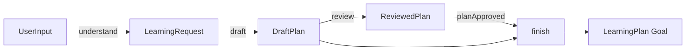

# 实战：用 Embabel Agent 实现学习计划 Agent

> [!abstract] 一句话总结
> 本项目用一个可运行的 Java 21 + Embabel Agent 1.5.0 应用串起工程搭建、类型化 Blackboard、GOAP、LLM 结构化输出、Condition、AgentInvocation 和测试，完成 `UserInput → LearningRequest → DraftPlan → ReviewedPlan → LearningPlan`。

## 1. 需求与验收标准

用户输入：

```text
我是 Java 后端开发，希望 7 天学会 Embabel Agent，每天 90 分钟。
```

系统输出一份结构化学习计划：

- 识别主题、天数、背景和每天时间。
- 每天只有一个明确目标。
- 每天包含一个可验证练习。
- 任务天数必须与用户要求一致。
- 审核通过后才能产生最终 `LearningPlan`。

本项目刻意不加入 Web、数据库和 MCP。先证明 Embabel 的核心规划闭环，再扩展外围能力。

## 2. 规划图



为什么 `finish` 同时接收 `DraftPlan` 和 `ReviewedPlan`？

- `DraftPlan` 提供最终要交付的任务明细。
- `ReviewedPlan` 证明审核发生，并为 `planApproved` 提供判断依据。
- `pre = "planApproved"` 保证“有审核结果”不等于“审核通过”。

## 3. 项目结构

```text
embabel-learning/
├── pom.xml
└── src/
    ├── main/
    │   ├── java/com/example/learning/
    │   │   ├── LearningAgentApplication.java
    │   │   └── LearningPlanAgent.java
    │   └── resources/application.yml
    └── test/
        └── java/com/example/learning/
            ├── LearningPlanAgentTest.java
            └── LearningPlanIntegrationTest.java
```

## 4. Maven 配置

```xml
<?xml version="1.0" encoding="UTF-8"?>
<project xmlns="http://maven.apache.org/POM/4.0.0"
         xmlns:xsi="http://www.w3.org/2001/XMLSchema-instance"
         xsi:schemaLocation="http://maven.apache.org/POM/4.0.0 https://maven.apache.org/xsd/maven-4.0.0.xsd">
    <modelVersion>4.0.0</modelVersion>

    <parent>
        <groupId>org.springframework.boot</groupId>
        <artifactId>spring-boot-starter-parent</artifactId>
        <version>4.1.0</version>
        <relativePath/>
    </parent>

    <groupId>com.example</groupId>
    <artifactId>embabel-learning</artifactId>
    <version>0.0.1-SNAPSHOT</version>

    <properties>
        <java.version>21</java.version>
        <embabel-agent.version>1.5.0</embabel-agent.version>
    </properties>

    <dependencies>
        <dependency>
            <groupId>com.embabel.agent</groupId>
            <artifactId>embabel-agent-starter-shell</artifactId>
            <version>${embabel-agent.version}</version>
        </dependency>
        <dependency>
            <groupId>com.embabel.agent</groupId>
            <artifactId>embabel-agent-starter-openai</artifactId>
            <version>${embabel-agent.version}</version>
        </dependency>
        <dependency>
            <groupId>com.embabel.agent</groupId>
            <artifactId>embabel-agent-test</artifactId>
            <version>${embabel-agent.version}</version>
            <scope>test</scope>
        </dependency>
        <dependency>
            <groupId>org.springframework.boot</groupId>
            <artifactId>spring-boot-starter-test</artifactId>
            <scope>test</scope>
        </dependency>
    </dependencies>

    <build>
        <plugins>
            <plugin>
                <groupId>org.springframework.boot</groupId>
                <artifactId>spring-boot-maven-plugin</artifactId>
            </plugin>
            <plugin>
                <groupId>org.apache.maven.plugins</groupId>
                <artifactId>maven-compiler-plugin</artifactId>
                <configuration>
                    <parameters>true</parameters>
                </configuration>
            </plugin>
        </plugins>
    </build>
</project>
```

Shell Starter 已传递引入基础 Platform Starter，不需要重复声明。

## 5. 启动类与配置

```java
package com.example.learning;

import org.springframework.boot.SpringApplication;
import org.springframework.boot.autoconfigure.SpringBootApplication;

@SpringBootApplication
public class LearningAgentApplication {

    public static void main(String[] args) {
        SpringApplication.run(LearningAgentApplication.class, args);
    }
}
```

`application.yml`：

```yaml
embabel:
  models:
    default-llm: gpt-4.1-mini
  agent:
    platform:
      toolloop:
        max-iterations: 10
```

## 6. 完整 Agent

```java
package com.example.learning;

import com.embabel.agent.api.annotation.AchievesGoal;
import com.embabel.agent.api.annotation.Action;
import com.embabel.agent.api.annotation.Agent;
import com.embabel.agent.api.annotation.Condition;
import com.embabel.agent.api.common.OperationContext;
import com.embabel.agent.domain.io.UserInput;

import java.util.ArrayList;
import java.util.List;

@Agent(
        name = "learning-plan-agent",
        description = "Create and review a structured learning plan from a user's request",
        version = "1.0.0"
)
public class LearningPlanAgent {

    public record LearningRequest(
            String topic,
            int days,
            String learnerBackground,
            int minutesPerDay
    ) {}

    public record DailyTask(
            int day,
            String objective,
            String exercise,
            String doneWhen
    ) {}

    public record DraftPlan(
            LearningRequest request,
            List<DailyTask> tasks
    ) {}

    public record ReviewedPlan(
            boolean approved,
            List<String> issues
    ) {}

    public record LearningPlan(
            String topic,
            int days,
            int minutesPerDay,
            List<DailyTask> tasks,
            String reviewSummary
    ) {}

    @Action(
            description = "Extract a structured learning request from user input",
            readOnly = true
    )
    public LearningRequest understand(
            UserInput input,
            OperationContext context) {
        String prompt = """
                Extract a learning request from the user text.
                If duration is missing, use 7 days.
                If daily time is missing, use 60 minutes.
                Preserve the learner's technical background.

                User text:
                %s
                """.formatted(input.getContent());

        return context.ai()
                .withAutoLlm()
                .withId("understand-learning-request")
                .createObject(prompt, LearningRequest.class);
    }

    @Action(
            description = "Create one concrete and verifiable task for each learning day",
            readOnly = true
    )
    public DraftPlan draft(
            LearningRequest request,
            OperationContext context) {
        String prompt = """
                Create exactly one learning task for each day.
                Every task must contain:
                - one focused objective;
                - one hands-on exercise;
                - an observable doneWhen criterion.
                Build later days on the results of earlier days.

                Topic: %s
                Days: %d
                Learner background: %s
                Minutes per day: %d
                """.formatted(
                request.topic(),
                request.days(),
                request.learnerBackground(),
                request.minutesPerDay());

        return context.ai()
                .withDefaultLlm()
                .withId("draft-learning-plan")
                .createObject(prompt, DraftPlan.class);
    }

    @Action(
            description = "Check structural and business rules of a draft plan",
            readOnly = true,
            post = {"planApproved"}
    )
    public ReviewedPlan review(DraftPlan draft) {
        List<String> issues = new ArrayList<>();

        if (draft.tasks().size() != draft.request().days()) {
            issues.add("Task count must equal requested days");
        }

        for (int i = 0; i < draft.tasks().size(); i++) {
            DailyTask task = draft.tasks().get(i);
            if (task.day() != i + 1) {
                issues.add("Day numbers must be continuous from 1");
            }
            if (task.exercise() == null || task.exercise().isBlank()) {
                issues.add("Every day must include an exercise");
            }
            if (task.doneWhen() == null || task.doneWhen().isBlank()) {
                issues.add("Every day must include a doneWhen criterion");
            }
        }

        return new ReviewedPlan(issues.isEmpty(), List.copyOf(issues));
    }

    @Condition(name = "planApproved")
    public boolean planApproved(ReviewedPlan reviewedPlan) {
        return reviewedPlan.approved();
    }

    @AchievesGoal(
            description = "Return a concrete learning plan that passed review",
            tags = {"learning", "planning"},
            examples = {
                    "Create a 7-day Embabel Agent learning plan",
                    "Plan two weeks of Spring AI study"
            }
    )
    @Action(
            description = "Publish an approved learning plan",
            pre = {"planApproved"},
            readOnly = true
    )
    public LearningPlan finish(
            DraftPlan draft,
            ReviewedPlan reviewedPlan) {
        return new LearningPlan(
                draft.request().topic(),
                draft.request().days(),
                draft.request().minutesPerDay(),
                draft.tasks(),
                "Approved with no structural issues");
    }
}
```

## 7. 一次执行如何完成

初始 Blackboard 只有 `UserInput`：

1. `understand` 可执行，产生 `LearningRequest`。
2. `draft` 的输入满足，产生 `DraftPlan`。
3. `review` 的输入满足，产生 `ReviewedPlan`，随后 `planApproved` 可求值。
4. 若条件为真，`finish` 可执行并产生 Goal 类型 `LearningPlan`。
5. Goal 满足，Process 完成。

如果审核失败，当前版本会停在不可达状态，而不是偷偷交付坏计划。这是刻意的第一版边界；后面的进阶练习会补修订路径。

## 8. Action 单元测试

```java
package com.example.learning;

import com.embabel.agent.domain.io.UserInput;
import com.embabel.agent.test.unit.FakeOperationContext;
import org.junit.jupiter.api.Test;

import static org.junit.jupiter.api.Assertions.*;

class LearningPlanAgentTest {

    @Test
    void understandUsesStructuredOutputWithoutRealLlm() {
        var context = FakeOperationContext.create();
        context.expectResponse(new LearningPlanAgent.LearningRequest(
                "Embabel Agent", 7, "Java backend", 90));

        var result = new LearningPlanAgent().understand(
                new UserInput("Java 后端每天 90 分钟，7 天学习 Embabel"),
                context);

        assertEquals("Embabel Agent", result.topic());
        assertEquals(7, result.days());
        assertEquals(90, result.minutesPerDay());
        assertTrue(context.getLlmInvocations()
                .getFirst()
                .getPrompt()
                .contains("7 天"));
    }

    @Test
    void reviewRejectsMissingDay() {
        var request = new LearningPlanAgent.LearningRequest(
                "Embabel Agent", 2, "Java", 60);
        var draft = new LearningPlanAgent.DraftPlan(
                request,
                java.util.List.of(
                        new LearningPlanAgent.DailyTask(
                                1, "Setup", "Start the Shell", "Agent is listed")));

        var review = new LearningPlanAgent().review(draft);

        assertFalse(review.approved());
        assertTrue(review.issues().contains(
                "Task count must equal requested days"));
    }
}
```

## 9. 完整规划集成测试

```java
package com.example.learning;

import com.embabel.agent.api.invocation.AgentInvocation;
import com.embabel.agent.domain.io.UserInput;
import com.embabel.agent.test.integration.EmbabelMockitoIntegrationTest;
import org.junit.jupiter.api.Test;
import org.springframework.test.context.TestPropertySource;

import java.util.List;

import static org.junit.jupiter.api.Assertions.assertEquals;

@TestPropertySource(properties = {
        "embabel.models.default-llm=test-model",
        "embabel.agent.platform.models.openai.api-key=test-key",
        "spring.autoconfigure.exclude=" +
                "org.springframework.shell.boot.ShellRunnerAutoConfiguration"
})
class LearningPlanIntegrationTest
        extends EmbabelMockitoIntegrationTest {

    @Test
    void reachesLearningPlanGoal() {
        var request = new LearningPlanAgent.LearningRequest(
                "Embabel Agent", 2, "Java backend", 60);
        var draft = new LearningPlanAgent.DraftPlan(request, List.of(
                new LearningPlanAgent.DailyTask(
                        1, "Setup", "Run the Shell", "Agent appears in agents"),
                new LearningPlanAgent.DailyTask(
                        2, "Planning", "Inspect Blackboard", "Explain the type path")
        ));

        whenCreateObject(
                prompt -> prompt.contains("Extract a learning request"),
                LearningPlanAgent.LearningRequest.class)
                .thenReturn(request);

        whenCreateObject(
                prompt -> prompt.contains("exactly one learning task"),
                LearningPlanAgent.DraftPlan.class)
                .thenReturn(draft);

        var invocation = AgentInvocation.create(
                agentPlatform,
                LearningPlanAgent.LearningPlan.class);

        var result = invocation.invoke(
                new UserInput("Java 后端两天学习 Embabel"));

        assertEquals("Embabel Agent", result.topic());
        assertEquals(2, result.tasks().size());

        verifyCreateObjectMatching(
                prompt -> prompt.contains("Extract a learning request"),
                LearningPlanAgent.LearningRequest.class,
                interaction -> interaction.getToolGroups().isEmpty());
        verifyCreateObjectMatching(
                prompt -> prompt.contains("exactly one learning task"),
                LearningPlanAgent.DraftPlan.class,
                interaction -> interaction.getToolGroups().isEmpty());
        verifyNoMoreInteractions();
    }
}
```

`test-key` 只用于让 OpenAI 配置 Bean 完成初始化；排除 `ShellRunnerAutoConfiguration` 是为了让 Surefire 不进入 JLine 交互。测试底层的 `LlmOperations` 已被 Mockito 替换，不调用真实模型，但会启动 Spring、扫描 Agent、寻找 Goal、运行 GOAP 并传递 Blackboard 对象。因此它能发现“单个方法都对，但整体规划走不通”的问题。

## 10. 运行

```powershell
$env:OPENAI_API_KEY = "你的密钥"
mvn test
mvn spring-boot:run
```

Shell 中：

```text
agents
actions
conditions
goals
x "我是 Java 后端开发，希望 7 天学会 Embabel Agent，每天 90 分钟" -p
blackboard
```

验收：

- `agents` 中有 `learning-plan-agent`。
- `actions` 显示四个 Action。
- `conditions` 有 `planApproved`。
- `goals` 有最终学习计划 Goal。
- planning 日志显示按类型依赖执行。
- 最终 Blackboard 中有五种阶段对象。

## 11. 故障演练

### 场景一：模型生成 6 个任务

输入要求 7 天，`review` 返回拒绝：

```text
DraftPlan 已存在
ReviewedPlan.approved = false
planApproved = false
finish 的 pre 不满足
Goal 不会完成
```

这证明结构化输出成功不等于业务有效。

### 场景二：删掉 `@AchievesGoal`

`AgentInvocation.create(..., LearningPlan.class)` 无法找到具有该输出 Goal 的 Agent。返回类型相同的普通 Action 不足以声明任务终点。

### 场景三：删掉 `OperationContext`

纯 Java `review` 不受影响；需要 LLM 的 `understand`、`draft` 失去 PromptRunner 来源。它说明不是每个 Action 都必须调用模型。

### 场景四：把所有 record 改成 `String`

项目可能还能手工串起来，但 Planner 失去阶段语义，同类型 binding 变复杂，测试也只能不断解析文本。这正是 Embabel 强类型模型要解决的问题。

## 12. 进阶练习

按顺序完成，不要一次全加：

### 练习一：增加修订路径

目标：审核失败后修订一次，再重新审核。

要处理：

- 同类型 `DraftPlan` 再次产生时的 binding。
- `canRerun` 与终止条件。
- `clearBlackboard` 或 `@State` 循环建模。
- 最大 Action 数，防止无限修订。

### 练习二：资源搜索 ToolGroup

新增：

```text
LearningRequest → ResourceList → DraftPlan
```

只给 `findResources` Action 开 Web/MCP 工具，不要让 `finish` 拥有网络权限。

### 练习三：REST + SSE

目标：

- `POST /tasks` 返回 Process ID。
- SSE 显示 Action 时间线。
- 支持查询和取消。
- 前端把状态与文本消息分开显示。

### 练习四：多模型角色

- `understand` 使用便宜模型。
- `draft` 使用高质量模型。
- 普通 Java `review` 不调用模型。
- 用测试验证模型角色和总调用次数。

### 练习五：评测集

准备至少 20 条不同表达的学习需求，统计：

- 天数识别准确率。
- Goal 达成率。
- 审核拒绝率。
- 平均 Token/耗时/Action 数。
- 不同模型的质量与成本。

## 13. 完成标准

做到以下内容，才算真正完成本实战：

- [ ] 不看文档能搭出 `1.5.0` 项目。
- [ ] 能画出五个领域类型的规划图。
- [ ] 能解释每个 Action 为什么在那个时刻可执行。
- [ ] 能用 Fake 测单个 LLM Action。
- [ ] 能用 Mock 集成测试跑完整 GOAP。
- [ ] 能构造一个 Goal 不可达场景并定位缺失边。
- [ ] 能说清 Planner 循环和 Tool Loop 的区别。
- [ ] 能给 Process 增加动作数上限。
- [ ] 能解释如何改造成桌面 Agent 的异步任务后端。

## 关联阅读

- 上一篇：[[08-测试-可观测性与可靠性]]
- 下一篇：[[99-本章总结与复习]]
- 项目实战：[[../../08-项目实战/07-项目-业务Agent系统]]
- 编程 Agent 架构：[[../../09-标杆产品拆解/02-编程Agent通用架构图]]
- 子区索引：[[_index]]

## 参考资料

- [Embabel Agent v1.5.0 Source](https://github.com/embabel/embabel-agent/tree/v1.5.0)
- [Embabel Agent Examples](https://github.com/embabel/embabel-agent-examples)
- [Embabel Java Agent Template](https://github.com/embabel/java-agent-template)
