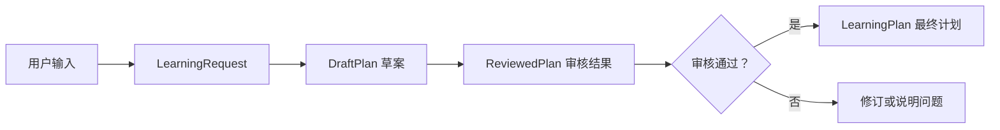

# 📚 实战：学习计划 Agent

> [!abstract] 实战目标
> 用学习计划场景理解 Embabel 的领域对象、Action、Condition 和 Goal。这里保留关键片段与验证方法，省略完整项目配置；代码未在本机编译或连接模型运行。

## 🎯 需求是什么？

用户说：“我是 Java 后端开发，希望 7 天学习 Embabel Agent，每天 90 分钟。”系统需要识别主题、天数和时间，生成每天的目标与练习，再检查天数、编号和练习是否符合要求。审核不通过时，应返回问题或安排修订，不能直接标记为完成。

## 🗺️ 从需求到计划



图示表示业务目标，不代表框架会自动实现修订。要让不通过的草案继续修改，必须显式设计相应 Action、条件和停止策略。

## 🧩 领域对象怎么分？

| 对象 | 作用 |
| :--- | :--- |
| `LearningRequest` | 用户的主题、天数、背景和每天可用时间 |
| `DraftPlan` | 待审核的学习安排 |
| `ReviewedPlan` | 审核结论与问题列表 |
| `LearningPlan` | 满足要求后交付的最终计划 |

使用不同类型的对象，可以让 Action 的输入和输出表达各阶段的职责；类型不同不代表内容自动正确，字段仍要校验。

## 💻 关键 Action 和条件

假设 `DraftPlan`、`ReviewedPlan` 和检查方法 `checkPlan` 已定义。以下展示注解如何表达审核动作与条件，省略类声明和 imports。

```java
@Action(description = "检查学习计划草案", post = {"planApproved"})
public ReviewedPlan review(DraftPlan draft) {
    return checkPlan(draft);
}

@Condition(name = "planApproved")
public boolean approved(ReviewedPlan result) {
    return result.approved();
}
```

`checkPlan` 应明确检查计划天数、日期是否连续，以及每一天是否有目标和可验证练习。`@Condition` 只判断状态，通常不应产生副作用。

```java
@AchievesGoal(description = "生成已审核的学习计划")
@Action(pre = {"planApproved"})
public LearningPlan finish(DraftPlan draft, ReviewedPlan result) {
    return toLearningPlan(draft, result);
}
```

`finish` 依赖草案、审核结果和 `planApproved` 条件。输入、类型、条件和 Goal 要与项目使用的 Embabel 版本一致；若条件不满足且没有可用修订路径，流程可能无法完成，需要捕获并解释失败。

## 🔎 调用与检查

假设 `agentPlatform` 已配置，存在能产出 `LearningPlan` 的 Agent，输入和依赖已经准备：

```java
var invocation = AgentInvocation.create(agentPlatform, LearningPlan.class);
LearningPlan plan = invocation.invoke(userInput);
```

模型生成草案时，可按项目配置使用 `OperationContext` 调用模型并将结果映射为领域对象；不要把格式符合要求等同于内容一定合理。配置、模型接入与启动步骤见 [[02-环境搭建与第一个Agent]]。

## 🧪 验证哪些场景？

| 场景 | 预期检查 |
| :--- | :--- |
| 输入要求 7 天，每天 90 分钟 | 结果天数和时间与输入一致，每天有具体练习 |
| 草案只有 6 天 | 审核不通过，不直接生成已通过的最终计划 |
| 每天练习为空 | 报告缺失字段，允许修订或明确失败 |
| 模型服务超时 | 显示错误并记录原因，不把失败当成成功 |

先单测 `checkPlan`，再通过测试模型或模拟输出验证 Action 与规划链路；最后再连接实际模型观察结果。模型输出有随机性，应保存输入、实际结果和版本信息进行复盘。

> [!question]- 加了 `@AchievesGoal`，是不是草案一生成就能直接交付？
> 不是。还要满足 Action 所需的输入和前置条件。若审核失败，必须有可执行的修订或结束路径。

## 🔗 关联与资料

- [[03-领域对象与Blackboard状态模型]]、[[04-Action-Goal-Condition核心注解]]、[[08-测试-可观测性与可靠性]]。
- [Embabel 官方仓库](https://github.com/embabel/embabel-agent)
- [Embabel 官方指南](https://docs.embabel.com/embabel-agent/guide/1.5.1/)
