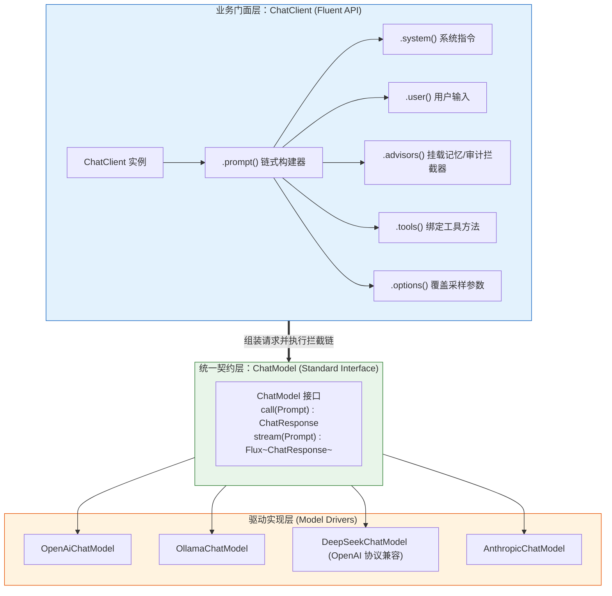
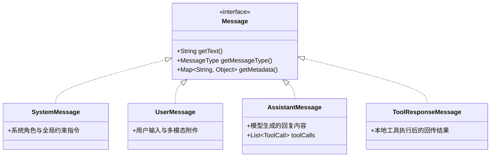
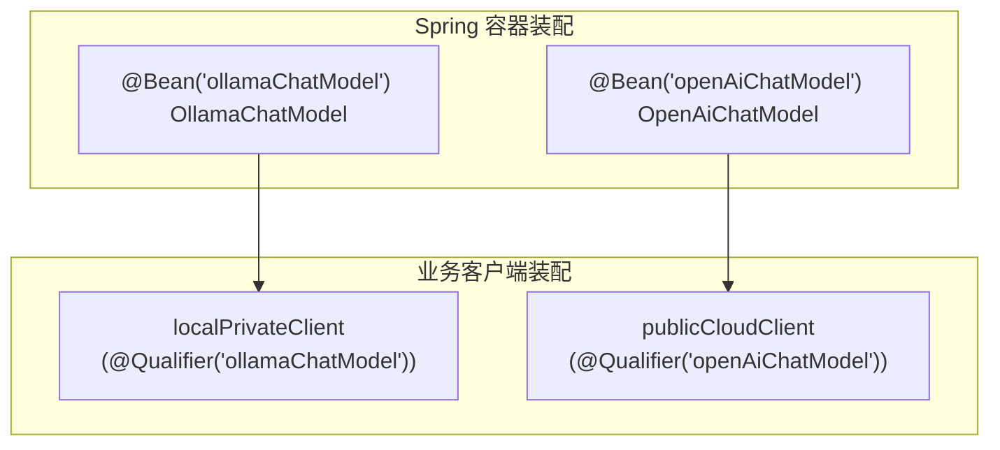

# 💬 ChatClient 与 ChatModel 核心机制深度解析

> [!abstract] 一句话总结
> `ChatModel` 是 Spring AI 针对底层大模型服务的**统一通信接口**（负责协议适配与基础请求响应），而 `ChatClient` 是面向业务层提供链式编排、拦截器挂载与结构化映射的**高阶调用门面**。

---

## 📌 架构设计：调用层双层抽象



### 1. `ChatModel`：模型驱动标准契约
`ChatModel` 继承自 `Model<Prompt, ChatResponse>` 和 `StreamingModel<Prompt, ChatResponse>`，职责聚焦于底层通信：
- **入参**：标准的 `Prompt` 对象（封装 `List<Message>` 与 `ChatOptions`）。
- **出参**：标准的 `ChatResponse`（包含模型生成的 `Generation` 结果、Token 消耗 `Usage` 以及响应元数据 `ChatResponseMetadata`）。
- **职责边界**：将标准 `Prompt` 转化为目标供应商的 HTTP 请求载荷，执行网络调用并解析返回结果。需要直接控制底层消息结构与响应元数据时，可直接调用 `ChatModel`。

### 2. `ChatClient`：业务编排门面
`ChatClient` 内部持有 `ChatModel` 引用，采用委托与建造者模式面向业务开发提供高阶能力：
- 提供链式 Fluent API（`.system(...)`、`.user(...)`、`.advisors(...)`），简化提示词组装；
- 管理 **Advisor 拦截器链**，统一执行会话记忆读写、RAG 知识检索与日志审计；
- 支持将模型输出反序列化为强类型 Java 对象（`.entity(...)`）；
- 统一提供同步阻塞调用（`.call()`）与响应式流式调用（`.stream()`）入口。

---

## 🧩 核心对象体系：Message 与 ChatOptions

Spring AI 使用统一的消息对象层次表达多轮对话结构：



### 动态参数控制：`ChatOptions`
在单次请求中，可通过 `options(...)` 覆盖全局默认采样参数：

```java
ChatOptions options = OpenAiChatOptions.builder()
        .model("gpt-4o")
        .temperature(0.2)
        .maxTokens(2000)
        .topP(0.9)
        .build();
```

---

## 💻 代码实践：ChatClient 装配与调用

### 1. Spring Boot 单例装配（推荐方式）
Spring AI 自动配置会在容器中注册 `ChatClient.Builder`。通常在配置类中按业务域构建对应的 `ChatClient` 单例 Bean：

```java
package com.example.ai.config;

import org.springframework.ai.chat.client.ChatClient;
import org.springframework.ai.chat.client.advisor.MessageChatMemoryAdvisor;
import org.springframework.ai.chat.client.advisor.SimpleLoggerAdvisor;
import org.springframework.ai.chat.memory.MessageWindowChatMemory;
import org.springframework.context.annotation.Bean;
import org.springframework.context.annotation.Configuration;

@Configuration
public class AiClientConfig {

    @Bean
    public ChatClient customerServiceChatClient(ChatClient.Builder builder) {
        return builder
                // 1. 设置默认系统提示词
                .defaultSystem("""
                    你是电商平台的智能导购助手。
                    回答请保持礼貌客观，仅推荐系统已上架的商品。
                    """)
                // 2. 挂载默认拦截器（调试日志 + 会话记忆）
                .defaultAdvisors(
                        new SimpleLoggerAdvisor(), // 开发调试日志（生产环境需注意敏感数据脱敏）
                        MessageChatMemoryAdvisor.builder(
                                MessageWindowChatMemory.builder().build()).build()
                )
                // 3. 设置默认模型参数
                .defaultOptions(org.springframework.ai.chat.prompt.ChatOptions.builder()
                        .temperature(0.7)
                        .build())
                .build();
    }
}
```

### 2. 四种典型业务调用场景

```java
package com.example.ai.service;

import com.example.ai.dto.ProductRecommendation;
import org.springframework.ai.chat.client.ChatClient;
import org.springframework.ai.chat.memory.ChatMemory;
import org.springframework.ai.chat.model.ChatResponse;
import org.springframework.stereotype.Service;
import reactor.core.publisher.Flux;

@Service
public class ShoppingAssistantService {

    private final ChatClient chatClient;

    public ShoppingAssistantService(ChatClient customerServiceChatClient) {
        this.chatClient = customerServiceChatClient;
    }

    /**
     * 场景 A：同步调用，提取纯文本结果
     */
    public String askDirectly(String question) {
        return chatClient.prompt()
                .user(question)
                .call()
                .content();
    }

    /**
     * 场景 B：结构化输出，反序列化为 Java Record / POJO
     */
    public ProductRecommendation recommendProduct(String userRequirement) {
        return chatClient.prompt()
                .user("用户需求：" + userRequirement)
                .call()
                .entity(ProductRecommendation.class);
    }

    /**
     * 场景 C：获取完整 ChatResponse，读取 Token 用量与响应元数据
     */
    public ChatResponse askWithMetrics(String promptText) {
        return chatClient.prompt()
                .user(promptText)
                .call()
                .chatResponse();
    }

    /**
     * 场景 D：响应式流式输出（用于 SSE）并传入会话 ID
     */
    public Flux<String> streamChat(String conversationId, String userMessage) {
        return chatClient.prompt()
                .user(userMessage)
                .advisors(a -> a.param(ChatMemory.CONVERSATION_ID, conversationId))
                .stream()
                .content();
    }
}
```

---

## ⚙️ 多模型共存与注入配置

当应用同时接入多个模型提供商（例如内部数据使用本地部署的 **Ollama**，公网业务使用 **OpenAI**）时，容器中会存在多个 `ChatModel` Bean，可通过 `@Qualifier` 分别构建对应的 `ChatClient`：



```java
@Configuration
public class MultiModelConfig {

    @Bean
    public ChatClient localPrivateClient(@Qualifier("ollamaChatModel") ChatModel localModel) {
        return ChatClient.builder(localModel)
                .defaultSystem("你是运行在本地内网环境的数据助手。")
                .build();
    }

    @Bean
    public ChatClient publicCloudClient(@Qualifier("openAiChatModel") ChatModel cloudModel) {
        return ChatClient.builder(cloudModel)
                .defaultSystem("你是面向公网业务的智能助手。")
                .build();
    }
}
```

---

## ⚠️ 生产实践与常见误区

### 1. 避免在业务代码中直接拼接底层 `ChatModel.call(new Prompt(...))`
- **原因**：直接调用 `ChatModel` 会绕过 `ChatClient` 上统一配置的默认系统提示词、`Advisor` 拦截链与结构化转换器，增加重复样板代码。
- **建议**：常规业务统一通过 `ChatClient` 调用；仅在编写底层框架扩展或自定义基础设施组件时直接操作 `ChatModel`。

### 2. 复用 `ChatClient` 单例 Bean
- **原因**：`ChatClient` 本身是线程安全的不可变配置门面，每次调用 `.prompt()` 都会创建独立的请求构建上下文。
- **建议**：在配置类中将 `ChatClient` 声明为 `@Bean` 单例复用，避免在每次请求中重复执行 `builder.build()`。

### 3. 结构化校验与分布式记忆配置
- **结构化输出校验**：`.entity(DTO.class)` 默认通过格式提示词与 JSON 反序列化生成目标对象（若需底层模型强制遵循 JSON Schema，需结合对应 Provider 的 Structured Outputs 选项配置），业务层仍应对返回对象的关键字段进行非空与合法性校验。
- **会话记忆持久化**：示例中的默认 `MessageWindowChatMemory` 使用内存存储，仅适用于单实例开发验证；生产环境多实例部署时需配置 Redis 或 JDBC 等共享 `ChatMemoryRepository`，并由服务端基于登录态传入经过鉴权的 `conversationId`。

### 4. 采集 `ChatResponse` 中的 Token 用量指标
- **建议**：在生产环境中通过自定义 `Advisor` 或 Micrometer 观测机制提取 `chatResponse.getMetadata().getUsage()`，监控输入与输出 Token 消耗。

---

## 🎯 高频面试问题

> [!question] 常见面试问题解析
> 
> **Q1：请从设计模式和架构分层角度，说明 Spring AI 中 `ChatClient` 与 `ChatModel` 的分工？**
> - **答**：
>   - **驱动适配层（`ChatModel`）**：采用**适配器模式（Adapter）**，定义统一的模型调用契约，将标准 `Prompt` 与 `ChatResponse` 映射到各模型厂商的 HTTP 接口与报文格式；
>   - **业务门面层（`ChatClient`）**：采用**门面模式（Facade）与建造者模式（Builder）**，面向业务开发提供链式 Fluent API，封装提示词模板渲染、结构化实体映射与流式转换；
>   - **横切增强层（`Advisor`）**：在 `ChatClient` 中集成基于责任链的 `Advisor` 机制，使会话记忆、RAG 检索、日志审计与安全过滤与核心业务代码解耦。
>
> **Q2：使用 `ChatClient` 接收流式响应时，底层是如何工作的？**
> - **答**：
>   底层基于 Project Reactor 响应式流规范。调用 `.stream()` 时，`ChatModel` 与模型服务端建立流式 HTTP 连接（通常为 `text/event-stream`），将增量返回的数据块解析为 `ChatResponse` 并封装为 `Flux<ChatResponse>`。在控制器层返回 `Flux<String>` 并声明 `produces = MediaType.TEXT_EVENT_STREAM_VALUE`，即可向前端持续推送增量文本。
>
> **Q3：在多模型并存（如本地 Ollama + 云端 OpenAI）场景下，Spring AI 如何管理不同模型？**
> - **答**：
>   各模型 Starter 会在容器中注册对应名称的 `ChatModel` Bean。开发者可以在 `@Configuration` 配置类中通过 `@Qualifier("openAiChatModel")` 或 `@Qualifier("ollamaChatModel")` 注入指定驱动，分别构建面向不同业务场景的 `ChatClient` Bean，使上层服务使用统一的 API 完成按场景路由或主备切换。

---

## 🪝 知识复盘卡

```
┌────────────────────────────────────────────────────────┐
│               ChatClient 与 ChatModel 复盘卡            │
├────────────────────────────────────────────────────────┤
│  1. 架构分工：ChatModel 负责协议适配；ChatClient 负责门面编排│
│  2. 核心语法：.prompt().system().user().call().content() │
│  3. 响应形态：.call() 同步阻塞；.stream() 响应式 Flux 流 │
│  4. 结构映射：.entity(DTO.class) 将 JSON 反序列化为对象  │
│  5. 横切扩展：通过 Advisor 责任链挂载记忆、RAG 与审计逻辑│
└────────────────────────────────────────────────────────┘
```

---

## 🔗 关联笔记

- [[01-Spring-AI项目搭建]] - Spring AI 工程依赖与基础配置
- [[04-流式输出-SSE]] - SSE 流式传输与 WebFlux 集成
- [[06-Function-Calling工具调用]] - 在 ChatClient 中声明与挂载工具方法
- [[07-Advisor拦截器]] - Advisor 责任链机制与自定义拦截器
- [[_index]] - 返回 Spring AI 专题索引
