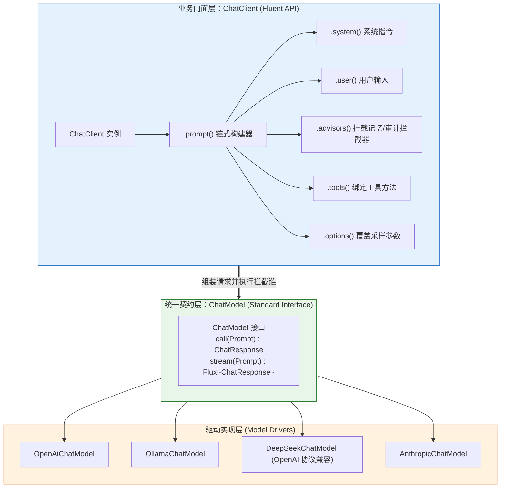
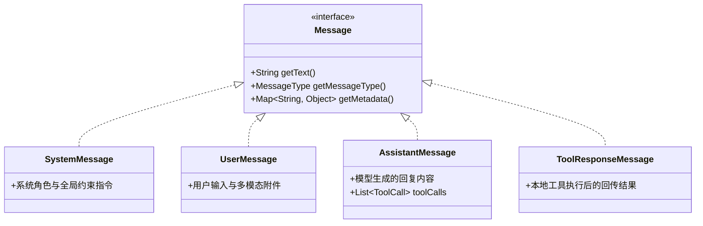
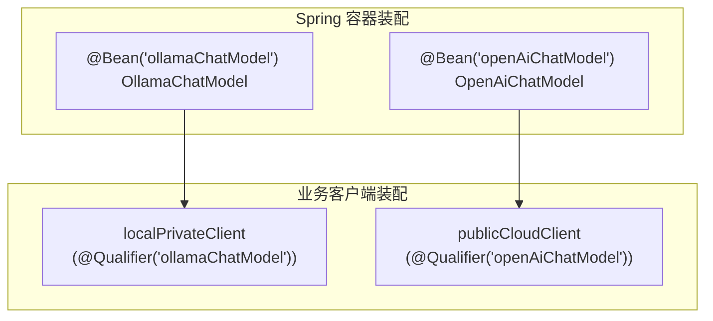

# 💬 ChatClient 与 ChatModel 核心机制深度解析

> [!abstract] 一句话总结
> `ChatModel` 是 Spring AI 针对底层大模型服务的**统一通信接口**（负责协议适配与基础请求响应），而 `ChatClient` 是面向业务层提供链式编排、拦截器挂载与结构化映射的**高阶调用门面**。

---

## 📌 架构设计：调用层双层抽象



### 1. `ChatModel`：模型驱动标准契约

`ChatModel` 继承自 `Model<Prompt, ChatResponse>` 和 `StreamingModel<Prompt, ChatResponse>`，职责聚焦于底层通信：
- **入参**：标准的 `Prompt` 对象（封装 `List<Message>` 与 `ChatOptions`）。
- **出参**：标准的 `ChatResponse`（包含模型生成的 `Generation` 结果、Token 消耗 `Usage` 以及响应元数据 `ChatResponseMetadata`）。
- **职责边界**：将标准 `Prompt` 转化为目标供应商的 HTTP 请求载荷，执行网络调用并解析返回结果。需要直接控制底层消息结构与响应元数据时，可直接调用 `ChatModel`。

### 2. `ChatClient`：业务编排门面

`ChatClient` 内部持有 `ChatModel` 引用，采用委托与建造者模式面向业务开发提供高阶能力：
- 提供链式 Fluent API（`.system(...)`、`.user(...)`、`.advisors(...)`），简化提示词组装；
- 管理 **Advisor 拦截器链**，统一执行会话记忆读写、RAG 知识检索与日志审计；
- 支持将模型输出反序列化为强类型 Java 对象（`.entity(...)`）；
- 统一提供同步阻塞调用（`.call()`）与响应式流式调用（`.stream()`）入口。

---

## 🧩 核心对象体系：Message 与 ChatOptions

Spring AI 使用统一的消息对象层次表达多轮对话结构：



### 动态参数控制：`ChatOptions`

在单次请求中，可通过 `options(...)` 覆盖全局默认采样参数：

```java
ChatOptions options = OpenAiChatOptions.builder()
        .model("gpt-4o")
        .temperature(0.2)
        .maxTokens(2000)
        .topP(0.9)
        .build();
```

---

## 💻 代码实践：ChatClient 装配与调用

### 1. 构建 ChatClient

假设模型 Starter 已正确配置、Spring 已提供 `ChatClient.Builder`。下面是片段，省略类、注入和依赖；代码尚未连接模型运行。

```java
ChatClient client = builder.defaultSystem("你是电商导购助手。").build();
String answer = client.prompt().user("推荐一台轻薄笔记本").call().content();
```

### 2. 获取不同类型的结果

`client` 已配置，`ProductRecommendation` 是应用定义的类型；调用结构化输出后仍需验证字段和业务规则。

```java
ProductRecommendation dto = client.prompt().user("推荐轻薄笔记本")
        .call().entity(ProductRecommendation.class);
ChatResponse response = client.prompt().user("介绍产品").call().chatResponse();
Flux<String> stream = client.prompt().user("介绍产品").stream().content();
```

`content()` 取文本，`chatResponse()` 可以读取响应元数据，`stream().content()` 返回增量文本。用户会话隔离与记忆配置见 [[08-ChatMemory记忆]]。


---

## ⚙️ 多模型共存与注入配置

当应用同时接入多个模型提供商（例如内部数据使用本地部署的 **Ollama**，公网业务使用 **OpenAI**）时，容器中会存在多个 `ChatModel` Bean，可通过 `@Qualifier` 分别构建对应的 `ChatClient`：



假设 `localModel` 和 `cloudModel` 已在 Spring 中分别配置和注入，以下只展示构建关系：

```java
ChatClient localClient = ChatClient.builder(localModel).build();
ChatClient cloudClient = ChatClient.builder(cloudModel).build();
```

实际注入时可使用 `@Qualifier` 区分 Bean，名称以项目配置为准。

---

## ⚠️ 生产实践与常见误区

### 1. 选择 `ChatClient` 或 `ChatModel`

`ChatClient` 可以统一配置系统提示词、Advisor 和输出转换；直接调用 `ChatModel` 不会经过这些 `ChatClient` 配置。普通业务可以优先使用 `ChatClient`，需要直接操作底层消息和响应时也可以使用 `ChatModel`。

### 2. 复用 `ChatClient` 单例 Bean

通常可以复用配置好的 `ChatClient`，请求级参数在每次调用时设置；Advisor 和工具中如果包含共享状态，仍需单独检查线程安全。

### 3. 结构化校验与分布式记忆配置

结构化输出和会话记忆分别需要检查：
- `.entity(DTO.class)` 转换成功后，业务层仍要检查必填字段和取值范围。
- 如果要求模型按 JSON Schema 输出，需要确认对应 Provider 的支持情况并配置相应选项。
- 多实例部署时，可以使用 Redis 或 JDBC 等共享 `ChatMemoryRepository`；`conversationId` 应由服务端认证并校验归属。

### 4. 采集 `ChatResponse` 中的 Token 用量指标

可以通过自定义 `Advisor` 或 Micrometer 观测机制读取 `chatResponse.getMetadata().getUsage()`，记录输入与输出 Token 用量；实际返回情况取决于模型服务。

---

## 🎯 高频面试问题

> [!question]- Q1：请从设计模式和架构分层角度，说明 Spring AI 中 `ChatClient` 与 `ChatModel` 的分工？
>   - **驱动适配层（`ChatModel`）**：采用**适配器模式（Adapter）**，定义统一的模型调用契约，将标准 `Prompt` 与 `ChatResponse` 映射到各模型厂商的 HTTP 接口与报文格式；
>   - **业务门面层（`ChatClient`）**：采用**门面模式（Facade）与建造者模式（Builder）**，面向业务开发提供链式 Fluent API，封装提示词模板渲染、结构化实体映射与流式转换；
>   - **横切增强层（`Advisor`）**：在 `ChatClient` 中集成基于责任链的 `Advisor` 机制，使会话记忆、RAG 检索、日志审计与安全过滤与核心业务代码解耦。

> [!question]- Q2：使用 `ChatClient` 接收流式响应时，底层是如何工作的？
>   底层基于 Project Reactor 响应式流规范。调用 `.stream()` 会构建响应式流，实际订阅时 `ChatModel` 与模型服务端建立流式 HTTP 连接（通常为 `text/event-stream`），将增量返回的数据块解析为 `ChatResponse` 并封装为 `Flux<ChatResponse>`。在控制器层返回 `Flux<String>` 并声明 `produces = MediaType.TEXT_EVENT_STREAM_VALUE`，即可向前端持续推送增量文本。

> [!question]- Q3：在多模型并存（如本地 Ollama + 云端 OpenAI）场景下，Spring AI 如何管理不同模型？
>   各模型 Starter 会在容器中注册对应名称的 `ChatModel` Bean。开发者可以在 `@Configuration` 配置类中通过 `@Qualifier("openAiChatModel")` 或 `@Qualifier("ollamaChatModel")` 注入指定驱动，分别构建面向不同业务场景的 `ChatClient` Bean，使上层服务使用统一的 API 完成按场景路由或主备切换。

---

## 🪝 知识复盘卡

```text
┌────────────────────────────────────────────────────────┐
│               ChatClient 与 ChatModel 复盘卡            │
├────────────────────────────────────────────────────────┤
│  1. 架构分工：ChatModel 负责协议适配；ChatClient 负责门面编排│
│  2. 核心语法：.prompt().system().user().call().content() │
│  3. 响应形态：.call() 同步阻塞；.stream() 响应式 Flux 流 │
│  4. 结构映射：.entity(DTO.class) 将 JSON 反序列化为对象  │
│  5. 横切扩展：通过 Advisor 责任链挂载记忆、RAG 与审计逻辑│
└────────────────────────────────────────────────────────┘
```

---

## 🔗 关联笔记

- [[01-Spring-AI项目搭建]] - Spring AI 工程依赖与基础配置
- [[04-流式输出-SSE]] - SSE 流式传输与 WebFlux 集成
- [[06-Function-Calling工具调用]] - 在 ChatClient 中声明与挂载工具方法
- [[07-Advisor拦截器]] - Advisor 责任链机制与自定义拦截器
- [[_index]] - 返回 Spring AI 专题索引
