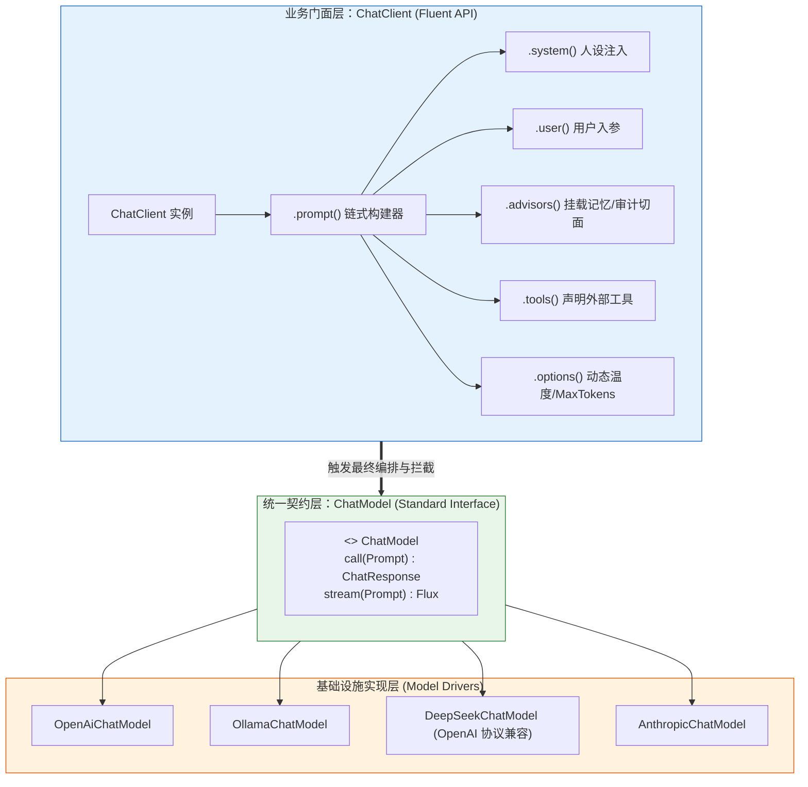
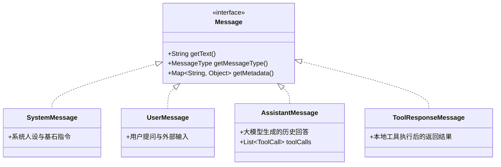
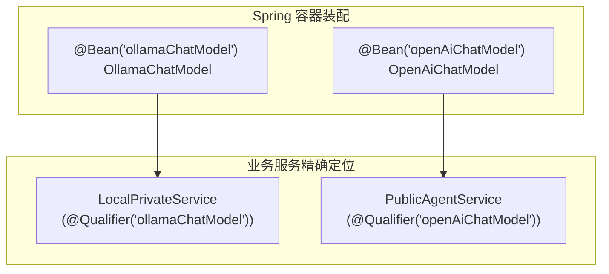

# 💬 ChatClient 与 ChatModel 核心机制深度解析

> [!abstract] 一句话总结
> `ChatModel` 是 Spring AI 针对底层大模型驱动的**通信标准接口（类比 JDBC Driver）**，而 `ChatClient` 是面向业务开发提供链式编排、拦截器挂载与结构化映射的**高级门面（类比 JdbcTemplate / WebClient）**。

---

## 🗣️ 白话版（先建立直觉）

如果让你用 Java 调大模型，最原始的做法是什么？
拿起 `HttpClient`，把模型厂商的 API Key 塞进 Header，把用户的提问序列化成特定 JSON，POST 发送过去，再把返回的 JSON 一层层剥开提取文本。

`ChatModel` 帮我们做完了这件脏活：它把 OpenAI、Azure、DeepSeek、Ollama 等各家千奇百怪的底层 HTTP 协议，统一收敛为标准接口方法：
```java
ChatResponse call(Prompt prompt);
```
但光有 `ChatModel` 依然很痛苦：你每次发消息都要手动 new `Prompt`、手动 new `UserMessage`、手写参数配置，如果要加多轮会话记忆、要记录审计日志，你得把这些胶水代码复制粘贴几十遍！

这就轮到了 **`ChatClient` 闪亮登场**！
它就像 Spring 里的 `WebClient` 或 `RestClient`，提供行云流水般的 **Fluent API（链式调用）**。你只需像说话一样链式指定 `.system(...)`、`.user(...)`、`.advisors(...)`、`.stream()`，底层自动帮你编排好所有复杂组件！

---

## 📌 第一性原理：调用层双层架构设计



### 1. `ChatModel`：模型驱动标准契约
`ChatModel` 继承自 `Model<Prompt, ChatResponse>` 和 `StreamingModel<Prompt, ChatResponse>`。它的职责极其纯粹：
- **入参**：标准的 `Prompt` 对象（封装了 `List<Message>` 和 `ChatOptions`）。
- **出参**：标准的 `ChatResponse`（包含模型生成的 `Generation` 候选结果、Token 消耗 `Usage`、元数据 `ChatResponseMetadata`）。
- **职责边界**：只负责将对象转化为对应供应商的 HTTP 报文，发送网络请求，解析响应，**不做任何业务状态管理与拦截编排**。

### 2. `ChatClient`：企业业务编排中枢
`ChatClient` 不是通过继承创建的，而是持有一个 `ChatModel` 引用的委托对象。它负责：
- 提供流畅的 DSL 链式语法；
- 管理 **Advisor 拦截器链**（实现类似 Spring AOP 的前置注入与后置切面）；
- 自动完成从 JSON 字符串到强类型 DTO 的转换（`.entity(...)`）；
- 统一隔离同步阻塞调用（`.call()`）与响应式流式推送（`.stream()`）。

---

## 🧩 核心对象体系：Message 家族与 ChatOptions

在调用底层模型时，Spring AI 构建了严密的面向对象抽象：



### 动态参数控制：`ChatOptions`
每次调用大模型时，可以通过 `options(...)` 动态覆盖全局配置：

```java
ChatOptions options = OpenAiChatOptions.builder()
        .model("gpt-4o")
        .temperature(0.2) // 严谨低温
        .maxTokens(2000)  // 最大输出上限
        .topP(0.9)
        .build();
```

---

## 💻 工业级实战：ChatClient 全功能装配

### 1. Spring Boot 注入与单例装配（推荐范式）
Spring AI 自动装配机制会在容器中注册一个 `ChatClient.Builder`。推荐在配置类中初始化领域专用的 `ChatClient` Bean：

```java
package com.example.ai.config;

import org.springframework.ai.chat.client.ChatClient;
import org.springframework.ai.chat.client.advisor.MessageChatMemoryAdvisor;
import org.springframework.ai.chat.client.advisor.SimpleLoggerAdvisor;
import org.springframework.ai.chat.memory.InMemoryChatMemory;
import org.springframework.context.annotation.Bean;
import org.springframework.context.annotation.Configuration;

@Configuration
public class AiClientConfig {

    @Bean
    public ChatClient customerServiceChatClient(ChatClient.Builder builder) {
        return builder
                // 1. 设置默认系统人设（业务基石）
                .defaultSystem("""
                    你是一家知名电商的智能导购专家。
                    回答必须礼貌专业，只推荐系统已上架商品。
                    """)
                // 2. 挂载全局默认拦截器（日志记录 + 会话记忆）
                .defaultAdvisors(
                        new SimpleLoggerAdvisor(), // 自动打印请求/响应 Token 统计
                        new MessageChatMemoryAdvisor(new InMemoryChatMemory()) // 会话上下文挂载
                )
                // 3. 设置默认生成参数
                .defaultOptions(org.springframework.ai.chat.prompt.ChatOptions.builder()
                        .temperature(0.7)
                        .build())
                .build();
    }
}
```

### 2. 业务使用：四大核心调用场景

```java
package com.example.ai.service;

import com.example.ai.dto.ProductRecommendation;
import org.springframework.ai.chat.client.ChatClient;
import org.springframework.ai.chat.model.ChatResponse;
import org.springframework.stereotype.Service;
import reactor.core.publisher.Flux;

import static org.springframework.ai.chat.client.advisor.AbstractChatMemoryAdvisor.CHAT_MEMORY_CONVERSATION_ID_KEY;

@Service
public class ShoppingAssistantService {

    private final ChatClient chatClient;

    public ShoppingAssistantService(ChatClient customerServiceChatClient) {
        this.chatClient = customerServiceChatClient;
    }

    /**
     * 场景 A：极简同步阻塞调用，提取纯文本
     */
    public String askDirectly(String question) {
        return chatClient.prompt()
                .user(question)
                .call()
                .content();
    }

    /**
     * 场景 B：结构化强类型转换，直接反序列化为 Java Record
     */
    public ProductRecommendation recommendProduct(String userRequirement) {
        return chatClient.prompt()
                .user("用户需求：" + userRequirement)
                .call()
                .entity(ProductRecommendation.class); // 底层自动推导 JSON Schema
    }

    /**
     * 场景 C：获取完整元数据与 Token 计费审计
     */
    public ChatResponse askWithMetrics(String promptText) {
        return chatClient.prompt()
                .user(promptText)
                .call()
                .chatResponse(); // 获取底层原始 ChatResponse，包含 Usage 和 Model 信息
    }

    /**
     * 场景 D：响应式流式打字机输出（用于 SSE）+ 动态指定会话 ID
     */
    public Flux<String> streamChat(String conversationId, String userMessage) {
        return chatClient.prompt()
                .user(userMessage)
                // 动态指定会话上下文 ID，Advisor 据此自动按用户隔离记忆
                .advisors(a -> a.param(CHAT_MEMORY_CONVERSATION_ID_KEY, conversationId))
                .stream()
                .content();
    }
}
```

---

## ⚙️ 多模型共存与精准路由装配

在大型企业中，往往同时存在多个模型厂商（例如：内部敏感数据走本地部署的 **Ollama/DeepSeek**，公网复杂推理走 **OpenAI/Azure**）。

Spring Boot 容器中会同时存在多个 `ChatModel` 实现类，如何精准注入？



```java
@Configuration
public class MultiModelConfig {

    @Bean
    public ChatClient localPrivateClient(@Qualifier("ollamaChatModel") ChatModel localModel) {
        return ChatClient.builder(localModel)
                .defaultSystem("你是一个完全离线运行的内部数据助手。")
                .build();
    }

    @Bean
    public ChatClient publicCloudClient(@Qualifier("openAiChatModel") ChatModel cloudModel) {
        return ChatClient.builder(cloudModel)
                .defaultSystem("你是一个面向公网的大模型网关助手。")
                .build();
    }
}
```

---

## ⚠️ 生产避坑指南与反模式

### 1. 忌：在业务层到处裸用 `ChatModel.call(new Prompt(...))`
- **缺陷**：失去 Fluent API 的优雅链式表达，无法复用预设的 Advisor 拦截链（导致日志丢漏、记忆挂载失败），业务代码充斥样板代码。
- **最佳实践**：业务代码一律面向 `ChatClient` 编程；只有在开发通用中间件或底层框架扩展时，才触碰 `ChatModel`。

### 2. 忌：每次请求都 `new ChatClient()`
- **缺陷**：`ChatClient` 是线程安全的轻量级门面对象，每次请求 `builder.build()` 会带来不必要的对象创建与元数据解析开销。
- **最佳实践**：将其作为 `@Bean` 单例托管在 Spring 容器中，每次请求调用 `.prompt()` 开启独立的流式操作。

### 3. 忌：忽略 `.chatResponse()` 中的 Usage 监控
- **教训**：很多系统上线后，只取 `.content()` 返回给前端，导致后台完全无法统计模型调用 Token 量，月底收到巨额账单时无法对账。
- **最佳实践**：挂载 `SimpleLoggerAdvisor` 或在拦截器中提取 `chatResponse.getMetadata().getUsage()` 异步推送至 Prometheus / 时序数据库。

---

## 🎯 大厂高频面试 30 秒绝杀

> [!question] 面试高频问题 3 连击
> 
> **Q1：请从设计模式和架构分层角度，谈谈 Spring AI 中 ChatClient 与 ChatModel 的设计哲学？**
> - **答（满分绝杀）**：
>   - **分层隔离**：`ChatModel` 遵循**适配器模式（Adapter）**，充当底层大模型驱动的统一标准抽象（类似 JDBC Driver），负责抹平各厂商的私有 HTTP 协议与数据载荷；
>   - **门面与构建**：`ChatClient` 遵循**门面模式（Facade）与建造者模式（Builder）**，面向业务开发者屏蔽底层组装细节，提供链式 Fluent API；
>   - **切面解耦**：`ChatClient` 引入了基于责任链的 **Advisor 机制（类似 AOP）**，使得会话记忆、审计监控、敏感词过滤与 RAG 检索可以在不侵入业务逻辑的前提下无缝插拔。
>
> **Q2：使用 ChatClient 接收流式响应时，底层是如何实现非阻塞输出的？**
> - **答（满分绝杀）**：
>   底层基于 Project Reactor 响应式流规范。调用 `.stream()` 时，`ChatModel` 会与模型服务建立 HTTP **Server-Sent Events (SSE)** 长连接。大模型吐出的每一个 Token 数据包被封装为 `Generation` 并包装在 `Flux<ChatResponse>` 中以响应式流的形式推送给调用方。在 Spring MVC / WebFlux 控制器中，直接返回 `Flux<String>` 并标注 `produces = MediaType.TEXT_EVENT_STREAM_VALUE`，即可实现端到端全链路非阻塞的打字机流式输出。
>
> **Q3：在微服务多模型（如本地私有模型 + 商业闭源模型）场景下，Spring AI 如何优雅管理？**
> - **答（满分绝杀）**：
>   Spring Boot 会根据各自 Starter 装配出带有明确命名的 `ChatModel` Bean。我们可以为不同的业务域创建对应的 `ChatClient` 单例 Bean，使用 `@Qualifier("openAiChatModel")` 或 `@Qualifier("ollamaChatModel")` 显式注入对应的驱动，既实现了模型物理隔离与配置隔离，又对上层业务暴露一致的 `ChatClient` 操作接口。

---

## 🪝 一分钟复盘记忆卡

```
┌────────────────────────────────────────────────────────┐
│               ChatClient 与 ChatModel 极速通关卡         │
├────────────────────────────────────────────────────────┤
│  1. 架构定位：ChatModel = JDBC 驱动；ChatClient = 业务门面 │
│  2. 核心语法：.prompt().system().user().call().content() │
│  3. 响应形态：.call() 同步阻塞；.stream() 响应式 Flux 流 │
│  4. 结构抽取：.entity(DTO.class) 自动实现 JSON Schema 绑定│
│  5. 扩展灵魂：Advisor 责任链机制实现记忆/日志/安全无侵入切面│
└────────────────────────────────────────────────────────┘
```

---

## 🔗 关联笔记

- [[01-Spring-AI项目搭建]] - 快速搭建最小可用 Spring AI 工程
- [[04-流式输出-SSE]] - 深入打字机流式长连接与 WebFlux 响应式集成
- [[06-Function-Calling工具调用]] - 赋予 ChatClient 挂载本地方法的能力
- [[07-Advisor拦截器]] - 掌握 Spring AI 的 AOP 切面核心机制
- [[_index]] - 返回 Spring AI 专题索引
