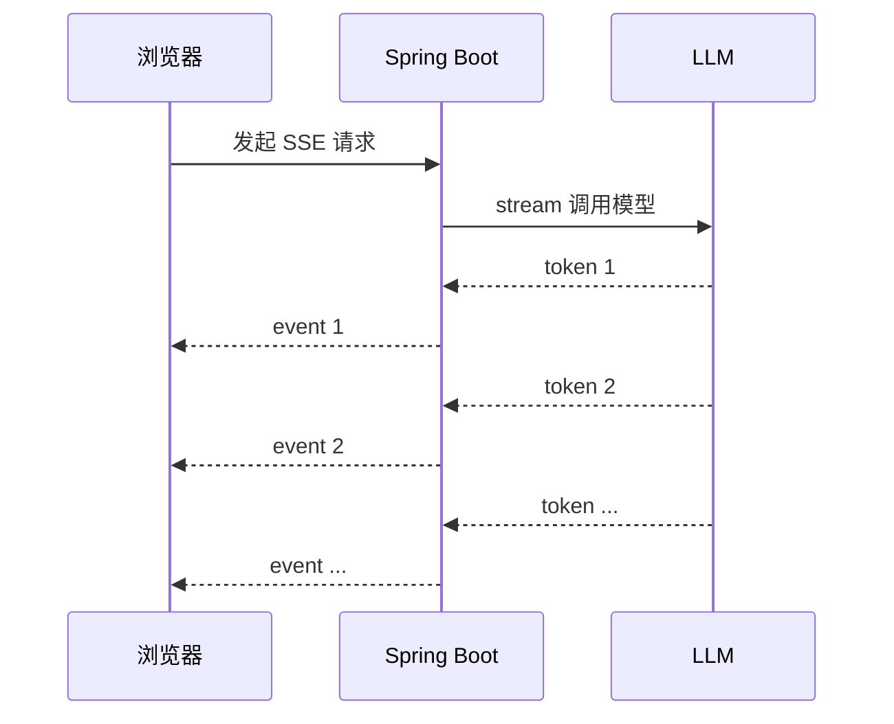

# 🌊 流式输出 SSE

> [!abstract] 一句话总结
> 流式输出把“等完整答案”改成“边生成边返回”，SSE 是 Java Web 场景里最简单稳定的文本流传输方式。

> [!info] MCP 与页面中的 SSE
> 本节使用 Web 的 `text/event-stream` 向前端发送增量内容。MCP 早期也有 HTTP + SSE 传输，后来引入 Streamable HTTP；后者在部分响应中仍可以使用 SSE。旧传输主要用于兼容已有客户端，具体见 [[../../05-Agent-MCP-Skills/09-MCP协议详解|MCP 协议]]。

## 🎯 本节定位

本节在 [[02-ChatClient与ChatModel]] 的同步调用基础上学习流式输出，示例使用 Spring WebFlux 的 `Flux`。事件循环和背压的原理见 [[../../../20-Java后端/04-Spring生态/09-WebFlux与响应式编程|WebFlux 与响应式编程]]；前端消费方式和工程注意点见下文。

## 📌 这是什么

大模型生成长答案时，如果等全部生成完再返回，用户会觉得卡。Spring AI 的 `ChatClient.stream()` 可以返回响应流，Spring WebFlux 可以把它包装成 `text/event-stream`。这里用到的 WebFlux 是 Spring 的响应式 Web 框架，`Flux<String>` 是它的响应式流类型（可理解为“可订阅的异步序列”），本节只使用其最基础用法，无需先系统学完响应式编程。



## 🤔 解决什么问题

| 普通响应 | 流式响应 |
| ---- | ---- |
| 等生成完整回答后再显示 | 通常可更早显示已有片段；实际首字时间仍受模型和网络影响 |
| 长答案容易超时 | 持续输出保持连接活跃 |
| 只能一次性展示 | 可做打字机效果 |

---

## 💻 Spring WebFlux 示例

```java
@RestController
class StreamController {

    private final ChatClient chatClient;

    StreamController(ChatClient.Builder builder) {
        this.chatClient = builder.build();
    }

    @GetMapping(value = "/chat/stream", produces = MediaType.TEXT_EVENT_STREAM_VALUE)
    Flux<String> stream(@RequestParam String message) {
        return chatClient.prompt()
                .user(message)
                .stream()
                .content();
    }
}
```

前端用 `EventSource`；浏览器默认会重连，本例在连接出错或结束时关闭连接。实际项目应定义明确的结束/错误事件，并处理取消与重复请求：

```javascript
const source = new EventSource("/chat/stream?message=解释RAG");

source.onmessage = (event) => {
  document.querySelector("#answer").textContent += event.data;
};

source.onerror = () => {
  source.close();
};
```

---

## 🧩 SSE vs WebSocket

| 维度 | SSE | WebSocket |
| ---- | ---- | ---- |
| 通信方向 | 服务端到客户端为主 | 双向 |
| 实现复杂度 | 低 | 中 |
| 适合场景 | LLM 文本流、通知 | 实时协作、双向控制 |
| HTTP 兼容 | 好 | 需要升级协议 |

AI 聊天的“模型往前端吐字”优先选 SSE；停止生成也可通过 AbortController 取消 fetch 或单独的取消接口实现；只有持续双向通信等需求再考虑 WebSocket。

## ⚙️ 工程注意点

- 检查网关或 Nginx 的响应缓冲，例如 `proxy_buffering off;`，避免片段被攒到最后才返回。
- SSE 事件中的文本片段不一定等于分词器中的一个 Token。
- 原生 `EventSource` 使用 GET 且不能自定义请求头；需要 POST 或 `Authorization` 时，可用 `fetch` 读取 `ReadableStream`。
- 断线后不要盲目重复生成，可结合 `requestId` 查询状态、去重或取消。
- 按需要审核流式内容；结束后保存完整回答，避免每个片段都写一次数据库。

---

## ✅ 学习检查点

- [ ] 能写出 `produces = MediaType.TEXT_EVENT_STREAM_VALUE`
- [ ] 能用 `ChatClient.stream().content()` 输出 `Flux<String>`
- [ ] 能说明 SSE 和 WebSocket 的区别及前端请求方式选型
- [ ] 能解释为什么流式输出能改善首字延迟体验

## ⚠️ 常见坑

- 使用 Spring MVC 返回流时，确认容器和部署环境支持相应的异步处理。
- 代理层缓冲可能让前端一次性收到全部内容。
- 流中发生错误时，前端需要能识别错误事件或结束状态。
- 通常在流结束后保存完整回答，避免每个片段都写入数据库。

## 🎯 面试速记

> [!question]- SSE 为什么适合大模型输出？
> 大模型输出天然是单向增量文本，SSE 简单、基于 HTTP、浏览器原生支持。

> [!question]- 流式接口怎么做？
> 后端用 `ChatClient.stream()` 返回 `Flux`，接口声明 `text/event-stream`，前端用 `EventSource` 消费。

## 🔗 关联阅读

- [[02-ChatClient与ChatModel]]
- [[01-Spring-AI项目搭建]]
- [[../../../20-Java后端/04-Spring生态/09-WebFlux与响应式编程]] —— Flux/事件循环/背压的原理篇
- [[../_index]]

## 📚 参考资料

- [Spring AI Chat Client Streaming](https://docs.spring.io/spring-ai/reference/api/chatclient.html)
- [Spring Framework WebFlux](https://docs.spring.io/spring-framework/reference/web/webflux.html)
- [MCP 传输方式](https://modelcontextprotocol.io/specification/2025-11-25/basic/transports)
