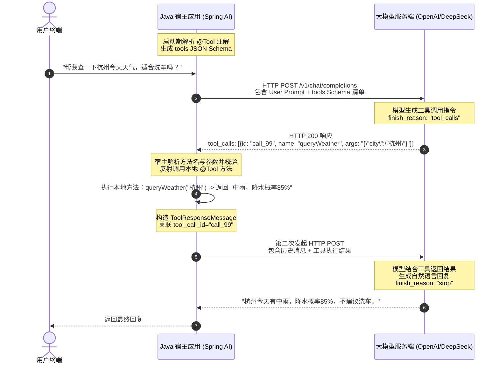
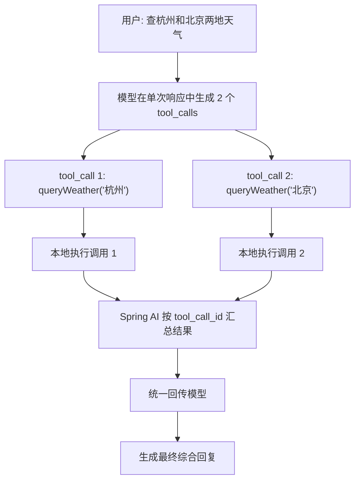

# 🛠️ Function Calling 工具调用深度机制与闭环

> [!abstract] 一句话总结
> Function Calling（工具调用）的机制是**“模型根据工具 JSON Schema 输出调用意图与参数 $\leftrightarrow$ 宿主应用在本地执行代码并回传结果”**的多轮协商闭环，用于将大模型与实时数据查询、外部 API 及业务系统连接起来。

---

## 📌 核心机制：网络协商与多轮调用时序

大模型本身运行在推理服务端，无法直接访问宿主应用的本地内存或内网数据库。Function Calling 的完整交互由宿主程序与模型通过多轮 HTTP 请求协作完成：



### 1. 工具描述 Schema 的生成与下发
Spring AI 通过反射解析标注了 `@Tool` 注解的方法签名与 `@ToolParam` 描述，自动生成符合 OpenAI 规范的 **tools JSON Schema**，随对话请求下发给模型：

```json
{
  "tools": [
    {
      "type": "function",
      "function": {
        "name": "queryWeather",
        "description": "根据城市名称查询当天的实时天气与降水情况",
        "parameters": {
          "type": "object",
          "properties": {
            "city": { "type": "string", "description": "城市中文名称，如北京、杭州" }
          },
          "required": ["city"]
        }
      }
    }
  ]
}
```

### 2. 工具执行闭环（Tool Execution Loop）
当模型返回的响应中包含 `tool_calls` 时，Spring AI 的 `ToolCallingManager` 会自动拦截该响应，根据名称匹配并调用本地 Java 方法，将方法返回值按对应的 `tool_call_id` 封装为 `ToolResponseMessage` 追加到对话历史中，再次向模型发起请求，直到模型返回普通文本（`finish_reason: "stop"`）或达到最大迭代次数上限。

---

## 💻 代码实践：Spring AI 工具定义与挂载

### 1. 定义领域业务工具（支持强类型 Record 入参）

```java
package com.example.ai.tools;

import com.fasterxml.jackson.annotation.JsonProperty;
import com.fasterxml.jackson.annotation.JsonPropertyDescription;
import lombok.extern.slf4j.Slf4j;
import org.springframework.ai.tool.annotation.Tool;
import org.springframework.ai.tool.annotation.ToolParam;
import org.springframework.stereotype.Service;

@Slf4j
@Service
public class LogisticsOrderTools {

    // 结构化入参对象
    public record OrderQueryRequest(
        @JsonProperty(required = true)
        @JsonPropertyDescription("快递运单号，如 SF10008899")
        String trackingNumber,

        @JsonPropertyDescription("是否需要包含各分拨中心流转明细，默认为 true")
        Boolean needTraceDetail
    ) {}

    public record OrderStatusResponse(
        String trackingNumber,
        String currentStatus,
        String currentLocation,
        String estimatedDeliveryTime
    ) {}

    /**
     * 使用 @Tool 注解将 Java 方法暴露为模型可调用工具
     */
    @Tool(description = "根据快递运单编号，实时查询包裹当前最新的物流轨迹与配送状态")
    public OrderStatusResponse queryOrderStatus(OrderQueryRequest request) {
        log.info("触发本地工具调用 -> 查询运单: {}, 是否含明细: {}", 
                request.trackingNumber(), request.needTraceDetail());

        // 调用内部物流微服务或数据库查询
        if ("SF10008899".equals(request.trackingNumber())) {
            return new OrderStatusResponse(
                    "SF10008899",
                    "派送中",
                    "杭州市西湖区文三路营业部",
                    "预计今天下午 16:30 前送达，派送员：张师傅（138xxxx9999）"
            );
        }
        return new OrderStatusResponse(request.trackingNumber(), "未查到相关运单信息", "未知", "无");
    }

    /**
     * 多参数工具方法（使用 @ToolParam 说明各参数含义）
     */
    @Tool(description = "计算两个网点之间的预计配送运费")
    public double calculateShippingCost(
            @ToolParam(description = "始发地城市") String fromCity,
            @ToolParam(description = "目的城市") String toCity,
            @ToolParam(description = "包裹物理重量(公斤)") double weightKg) {
        log.info("计算运费：从 {} 到 {}, 重量 {} kg", fromCity, toCity, weightKg);
        return 12.0 + Math.max(0, weightKg - 1) * 2.0;
    }
}
```

### 2. 在 ChatClient 中挂载工具并调用

```java
package com.example.ai.service;

import com.example.ai.tools.LogisticsOrderTools;
import org.springframework.ai.chat.client.ChatClient;
import org.springframework.stereotype.Service;

@Service
public class CustomerAssistantService {

    private final ChatClient chatClient;
    private final LogisticsOrderTools logisticsOrderTools;

    public CustomerAssistantService(ChatClient.Builder builder, LogisticsOrderTools logisticsOrderTools) {
        this.logisticsOrderTools = logisticsOrderTools;
        this.chatClient = builder
                .defaultSystem("你是物流智能客服助手。遇到运单与运费问题请调用工具查询真实数据，请勿凭空编造。")
                .build();
    }

    public String handleCustomerMessage(String userPrompt) {
        return chatClient.prompt()
                .user(userPrompt)
                .tools(logisticsOrderTools) // 挂载包含 @Tool 方法的 Bean 实例
                .call()
                .content();
    }
}
```

---

## ⚡ 并行工具调用（Parallel Tool Calling）

主流大模型（如 GPT-4o、Claude 3.5/3.7 Sonnet、DeepSeek-V3 等）支持**并行工具调用**。
当用户提问涉及多个独立查询（如“帮我查一下杭州和北京今天的天气”）时，模型可在单次响应中同时返回多个 `tool_calls` 项：
- `tool_call_1`: `queryWeather(city="杭州")`
- `tool_call_2`: `queryWeather(city="北京")`



> [!TIP]
> Spring AI 会将每个工具的执行结果与模型下发的 `tool_call_id` 一一对应封装为 `ToolResponseMessage`，确保多工具返回结果准确关联。

---

## ⚠️ 生产实践与安全注意事项

### 1. 明确编写工具与参数的语义描述
- **问题**：若 `@Tool(description = "...")` 或 `@ToolParam(description = "...")` 过于简略（如仅写“处理数据”），模型难以判断何时调用该工具以及如何构造参数格式。
- **建议**：在描述中清晰声明工具的适用条件、参数格式要求（如日期格式 `YYYY-MM-DD`、枚举取值范围）与返回值含义。

### 2. 工具内部执行独立的服务端权限校验
- **问题**：若工具方法直接根据模型传入的 `userId` 或 `orderId` 执行修改或删除操作，攻击者可能通过提示词注入诱导模型传入他人 ID 造成越权访问。
- **建议**：工具方法内部必须从服务端安全上下文（如 `SecurityContextHolder` 或 `ToolContext`）获取当前已认证的用户身份，校验当前用户对目标数据的访问权限，避免将用户身份标识暴露为模型可自由填写的参数。

### 3. 设置下游调用超时、幂等与熔断保护
- **建议**：工具方法调用外部 HTTP 接口或微服务时，需配置严格的连接与读取超时及异常兜底；对于写操作工具，必须设计业务幂等键，防止网络重试或模型重复调用引发重复写操作。

### 4. 限制最大工具调用迭代轮数
- **建议**：当工具返回错误或未查到数据时，模型可能反复尝试调用工具。生产环境需配置单次请求的最大工具循环次数上限，防止异常情况下无限循环消耗 Token。

---

## 🎯 高频面试问题

> [!question] 常见面试问题解析
> 
> **Q1：大模型 Function Calling 的底层交互流程是怎样的？**
> - **答**：
>   大模型本身不直接执行本地代码，完整流程由三步组成：
>   1. **注册下发 Schema**：应用启动时通过反射解析 `@Tool` 方法签名与注解，生成 JSON Schema 并在请求模型时放入 `tools` 字段；
>   2. **模型输出调用指令**：模型根据用户问题判断是否需要调用工具，若需要则返回 `finish_reason: "tool_calls"` 及包含工具名、参数 JSON 与 `tool_call_id` 的结构；
>   3. **本地执行与结果回传**：宿主框架解析参数并在本地执行对应 Java 方法，将结果封装为携带相同 `tool_call_id` 的 `ToolResponseMessage` 追加到消息历史中再次请求模型，由模型生成最终回答。
>
> **Q2：什么是并行工具调用（Parallel Tool Calling）？框架如何保证结果正确映射？**
> - **答**：
>   当用户请求包含多个独立子任务时，模型可在一次响应中返回多个 `tool_calls` 条目，每个条目带有唯一的 `id`。框架依次或并发执行对应的本地工具后，将每个返回值通过 `ToolResponseMessage` 与对应的 `tool_call_id` 绑定回传，模型据此区分各工具的执行结果并汇总回答。
>
> **Q3：在企业生产环境中落地 Tool Calling 时，如何保障安全性？**
> - **答**：
>   主要采取三项措施：
>   1. **服务端身份与权限校验**：工具内部从服务端安全上下文获取真实登录用户身份并进行行级权限校验，不信任模型传入的身份参数；
>   2. **参数合法性校验与最小权限暴露**：对模型生成的参数执行格式校验，且仅向当前任务挂载必要的工具集合；
>   3. **敏感写操作人机协同（Human-in-the-loop）**：对于支付、删除或状态变更等高风险操作，工具仅生成待审批草案，需经前端用户显式确认后再调用业务接口执行。

---

## 🪝 知识复盘卡

```
┌────────────────────────────────────────────────────────┐
│               Function Calling 复盘卡                  │
├────────────────────────────────────────────────────────┤
│  1. 职责边界：模型输出调用意图与参数，宿主应用执行代码   │
│  2. 交互三步：下发 Schema → 模型返回 Args → 本地执行回填 │
│  3. 核心注解：@Tool 声明工具方法；@ToolParam 描述参数   │
│  4. 自动闭环：框架自动管理多轮工具调用与结果回传         │
│  5. 安全规范：服务端独立鉴权、写操作幂等、高危操作需审批 │
└────────────────────────────────────────────────────────┘
```

---

## 🔗 关联笔记

- [[02-ChatClient与ChatModel]] - ChatClient 链式调用与工具挂载语法
- [[07-Advisor拦截器]] - 在模型调用链路中实现审计与安全拦截
- [[../../05-Agent-MCP-Skills/09-MCP协议详解]] - 跨进程标准化工具与上下文协议 MCP
- [[_index]] - 返回 Spring AI 专题索引
