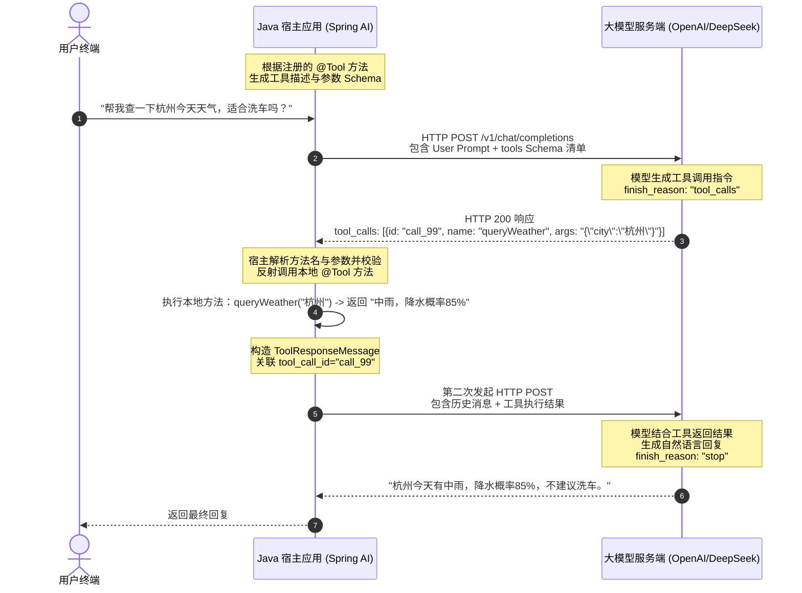
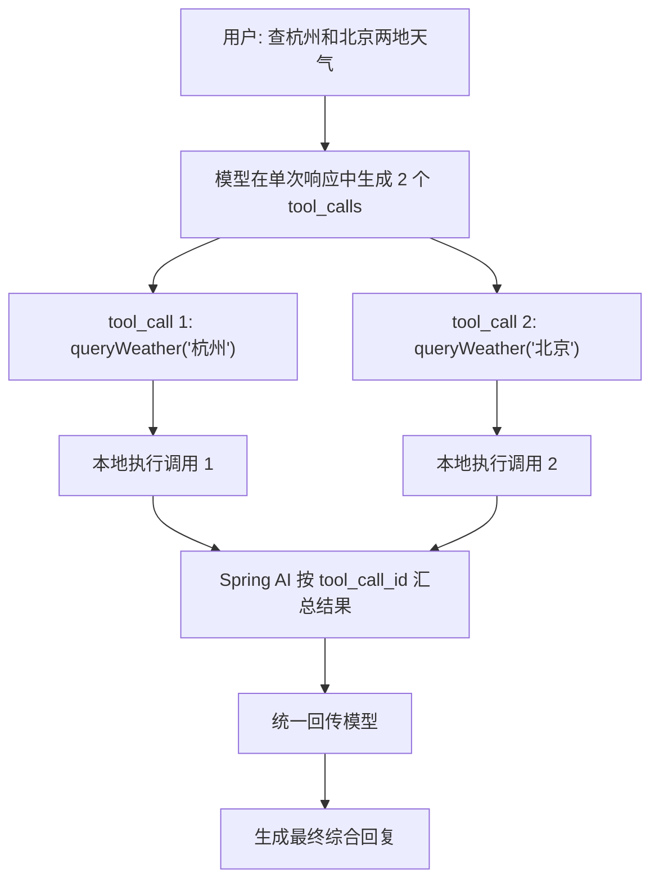

# 🛠️ Function Calling 工具调用深度机制与闭环

> [!abstract] 一句话总结
> Function Calling（工具调用）的机制是**“模型根据工具 JSON Schema 输出调用意图与参数 $\leftrightarrow$ 宿主应用在本地执行代码并回传结果”**的多轮协商闭环，用于将大模型与实时数据查询、外部 API 及业务系统连接起来。

---

## 📌 核心机制：网络协商与多轮调用时序

大模型本身运行在推理服务端，无法直接访问宿主应用的本地内存或内网数据库。Function Calling 的完整交互由宿主程序与模型通过多轮 HTTP 请求协作完成：



### 1. 工具描述 Schema 的生成与下发

Spring AI 通过反射解析标注了 `@Tool` 注解的方法签名与 `@ToolParam` 描述，生成工具描述和参数 JSON Schema，随对话请求下发给模型。下面以 OpenAI Chat Completions 风格的请求为例，不同 Provider 的协议字段可能不同：

```json
{
  "tools": [
    {
      "type": "function",
      "function": {
        "name": "queryWeather",
        "description": "根据城市名称查询当天的实时天气与降水情况",
        "parameters": {
          "type": "object",
          "properties": {
            "city": { "type": "string", "description": "城市中文名称，如北京、杭州" }
          },
          "required": ["city"]
        }
      }
    }
  ]
}
```

### 2. 工具执行闭环（Tool Execution Loop）

在 Spring AI 2.x 的 `ChatClient` 中，工具调用循环由 `ToolCallingAdvisor` 组织，`ToolCallingManager` 负责分发执行；结果加入上下文后再请求模型，直到没有工具调用或达到配置的终止条件。不同模型的协议字段和版本行为可能不同，详见 [[10-2.x工具调用循环与动态工具发现]]。

---

## 💻 代码实践：Spring AI 工具定义与挂载

### 1. 定义工具

假设 `orderService` 是应用已有的订单服务；方法只展示调用关系，省略依赖注入与权限校验，不是可直接运行的完整类。

```java
@Tool(description = "根据运单号查询物流状态")
public String queryOrderStatus(@ToolParam(description = "运单号") String trackingNumber) {
    return orderService.queryStatus(trackingNumber);
}
```

### 2. 交给 ChatClient

假设 `chatClient` 已配置、`orderTools` 是包含该方法的对象：

```java
String answer = chatClient.prompt()
        .user("运单 SF10008899 到哪了？")
        .tools(orderTools).call().content();
```

模型只提出调用请求，业务方法真正执行查询。真实场景还要由服务端校验用户对运单的访问权限；上述片段未连接物流系统运行。


---

## ⚡ 并行工具调用（Parallel Tool Calling）

部分模型可以在一次响应中请求多个工具；具体是否支持及如何配置应查询对应服务商文档。
当用户提问涉及多个独立查询（如“帮我查一下杭州和北京今天的天气”）时，模型可在单次响应中同时返回多个 `tool_calls` 项：
- `tool_call_1`: `queryWeather(city="杭州")`
- `tool_call_2`: `queryWeather(city="北京")`



> [!TIP]
> Spring AI 会将每个工具的执行结果与模型下发的 `tool_call_id` 一一对应封装为 `ToolResponseMessage`，确保多工具返回结果准确关联。

---

## ⚠️ 生产实践与安全注意事项

### 1. 明确编写工具与参数的语义描述

如果工具描述只写“处理数据”，模型难以判断何时调用。应写清适用条件、参数格式（如 `YYYY-MM-DD` 或枚举范围）和返回值含义。

### 2. 工具内部执行独立的服务端权限校验

模型传入的用户或订单 ID 不代表已经授权。工具应使用服务端认证的身份检查目标数据权限；如果通过 `ToolContext` 传递身份，也要确保该上下文由可信的服务端构造。

### 3. 设置下游调用超时、幂等与熔断保护

访问外部服务时要设置连接和读取超时，并处理异常；必要时配置熔断。写操作还需要业务幂等键，避免重试或模型重复调用导致重复写入。

### 4. 限制最大工具调用迭代轮数

工具失败或查不到数据时，模型可能反复尝试。应设置单次请求的工具调用轮数上限，避免持续消耗 Token。

---

## 🎯 高频面试问题

> [!question]- Q1：大模型 Function Calling 的底层交互流程是怎样的？
>   大模型本身不直接执行本地代码，完整流程由三步组成：
>   1. **注册下发 Schema**：框架通过反射解析 `@Tool` 方法签名与注解，生成 JSON Schema 并在请求模型时放入 `tools` 字段；
>   2. **模型输出调用指令**：模型根据用户问题判断是否需要调用工具，若需要则返回 `finish_reason: "tool_calls"` 及包含工具名、参数 JSON 与 `tool_call_id` 的结构；
>   3. **本地执行与结果回传**：宿主框架解析参数并在本地执行对应 Java 方法，将结果封装为携带相同 `tool_call_id` 的 `ToolResponseMessage` 追加到消息历史中再次请求模型，由模型生成最终回答。

> [!question]- Q2：什么是并行工具调用（Parallel Tool Calling）？框架如何保证结果正确映射？
>   当用户请求包含多个独立子任务时，模型可在一次响应中返回多个 `tool_calls` 条目，每个条目带有唯一的 `id`。框架依次或并发执行对应的本地工具后，将每个返回值通过 `ToolResponseMessage` 与对应的 `tool_call_id` 绑定回传，模型据此区分各工具的执行结果并汇总回答。

> [!question]- Q3：在企业生产环境中落地 Tool Calling 时，如何保障安全性？
>   主要采取三项措施：
>   1. **服务端身份与权限校验**：工具内部从服务端安全上下文获取真实登录用户身份并进行行级权限校验，不信任模型传入的身份参数；
>   2. **参数合法性校验与最小权限暴露**：对模型生成的参数执行格式校验，且仅向当前任务挂载必要的工具集合；
>   3. **敏感写操作人机协同（Human-in-the-loop）**：对于支付、删除或状态变更等高风险操作，工具仅生成待审批草案，需经前端用户显式确认后再调用业务接口执行。

---

## 🪝 知识复盘卡

```text
┌────────────────────────────────────────────────────────┐
│               Function Calling 复盘卡                  │
├────────────────────────────────────────────────────────┤
│  1. 职责边界：模型输出调用意图与参数，宿主应用执行代码   │
│  2. 交互三步：下发 Schema → 模型返回 Args → 本地执行回填 │
│  3. 核心注解：@Tool 声明工具方法；@ToolParam 描述参数   │
│  4. 自动闭环：框架自动管理多轮工具调用与结果回传         │
│  5. 安全规范：服务端独立鉴权、写操作幂等、高危操作需审批 │
└────────────────────────────────────────────────────────┘
```

---

## 🔗 关联笔记

- [[02-ChatClient与ChatModel]] - ChatClient 链式调用与工具挂载语法
- [[07-Advisor拦截器]] - 在模型调用链路中实现审计与安全拦截
- [[../../05-Agent-MCP-Skills/09-MCP协议详解]] - 跨进程标准化工具与上下文协议 MCP
- [[_index]] - 返回 Spring AI 专题索引
