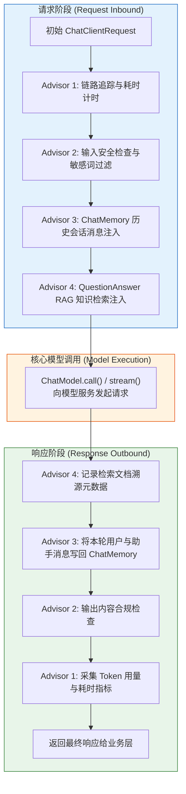

# 🧭 Advisor 拦截器机制与切面编排

> [!abstract] 一句话总结
> `Advisor` 是 Spring AI 专为大模型交互设计的**请求/响应责任链拦截机制**，支持以非侵入方式在请求发送前执行会话记忆注入、RAG 知识检索与参数改写，在响应返回后执行耗时统计、Token 审计与安全过滤。

---

## 📌 核心机制：Advisor 责任链执行模型

`Advisor` 采用与 AOP 环绕通知（Around Advice）相似的责任链设计，但专门针对模型请求（`ChatClientRequest`）与响应（`ChatClientResponse`）建模：



### 两种拦截接口

`CallAdvisor` 拦截同步调用，`StreamAdvisor` 拦截流式调用。两者都接收当前请求和责任链，分别返回普通响应和响应流：

```java
ChatClientResponse adviseCall(ChatClientRequest request, CallAdvisorChain chain);
Flux<ChatClientResponse> adviseStream(ChatClientRequest request, StreamAdvisorChain chain);
```

自定义拦截器通常同时实现这两个接口，以确保业务层无论调用 `.call()` 还是 `.stream()` 都能执行一致的横切逻辑。

### 请求级上下文传递：`context`

在责任链各节点之间传递动态参数（如会话 ID `conversationId`、租户标识 `tenantId`），可通过 `ChatClientRequest.context()` 维护的请求级键值对实现（在响应式流或异步执行场景下，建议存入不可变对象以保证并发安全）：

```java
// 假设 chatClient 已配置，用户与租户身份来自服务端
String result = chatClient.prompt().user("你好")
        .advisors(a -> a.param("tenantId", tenantId))
        .call().content();
```

---

## 🧩 常用内置 Advisor

| 内置 Advisor | 所属领域 | 核心职责 |
| :--- | :--- | :--- |
| **`MessageChatMemoryAdvisor`** | 会话记忆 | 将历史对话以结构化 `List<Message>` 形式注入请求，并在响应完成后将新增消息写回 `ChatMemory` |
| **`PromptChatMemoryAdvisor`（1.x 提供，2.0 已移除）** | 会话记忆 | 将历史消息拼接为纯文本注入系统提示词模板变量中 |
| **`QuestionAnswerAdvisor`** | 检索增强 (RAG) | 将用户问题向量化后在 `VectorStore` 中检索相似文档，并将检索结果拼接至上下文 |
| **`SimpleLoggerAdvisor`** | 调试日志 | 打印请求 Prompt 与响应内容，适用于开发调试阶段 |
| **`SafeGuardAdvisor`** | 安全过滤 | 校验输入是否包含预设敏感词，命中时直接阻断请求并返回预设提示文案 |

---

## 💻 代码实践：自定义耗时审计 Advisor

下面以同步调用为例，展示自定义 `CallAdvisor` 的核心方法；省略类声明、`getName()`、`getOrder()` 和日志配置，未在本机运行。

```java
public ChatClientResponse adviseCall(ChatClientRequest request, CallAdvisorChain chain) {
    long start = System.nanoTime();
    try { return chain.nextCall(request); }
    finally { log.info("耗时：{} ns", System.nanoTime() - start); }
}
```

若还需要拦截 `.stream()`，应另外实现 `StreamAdvisor`，在订阅、结束、错误和取消时处理统计，不能只统计创建流对象的耗时。

### 在 ChatClient 中挂载 Advisor

假设 `auditAdvisor`、`chatMemory` 已创建：

```java
ChatClient client = builder.defaultAdvisors(auditAdvisor,
        MessageChatMemoryAdvisor.builder(chatMemory).build()).build();
```

实际顺序由 Advisor 的 `getOrder()` 决定，敏感内容的权限和脱敏需要在各自数据进入链路时处理。

---

## ⚠️ 工程注意事项

### 1. 合理规划 `getOrder()` 执行顺序与数据边界

`getOrder()` 的值越小，请求阶段越早执行，响应阶段越晚返回。输入过滤只能检查当时已有的内容；后续注入的历史消息、检索片段和工具结果也需要在各自环节检查权限与敏感信息。一次调用的处理顺序可以这样安排：

```text
审计计时 → 输入检查 → 记忆注入 → 检索注入 → 模型调用 → 输出检查
```

### 2. 避免在 Advisor 中执行长耗时同步阻塞操作

`Advisor` 位于模型调用路径上，流式响应中的同步阻塞 I/O 可能阻塞事件循环。规则配置可以按需缓存，审计日志和指标可以使用异步或非阻塞方式上报。

### 3. 显式传入 `conversationId`

使用 `MessageChatMemoryAdvisor` 时，在请求中通过 `.advisors(a -> a.param(ChatMemory.CONVERSATION_ID, id))` 传入会话标识，并在服务端校验会话归属。不同版本省略该参数时可能报错或使用默认会话，不能依赖默认值实现用户隔离。

---

## 🎯 高频面试问题

> [!question]- Q1：Spring AI 中的 `Advisor` 机制是如何设计的？它与传统的 Spring AOP 有什么区别？
>   - **设计模式**：`Advisor` 采用**责任链模式（Chain of Responsibility）**，通过 `CallAdvisor` 和 `StreamAdvisor` 接口分别对同步调用和 Project Reactor 响应式流提供环绕拦截能力；
>   - **与 Spring AOP 的区别**：传统 Spring AOP 基于动态代理拦截通用 Java 方法调用（`MethodInvocation`）；而 `Advisor` 是面向大模型调用生命周期的专用拦截链，直接操作 `ChatClientRequest`（包含 `Prompt`、参数与上下文 Map）与 `ChatClientResponse`，便于对提示词、历史消息、检索上下文及流式响应块进行结构化改写与观测。

> [!question]- Q2：`MessageChatMemoryAdvisor` 与旧版 `PromptChatMemoryAdvisor`（2.0 已移除）有什么区别？
>   - **`MessageChatMemoryAdvisor`**：保持多轮对话的原生的角色结构，将历史记录作为独立的 `UserMessage`、`AssistantMessage` 列表注入 `Prompt`，符合现代聊天模型的消息对齐规范；
>   - **`PromptChatMemoryAdvisor`**：将历史消息拼接为一段纯文本字符串并填入系统提示词占位符中，会丢失结构化的消息角色边界，因此在 Spring AI 2.0 中已被移除。

> [!question]- Q3：在流式输出（SSE）场景下，自定义 `StreamAdvisor` 如何准确记录耗时与采集 Token 用量？
>   在 `adviseStream(...)` 中使用 `Flux.defer()` 记录起始时间，并通过 Reactor 的 `.doFinally(signal -> ...)` 统一处理流正常完成（`ON_COMPLETE`）、异常（`ON_ERROR`）和客户端取消（`CANCEL`）时的收尾统计。采集 Token 用量（`Usage`）时，应从流式响应块中携带元数据的最后一个有效 `ChatClientResponse` 提取，避免将多个分块的累计统计值重复相加。

---

## 🪝 知识复盘卡

```text
┌────────────────────────────────────────────────────────┐
│               Advisor 拦截器 复盘卡                     │
├────────────────────────────────────────────────────────┤
│  1. 架构定位：面向模型请求与响应流的专用责任链拦截机制   │
│  2. 核心接口：CallAdvisor (同步) + StreamAdvisor (流式)│
│  3. 排序规则：按 getOrder() 决定外层与内层的环绕执行次序│
│  4. 参数传递：通过 ChatClientRequest.context() 透传上下文│
│  5. 核心价值：解耦会话记忆、RAG 检索、安全检查与监控审计│
└────────────────────────────────────────────────────────┘
```

---

## 🔗 关联笔记

- [[02-ChatClient与ChatModel]] - ChatClient 链式调用与 Advisor 挂载方式
- [[08-ChatMemory记忆]] - 多轮会话记忆的窗口管理与持久化存储
- [[09-VectorStore向量存储]] - QuestionAnswerAdvisor 底层的向量检索机制
- [[_index]] - 返回 Spring AI 专题索引
