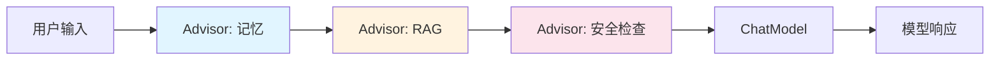

# 🧭 Advisor 拦截器

> [!abstract] 一句话总结
> Advisor 是 Spring AI 的对话增强链：在模型调用前后插入记忆、RAG、日志、Guardrail 等横切能力。

## 🎯 本节定位

- **本章第 7 课，链路增强**。前置：[[02-ChatClient与ChatModel]] 的调用链；本节把记忆、RAG、安全、日志统一成可组合的 Advisor 链。
- **延伸**：记忆与向量检索的具体实现在 [[08-ChatMemory记忆]]、[[09-VectorStore向量存储]]。

## 📌 这是什么

`Advisor` 类似 AI 调用链里的拦截器。它可以在 `ChatClient` 调用过程中改写请求、补充上下文、读取响应或记录观测数据。



## 🤔 解决什么问题

如果没有 Advisor，很多逻辑会散落在业务代码里：每次手动拼历史消息、手动查向量库、手动加安全提示、每个 Controller 都写日志和指标。

Advisor 把这些横切逻辑收敛成可组合的链。

---

## 🧩 常见内置场景

| Advisor 类型 | 作用 |
| ---- | ---- |
| Chat Memory Advisor | 自动注入对话历史 |
| Question Answer Advisor | 基于 VectorStore 做 RAG |
| Safe Guard / 自定义 Advisor | 安全过滤、输出约束 |
| Logging / Observability Advisor | 请求响应记录、指标采集 |

> [!note] 记忆和 RAG 都可以理解成 Advisor
> 它们本质上都是在模型调用前给 Prompt 补上下文，只是上下文来源不同。

---

## 💻 示例：组合记忆和 RAG

```java
// chatMemory 的构造见 08 课（2.0：MessageWindowChatMemory + ChatMemoryRepository）
ChatClient client = ChatClient.builder(chatModel)
        .defaultAdvisors(
                MessageChatMemoryAdvisor.builder(chatMemory).build(),
                QuestionAnswerAdvisor.builder(vectorStore).build()
        )
        .build();

// 2.0 起记忆类 Advisor 必须显式传 conversationId，否则抛 IllegalArgumentException：
String answer = client.prompt()
        .user("继续解释刚才那个概念，并引用知识库内容")
        .advisors(a -> a.param(ChatMemory.CONVERSATION_ID, "user-1001"))
        .call()
        .content();
```

也可以在单次调用时添加：

```java
String answer = chatClient.prompt()
        .user(question)
        .advisors(QuestionAnswerAdvisor.builder(vectorStore).build())
        .call()
        .content();
```

---

## ⚙️ 设计原则

| 原则 | 说明 |
| ---- | ---- |
| 顺序要明确 | 先记忆还是先 RAG 会影响 Prompt |
| 保持可观测 | Advisor 修改了什么上下文要能追踪 |
| 不要塞太多 | 每个 Advisor 都可能增加 Token |
| 横切逻辑才放 Advisor | 具体业务流程仍放 Service |

推荐顺序：

```text
输入规范化
  → 记忆注入
  → RAG 检索
  → 安全/权限上下文
  → 模型调用
  → 响应记录/后处理
```

---

## ✅ 学习检查点

- [ ] 能解释 Advisor 类似拦截器
- [ ] 能说出 Memory Advisor 和 RAG Advisor 的作用
- [ ] 能说明 Advisor 顺序为什么重要
- [ ] 能判断哪些逻辑适合放 Advisor

## ⚠️ 常见坑

- [ ] **Advisor 过多**：Prompt 膨胀，成本和延迟上升。
- [ ] **顺序混乱**：后面的 Advisor 覆盖前面的上下文。
- [ ] **业务逻辑塞进 Advisor**：会让调用链难调试。
- [ ] **无日志**：不知道最终给模型的上下文是什么。

## 🎯 面试速记

> - **Q: Advisor 是什么？**
>   - A: Spring AI ChatClient 的调用链增强机制，用于在模型调用前后注入记忆、RAG、安全、日志等横切能力。
> - **Q: Advisor 和 Filter 有什么像？**
>   - A: 都是链式拦截，只是 Advisor 面向 AI Prompt / Response。

## 🔗 关联阅读

- [[08-ChatMemory记忆]]
- [[09-VectorStore向量存储]]
- [[06-Function-Calling工具调用]]
- [[10-AI应用开发/02-框架-SpringAI与LangChain4j/_index]]

## 📚 参考资料

- [Spring AI Advisors API](https://docs.spring.io/spring-ai/reference/api/advisors.html)

