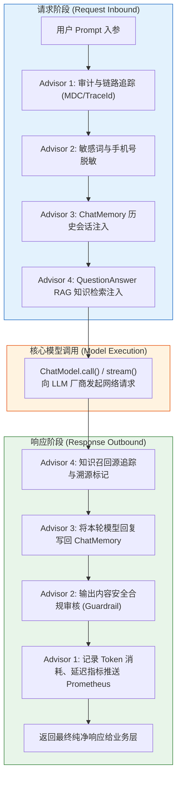

# 🧭 Advisor 拦截器：Spring AI 的 AOP 灵魂

> [!abstract] 一句话总结
> Advisor 是 Spring AI 在大模型交互生命周期中的**责任链环绕切面（AOP Around Advice）**，它以非侵入的方式，在请求发送前完成会话记忆注入、RAG 知识召回与脱敏，在响应返回后完成 Token 审计、敏感内容拦截与指标统计。

---

## 🗣️ 白话版（先建立直觉）

在传统的 Spring MVC 网站中，当一个用户请求打进来，我们是怎么处理登录鉴权、慢请求日志和接口计费的？
你肯定**不会**在每个 Controller 方法的第一行手写 `checkLogin()`，最后一行手写 `logCost()`，而是使用 **Filter（过滤器）** 或 **Spring AOP（环绕切面）**。

在大模型应用中，横切关注点更加密集且复杂：
- 发送给大模型之前：要不要偷偷翻看前 5 轮历史聊天塞进 Prompt？要不要拿用户的问题去向量数据库查知识库？要不要把用户填写的手机号和身份证脱敏？
- 大模型返回之后：花了多少 Token？这次 API 耗时多久？模型吐出来的内容有没有违规词汇？

如果把这些代码全写在业务 Service 里，你的代码很快就会变成一坨无法维护的意面泥潭！
**Advisor 就是 Spring AI 赋予我们的“大模型专用 AOP 切面”**。它像洋葱圈一样把底层模型包在最核心，任何请求和流式响应都要穿过这一层层 Advisor 拦截器！

---

## 📌 第一性原理：Advisor 责任链与洋葱圈模型



### 两种核心拦截机制
Spring AI 为同步调用和响应式流式调用分别设计了抽象接口：

1. **`CallAroundAdvisor`（同步阻塞调用拦截）**：
   ```java
   AdvisedResponse aroundCall(AdvisedRequest advisedRequest, CallAroundAdvisorChain chain);
   ```
2. **`StreamAroundAdvisor`（响应式流拦截）**：
   ```java
   Flux<AdvisedResponse> aroundStream(AdvisedRequest advisedRequest, StreamAroundAdvisorChain chain);
   ```

两者通常由同一个类同时实现，以便无论业务端调用 `.call()` 还是 `.stream()`，拦截逻辑都能无缝生效。

### 上下文参数透传：`adviseContext`
在拦截链各环节之间传递动态业务上下文（如 `conversationId`、当前用户的 `userId`、租户 `tenantId`），依靠的是 `AdvisedRequest.adviseContext()`（一个线程安全的上下文 Map）：
```java
// 业务调用端传参
chatClient.prompt()
    .advisors(a -> a.param("tenantId", "tenant_001"))
    ...
```

---

## 🧩 内置 Advisor 全家桶矩阵

Spring AI 官方开箱即用地提供了大量高品质 Advisor：

| 内置 Advisor | 属于领域 | 核心职责 |
| :--- | :--- | :--- |
| **`MessageChatMemoryAdvisor`** | 会话记忆 | 以原生 `List<Message>` 结构在 System 之后注入历史多轮消息并持久化 |
| **`PromptChatMemoryAdvisor`** | 会话记忆 | 将历史记录渲染为纯文本拼入特定 Prompt 模板变量中 |
| **`QuestionAnswerAdvisor`** | 检索增强 (RAG) | 自动将用户问题向量化并在 `VectorStore` 检索相关文档，拼入系统上下文 |
| **`SimpleLoggerAdvisor`** | 可观测性 | 打印发出前的完整 Prompt 文本与返回后的完整 Token/耗时指标 |
| **`SafeGuardAdvisor`** | 安全风控 | 拦截检测敏感黑名单词汇，触发时阻断大模型调用并返回预设合规文案 |

---

## 💻 工业级实战：手写企业级“脱敏+Token审计”自定义 Advisor

在真实的金融、电商或政企系统中，脱敏和精确计费是上线硬性指标。下面我们手写一个兼顾**同步与流式**的高性能企业级 Advisor：

```java
package com.example.ai.advisor;

import lombok.extern.slf4j.Slf4j;
import org.springframework.ai.chat.client.advisor.api.*;
import org.springframework.ai.chat.model.ChatResponse;
import org.springframework.core.Ordered;
import org.springframework.stereotype.Component;
import reactor.core.publisher.Flux;

import java.time.Duration;
import java.time.Instant;
import java.util.regex.Pattern;

@Slf4j
@Component
public class SecurityAuditAdvisor implements CallAroundAdvisor, StreamAroundAdvisor, Ordered {

    // 手机号脱敏正则匹配
    private static final Pattern PHONE_PATTERN = Pattern.compile("1[3-9]\\d{9}");

    @Override
    public int getOrder() {
        // 优先级设置：最高优先级（数值越小越靠前执行），最先脱敏，最后审计统计
        return Ordered.HIGHEST_PRECEDENCE + 10;
    }

    @Override
    public String getName() {
        return "SecurityAuditAdvisor";
    }

    /**
     * 1. 拦截同步阻塞调用 (.call())
     */
    @Override
    public AdvisedResponse aroundCall(AdvisedRequest advisedRequest, CallAroundAdvisorChain chain) {
        Instant startTime = Instant.now();
        
        // 前置处理：对用户提问中的手机号执行脱敏
        AdvisedRequest sanitizedRequest = maskSensitiveData(advisedRequest);

        log.info("[AI Audit] 准备发起模型调用，已完成敏感数据合规脱敏");

        // 驱动责任链向下传递，调用模型
        AdvisedResponse advisedResponse = chain.nextAroundCall(sanitizedRequest);

        // 后置处理：统计耗时与 Token 消耗
        long costMs = Duration.between(startTime, Instant.now()).toMillis();
        ChatResponse chatResponse = advisedResponse.response();
        if (chatResponse != null && chatResponse.getMetadata() != null) {
            var usage = chatResponse.getMetadata().getUsage();
            log.info("[AI Audit] 调用完成！耗时: {}ms, 输入Token: {}, 输出Token: {}, 总计: {}",
                    costMs, usage.getPromptTokens(), usage.getGenerationTokens(), usage.getTotalTokens());
        }

        return advisedResponse;
    }

    /**
     * 2. 拦截响应式流式输出 (.stream())
     */
    @Override
    public Flux<AdvisedResponse> aroundStream(AdvisedRequest advisedRequest, StreamAroundAdvisorChain chain) {
        Instant startTime = Instant.now();
        AdvisedRequest sanitizedRequest = maskSensitiveData(advisedRequest);

        log.info("[AI Audit Stream] 流式连接建立，已脱敏");

        // 响应式流增强：在流结束 (doOnComplete) 或报错 (doOnError) 时记录耗时
        return chain.nextAroundStream(sanitizedRequest)
                .doOnComplete(() -> {
                    long costMs = Duration.between(startTime, Instant.now()).toMillis();
                    log.info("[AI Audit Stream] 流式打字机推送完毕，总耗时: {}ms", costMs);
                })
                .doOnError(e -> log.error("[AI Audit Stream] 流式推送异常中断: {}", e.getMessage()));
    }

    /**
     * 私有脱敏工具方法：重写 AdvisedRequest
     */
    private AdvisedRequest maskSensitiveData(AdvisedRequest original) {
        String originalPrompt = original.userText();
        if (originalPrompt == null || originalPrompt.isBlank()) {
            return original;
        }
        // 将手机号替换为 [手机号脱敏]
        String maskedPrompt = PHONE_PATTERN.matcher(originalPrompt).replaceAll("[手机号脱敏]");

        // 使用 Builder 模式重建不可变 AdvisedRequest
        return AdvisedRequest.from(original)
                .userText(maskedPrompt)
                .build();
    }
}
```

### 在业务 ChatClient 中挂载使用

```java
@Configuration
public class ChatClientConfig {

    @Bean
    public ChatClient enterpriseChatClient(
            ChatClient.Builder builder,
            SecurityAuditAdvisor auditAdvisor,
            ChatMemory chatMemory,
            VectorStore vectorStore) {

        return builder
                .defaultSystem("你是企业内部智能助理。")
                .defaultAdvisors(
                        auditAdvisor, // 顺序 1：最外层做脱敏与审计
                        MessageChatMemoryAdvisor.builder(chatMemory).build(), // 顺序 2：注入历史记忆
                        QuestionAnswerAdvisor.builder(vectorStore).build()    // 顺序 3：注入知识库
                )
                .build();
    }
}
```

---

## ⚠️ 生产避坑指南与致命陷阱

### 1. 致命缺陷：Advisor 顺序混乱引发逻辑错乱
- **惨案案例**：如果把 `QuestionAnswerAdvisor`（RAG 知识检索）放在 `SecurityAuditAdvisor`（脱敏）之前执行，用户输入的明文身份证/手机号就会**带着明文去向量数据库里检索并留在检索日志中**！
- **治理铁律**：严格实现 `Ordered` 接口，执行次序必须遵循：
  $$\text{审计/MDC} \to \text{输入脱敏} \to \text{记忆注入} \to \text{RAG知识注入} \to \text{模型调用} \to \text{输出安全审核}$$

### 2. 性能隐患：在 Advisor 中执行重度同步阻塞 IO
- 如果在自定义 Advisor 中做远程 HTTP 接口调用（如远程黑名单接口），且没有设置严密超时，每次模型调用都会被平白无故卡顿几百毫秒。
- **对策**：黑名单与词表本地缓存化，远程审计日志异步投递（如通过 Disruptor 或 Kafka 异步线程池发送）。

### 3. 上下文灾难：动态参数遗漏 `conversationId`
- Spring AI 2.0+ 对 `MessageChatMemoryAdvisor` 做了严格断言：若未在单次调用传 `conversationId`，底层会直接抛出 `IllegalArgumentException`，防止多用户记忆串台！
- **排查**：在 Controller 层的 `.advisors(a -> a.param(ChatMemory.CONVERSATION_ID, id))` 必须作为必须参数传递。

---

## 🎯 大厂高频面试 30 秒绝杀

> [!question] 面试高频问题 3 连击
> 
> **Q1：Spring AI 中的 Advisor 机制是如何设计的？它与传统的 Spring AOP 有什么异同？**
> - **答（满分绝杀）**：
>   - **设计范式**：Advisor 采用了**责任链模式（Chain of Responsibility）与环绕切面（Around Advice）**。通过抽象出 `CallAroundAdvisor` 和 `StreamAroundAdvisor`，分别拦截同步阻塞与 Project Reactor 响应式流；
>   - **与传统 AOP 异同**：传统 AOP 拦截的是通用的 Java 方法签名，而 Advisor 是**专为 LLM 生成领域建模的语义切面**。它的输入输出是语义明确的 `AdvisedRequest`（Prompt、Options、Context）和 `AdvisedResponse`（ChatResponse、Flux），天然支持对 Prompt 的动态改写、记忆挂载与打字机流式异步监听。
>
> **Q2：Spring AI 官方为什么同时提供 MessageChatMemoryAdvisor 和 PromptChatMemoryAdvisor？两者有何取舍？**
> - **答（满分绝杀）**：
>   - **MessageChatMemoryAdvisor**：保留原生对话角色结构，将历史轮次作为独立的 `List<Message>`（多条 UserMessage 和 AssistantMessage）塞入请求。优点是符合模型对话对齐格式，保留消息元数据；
>   - **PromptChatMemoryAdvisor**：将历史记录扁平化拼接为一大串纯文本字符串，通过占位符替换进系统 Prompt。优点是适用于只接受单条提示词模板的传统场景或完成特殊格式定制，但损失了结构化角色的语义纯度。
>
> **Q3：在微服务高并发流式输出（SSE）场景下，Advisor 是如何拦截并统计 Token 消耗的？**
> - **答（满分绝杀）**：
>   流式拦截通过 `aroundStream(...)` 返回 `Flux<AdvisedResponse>`。由于流式传输是逐个 Token 异步发射的，Advisor 可以在 Reactor 管道上通过操作符（如 `.doOnNext()`、`.doOnComplete()`）在不阻塞下发的前提下完成切面监控。许多模型服务会在最后一个 chunk 或响应结束元数据中附带真实的 Token Usage，Advisor 在流结束回调中提取该元数据即可实现异步审计入库。

---

## 🪝 一分钟复盘记忆卡

```
┌────────────────────────────────────────────────────────┐
│               Advisor 拦截器 极速通关卡                 │
├────────────────────────────────────────────────────────┤
│  1. 架构定位：大模型交互生命周期的专用 AOP 环绕切面     │
│  2. 双核接口：CallAround (同步) + StreamAround (响应式)│
│  3. 洋葱顺序：审计脱敏最先进最后出，记忆与 RAG 居中     │
│  4. 参数传递：依靠 AdvisedRequest.adviseContext() 容器 │
│  5. 核心价值：业务代码零侵入，解耦记忆、风控与计量     │
└────────────────────────────────────────────────────────┘
```

---

## 🔗 关联笔记

- [[02-ChatClient与ChatModel]] - ChatClient 的 Fluent API 与全局/单次 Advisor 挂载
- [[08-ChatMemory记忆]] - 深入多轮会话记忆的底层存储与窗口淘汰
- [[09-VectorStore向量存储]] - QuestionAnswerAdvisor 底层的向量检索机制
- [[_index]] - 返回 Spring AI 专题索引
