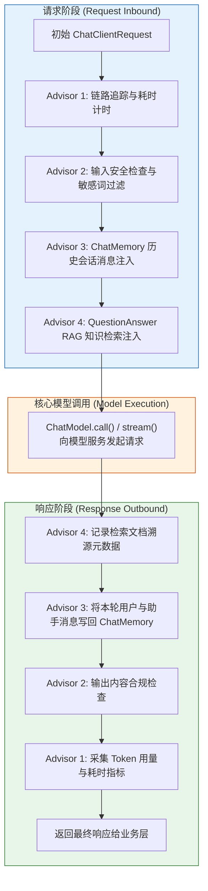

# 🧭 Advisor 拦截器机制与切面编排

> [!abstract] 一句话总结
> `Advisor` 是 Spring AI 专为大模型交互设计的**请求/响应责任链拦截机制**，支持以非侵入方式在请求发送前执行会话记忆注入、RAG 知识检索与参数改写，在响应返回后执行耗时统计、Token 审计与安全过滤。

---

## 📌 核心机制：Advisor 责任链执行模型

`Advisor` 采用与 AOP 环绕通知（Around Advice）相似的责任链设计，但专门针对模型请求（`ChatClientRequest`）与响应（`ChatClientResponse`）建模：



### 两种拦截接口
Spring AI 针对同步调用和流式调用分别提供了对应的拦截接口：

1. **`CallAdvisor`（同步调用拦截）**：
   ```java
   ChatClientResponse adviseCall(ChatClientRequest chatClientRequest, CallAdvisorChain callAdvisorChain);
   ```
2. **`StreamAdvisor`（响应式流式拦截）**：
   ```java
   Flux<ChatClientResponse> adviseStream(ChatClientRequest chatClientRequest, StreamAdvisorChain streamAdvisorChain);
   ```

自定义拦截器通常同时实现这两个接口，以确保业务层无论调用 `.call()` 还是 `.stream()` 都能执行一致的横切逻辑。

### 请求级上下文传递：`context`
在责任链各节点之间传递动态参数（如会话 ID `conversationId`、租户标识 `tenantId`），可通过 `ChatClientRequest.context()` 维护的请求级键值对实现（在响应式流或异步执行场景下，建议存入不可变对象以保证并发安全）：
```java
// 业务调用端传入上下文参数
chatClient.prompt()
    .advisors(a -> a.param("tenantId", "tenant_001"))
    ...
```

---

## 🧩 常用内置 Advisor

| 内置 Advisor | 所属领域 | 核心职责 |
| :--- | :--- | :--- |
| **`MessageChatMemoryAdvisor`** | 会话记忆 | 将历史对话以结构化 `List<Message>` 形式注入请求，并在响应完成后将新增消息写回 `ChatMemory` |
| **`PromptChatMemoryAdvisor`（1.x 提供，2.0 已移除）** | 会话记忆 | 将历史消息拼接为纯文本注入系统提示词模板变量中 |
| **`QuestionAnswerAdvisor`** | 检索增强 (RAG) | 将用户问题向量化后在 `VectorStore` 中检索相似文档，并将检索结果拼接至上下文 |
| **`SimpleLoggerAdvisor`** | 调试日志 | 打印请求 Prompt 与响应内容，适用于开发调试阶段 |
| **`SafeGuardAdvisor`** | 安全过滤 | 校验输入是否包含预设敏感词，命中时直接阻断请求并返回预设提示文案 |

---

## 💻 代码实践：自定义耗时审计 Advisor

以下示例同时实现 `CallAdvisor` 与 `StreamAdvisor` 接口，统一记录同步调用与流式调用的链路耗时（避免在生产日志中直接打印未脱敏的完整 Prompt 文本）：

```java
package com.example.ai.advisor;

import lombok.extern.slf4j.Slf4j;
import org.springframework.ai.chat.client.ChatClientRequest;
import org.springframework.ai.chat.client.ChatClientResponse;
import org.springframework.ai.chat.client.advisor.api.CallAdvisor;
import org.springframework.ai.chat.client.advisor.api.CallAdvisorChain;
import org.springframework.ai.chat.client.advisor.api.StreamAdvisor;
import org.springframework.ai.chat.client.advisor.api.StreamAdvisorChain;
import org.springframework.stereotype.Component;
import reactor.core.publisher.Flux;

@Slf4j
@Component
public class SecurityAuditAdvisor implements CallAdvisor, StreamAdvisor {

    @Override
    public int getOrder() {
        return 0;
    }

    @Override
    public String getName() {
        return "SecurityAuditAdvisor";
    }

    @Override
    public ChatClientResponse adviseCall(ChatClientRequest request, CallAdvisorChain chain) {
        long started = System.nanoTime();
        try {
            return chain.nextCall(request);
        } finally {
            log.info("模型同步调用结束，耗时={}ms", (System.nanoTime() - started) / 1_000_000);
        }
    }

    @Override
    public Flux<ChatClientResponse> adviseStream(ChatClientRequest request, StreamAdvisorChain chain) {
        return Flux.defer(() -> {
            long started = System.nanoTime();
            return chain.nextStream(request).doFinally(signal ->
                    log.info("模型流式调用结束，终止信号={}，耗时={}ms",
                            signal, (System.nanoTime() - started) / 1_000_000));
        });
    }
}
```

### 在 ChatClient 中挂载拦截器链

```java
@Configuration
public class ChatClientConfig {

    @Bean
    public ChatClient enterpriseChatClient(
            ChatClient.Builder builder,
            SecurityAuditAdvisor auditAdvisor,
            ChatMemory chatMemory,
            VectorStore vectorStore) {

        return builder
                .defaultSystem("你是企业内部智能助理。")
                .defaultAdvisors(
                        auditAdvisor, // 执行顺序由各 Advisor 的 getOrder() 返回值决定
                        MessageChatMemoryAdvisor.builder(chatMemory).build(),
                        QuestionAnswerAdvisor.builder(vectorStore).build()
                )
                .build();
    }
}
```

---

## ⚠️ 工程注意事项

### 1. 合理规划 `getOrder()` 执行顺序与数据边界
- **排序规则**：责任链按 `getOrder()` 返回值从小到大排序；数值越小的 `Advisor` 在请求阶段越先执行，在响应阶段越晚执行。
- **全链路数据治理**：外层输入过滤 `Advisor` 仅能处理用户的当前提问；后续由 `ChatMemory` 注入的历史消息、由 RAG 检索出的知识片段以及工具调用返回的数据，同样需要在入库或检索阶段做好权限过滤与敏感信息脱敏。
  $$\text{链路审计/计时} \to \text{输入安全检查} \to \text{会话记忆注入} \to \text{RAG 检索注入} \to \text{模型调用} \to \text{输出合规检查}$$

### 2. 避免在 Advisor 中执行长耗时同步阻塞操作
- **原因**：`Advisor` 位于每次模型调用的关键路径上，尤其是在流式（`StreamAdvisor`）响应式线程中，同步阻塞 I/O 会降低系统吞吐甚至阻塞事件循环线程。
- **建议**：敏感词表或规则配置应采用本地内存缓存，审计日志与监控指标采用异步队列或非阻塞方式上报。

### 3. 显式传入 `conversationId`
- **注意**：在 Spring AI 2.0 中，使用 `MessageChatMemoryAdvisor` 时需在单次请求中通过 `.advisors(a -> a.param(ChatMemory.CONVERSATION_ID, id))` 显式传入会话标识，确保不同用户的上下文严格隔离。

---

## 🎯 高频面试问题

> [!question] 常见面试问题解析
> 
> **Q1：Spring AI 中的 `Advisor` 机制是如何设计的？它与传统的 Spring AOP 有什么区别？**
> - **答**：
>   - **设计模式**：`Advisor` 采用**责任链模式（Chain of Responsibility）**，通过 `CallAdvisor` 和 `StreamAdvisor` 接口分别对同步调用和 Project Reactor 响应式流提供环绕拦截能力；
>   - **与 Spring AOP 的区别**：传统 Spring AOP 基于动态代理拦截通用 Java 方法调用（`MethodInvocation`）；而 `Advisor` 是面向大模型调用生命周期的专用拦截链，直接操作 `ChatClientRequest`（包含 `Prompt`、参数与上下文 Map）与 `ChatClientResponse`，便于对提示词、历史消息、检索上下文及流式响应块进行结构化改写与观测。
>
> **Q2：`MessageChatMemoryAdvisor` 与旧版 `PromptChatMemoryAdvisor`（2.0 已移除）有什么区别？**
> - **答**：
>   - **`MessageChatMemoryAdvisor`**：保持多轮对话的原生的角色结构，将历史记录作为独立的 `UserMessage`、`AssistantMessage` 列表注入 `Prompt`，符合现代聊天模型的消息对齐规范；
>   - **`PromptChatMemoryAdvisor`**：将历史消息拼接为一段纯文本字符串并填入系统提示词占位符中，会丢失结构化的消息角色边界，因此在 Spring AI 2.0 中已被移除。
>
> **Q3：在流式输出（SSE）场景下，自定义 `StreamAdvisor` 如何准确记录耗时与采集 Token 用量？**
> - **答**：
>   在 `adviseStream(...)` 中使用 `Flux.defer()` 记录起始时间，并通过 Reactor 的 `.doFinally(signal -> ...)` 统一处理流正常完成（`ON_COMPLETE`）、异常（`ON_ERROR`）和客户端取消（`CANCEL`）时的收尾统计。采集 Token 用量（`Usage`）时，应从流式响应块中携带元数据的最后一个有效 `ChatClientResponse` 提取，避免将多个分块的累计统计值重复相加。

---

## 🪝 知识复盘卡

```
┌────────────────────────────────────────────────────────┐
│               Advisor 拦截器 复盘卡                     │
├────────────────────────────────────────────────────────┤
│  1. 架构定位：面向模型请求与响应流的专用责任链拦截机制   │
│  2. 核心接口：CallAdvisor (同步) + StreamAdvisor (流式)│
│  3. 排序规则：按 getOrder() 决定外层与内层的环绕执行次序│
│  4. 参数传递：通过 ChatClientRequest.context() 透传上下文│
│  5. 核心价值：解耦会话记忆、RAG 检索、安全检查与监控审计│
└────────────────────────────────────────────────────────┘
```

---

## 🔗 关联笔记

- [[02-ChatClient与ChatModel]] - ChatClient 链式调用与 Advisor 挂载方式
- [[08-ChatMemory记忆]] - 多轮会话记忆的窗口管理与持久化存储
- [[09-VectorStore向量存储]] - QuestionAnswerAdvisor 底层的向量检索机制
- [[_index]] - 返回 Spring AI 专题索引
