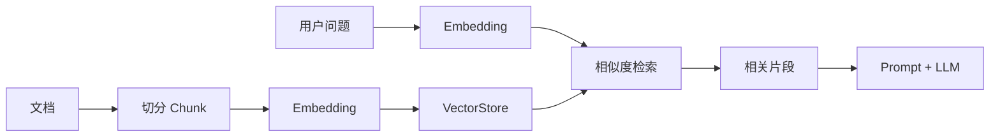

# 🧲 VectorStore 向量存储

> [!abstract] 一句话总结
> VectorStore 是 RAG 的检索底座：把文档变成向量存起来，再按语义相似度找回和问题最相关的内容。

## 🎯 本节定位

- **本章第 9 课，RAG 检索底座**。前置：[[03-PromptTemplate]]、[[07-Advisor拦截器]]；本节讲 `VectorStore` 的写入、相似度检索与注入 Prompt。
- **延伸**：完整 RAG 工程（文档解析、切分、Embedding、召回、评估）在下一章 [[10-AI应用开发/03-知识库技术-RAG/_index|知识库技术 RAG]]。

## 📌 这是什么

向量库保存的是“文本的语义表示”。用户提问时，系统把问题也转成向量，在库里找最相近的文档片段，最后把这些片段塞进 Prompt。



## 🤔 解决什么问题

| 纯 LLM | RAG + VectorStore |
| ---- | ---- |
| 不知道企业私有知识 | 可检索内部文档 |
| 容易编造 | 用资料约束回答 |
| 模型知识有时效性 | 文档更新即可生效 |
| 长文档塞不进上下文 | 只取相关片段 |

---

## 🧩 Spring AI 核心对象

| 对象 | 作用 |
| ---- | ---- |
| `Document` | 文档片段 + metadata |
| `EmbeddingModel` | 把文本转向量 |
| `VectorStore` | 存储和相似度检索 |
| `SearchRequest` | 查询、topK、阈值、过滤条件 |
| `QuestionAnswerAdvisor` | 把检索结果自动注入 Prompt |

> [!info] 版本说明（2026-08）
> Spring AI 2.0 精简了向量库实现清单（移除 SAP HANA / Infinispan 模块），当前主流实现为 pgvector、Redis、Milvus、Chroma、MongoDB Atlas、Elasticsearch、Qdrant 等；本课讲的是与实现无关的抽象层（`VectorStore` 接口），选型见 [[10-AI应用开发/03-知识库技术-RAG/15-向量库选型对比|RAG 章向量库选型]]。

---

## 💻 基础写入与检索

### 写入文档

```java
List<Document> documents = List.of(
        new Document("Spring AI 的 ChatClient 是面向业务的 Fluent API。",
                Map.of("source", "note-001")),
        new Document("ChatModel 是底层模型调用抽象。",
                Map.of("source", "note-002"))
);

vectorStore.add(documents);
```

### 相似度检索

```java
List<Document> results = vectorStore.similaritySearch(
        SearchRequest.builder()
                .query("ChatClient 和 ChatModel 有什么区别？")
                .topK(3)
                .build()
);
```

### 和 ChatClient 组合

```java
String answer = chatClient.prompt()
        .user("ChatClient 和 ChatModel 有什么区别？")
        .advisors(QuestionAnswerAdvisor.builder(vectorStore).build())
        .call()
        .content();
```

---

## ⚙️ RAG 参数

| 参数              | 含义     | 调优方向              |
| --------------- | ------ | ----------------- |
| chunk size      | 文档切片大小 | 太大噪声多，太小语义断       |
| overlap         | 切片重叠   | 保持上下文连续           |
| topK            | 返回片段数量 | 太多增加 Token，太少召回不足 |
| threshold       | 相似度阈值  | 控制低相关片段           |
| metadata filter | 元数据过滤  | 按租户、权限、文档类型过滤     |

> [!important] 权限过滤
> 企业知识库一定要先做权限过滤，再把文档片段交给模型。不要指望模型替你判断用户能不能看。

---

## ✅ 学习检查点

- [ ] 能画出 RAG 基本流程
- [ ] 能解释 `Document`、`EmbeddingModel`、`VectorStore`
- [ ] 能写入文档并做 similarity search
- [ ] 能说明 topK、chunk size、metadata filter 的作用

## ⚠️ 常见坑

- [ ] **只调模型不评估检索**：RAG 质量大多先坏在检索。
- [ ] **没有 metadata**：后续做权限、来源引用、更新删除都会困难。
- [ ] **切片太随意**：按段落、标题、语义边界切通常更稳。
- [ ] **忽略删除和更新**：知识库不是一次性导入，生命周期要设计。
- [ ] **把低相关片段塞给模型**：会诱导模型回答偏题。

## 🎯 面试速记

> - **Q: VectorStore 在 RAG 中做什么？**
>   - A: 保存文档向量，并根据用户问题做语义相似度检索，找出相关上下文。
> - **Q: RAG 的质量关键在哪里？**
>   - A: 文档切分、Embedding、召回、重排、Prompt 合成和权限过滤。

## 🔗 关联阅读

- [[03-PromptTemplate]]
- [[07-Advisor拦截器]]
- [[10-AI应用开发/03-知识库技术-RAG/_index]]
- [[10-AI应用开发/02-框架-SpringAI与LangChain4j/_index]]

## 📚 参考资料

- [Spring AI Vector Databases](https://docs.spring.io/spring-ai/reference/api/vectordbs.html)
- [Spring AI ETL Pipeline](https://docs.spring.io/spring-ai/reference/api/etl-pipeline.html)


