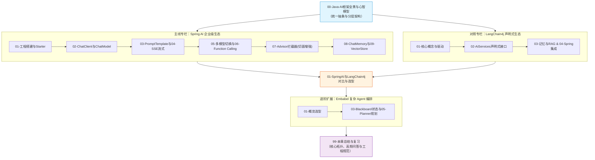

# ☕ 02 · Java AI 框架（Spring AI 与 LangChain4j）

> [!info] 本区说明
> 对应学习路径 **阶段二**。全面构建 Java 工程师面向大模型时代的工程落地架构体系：以 **Spring AI** 作为企业级主线，以 **LangChain4j** 作为声明式接口对照，以 **Embabel Agent** 作为多 Agent 规划进阶。

---

## 🗺️ 全章学习路线与架构总览

---

## 📚 知识导航清单

### 00 · 全景心智
- [ ] [[00-Java-AI框架全景与心智模型]]（统一模型抽象、分层架构与 Java 工程生态优势）

### 01 · 框架对比与选型
- [ ] [[01-SpringAI与LangChain4j对比]]（设计理念、Fluent 链式 API 与声明式接口对比及选型策略）

### 02 · Spring AI 专区（主线）
- [ ] [[SpringAI/_index|Spring AI 体系总览索引]]
  - [ ] [[SpringAI/01-Spring-AI项目搭建|01-Spring-AI项目搭建]]（BOM 依赖管理与 Provider 接入）
  - [ ] [[SpringAI/02-ChatClient与ChatModel|02-ChatClient与ChatModel]]（底层模型接口与 Fluent API 门面）
  - [ ] [[SpringAI/03-PromptTemplate|03-PromptTemplate]]（结构化模板与动态参数渲染）
  - [ ] [[SpringAI/04-流式输出-SSE|04-流式输出-SSE]]（响应式 Flux 与 SSE 流式传输）
  - [ ] [[SpringAI/05-多模型接入与切换|05-多模型接入与切换]]（@Qualifier 装配与多模型路由降级）
  - [ ] [[SpringAI/06-Function-Calling工具调用|06-Function-Calling工具调用]]（@Tool 注解与多轮工具调用闭环）
  - [ ] [[SpringAI/07-Advisor拦截器|07-Advisor拦截器]]（请求/响应责任链拦截器，日志审计与安全控制）
  - [ ] [[SpringAI/08-ChatMemory记忆|08-ChatMemory记忆]]（滑动窗口管理与 Redis/JDBC 持久化）
  - [ ] [[SpringAI/09-VectorStore向量存储|09-VectorStore向量存储]]（PGVector/Milvus 接入与相似度检索）

### 03 · LangChain4j 专区（对照）
- [ ] [[LangChain4j/_index|LangChain4j 体系总览索引]]
  - [ ] [[LangChain4j/01-LangChain4j核心概念|01-核心概念与架构]]
  - [ ] [[LangChain4j/02-AiServices声明式AI服务|02-AiServices声明式服务]]（基于动态代理的声明式接口设计）
  - [ ] [[LangChain4j/03-记忆与RAG|03-记忆与RAG]]
  - [ ] [[LangChain4j/04-与Spring生态集成|04-与Spring生态集成]]
  - [ ] [[LangChain4j/05-流式输出与结构化输出|05-流式输出与结构化输出]]
  - [ ] [[LangChain4j/06-多模型接入与配置|06-多模型接入与配置]]

### 04 · Embabel Agent 进阶专区
- [ ] [[EmbabelAgent/_index|Embabel Agent 编排专区索引]]（面向 JVM 的强类型状态机与多步骤 Agent 规划）

### 99 · 本章总结与复习
- [ ] [[99-本章总结与复习]]（全章核心拓扑、高频面试问答、生产工程规范）

---

## 🔗 相关链接

- 上级总览：[[../00-总览/学习仪表盘]]
- 前置章节：[[../01-LLM基础与Prompt/_index|01 · LLM 基础与 Prompt 工程]]
- 下一章节：[[../03-知识库技术-RAG/_index|03 · 知识库技术：RAG]]
