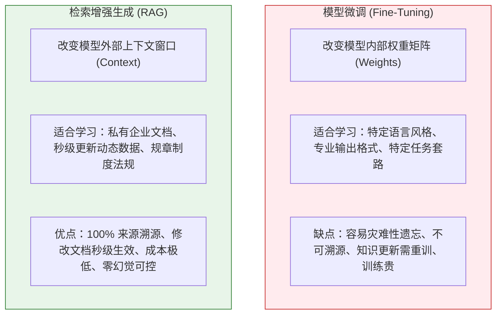
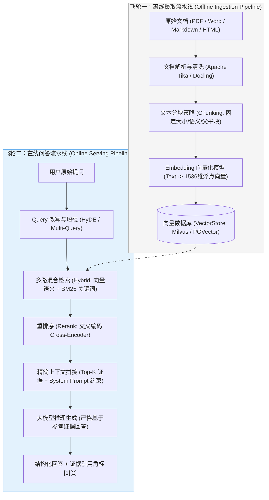
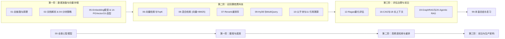

# 📚 RAG 全景与心智模型：大模型的外挂开卷图书馆

> [!abstract] 一句话总结
> RAG（Retrieval-Augmented Generation，检索增强生成）的核心本质是**“将大模型的‘闭卷盲猜考试’转变为‘带着精准证据材料的开卷考试’”**，它是解决大模型知识截止、内部私有数据不可见、严重幻觉以及商业审计溯源的行业基石方案。

---

## 🗣️ 白话版（先建立直觉）

想象你请了一位刚从哈佛毕业的天才博士（大模型）：
- 他智商极高，数理化哲学样样精通，表达能力极其华丽；
- 但是，**他今天刚刚第一天入职你们公司**！他从来没见过你们公司内部的《2026年差旅报销制度》，更没看过你们内部微服务的敏捷发布手册。

如果你此时直接问他：“请问我们公司总监出差上海，住宿标准是一晚上多少钱？”
这位天才博士为了显得自己无所不知，就会**一本正经地开始编造（幻觉）**：“根据惯例，上海作为一线城市，总监住宿标准通常为每晚 800 元，凭发票实报实销...”。而实际上，你们公司制度明明写着是 600 元！直接采信就会造成严重的财务审计灾难！

怎么彻底解决这个问题？
**微调（Fine-tuning）可行吗？**
微调就像让这位博士把整本报销手册背下来。代价极其昂贵，而且如果明天制度改成了 650 元，你又得拉上 GPU 集群花几万块钱重新训练一遍！一旦背串了，他依然会说胡话。

**RAG 的做法是怎样的？**
你直接在公司内部设立一个**“图书管理员（检索系统）”**：
1. 当用户问：“总监去上海住宿标准是多少？”
2. 图书管理员立刻跑到档案库（向量数据库），在 1000 份制度中抽出第 42 页第 3 段关于《上海差旅标准》的纸条；
3. 你把这张纸条和大模型一起叫过来：“博士，**请你严格参考这张纸条上的内容**，回答用户的提问，严禁自我发挥！”
4. 博士看了一眼纸条，微笑着回答：“根据《2026年差旅报销制度》第 42 页规定，总监在上海的住宿标准上限为 600 元/天。”

**这就是 RAG：让模型负责“语言组织与逻辑推理”，让检索系统负责“提供事实证据与引用溯源”！**

---

## 📌 第一性原理：微调（Fine-Tuning）vs RAG 深度抉择

很多企业在启动 AI 项目时最常犯的错误，就是“迷信微调”。从第一性原理来看，两者的能力边界完全不同：

| 评估维度 | 微调（Fine-Tuning） | 检索增强（RAG） | 结论与选型建议 |
| :--- | :--- | :--- | :--- |
| **知识时效性** | 极差（更新必须重新微调，通常按周/月周期） | **秒级实时**（文档修改后重新入库即可） | 动态业务规约选 RAG |
| **真实性与溯源** | 无法溯源（知识融化在数千亿参数中，无法指出哪一页） | **百分之百可追溯**（精准定位文件名、页码、段落） | 法律、金融、客服选 RAG |
| **数据安全性** | 权重一旦被导出，私有数据可能被反向提取泄露 | **天然支持权限隔离**（检索层通过 RBAC 决定用户能看哪篇文档） | 多租户多部门选 RAG |
| **实施成本** | 高（需要大量高质量标注数据、GPU 算力与算法调优） | **低**（普通 Java 后端 + 现成向量库，极快见效） | 企业工程化落地选 RAG |
| **核心适用场景** | 医疗诊断对话风格、代码生成语法纠偏、SQL Dialect 习惯 | 企业内部知识库、智能客服、合同合规审查、技术文档助手 | **80% 的企业需求首选 RAG！** |

---

## 🗺️ RAG 两大飞轮：全链路架构全景图

一个工业级 RAG 系统由**两条完全独立但紧密配合的流水线（Pipelines）**组成：

---

## 🧩 RAG 的技术演进三部曲

| 演进阶段 | 架构特征 | 致命痛点 | 业界现状 |
| :--- | :--- | :--- | :--- |
| **1. Naive RAG（初级幼稚 RAG）** | 简单按固定字数切块（如 500 字）$\to$ 计算向量 $\to$ 余弦相似度 Top-3 $\to$ 塞进 Prompt。 | **断章取义、召回垃圾、专有名词与精确数字搜不到、上下文超载。** | 仅用于 Demo 演示 |
| **2. Advanced RAG（进阶工程 RAG）** | 引入**语义分块、父子块（Parent-Child）、多路混合检索（Hybrid Search: 向量+BM25）、Rerank 重排**。 | 解决了 90% 的召回与排序精度问题，大幅消除幻觉。 | **当前大厂工业界主流！** |
| **3. Agentic RAG（智能体反思 RAG）** | 引入 Agent 自主规划：自主决定查不查、分步多轮检索、检索结果自检（Self-Correction）、反思与路由。 | 延迟较长，适用于需要深度分析的跨文档复杂调研任务。 | 前沿攻坚方向 |

---

## 🧭 本章通关路线指引

本专栏将带你由浅入深，从底层数学几何原理直击工业高可用落地：

> [!TIP]
> **学习第一铁律**：**Garbage In, Garbage Out！** 
> RAG 系统的回答质量，70% 取决于**文档解析与切分（Chunking）的干净程度**，20% 取决于**混合检索与 Rerank 的召回精度**，大模型自身的生成能力只占最后 10%！切忌把时间全花在换大模型上，把数据洗干净才是 RAG 的最高真理！
