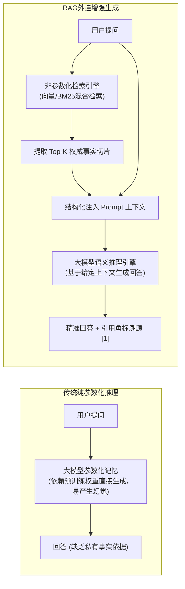
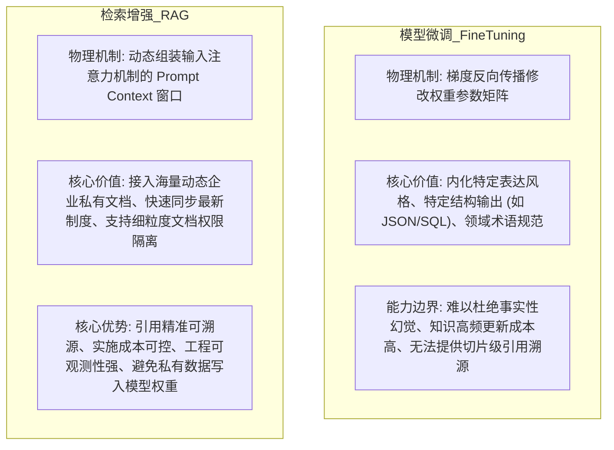
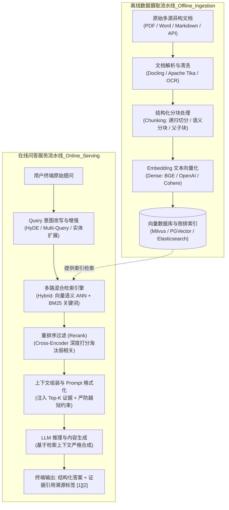

# 00 · RAG 架构全景与非参数化检索增强心智模型

> **导读**：大语言模型（LLM）虽然具备强大的逻辑推理与自然语言生成能力，但其本质是基于海量公开语料预训练的“参数化记忆模型”，天然受限于**知识截止（Knowledge Cutoff）、内部私有数据不可见、严重幻觉（Hallucination）以及无法准确追溯证据来源**等硬性约束。检索增强生成（Retrieval-Augmented Generation, RAG）作为连接通用大模型与企业专有知识库的关键工程桥梁，通过动态检索非参数化外部权威事实注入提示词上下文，彻底改变了生成范式。本文系统剖析 RAG 的第一性原理、微调（FT）与 RAG 的本质差异、双流水线工业级架构，以及从 Naive 到 Agentic RAG 的技术演进路径。

---

## 一、RAG 核心定义与第一性原理

### 1. 技术定义
**检索增强生成（RAG）**是一种在模型生成响应之前，先从外部权威知识库中动态检索相关证据材料，并将检索到的事实片段作为可信上下文（Context）注入到 Prompt 中，引导大语言模型严格依据给定事实生成结构化回答的系统架构。

### 2. 参数化知识 vs 非参数化外挂事实
- **参数化知识（Parametric Knowledge）**：沉淀在大模型神经网络的权重矩阵（Weights）中。修改或更新知识需要重新进行预训练或领域微调（Fine-Tuning），训练成本高、周期长，容易引发**灾难性遗忘（Catastrophic Forgetting）**，且无法提供细粒度的文档出处证明。
- **非参数化知识（Non-Parametric Knowledge）**：存储在模型外部的向量数据库、关系型数据库或全文检索引擎中。知识更新只需同步刷新外部索引，无需重训模型；生效延迟由数据摄取与索引构建周期决定，并可在应用层结合文档元数据实现精确的引用溯源与访问权限控制。

---

## 二、第一性原理抉择：微调（Fine-Tuning）vs 检索增强（RAG）

在企业 AI 知识库与智能化落地选型中，“做微调还是做 RAG”是首要的架构抉择。从底层物理机制来看，二者存在明确的适用边界：

### 微调 vs RAG 工业级全方位能力对比矩阵

| 评估维度 | 模型微调（Fine-Tuning） | 检索增强（RAG） | 架构决策建议 |
| :--- | :--- | :--- | :--- |
| **知识时效性** | 较差（更新需重新清洗语料并训练，周期通常按天/周计） | **近实时**（文档修改后经增量解析、向量化与索引刷新即可生效） | 规章制度、产品配置等变动频繁的数据选 RAG |
| **事实准确性与溯源** | 难以杜绝幻觉；无法定位回答来源于哪份文档哪一页 | **严格可溯源**（通过切片元数据精确标注文档名称、页码与段落） | 金融、医疗、司法、合同合规场景首选 RAG |
| **数据安全性与权限** | 私有知识编码进权重，难以针对不同查询用户做动态隔离 | **原生支持 RBAC 权限过滤**（检索层根据用户角色动态过滤可见文档） | 多租户、多部门权限隔离场景选 RAG |
| **算力与实施成本** | 较高（需准备高质量对齐数据集与 GPU 训练资源） | **较低**（标准后端工程 + 检索引擎，迭代周期短） | 敏捷交付与高 ROI 诉求优先选 RAG |
| **核心适用场景** | 学习特定语言语气、专有编程语法（DSL）、小模型能力蒸馏 | 企业级知识库、智能客服问答、技术文档检索、跨研报比对分析 | **高频动态知识与来源追溯场景优先采用 RAG** |

---

## 三、RAG 核心全链路架构：双流水线模型

一个企业级工业级 RAG 系统由两条相互独立但高度协同的流水线构成：

---

## 四、RAG 技术架构演进三阶段

RAG 技术在工业界的演进经历了从基础链路到智能化编排的三个阶段：

| 演进范式 | 核心技术拓扑 | 核心局限与工程特征 | 工业界应用定位 |
| :--- | :--- | :--- | :--- |
| **Naive RAG（基础检索版）** | 固定字符窗口切块（如每 512 字符）$\to$ 纯向量检索（余弦相似度 Top-K）$\to$ 直接拼接 Prompt。 | **易切断跨段语义、精确关键词（工单号/型号）召回率偏低、长上下文噪声易引发“迷失在中间”（Lost in the Middle）。** | 适合结构简单的知识域与快速验证，常作为系统评测的初始基线。 |
| **Advanced RAG（高级工程版）** | 引入**结构化与父子分块、Query 改写（HyDE/多查询扩展）、多路混合检索（Dense 向量 + Sparse BM25）、Cross-Encoder Rerank 重排**。 | 针对解析、召回和排序各环节做精细化增强，需综合平衡准确率与检索延迟。 | **当前企业级生产系统的主流标准架构。** |
| **Agentic RAG（智能体自主规划版）** | 引入 LLM Agent 自主决策规划：动态判定是否需要检索、拆解子问题多轮迭代检索、评估证据充分性并自我修正（Self-Correction）。 | 端到端调用延迟较高，Token 消耗量随迭代轮数增加。 | 适用于跨多文档长链路调研、复杂多跳推理与研报深度比对场景。 |

---

### 场景示例：企业差旅报销问答的数据流转

以员工提问“研发部员工去上海出差的住宿报销标准是多少？”为例，RAG 在线问答的完整数据流转过程如下：

1. **查询接收与权限解析**：系统接收用户提问，并结合登录态提取当前用户的部门与角色信息（如 `department=RD`）。
2. **混合检索与重排序（Retrieval & Rerank）**：检索引擎在满足权限过滤条件的制度切片中，同步执行向量语义检索与 BM25 关键词匹配，召回候选制度片段，再通过 Rerank 模型对“问题—切片”相关性精细打分，筛选出《差旅费用管理制度》第 3.2 条住宿标准切片。
3. **上下文注入（Context Injection）**：系统将检索出的制度原文切片、来源文档元数据（文件名、页码、条款号）以及“仅依据给定参考资料作答，未提及信息明确拒答”的指令约束，统一组装进 Prompt 模板。
4. **受控生成与引用溯源（Generation & Attribution）**：大语言模型基于注入的制度切片提炼出上海地区的住宿限额与超标审批规则，并在回答末尾附上对应的文档名称与页码引用标识，返回给终端用户。

---

## 🧭 下一步

在掌握了 RAG 的心智模型与架构分层后，从原始非结构化文件（PDF、Markdown、Excel、HTML）到能够在向量数据库中高速检索的向量点，必须经历完整的数据流水线。
从分块策略到嵌入编码，底层技术细节究竟如何串联？
请进入下一篇核心专题：[[01-RAG基础与全链路]]！
