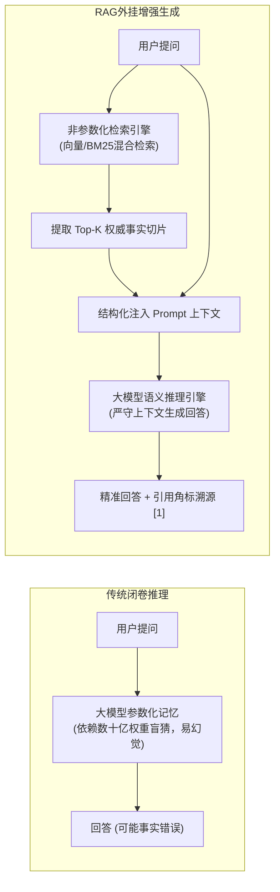
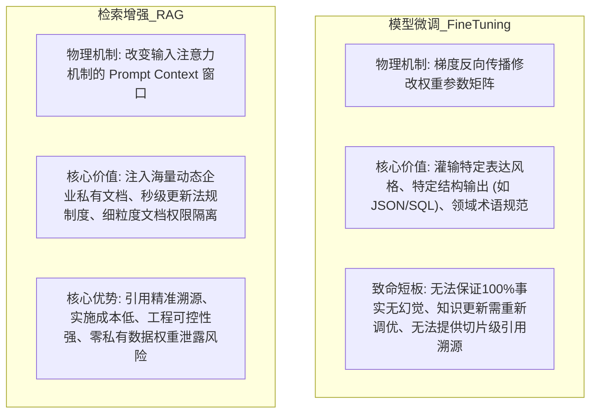
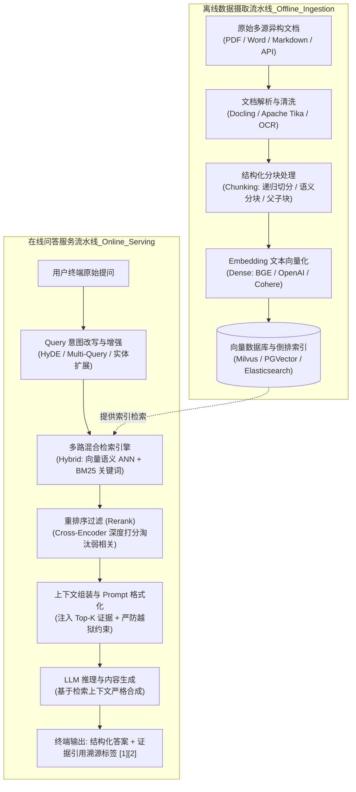

# 00 · RAG 架构全景与非参数化检索增强心智模型

> **导读**：大语言模型（LLM）虽然具备强大的逻辑推理与自然语言生成能力，但其本质是基于海量公开语料预训练的“参数化记忆模型”，天然受限于**知识截止（Knowledge Cutoff）、内部私有数据不可见、严重幻觉（Hallucination）以及无法准确追溯证据来源**等硬性约束。检索增强生成（Retrieval-Augmented Generation, RAG）作为连接通用大模型与企业专有知识库的关键工程桥梁，通过动态检索非参数化外部权威事实注入提示词上下文，彻底改变了生成范式。本文系统剖析 RAG 的第一性原理、微调（FT）与 RAG 的本质差异、双流水线工业级架构，以及从 Naive 到 Agentic RAG 的技术演进路径。

---

## 一、RAG 核心定义与第一性原理

### 1. 技术定义
**检索增强生成（RAG）**是一种在模型生成响应之前，先从外部权威知识库中动态检索相关证据材料，并将检索到的事实片段作为可信上下文（Context）注入到 Prompt 中，引导大语言模型严格依据给定事实生成结构化回答的系统架构。

### 2. 参数化知识 vs 非参数化外挂事实
- **参数化知识（Parametric Knowledge）**：沉淀在大模型神经网络的权重矩阵（Weights）中。修改或更新知识必须重新进行全量预训练或领域微调（Fine-Tuning），成本极高且容易出现**灾难性遗忘（Catastrophic Forgetting）**，且无法百分之百保证模型按记忆吐出。
- **非参数化知识（Non-Parametric Knowledge）**：存储在模型外部的向量数据库、关系型数据库或全文检索引擎中。增删改查实现秒级实时生效，具备**100% 来源可溯源性**与**精细化访问控制权限（RBAC）**。

---

## 二、第一性原理抉择：微调（Fine-Tuning）vs 检索增强（RAG）

在企业 AI 知识库与智能化落地选型中，“做微调还是做 RAG”是首要的战略抉择。从底层物理机制来看，二者存在截然不同的适用边界：

### 微调 vs RAG 工业级全方位能力对比矩阵

| 评估维度 | 模型微调（Fine-Tuning） | 检索增强（RAG） | 架构决策建议 |
| :--- | :--- | :--- | :--- |
| **知识时效性** | 极差（更新必须重新清洗语料微调，周期为天/周） | **秒级实时**（文档修改后重新解析向量化即时生效） | 规章制度、产品配置等变动频繁数据选 RAG |
| **事实准确性与溯源** | 无法杜绝幻觉；无法定位回答来源于哪份文档哪一页 | **严格可溯源**（精准标注切片 ID、文档名称与段落） | 金融、医疗、司法、合同合规场景必选 RAG |
| **数据安全性与权限** | 私有知识融化于权重，模型导出后存在权重逆向提取风险 | **原生支持 RBAC 权限过滤**（检索层根据用户角色过滤文档） | 多租户、多部门混合隔离场景选 RAG |
| **算力与实施成本** | 极高（需要昂贵的 GPU 集群、大量高质量微调对齐数据集） | **低**（标准 Java/Python 工程 + 向量数据库，可迅速投产） | 敏捷交付与 ROI 优先选 RAG |
| **核心适用场景** | 学习特定语言语气、特定编程语法（如专有 DSL）、小模型能力蒸馏 | 企业级知识库、智能客服问答、技术文档检索、跨研报比对分析 | **工业界 80% 以上知识问答需求首选 RAG** |

---

## 三、RAG 核心全链路架构：双流水线模型

一个企业级工业级 RAG 系统由两条相互独立但高度协同的流水线构成：

---

## 四、RAG 技术架构演进三阶段

RAG 技术在工业界的演进经历了从粗放到精细化的三个标准演变范式：

| 演进范式 | 核心技术拓扑 | 核心缺陷与痛点 | 工业界应用现状 |
| :--- | :--- | :--- | :--- |
| **Naive RAG（简单基础版）** | 固定字符窗口硬切块（如每 512 字符）$\to$ 纯向量检索（余弦相似度 Top-3）$\to$ 直接拼接 Prompt。 | **断章取义严重、精确关键词（工单号/人名）召回率低、上下文噪声超载导致模型“迷失在中间”（Lost in the Middle）。** | 仅适合学术 Demo 与概念验证。 |
| **Advanced RAG（高级工程版）** | 引入**层次化分块（父子块）、Query 改写（HyDE/多查询扩展）、多路混合检索（Dense 向量 + Sparse BM25）、Cross-Encoder Rerank 重排**。 | 解决了 90% 以上的召回准确率、多格式解析与排序失真问题，极大抑制了事实幻觉。 | **当前大厂生产级系统的主流基石架构。** |
| **Agentic RAG（智能体自主规划版）** | 引入 LLM Agent 自主决策规划：自主判定是否需要检索、多轮递归分步检索、检索内容自省修正（Self-Correction）与路由编排。 | 调用延迟（Latency）较高，Prompt Token 消耗量大。 | 适用于跨多文档长链路调研、财务研报深度比对等复杂场景。 |

---

### 场景演示：企业差旅报销智能核验

- **通晓逻辑但未读内部制度的顾问（大语言模型 LLM）**：擅长语言组织与推理，但对未公开的私有数据若直接回答容易产生严重幻觉；
- **档案专员按问题抽调制度条款（混合检索与 Rerank）**：根据提问在制度库中精准检索出对应细则段落并按相关性排序；
- **将复印条款附在工单上递给顾问（上下文注入 Context Injection）**：把检索出的真实切片放入 Prompt，约束模型严格按依据回答；
- **根据条款答复并附注页码条款号（引用溯源 Source Attribution）**：回答中带上证据切片 ID，满足合规审计。

---

## 🧭 下一步

在掌握了 RAG 的心智模型与架构分层后，从原始非结构化文件（PDF、Markdown、Excel、HTML）到能够在向量数据库中高速检索的向量点，必须经历完整的数据流水线。
从分块策略到嵌入编码，底层技术细节究竟如何串联？
请进入下一篇核心专题：[[01-RAG基础与全链路]]！
