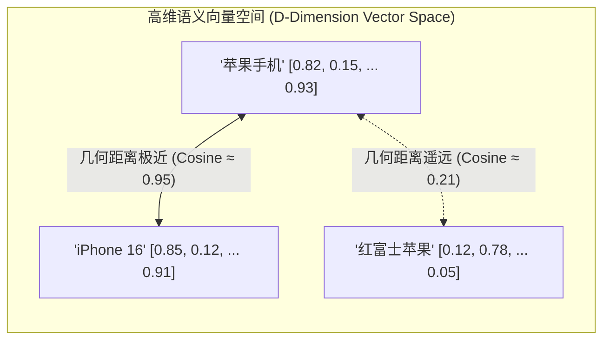
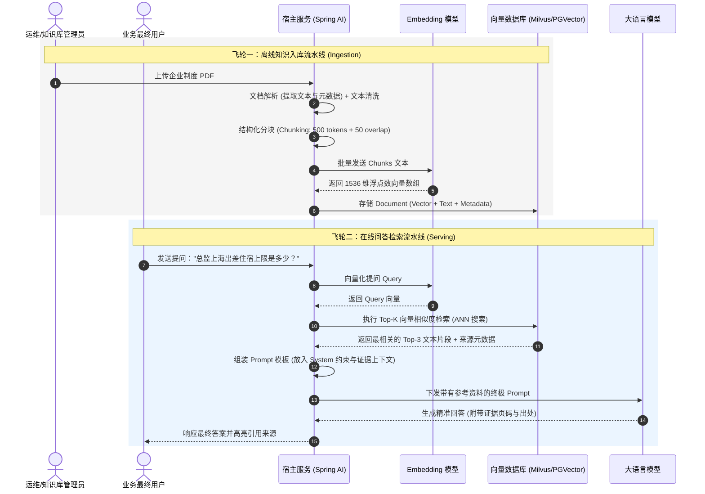
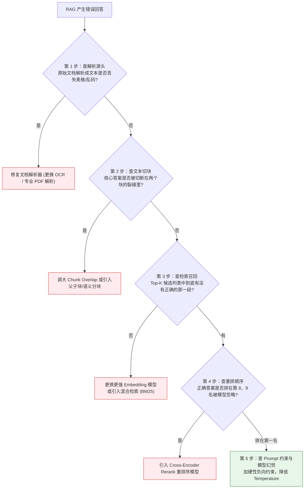

# 📖 RAG 基础与全链路工业级架构

> [!abstract] 一句话总结
> RAG（检索增强生成）的技术第一性原理是**“在高维语义向量空间中度量几何相似度以召回相关上下文，并作为先验证据输入大模型注意力机制”**，其全链路包含“离线知识向量化摄取”与“在线实时检索生成”两大飞轮。

---

## 🗣️ 白话版（先建立直觉）

如果让你给一家大型三甲医院做一个**“智能导医分诊助手”**，面临着 10 万篇涉及罕见病、专家特长和用药规约的 PDF 文档：
- 你不能把这 10 万篇 PDF 一口气塞给大模型——哪怕上下文窗口能装下，这一轮提问的 Token 费用可能就要几百块钱，而且模型会被海量无关文字彻底搞晕（著名的 **Lost in the Middle 迷失在中间** 效应）；
- 你更不能直接把用户的问题抛给大模型去猜——模型会根据通用医学常识胡说八道，酿成医疗事故。

RAG 是怎么干活的？
1. **在系统上线前（离线阶段）**：
   系统像一个勤奋的图书整理员，把每一本厚厚的医学手册拆成一段段 500 字的小卡片（Chunk），然后在每一张卡片背后盖上一个**“数学指纹”（Embedding 向量）**，整齐地归档在现代化的图书馆书架（向量数据库）里。
2. **在用户提问时（在线阶段）**：
   用户问：“我左腹部隐痛伴随恶心，挂哪个科？”
   系统立刻算出这句话的“数学指纹”，只用 5 毫秒就在 10 万张卡片中精准找到了**最相似的 3 张卡片**（如消化内科排查指引）。
   系统把这 3 张卡片贴在用户的提问后面递给大模型：“请**只根据这 3 张卡片的内容**回答”。大模型瞬间给出严谨准确的导医建议并附上依据！

---

## 📌 第一性原理：向量嵌入与高维空间几何距离

计算机并不懂中文汉字，它如何知道“西红柿炒鸡蛋”和“番茄炒蛋”是同一种菜？



### 1. 文本向量化（Embedding）
- 通过深度神经网络（如 `text-embedding-3-small`, `bge-m3`），将任意长度的一段自然语言映射为一个固定长度的**高维浮点数向量** $\vec{v} \in \mathbb{R}^D$（常见维度 $D = 768, 1024, 1536$）。
- 语义越相似的文本，在高维空间中的空间坐标距离就越近。

### 2. 距离度量算法（三大数学公式）

| 度量指标 | 数学公式 | 几何含义 | 适用场景与工程优劣 |
| :--- | :--- | :--- | :--- |
| **余弦相似度 (Cosine)** | $\cos(\theta) = \frac{\vec{A} \cdot \vec{B}}{\|\vec{A}\| \|\vec{B}\|}$ | 度量两向量的**夹角方向**，取值 $[-1, 1]$ | **生产中最推荐！** 不受文本绝对长度和向量模长的干扰，衡量纯粹的语义偏向。 |
| **点积 (Dot Product / IP)** | $\vec{A} \cdot \vec{B} = \sum_{i=1}^{D} A_i B_i$ | 结合了夹角与两向量的**绝对长度大小** | **当且仅当向量已做 L2 归一化时，点积等于余弦相似度**，且计算无需除法，CPU/GPU 运算速度最快！ |
| **欧几里得距离 (L2)** | $d(\vec{A}, \vec{B}) = \sqrt{\sum_{i=1}^D (A_i - B_i)^2}$ | 高维空间中两点间的**直线物理距离**，$\ge 0$ | 距离越小越相似；对向量绝对模长极其敏感，未归一化时易受文本长短干扰。 |

---

## ⚙️ RAG 双飞轮全链路详细时序



---

## 💻 代码实战：Spring AI 中的企业级 RAG 闭环

### 1. 离线入库服务（解析、分块、向量化存储）

```java
package com.example.ai.rag;

import lombok.extern.slf4j.Slf4j;
import org.springframework.ai.document.Document;
import org.springframework.ai.reader.tika.TikaDocumentReader;
import org.springframework.ai.transformer.splitter.TokenTextSplitter;
import org.springframework.ai.vectorstore.VectorStore;
import org.springframework.core.io.Resource;
import org.springframework.stereotype.Service;

import java.util.List;
import java.util.Map;

@Slf4j
@Service
public class DocumentIngestionService {

    private final VectorStore vectorStore;

    public DocumentIngestionService(VectorStore vectorStore) {
        this.vectorStore = vectorStore;
    }

    /**
     * 将本地 PDF/Word 文件完整入库
     */
    public void ingestDocument(Resource fileResource, String department, String docCategory) {
        log.info("开始摄取文档: {}", fileResource.getFilename());

        // 1. 文档解析：使用 Apache Tika 万能提取文本
        TikaDocumentReader reader = new TikaDocumentReader(fileResource);
        List<Document> rawDocuments = reader.get();

        // 2. 文本分块：按 Token 切分（块大小 500 Token，重叠 50 Token 防切断语义）
        TokenTextSplitter splitter = new TokenTextSplitter(500, 50, 5, 10000, true);
        List<Document> chunks = splitter.apply(rawDocuments);

        // 3. 元数据补全（为后续多租户权限过滤做准备）
        for (Document chunk : chunks) {
            chunk.getMetadata().put("department", department);
            chunk.getMetadata().put("docCategory", docCategory);
            chunk.getMetadata().put("sourceFileName", fileResource.getFilename());
        }

        // 4. 批量向量化并写入向量数据库（Spring AI 底层自动调用 EmbeddingModel）
        vectorStore.accept(chunks);
        log.info("文档摄取成功！切分为 {} 个 Chunk 并完成向量入库", chunks.size());
    }
}
```

### 2. 在线检索问答服务（结合元数据过滤与上下文拼装）

```java
package com.example.ai.rag;

import org.springframework.ai.chat.client.ChatClient;
import org.springframework.ai.document.Document;
import org.springframework.ai.vectorstore.SearchRequest;
import org.springframework.ai.vectorstore.VectorStore;
import org.springframework.stereotype.Service;

import java.util.List;
import java.util.stream.Collectors;

@Service
public class KnowledgeQueryService {

    private final ChatClient chatClient;
    private final VectorStore vectorStore;

    public KnowledgeQueryService(ChatClient.Builder builder, VectorStore vectorStore) {
        this.chatClient = builder.build();
        this.vectorStore = vectorStore;
    }

    public record RagAnswer(String answer, List<String> sourceReferences) {}

    public RagAnswer queryKnowledge(String userQuestion, String userDepartment) {
        // 1. 向量数据库检索：指定 Top-K 与 元数据权限过滤表达式
        SearchRequest searchRequest = SearchRequest.builder()
                .query(userQuestion)
                .topK(3) // 检索前 3 个最相关的段落
                .similarityThreshold(0.7) // 相似度门限过滤（低于 0.7 的噪声直接舍弃）
                // 仅允许检索属于当前部门或公共的文档
                .filterExpression("department == '" + userDepartment + "' || department == 'PUBLIC'")
                .build();

        List<Document> relevantDocs = vectorStore.similaritySearch(searchRequest);

        if (relevantDocs.isEmpty()) {
            return new RagAnswer("抱歉，在您权限允许的知识库中未找到相关规章制度。", List.of());
        }

        // 2. 提取证据上下文与溯源清单
        String contextText = relevantDocs.stream()
                .map(doc -> "【资料来源: " + doc.getMetadata().get("sourceFileName") + "】\n" + doc.getText())
                .collect(Collectors.joining("\n\n---\n\n"));

        List<String> references = relevantDocs.stream()
                .map(doc -> (String) doc.getMetadata().get("sourceFileName"))
                .distinct()
                .toList();

        // 3. 构造强约束 System Prompt 下发模型
        String systemPrompt = """
            你是一个严谨的企业知识库助理。
            你必须严格根据下方提供的【参考资料】回答用户的问题。
            
            【约束铁律】：
            1. 答案必须能在参考资料中找到严格依据，严禁结合常识做任何主观猜测！
            2. 如果参考资料中没有提及答案，请明确回答：“资料中未提及相关信息”。
            3. 回答结尾注明引用文件名。
            
            【参考资料】：
            %s
            """.formatted(contextText);

        String answer = chatClient.prompt()
                .system(systemPrompt)
                .user(userQuestion)
                .call()
                .content();

        return new RagAnswer(answer, references);
    }
}
```

---

## 🔍 工业级排障黄金 SOP：五步定位法定真凶

当业务人员抱怨：“RAG 给出的答案又错了！” 绝不能无脑去换大模型或乱改提示词，必须按照以下 **5 步标准化流水线逐级排查**：



---

## ⚠️ 生产避坑指南与致命陷阱

### 1. 陷阱一：只做纯向量检索，精确编码全部搜空
- **惨案**：用户提问“查一下型号 `RTX-4090-Ti-OC` 的功耗”，向量检索出来的却全是一堆关于 `RTX-3080`、`显卡供电` 的泛化文章，唯独没有你要查的那款型号。
- **根因**：Embedding 模型擅长理解**宏观抽象语义**，对**精确料号、数字、身份证号、人名、缩写**极其不敏感！
- **治理**：必须上 **混合检索（Hybrid Search: 密集向量 + BM25 稀疏关键词）**！

### 2. 陷阱二：忽略 Chunk Overlap（重叠率）导致“断头案”
- **惨案**：规定“出差上海住宿补贴上限是”正好是第 500 个字符，“600元每天”被硬生生切进了下一个块。两个块单独看都不完整，向量检索相似度极低，全部漏召回！
- **治理**：分块必须保留 10%~15% 的重叠区（如 `chunkSize=500, overlap=50`），高阶方案采用父子块。

### 3. 陷阱三：向量库只存文本，不建元数据过滤索引
- **惨案**：企业 100 个部门的文档混在同一张表里，每次搜索全表暴力向量比对。不仅跨部门越权泄露薪酬，而且随着数据量增大检索耗时直奔 2 秒。
- **治理**：必须为 `department`, `tenantId`, `status` 建立 B 树/标量过滤索引，实现**“前置标量过滤 + 局部向量检索”**。

---

## 🎯 大厂高频面试 30 秒绝杀

> [!question] 面试高频问题 3 连击
> 
> **Q1：为什么解决企业私有数据问答，工业界首选 RAG 而非大模型微调（Fine-Tuning）？**
> - **答（满分绝杀）**：
>   四大核心理由：
>   1. **时效性与成本**：RAG 新增或修改文档只需秒级向量入库，而微调需要收集数据集并耗费高昂 GPU 重新训练；
>   2. **可溯源与可解释性**：RAG 能够精准输出参考引用的文件名和页码，而微调的参数化记忆是黑盒且无法溯源；
>   3. **数据安全性**：RAG 可以在向量检索层通过用户 RBAC 权限实现动态行级隔离，微调模型一旦权重导出无法做权限控制；
>   4. **杜绝幻觉**：通过在 Prompt 中加入“未提及则明确拒答”的硬约束，RAG 能将虚假幻觉率压降至接近为零。
>
> **Q2：在高维向量检索中，余弦相似度与点积（Inner Product）有什么关系？如何优化计算性能？**
> - **答（满分绝杀）**：
>   余弦相似度本质是点积除以两个向量模长的乘积。**当在入库前对所有向量做 L2 范数归一化（Normalize to unit length, $\|\vec{v}\|=1$）后，向量模长为 1，此时点积在数学上绝对等价于余弦相似度**。在工程优化中，统一做 L2 归一化后直接使用点积作为度量标准，可以消除极其耗费 CPU/GPU 算力的开方与除法运算，使 SIMD 向量化指令执行吞吐提升数倍。
>
> **Q3：线上 RAG 系统回答经常答非所问，你们是如何进行系统化根因排查的？**
> - **答（满分绝杀）**：
>   遵循“排查五步法”：① **查解析**：确认文档解析器是否遗漏了表格、页眉或特殊符号；② **查分块**：确认核心事实是否因硬截断被切成两段导致上下文断裂；③ **查召回率**：打印向量库返回的前 Top-K 个 Chunk，确认证据片段是否在候选集中；若不在，说明纯向量检索对精确关键词失效，需引入 BM25 混合检索；④ **查排序**：若在候选集但排在末端，说明模型受 Lost in the Middle 影响，需引入 Cross-Encoder Rerank 重排；⑤ **查生成**：若证据排在前两名但仍答错，说明 Prompt 负向约束不够，需降低采样温度并加入强拒答模板。

---

## 🪝 一分钟复盘记忆卡

```
┌────────────────────────────────────────────────────────┐
│               RAG 基础与全链路 极速通关卡               │
├────────────────────────────────────────────────────────┤
│  1. 核心本质：带着精准材料的开卷考试，解决时效/溯源/幻觉│
│  2. 数学基础：Embedding 高维空间，L2 归一化后点积即余弦 │
│  3. 两个飞轮：离线解析切块入库 ↔ 在线检索增强生成     │
│  4. 排障铁律：五步定位法（解析→分块→召回→排序→Prompt） │
│  5. 生产架构：向量 + BM25 混合检索才是工业高精度标准  │
└────────────────────────────────────────────────────────┘
```

---

## 🔗 关联笔记

- [[00-RAG全景与心智模型]] - RAG 宏观心智与微调对比
- [[04-文本切分策略]] - 文本分块的长度、重叠率与语义切分
- [[07-Rerank重排序]] - 交叉编码器重排提升召回排名的核心算法
- [[08-混合检索-Hybrid-Search]] - 向量与 BM25 倒数排名融合实战
- [[12-RAG评估-Ragas]] - 构建量化评估集（忠实度、召回率）
- [[_index]] - 返回 RAG 专题索引
