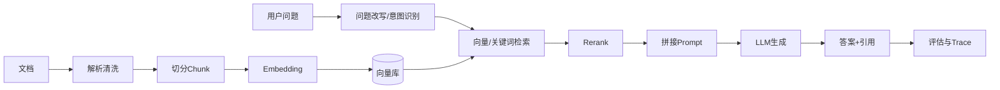

# RAG 基础与全链路

> [!abstract] 一句话总结
> RAG 是“先检索证据，再让模型基于证据回答”的架构，用来让 LLM 使用私有知识、降低幻觉并提供引用溯源。

## 📌 这是什么

RAG（Retrieval-Augmented Generation，检索增强生成）把知识库和 LLM 组合起来：

1. 离线阶段：文档解析、清洗、切分、Embedding、写入向量库。
2. 在线阶段：用户提问、问题改写、检索、重排、拼 Prompt、模型生成、引用溯源。

它不是一个单点技术，而是一条工程链路。任何一步质量差，最终答案都会变差。

## 🤔 解决什么问题 / 为什么需要

- **私有知识**：模型训练时不知道企业内部文档、制度、代码和业务数据。
- **知识更新**：不必重新训练模型，更新文档和索引即可。
- **可追溯**：回答可以附带来源，方便审计和纠错。
- **降成本**：比把全部文档塞进长上下文更可控。

## 🧩 核心概念

| 环节 | 作用 | 精通要点 |
| ---- | ---- | -------- |
| 文档解析 | 从 PDF、Word、网页、Markdown 中提取正文 | 保留标题层级、页码、来源和表格结构 |
| 文本切分 | 把长文档切成可检索片段 | chunk size、overlap、父子块会影响召回 |
| Embedding | 把文本转成向量 | 模型、维度、距离函数、归一化要一致 |
| VectorStore | 存储和查询向量 | Milvus、pgvector、过滤条件、索引类型 |
| Retriever | 根据问题召回候选片段 | TopK、阈值、元数据过滤、混合检索 |
| Rerank | 对候选片段重新排序 | 提升上下文质量，但增加延迟和成本 |
| Generator | LLM 基于证据生成答案 | Prompt 要约束“只基于资料回答” |
| Evaluation | 评估检索和生成质量 | context precision、faithfulness、answer relevancy |

## ⚙️ 工作原理 / 流程



## 💻 Spring AI 伪代码

```java
List<Document> docs = documentReader.read(file);
List<Document> chunks = tokenTextSplitter.split(docs);
vectorStore.add(chunks);

SearchRequest request = SearchRequest.builder()
        .query(question)
        .topK(8)
        .build();

List<Document> retrieved = vectorStore.similaritySearch(request);

String answer = chatClient.prompt()
        .system("只能基于给定资料回答；如果资料不足，明确说不知道。")
        .user(buildRagPrompt(question, retrieved))
        .call()
        .content();
```

## 🧠 精通学习重点

- 能把错误答案定位到：解析错、切分差、没召回、排序差、Prompt 约束弱、模型幻觉。
- 能准备一批评估问题，分别评估召回率、上下文精度、答案忠实度。
- 能解释 RAG、Long Context、CAG、LLM Wiki、GraphRAG 的适用边界。
- 能设计引用溯源，让答案能回到文档、页码、标题或 chunk id。

## ⚠️ 踩坑与注意事项

- 文档解析丢表格、标题或页码，后面再强的模型也很难补救。
- chunk 太小会缺上下文，chunk 太大会召回不准。
- 只做向量检索容易漏掉编号、专有名词、精确字段，必要时做混合检索。
- 没有评估集就调 TopK、chunk size、rerank，基本是在凭感觉。

## 🎯 面试问题

> [!question] 高频问题
> - Q: RAG 全链路怎么讲？
>   - A: 离线是解析、切分、Embedding、入库；在线是问题改写、检索、重排、拼 Prompt、生成、引用和评估。
> - Q: RAG 答案错了怎么排查？
>   - A: 先看是否召回正确资料，再看排序和上下文拼接，然后看 Prompt 约束和模型生成，最后用 trace 复盘输入输出。
> - Q: Rerank 是否一定需要？
>   - A: 不一定。文档少、初召回很准时可以不用；候选多、语义相近、需要提高上下文质量时值得加入。

## 🔗 关联笔记

- [[04-文本切分策略]]
- [[05-Embedding模型选型]]
- [[06-向量检索与TopK]]
- [[07-Rerank重排序]]
- [[12-RAG评估-Ragas]]
- [[_index]]

## 📚 参考资料

- [Spring AI Reference](https://docs.spring.io/spring-ai/reference/)
- [Milvus Docs](https://milvus.io/docs)
- [Ragas Docs](https://docs.ragas.io/)
- [Langfuse Docs](https://langfuse.com/docs)
