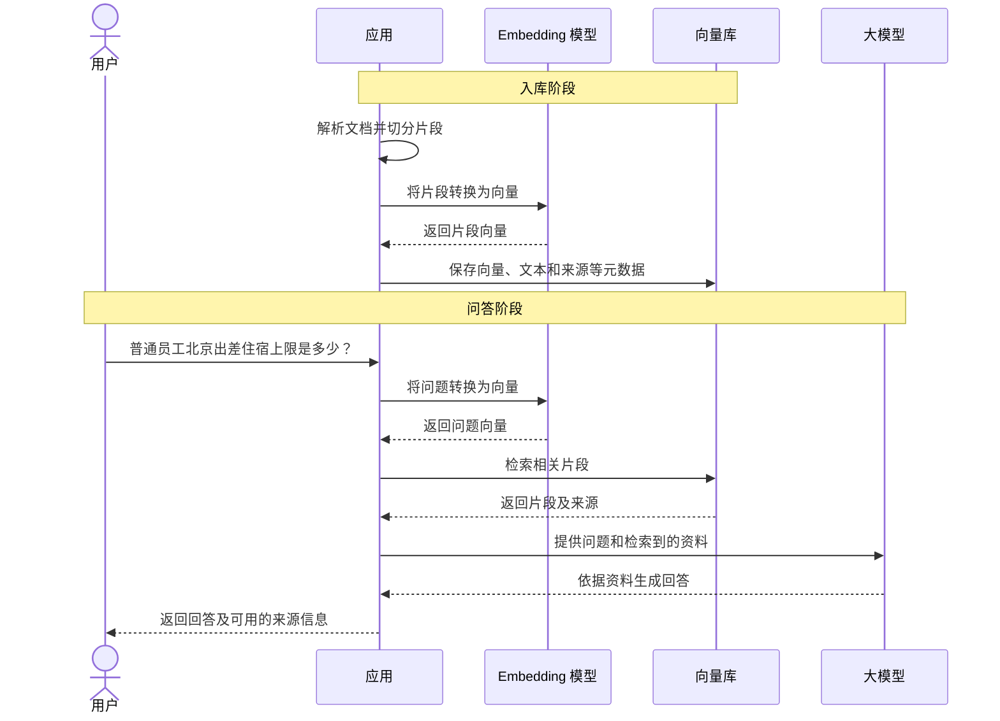

# 01 · RAG 核心原理与全链路实战

> [!abstract] 什么是 RAG？
> RAG（检索增强生成）是在回答问题前，先从知识库中检索相关资料，再把资料和问题一起交给大模型生成回答。它可以让模型利用企业内部或经常更新的知识，但回答质量仍取决于文档、检索结果和模型本身。

---

## 🗺️ 一、RAG 的工作流程

以查询差旅制度为例，RAG 先将文档处理并存入知识库，用户提问时再检索相关片段：



检索到的内容相当于给模型提供了参考资料，并不保证它一定能找对或答对。检索未命中、资料过期或模型理解有误，都可能影响最终回答。

### 为什么需要 RAG，而不是直接微调（Fine-Tuning）？

两者解决的问题不同，也可以结合使用：

| 维度 | RAG | 微调 |
| :--- | :--- | :--- |
| 主要作用 | 在回答时提供外部资料 | 通过训练调整模型的行为 |
| 知识更新 | 更新知识库并重新处理相关文档 | 通常需要重新准备数据并训练 |
| 来源追踪 | 可以返回检索片段及其来源，具体取决于实现 | 模型回答通常难以直接对应到训练资料 |
| 适用场景 | 企业制度、产品手册等需要查询的知识 | 调整回答风格、输出格式或特定任务表现 |

---

## ✂️ 二、文档解析、切分与元数据

文档入库通常要经过解析、切分和向量化。前两步决定了知识库里实际保存的内容，解析错了或切分不合适，后面的检索就可能找不到完整答案。

### 1. 文档解析

解析的目标是提取文字，同时尽量保留标题、段落、表格和来源位置。不同格式提供的信息不同：
- **Word**：可以读取段落样式、标题和表格；如果作者只是把普通文字加粗，解析器未必能把它识别为标题。
- **PDF**：常需要根据文字位置、字号等推断阅读顺序和标题层次；扫描件还需要 OCR，双栏、跨页表格都可能解析出错。
- **Markdown**：标题、列表和代码块有明确标记，适合根据结构处理，但也要检查内容本身是否完整。

Word、PDF 不一定要先转成 Markdown：可以直接解析成带标题、段落和表格的结构化数据，再依据这些结构切分；也可以转成 Markdown，检查和修正后再按标题等标记处理。转换不会自动保证正确，标题层级、表格和页码等仍需抽查。比如 [Docling 的 PDF 标题识别](https://docling-project.github.io/docling/usage/heading_levels/)会根据书签、编号和文字样式推断层级，结果仍受原文质量影响。

#### 图片、图表和扫描件怎么处理？

扫描件的文字可能保存在图片里，图表中的曲线、颜色和坐标也未必能转成普通文字。例如一份报告只有柱状图展示各月销售额，仅提取 PDF 文字可能找不到具体数据。转换成 Markdown 也不一定能解决：结果可能只有图片引用，没有图片内容。
处理时可以根据问题和文档特点选择方式：
- 先用 OCR 识别文字，或用文档解析、视觉模型提取表格和图片描述，再将结果作为文本检索。
- 使用支持图文检索的模型索引原图或页面，命中后把图片和相关文字交给支持图像输入的模型理解；[ColPali](https://arxiv.org/abs/2407.01449) 是页面图像检索的一种方案。

无论采用哪种方式，都应保留原文件、页码和图片位置，方便回看来源；OCR、表格识别和图片描述都可能出错，需要抽查原图并用实际问题测试召回。Spring AI 的 `PagePdfDocumentReader` 适合读取 PDF 页面文本，不能把它当作完整的 OCR 或图表理解工具。

### 2. 文本切分

切分是为了让每个片段既便于检索，又能保留回答问题所需的上下文。例如把“普通员工在北京出差，住宿上限 550 元/晚”拆成“普通员工在北京出差”和“住宿上限 550 元/晚”，后半句就丢了适用对象。实际处理时通常先利用文档结构确定边界，再对过长的内容按长度和标点继续拆分。

#### 根据标题和段落切分

假设文档有下面两个标题：

```markdown
# 差旅制度

## 北京住宿

普通员工住宿上限为 550 元/晚。

## 上海住宿

普通员工住宿上限为 600 元/晚。
```

可以根据 `##` 标题把北京和上海的规定分开，并把“差旅制度 / 北京住宿”这样的标题路径与内容一起保留。标题本身很短或下面没有内容时，不必机械地为每个标题单独生成一个片段；一个章节过长时，也可以在章节内部继续切分。这是我们选择的切分规则，不代表所有读取器都会自动按每个标题切块。例如 [Spring AI 的 MarkdownDocumentReader](https://docs.spring.io/spring-ai/reference/api/etl-pipeline.html)会将标题作为元数据，也可以配置按水平分隔线创建文档；具体效果需要结合配置检查。

#### 根据人工标记切分

如果文档没有可靠的标题，或者现有章节里还有需要单独保留的条款，可以先人工审核并添加约定的标记：

```text
北京：普通员工住宿上限为 550 元/晚。
===CHUNK===
上海：普通员工住宿上限为 600 元/晚。
```

`===CHUNK===` 是自定义标记，不是所有切分器都认识。下面的 Java 片段先按它拆分，`text` 为已读取的文本，省略了导入语句：

```java
List<String> chunks = Arrays.stream(text.split("===CHUNK==="))
        .map(String::trim)
        .filter(part -> !part.isEmpty())
        .toList();
```

有标题的文档也可以加标记，例如同一章节里的两项制度需要分开时。标记应选用正文中不会自然出现的内容，切分后还要保留对应的来源、标题或页码。

#### 根据长度和标点切分

没有合适的结构边界，或者某个章节仍然过长时，可以设定目标长度，并尽量在段落、句子或标点处找断点。长度需要结合文档和模型测试，例如先尝试 300～500 Token，再查看实际片段；Token 与汉字数量不是固定比例。
- 片段太小，可能缺少适用对象或上下文。
- 片段太大，可能混入多个主题，检索后也会带入更多无关内容。
- 表格、代码块和完整条款尽量按结构处理，避免只依靠长度截断。

相邻片段还可以保留一部分重复内容，称为 `overlap`。例如片段目标为 500 Token、重叠 50 Token 时，后一片段会带上前一片段末尾的一部分内容，降低断点割裂上下文的风险；重叠也会增加存储和重复检索，需要根据效果调整。具体切分器是否支持重叠，以及如何配置，要看它的实现。

#### Spring AI 的 TokenTextSplitter

Spring AI 的 `TokenTextSplitter` 以 Token 数量控制片段大小；[2.x 文档](https://docs.spring.io/spring-ai/reference/api/etl-pipeline.html)说明，文本超过目标大小时会尝试在标点处寻找断点，断点还受 `minChunkSizeChars` 等参数约束；较短的文本不会仅因为有标点就逐句拆开。`withPunctuationMarks` 接收单个字符，不能把 `===CHUNK===` 作为一个多字符边界直接传入；短片段也可能受 `minChunkLengthToEmbed` 等参数影响，需要检查是否丢失重要条款。不同版本的接口和默认值可能不同。

### 3. 父子块

有时小片段更容易命中问题，但单独拿给模型又缺上下文。父子块的做法是先保存较完整的父块，再从父块中拆出较小的子块用于检索；命中子块后，通过 `parentId` 找回对应父块，连同来源一起提供给模型。例如“北京住宿”这一节作为父块，普通员工和管理人员的规定分别作为子块。用户问普通员工标准时，先命中对应子块，再取回父块供模型理解上下文。父块不宜无限扩大，否则可能再次引入无关内容。

### 4. 保留元数据并检查切分结果

每个片段除了正文，还应按实际需要保留来源文件、标题路径、页码或文档 ID 等元数据。页码只有在解析和切分过程中能够可靠对应时才能用于引用，不能凭空补一个默认页码。入库和测试时可以检查：
- 适用对象、地点、金额和单位是否保留在一起。
- 表格的表头和数值是否仍能对应。
- 随机提几个实际问题，能否检索到包含完整答案的片段。

---

## 🧮 三、Embedding 与向量存储

### 1. Embedding 与相似度

Embedding 模型把文本转换为向量，例如 `[0.12, -0.34, ...]`。入库时生成片段向量，查询时使用与文档向量匹配的方式生成问题向量，再寻找相近的片段。有些模型对问题和文档使用不同的前缀或编码入口，应遵循对应模型的说明。语义相近不等于事实正确，也不保证一定能召回所需内容。
- **余弦相似度**：衡量两个非零向量的方向是否接近，取值范围是 `[-1, 1]`，越接近 1 表示方向越一致。
- **余弦距离**：pgvector 的 `<=>` 运算符返回 `1 - 余弦相似度`，距离越小表示越相近。

不同 Embedding 模型生成的向量一般不能直接混用，即使维度相同也一样。更换模型时，应使用新模型重新生成文档向量，并确保查询使用与索引匹配的编码方式；切换过程可以通过新建索引等方式安排。

#### 如何选择 Embedding 模型？

选模型要结合知识库的实际内容和问题，不能只看通用榜单。可以从以下几方面比较：
- 检查模型对业务语言和领域文本的支持，例如中文、英文和专业术语。
- 查看[输入长度限制](https://www.sbert.net/examples/sentence_transformer/applications/computing-embeddings/README.html)，确认片段超限时会报错还是被截断。
- 比较向量维度、存储与检索开销，以及模型调用成本和延迟。
- 根据数据处理要求与运维条件，选择 API 服务或本地部署。
- 用真实问题和标注的相关片段比较 [[03-前沿演进与质量评估#1. 检索指标|Recall@K]]，再检查未召回的案例。

### 2. 向量库选型

先看现有基础设施、数据规模、检索功能和运维能力，再结合实际数据测试：
- **PostgreSQL + pgvector**：已有 PostgreSQL，希望把向量与业务数据放在一起时可以优先评估。
- **Milvus、Qdrant**：需要专门的向量检索能力时可以评估，同时考虑部署和运维成本。
- **Elasticsearch**：已有 ES 且需要结合关键词与向量检索时可以评估。
- **SimpleVectorStore**：适合本地学习和验证，不等同于生产环境的向量数据库。

检索性能和容量受数据量、维度、索引、过滤条件及硬件等因素影响，不能只按某个固定数据量选择。

### 3. 向量维度和索引怎么配？

向量的维度是向量中数值的个数，例如 `[0.1, 0.2, 0.3]` 是 3 维。向量字段的维度要与 Embedding 模型的输出一致；维度相同也不能说明两个模型生成的向量可以直接比较。检索时还要选定余弦距离、内积或欧氏距离等度量，并让索引与查询使用相匹配的方式。

#### 精确检索与近似索引

数据量较小时可以先做精确检索，逐个比较符合条件的向量；近似索引用更少的比较换取速度，可能漏掉一部分最近邻。常见索引有：
- **HNSW**：通过多层图查找近邻，通常查询效果较好，但建索引较慢、内存占用较高。
- **IVFFlat**：先把向量分组，查询时只搜索部分组；通常建索引较快、内存占用较少，但需要足够的数据建立分组。

两者都需要根据数据和硬件测试。在 pgvector 中，`hnsw.ef_search` 调整搜索候选量，`ivfflat.probes` 调整搜索的分组数；调大通常能提高召回，但也可能增加延迟。还要用问题集检查正确片段是否被找回，具体见 [pgvector 索引说明](https://github.com/pgvector/pgvector#indexing)。

### 4. pgvector 是怎么存和查的？

pgvector 是 PostgreSQL 的向量扩展，可以把文本、租户信息和向量放在同一张表中。下面是 SQL 片段，假设数据库已安装 pgvector；`vector(3)` 和查询向量只是演示，实际维度与向量值要来自所选模型，表中也需要先写入数据：

```sql
CREATE EXTENSION IF NOT EXISTS vector;
CREATE TABLE rag_chunk (
    id bigint PRIMARY KEY,
    tenant_id text NOT NULL,
    content text,
    embedding vector(3)
);
CREATE INDEX ON rag_chunk USING hnsw (embedding vector_cosine_ops);
```

检索时带上当前用户允许访问的条件，再按余弦距离从小到大取结果：

```sql
SELECT id, content
FROM rag_chunk
WHERE tenant_id = 'tenant-a'
ORDER BY embedding <=> '[0.1, 0.2, 0.3]'::vector
LIMIT 3;
```

`vector_cosine_ops` 与查询中的 `<=>` 都对应余弦距离。真实应用应由服务端根据认证结果生成租户和文档权限条件，不能信任前端随意传入的租户 ID。使用近似索引时，过滤可能让返回数量少于 `LIMIT`；可以结合实际版本测试搜索候选量、迭代扫描、过滤字段索引或分区，但不能为了增加结果而去掉权限条件。

### 5. Milvus 的几个基本概念

Milvus 将数据组织在 **Collection（集合）** 中，类似数据库表；集合的 **Field（字段）** 定义主键、向量和其他数据。以差旅知识库为例，通常按以下步骤使用：
1. 定义字段和向量维度，为向量字段配置 HNSW 或 IVF_FLAT 索引及距离度量。
2. 写入片段 ID、文本、租户 ID 和向量，加载集合供查询。
3. 用问题向量执行 Search，加入租户等过滤条件，并返回所需字段和距离。

Milvus 的 [IVF_FLAT](https://milvus.io/docs/ivf-flat.md) 用 `nlist` 控制分组数，查询时用 `nprobe` 控制搜索多少组。Spring AI 可以通过 `VectorStore` 接入 Milvus，具体依赖与配置见 [Spring AI Milvus 文档](https://docs.spring.io/spring-ai/reference/api/vectordbs/milvus.html)。

### 6. 文档更新和删除

无论使用哪种向量库，文档更新后都要找到旧片段并更新或删除，再写入新片段；删除文档时也要处理关联向量和缓存。可通过文档 ID、版本和来源信息追踪这些操作，避免旧内容继续被召回。

---

## 💻 四、Spring AI 实现 RAG 的关键步骤

下面用 Spring AI 2.x 的接口串起入库、检索和生成。代码只展示关键步骤，省略了导入、Bean 注入和连接配置；项目搭建可参考 [[../02-框架-SpringAI与LangChain4j/SpringAI/01-Spring-AI项目搭建|Spring AI 项目搭建]]，API 和依赖以项目使用的版本为准。

### 1. 读取 PDF 并切分入库

假设 `vectorStore` 已配置，`docId` 是文档标识，`tenantId` 来自已认证的用户。读取页面后按 Token 切分，并配置中英文标点供切分器寻找断点，再为每个片段补充元数据：

```java
Resource pdf = new ClassPathResource("policy.pdf");
List<Document> pages = new PagePdfDocumentReader(pdf).get();
List<Document> chunks = TokenTextSplitter.builder()
        .withChunkSize(400)
        .withPunctuationMarks(List.of('。', '！', '？', '\n', '.', '?', '!'))
        .build()
        .apply(pages);

chunks.forEach(chunk -> {
    chunk.getMetadata().put("doc_id", docId);
    chunk.getMetadata().put("tenant_id", tenantId);
});
vectorStore.add(chunks);
```

这里的 400 Token 只是一个起点，需要查看切分结果并结合召回效果调整。切分后的片段会保留原 `Document` 的元数据；来源、页码是否可用，要检查解析器的实际输出。

### 2. 检索相关片段

检索时需要将用户的问题转换成向量，再查找相近的片段。下面使用 `VectorStore`，只检索当前租户的内容，最多返回 3 条：

```java
FilterExpressionBuilder filter = new FilterExpressionBuilder();
List<Document> hits = vectorStore.similaritySearch(SearchRequest.builder()
        .query(question)
        .topK(3)
        .similarityThreshold(0.65)
        .filterExpression(filter.eq("tenant_id", tenantId).build())
        .build());
```

`tenantId` 应从服务端的认证信息中获取；如果同一租户内还有知识库或文档级权限，也要在检索时一起限制。`0.65` 是示例阈值，实际需要结合评估结果调整；返回的是相关候选，命中了片段并不代表其中一定有答案。

### 3. 把片段和问题交给模型

下面假设代码位于返回 `String` 的问答方法中。没有命中时直接返回提示；有命中时，将片段作为参考资料发送给模型：

```java
if (hits.isEmpty()) {
    return "知识库中未找到相关资料";
}
String context = hits.stream()
        .map(Document::getText)
        .collect(Collectors.joining("\n\n"));
return chatClient.prompt()
        .system("根据参考资料回答；资料不足时说明不知道。")
        .user("参考资料：\n" + context + "\n\n问题：" + question)
        .call().content();
```

实际返回时还可以带上命中片段的文件名、页码等元数据，供用户查看来源。页码缺失就标记未知；命中的来源也不等于答案中的每句话都已得到证实，需要进一步核对引用与回答的对应关系。

### 4. 使用 QuestionAnswerAdvisor

如果不需要自己编排每一步，可以让 `QuestionAnswerAdvisor` 负责检索和拼接上下文：

```java
String answer = chatClient.prompt()
        .user(question)
        .advisors(QuestionAnswerAdvisor.builder(vectorStore).build())
        .call().content();
```

这个例子适用于已完成数据隔离的知识库。多租户场景仍需为检索配置权限过滤；需要返回来源时，可以查看所用版本提供的检索结果，或自行编排检索。

## 🧪 五、如何验证整条链路

以一份差旅制度为例，假设原文写着“普通员工在北京出差，住宿上限为 550 元/晚，超出部分自理”。可以按照下面的顺序检查：
1. 查看解析后的内容和切分结果，确认人员、城市、金额和超出部分的处理方式没有丢失。
2. 提问“普通员工在北京出差住 800 元/晚的酒店，能报销多少？”，检查检索结果是否包含这条规定。
3. 检查回答是否说明每晚报销上限为 550 元、超出部分自理，并能找到对应的参考来源。
4. 用无关问题和不同租户的账号测试，确认查不到资料时有合适提示，且不会召回无权访问的内容。

> [!question]- 已经检索到相关片段，为什么回答仍然可能出错？
> 片段可能缺少适用条件，也可能被模型误读或与其他片段混淆。排查时先看原文和切分结果，再看召回片段，最后核对模型回答。

## 🛠️ 六、常见问题

- 向量维度要与 Embedding 模型的输出一致；更换模型后通常需要重新生成向量并重建或切换索引。
- 文档更新后，要处理旧版本片段，避免新旧规定同时参与检索。
- 缺少来源或页码时，先检查解析和切分过程中是否保留了对应元数据。
- 检索结果不准时，先检查文档解析、切分和召回，再考虑调整 Top-K 或增加重排。

Spring AI 接口可参考官方的 [文档处理](https://docs.spring.io/spring-ai/reference/api/etl-pipeline.html)、[向量检索](https://docs.spring.io/spring-ai/reference/api/vectordbs.html) 和 [RAG Advisor](https://docs.spring.io/spring-ai/reference/api/retrieval-augmented-generation.html)。

## 🔗 下一步进阶

继续阅读 [[02-RAG工业级进阶与检索调优]]，了解混合检索、重排和查询优化；也可以结合 [[../08-项目实战/03-项目-企业知识库RAG系统|企业知识库项目]] 梳理完整工程。
