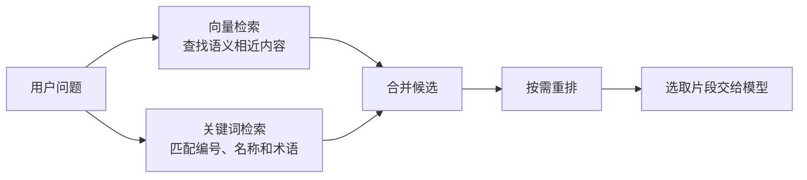

# 02 · RAG 检索优化：混合检索、文档直读与缓存

> [!abstract] 本篇解决什么问题？
> 基础 RAG 能把文档检索出来，但遇到错误码、缩写或跨段落信息时，单一路径可能找不准。本篇从混合检索、重排和查询改写入手，再介绍文档直读与缓存适合解决什么问题。

## 🎯 一、混合检索与重排

### 1. 为什么要组合关键词和向量检索？

向量检索擅长查找意思相近的内容，例如用“住宿能报多少钱”找到“差旅住宿标准”。但用户搜索错误码 `ERR_GATEWAY_504` 时，语义相似的其他错误码也可能排在前面。关键词检索更容易找到包含原始编号的文档，却可能漏掉换了一种说法的同义问题。
混合检索让两路各自召回，再合并结果；如果候选仍然较多，可以用重排模型进一步判断哪些片段最能回答问题：



两路都要应用同样的租户和文档权限过滤。混合检索能互补，但无法保证每次都找到答案，是否值得增加这一层要结合测试集、延迟和维护成本判断。

### 2. BM25 是怎样匹配关键词的？

BM25 是常见的词法检索算法，会综合查询词在文档中的出现情况为结果排序：
- **词频 TF**：查询词在文档中出现得越多，通常越相关，但增加到一定程度后收益会减小。
- **逆文档频率 IDF**：在整个文档集中越少见的词，通常越有区分度。
- **文档长度**：对长文档因包含更多词而获得的优势做调整。

例如搜索 `ERR_GATEWAY_504`，包含该编号的日志比只出现“网关错误”的日志更容易被词法检索找到。中文、错误码和产品名称的效果还受分词器影响，需要用真实查询验证。

### 3. 用 RRF 合并两路结果

BM25 和向量检索的分数范围不同，直接相加时某一路可能因为数值较大而占主导。可以先做分数归一化再加权，也可以用 **RRF（Reciprocal Rank Fusion，倒数排名融合）**：不比较原始分数，只按每一路中的排名计算。

$$\text{RRF}(d) = \sum_{m \in M} \frac{1}{k + \operatorname{rank}_m(d)}$$

`M` 是检索通道集合，`rank` 从 1 开始；某个结果未出现在某一路的候选中，该路贡献为 0。`k` 用来调节排名的影响，下面用 60 作为示例值，并非所有场景的固定最优值。

> [!example] 两路结果怎么合并？
> 文档 A 在关键词检索中排第 1、在向量检索中排第 2，得分约为 `1/61 + 1/62 = 0.03252`。
> 文档 B 只在关键词检索中排第 3，得分约为 `1/63 = 0.01587`。
> 这个例子中 A 的综合得分更高，因此排在 B 前面。

下面的 Java 片段展示一条检索通道如何贡献 RRF 分数；每路结果按排名传入，文档 ID 在同一路内不重复：

```java
void addRrfScores(List<String> ids, Map<String, Double> scores) {
    for (int i = 0; i < ids.size(); i++) {
        double score = 1.0 / (60 + i + 1); // 排名从 1 开始
        scores.merge(ids.get(i), score, Double::sum);
    }
}
```

两路分别调用一次，再按分数排序即可得到融合结果。RRF 不需要让两路原始分数处于同一量纲，但仍需要选择候选数量和参数；也可以评估加权分数组合，见 [Elastic 混合检索说明](https://www.elastic.co/search-labs/blog/improving-information-retrieval-elastic-stack-hybrid)。

### 4. Rerank 重排解决什么问题？

召回阶段先从大量文档中快速找到一批候选；Rerank 再把“问题 + 候选片段”逐对交给重排模型打分，挑出更相关的内容。这样做通常比对全库逐条精排节省计算，但会增加一次模型调用的延迟。
例如先召回 30 个候选，再重排后取 5 个片段，是可以测试的一组参数，不代表固定配置。正确片段如果没有进入候选集，重排也无法把它找回来；因此要先检查召回，再调整重排。

### 5. 查询改写与切片上下文

| 方法 | 怎么做 | 注意什么 |
| :--- | :--- | :--- |
| Multi-Query | 将问题改写成多个问法，分别检索后合并结果 | 可能提高召回，也会增加检索次数和去重工作 |
| HyDE | 先生成一段假设答案，用它辅助检索真实文档 | 假设答案不是事实证据，最终仍需以原文为准 |
| Contextual Retrieval | 入库时给片段补充文档、章节等上下文，再参与检索 | 需要额外生成和维护上下文，补充内容也可能出错 |

例如单独的“上限为 550 元/晚”缺少适用范围；加入“差旅制度 / 北京 / 普通员工”的上下文后，更容易判断它是否回答当前问题。补充的上下文要与原文、来源和权限一起管理。

## 📚 二、Markdown 文档直读

不是所有知识库都必须先切片并写入向量库。如果文档本身有清晰的目录和标题，也可以让应用先搜索文件或标题，再读取相关章节。例如排查配置项时，先搜索 `maximumPoolSize`，再读取命中标题下的完整说明和代码示例。


这种方式适合结构清晰、规模可控的文档，能保留完整章节，但也有取舍：
- 关键词写法不一致时可能搜不到，需要别名、改写或其他检索方式辅助。
- 章节过长仍可能超出上下文预算，必要时要进一步截取或拆分。
- 文件读取必须限制在用户有权访问的目录，并检查路径和读取范围。

文档直读、关键词检索和向量检索可以结合使用，不应把“不切块”等同于一定完整或一定更准确。

### LLM-Wiki 与文档直读有什么关系？

[LLM-Wiki](https://gist.github.com/karpathy/442a6bf555914893e9891c11519de94f) 是一种组织和维护知识库的思路：保留原始资料，让模型逐步整理出有链接的主题页，并按约定更新索引和记录。提问时可以先查索引、读取相关页面，必要时回到原始资料核对。
它不等于某一种固定的检索算法：规模较小时可以直接查目录和页面，规模增大后也可以加入关键词或向量检索。模型整理时可能遗漏、误解或沿用过期信息，所以来源、更新记录和人工抽查仍然重要；实践项目见 [[../08-项目实战/10-项目-Obsidian-LLM-Wiki|Obsidian LLM-Wiki]]。

## ⚡ 三、长上下文、提示词缓存与 CAG

| 概念 | 主要解决什么问题 | 使用边界 |
| :--- | :--- | :--- |
| 长上下文 | 一次请求可以放入更多内容 | 仍要考虑窗口限制、成本和模型对长资料的理解效果 |
| Prompt Caching | 复用多次请求共同前缀的部分计算 | 命中条件、保留时间和计费取决于模型与服务 |
| CAG | 将相对稳定的知识预先放入上下文，供后续问题使用 | 适合知识范围较稳定的场景，仍需处理更新和权限 |

### 1. 提示词缓存怎么复用？

模型处理输入时会生成 KV Cache。如果后续请求的前缀与已有缓存匹配，推理服务可以复用那部分结果，减少重复的预填充计算；新增的问题和未命中的部分仍需处理。

```text
请求 1：[固定差旅制度] + [北京住宿上限？] → 首次处理固定前缀
请求 2：[固定差旅制度] + [上海住宿上限？] → 有机会复用固定前缀
```

缓存是否命中还与模型、最小长度、缓存有效期、请求路由等有关，不是内容相同就一定命中，也不意味着后续请求完全没有预填充。以 [OpenAI Prompt Caching](https://developers.openai.com/api/docs/guides/prompt-caching) 为例，可以通过用量信息检查缓存效果；具体条件以所用服务的文档为准。

### 2. 怎么提高复用机会？

把稳定内容放在前面，把经常变化的内容放在后面，有利于保留相同前缀；实际还需要兼顾消息角色和业务约束：
- 避免在可复用前缀的开头放每次都会变化的时间戳。
- 多篇文档拼接时使用稳定顺序，并记录文档及提示词版本。
- 知识发生变化时更新相应内容，避免继续使用过期资料。
- 按租户和权限组织上下文，不能为了命中缓存而复用无权访问的知识。

CAG 可用于小范围、更新频率低的知识；较大或经常变化的资料仍可按需检索。两者可以组合，最终应比较回答质量、成本、延迟和更新难度。

> [!question]- 缓存命中后，是不是直接返回上次的答案？
> 不是。提示词缓存复用的是相同前缀的计算结果；模型仍会结合当前问题生成新的回答。复用完整答案属于另一类缓存，需要单独设计命中条件和失效策略。

## 🔗 下一步

继续阅读 [[03-前沿演进与质量评估]]，了解 GraphRAG、Agentic RAG，以及如何用评估数据判断检索和回答是否真的改善。
