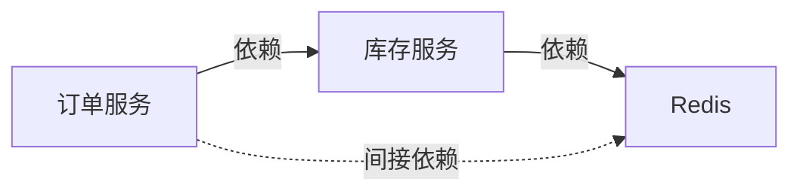
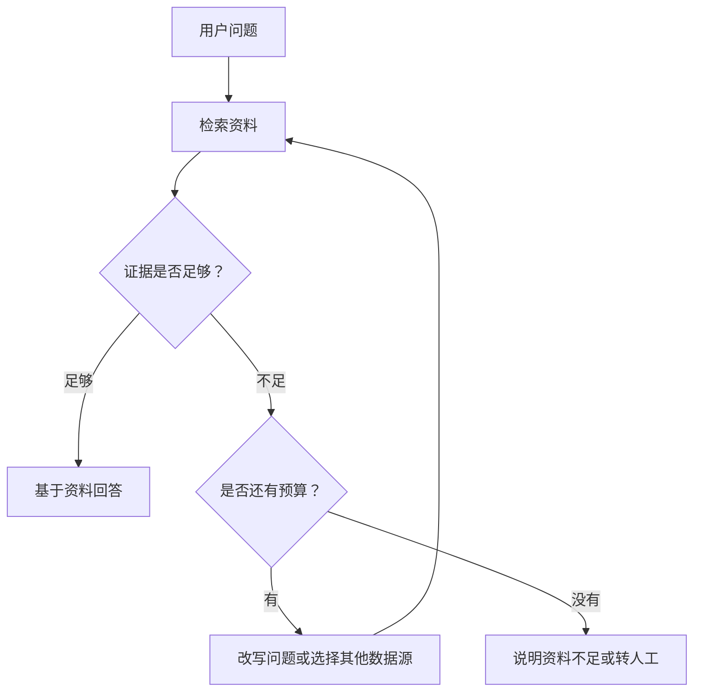
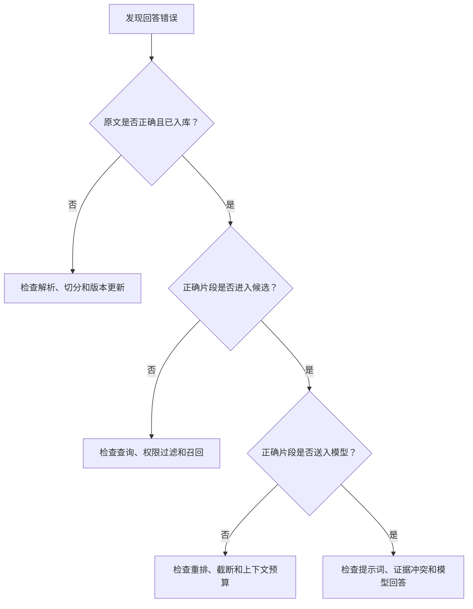

# 03 · RAG 进阶与评估：GraphRAG、Agentic RAG、Ragas

> [!abstract] 本篇解决什么问题？
> 一次检索不一定能回答跨文档的问题，也不能只凭几个例子判断系统质量。本篇介绍图谱检索、可调整检索过程的 Agentic RAG，以及如何分别检查召回和回答。

## 🕸️ 一、GraphRAG

### 1. 图谱能补充什么？

普通向量检索适合找到与问题相近的片段，但跨文档关系或全库概括有时需要把多个片段联系起来。例如文档 A 写“订单服务依赖库存服务”，文档 B 写“库存服务依赖 Redis”，用户问订单服务间接依赖什么，就需要把两条关系串起来。

GraphRAG 会从文档中抽取实体和关系，建立可查询的图结构，再结合图信息和原文回答。它可以辅助处理关系问题，但抽取错误、同名实体混淆或图未及时更新，也会影响结果；不是加了图就一定比向量检索准确。

### 2. 索引和查询怎么进行？

以微软 GraphRAG 的思路为例，入库时先从文档中提取实体与关系，再构建关系图、划分社区并生成社区摘要。查询时根据问题选择不同方式：
- **Local Search**：围绕相关实体查找关系，并结合原文片段，适合问某个服务的依赖。
- **Global Search**：利用社区报告归纳整个数据集的主题，适合问多份复盘中有哪些共同风险。

图谱抽取、消歧、社区划分和摘要都会带来计算与维护成本，数据规模、权限和更新频率也会影响方案。具体查询机制见 [GraphRAG 查询文档](https://microsoft.github.io/graphrag/query/overview/)。

## 🤖 二、Agentic RAG

基础 RAG 往往预先定义好检索和生成的步骤。Agentic RAG 则允许系统根据当前问题和检索结果选择后续动作：例如证据不足时改写查询、换一个允许访问的数据源，或者停止检索并说明资料不足。

评估器也可能判断错，重复查询会增加延迟和成本。实际设计时应设置最大检索次数、总耗时和调用预算；选择数据源时仍由服务端校验用户权限。具体次数应按任务测试，而不是固定为某个数字。

## 📊 三、如何评估 RAG

不要只看最终答案。一次回答至少经过文档解析、切分、召回、重排和生成；把检索与生成分开评估，才能知道问题出现在哪一步。测试集应包含问题、参考答案或证据、适用用户和文档版本，也要覆盖无答案、过期信息和越权请求。

### 1. 检索指标

| 指标 | 回答的问题 |
| :--- | :--- |
| Hit@K | 前 K 个结果里是否至少命中一个相关证据？统计多道题时可计算命中比例 |
| Recall@K | 所有已标注的相关证据中，前 K 个找回了多少？ |
| Precision@K | 前 K 个结果里，有多少是相关证据？ |
| MRR | 第一条相关结果排得有多靠前？对各问题的倒数排名取平均 |

例如一个问题有 4 个已标注的相关片段，前 3 个结果中命中了 2 个，那么 Recall@3 是 `2/4`，Precision@3 是 `2/3`。如果三道题的第一条相关结果分别排在第 1、第 2 和未命中，MRR 为 `(1 + 1/2 + 0) / 3 = 0.5`。计算前要明确相关证据标注范围，以及按文档还是按片段统计。

### 2. 回答与证据指标

- **Faithfulness（忠实度）**：回答中的事实是否得到提供给模型的资料支持。
- **答案相关度**：回答是否切合用户的问题，避免答非所问。
- **答案正确性**：回答与参考答案或业务事实是否一致，必要时由人工核查。

忠实于资料不代表事实一定正确：资料本身也可能过期或有误。[Ragas 的指标说明](https://docs.ragas.io/en/latest/concepts/metrics/available_metrics/)还提供上下文精度、召回等评估方法；部分指标依赖裁判模型，结果需要结合人工抽查，不能把分数当作唯一结论。

### 3. 引用怎么检查？

回答里有 `[1]` 不代表引用一定正确。先检查编号是否能找到对应来源，再确认来源是否支持答案中的事实和限定条件。

> [!example] 编号正确，内容仍可能不支持
> 回答说“普通员工在北京的住宿上限为 800 元/晚 [1]”，但 `[1]` 的原文是“部门总监在北京的住宿上限为 800 元/晚”。编号存在，原文却不支持“普通员工”。

### 4. 答错后从哪里查？

这个顺序用于缩小排查范围，不表示每个分支只有一种原因。应同时查看实际请求、文档版本、召回片段、排序结果和模型输入。

## ❓ 四、复习问题

> [!question]- 1. 为什么有时要同时使用关键词检索和向量检索？
> 关键词检索适合匹配编号、名称等明确文本；向量检索有助于发现语义相近的表达。两者可以互补，但是否需要混合应由实际评估决定。

> [!question]- 2. RRF 如何合并检索结果？
> RRF 将各路结果中的排名转换为分数并累加。它不直接依赖原始分数；也可以考虑先归一化分数，再做加权融合。

> [!question]- 3. 换了同维度的 Embedding 模型，还能直接复用旧向量吗？
> 通常不能。维度相同不代表向量空间相同；应使用新模型重新生成文档向量，并采用与之匹配的查询编码方式。部分模型需要分别使用查询和文档前缀。

> [!question]- 4. Rerank 与初始召回有什么区别？
> 召回负责从大量文档中找到候选，重排负责对候选重新排序。重排看不到未召回的文档，所以需要先保证召回覆盖。

> [!question]- 5. GraphRAG 的 Local Search 和 Global Search 分别适合什么问题？
> Local Search 适合围绕具体实体查关系，并可结合原文；Global Search 利用社区报告归纳数据集的整体主题。

> [!question]- 6. Agentic RAG 怎么控制重复检索？
> 给检索和模型调用设置次数、耗时与成本预算；达到上限后按业务要求提示资料不足或转人工，权限始终由服务端校验。

> [!question]- 7. 忠实度高，为什么答案仍可能错误？
> 忠实度只衡量回答是否有资料支持；如果资料过期、错误或不适用，忠实复述也可能得到错误答案。

> [!question]- 8. 回答里有引用编号，就证明来源正确吗？
> 不证明。既要检查编号是否存在，也要核对引用的原文是否支持回答中的事实、对象和适用条件。

> [!question]- 9. Prompt Caching 和缓存答案有什么区别？
> Prompt Caching 复用共享前缀的计算结果，模型仍会为当前问题生成回答；答案缓存则直接复用已有回答，命中条件和失效策略不同。

> [!question]- 10. 原文已经被召回，回答为什么仍然可能错误？
> 片段可能在重排或截断时丢失，也可能与其他证据冲突，或被模型误读。应检查最终送入模型的上下文和生成结果。

## 🔗 继续学习

回顾 [[01-RAG核心原理与全链路实战]] 和 [[02-RAG工业级进阶与检索调优]]；也可以到 [[../06-平台与工程化/07-Ragas评估实践|Ragas 评估实践]] 了解评估工具，或继续学习 [[../05-Agent-MCP-Skills/_index|Agent 与工具调用]]。
