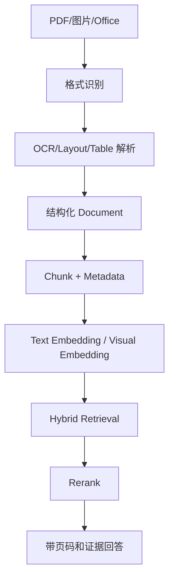

# 多模态 RAG 与文档智能

> [!abstract] 一句话总结
> 多模态 RAG 不只是把 PDF 转文字，而是要理解版面、表格、图片、扫描件和证据位置，让模型能回答“文档里到底写了什么”。

## 为什么最近要补

企业知识库的真实资料大量是 PDF、扫描件、图片、表格、PPT、合同和报表。普通文本切分只能处理干净 Markdown；一旦遇到跨页表格、图片说明、票据、报告版式，就需要文档智能。

## 三种路线

| 路线 | 做法 | 适合场景 |
| ---- | ---- | -------- |
| OCR + 文本 RAG | OCR 后按文本切分 | 扫描件、票据、合同 |
| Layout-aware RAG | 保留标题、表格、坐标、页码 | PDF 报告、制度文档 |
| Visual RAG | 图片/页面直接向量化或用视觉模型理解 | 图表、版面复杂文档 |

## 文档解析流水线

## Metadata 必须保留

- 文件名、文档版本、上传人、租户。
- 页码、段落标题、表格编号、图片编号。
- 坐标或 bounding box。
- OCR 置信度。
- 权限标签和有效期。

没有 metadata，后续引用溯源、权限过滤、更新删除、人工复核都会很痛。

## 表格处理

表格不要粗暴按行拼接。常见做法：

- 小表格：转 Markdown 表格进入上下文。
- 大表格：转结构化数据，按行/列检索。
- 数值统计：不要让 LLM 心算，交给 SQL/Pandas/工具。
- 跨页表格：解析阶段合并，并保留原页码。

## Visual RAG 的边界

Visual RAG 适合图表、海报、截图、扫描版式复杂文档。但成本高、延迟高、可解释性弱。生产上常用组合路线：文本能解决的先文本检索，召回不足时再调用视觉模型。

## 与普通 RAG 的差异

| 普通 RAG | 多模态/文档智能 RAG |
| -------- | ------------------- |
| 文本 chunk | 页面、段落、表格、图片块 |
| 只看文本相似度 | 文本 + 版面 + 视觉特征 |
| 引用文件名 | 引用页码、坐标、截图 |
| 更新简单 | 需要文档版本和解析缓存 |

## 面试讲法

> 企业知识库最大难点不是向量库，而是文档解析质量。真实文档里有扫描件、表格、图片和跨页结构。我会在解析阶段保留页码、坐标、标题层级、表格结构和权限 metadata，再做 Hybrid Search、Rerank 和引用溯源。

## 关联

- [[02-文档解析]]
- [[04-文本切分策略]]
- [[11-引用溯源]]
- [[08-混合检索-Hybrid-Search]]

## 📚 参考资料

- [Docling Documentation](https://ds4sd.github.io/docling/)
- [Unstructured Documentation](https://docs.unstructured.io/)
- [LlamaParse Documentation](https://docs.cloud.llamaindex.ai/llamaparse)
- [ColPali Paper](https://arxiv.org/abs/2407.01449)

