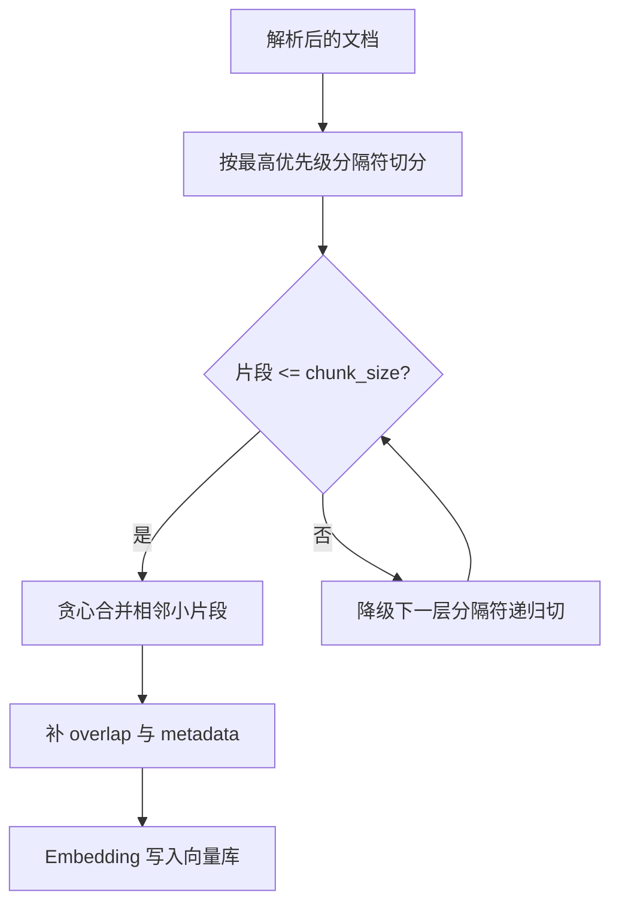

# 文本切分策略

> [!abstract] 一句话总结
> 文本切分（Chunking）决定 RAG 的"检索颗粒度"：块太大，向量表示被稀释、召回不准还塞爆上下文；块太小，语义不完整、模型拿到答案的碎片却拼不回原意。切分策略的本质是在语义完整性、召回精度、上下文成本三者之间找平衡。

## 🗣️ 白话版（先建立直觉）

把知识库想成一个图书馆，切分就是决定"借书的最小单位"。如果最小单位是"整本书"（块太大），你问"Redis 过期策略是什么"，图书馆员抱来一整本《Redis 实战》让你自己翻——信息在里面，但淹没在无关内容里。如果最小单位是"单个句子"（块太小），图书馆员递给你一张写着"惰性删除是其中一种。"的纸条——"其中一种"指什么？前文没了，这句话等于废话。

好的切分就像把书拆成一篇篇主题完整的小节：每一片既小到能精准命中你的问题，又大到自己能把话说完整。

## 📌 这是什么

Chunk（块）是 RAG 系统里的最小检索单元。文档入库前会被切成若干块，每块单独做 Embedding 存进向量库；用户提问时，检索的对象不是整篇文档，而是这些块。所以切分方式直接决定了两件事：**每个向量"代表"多大范围的语义**，以及**检索命中后 LLM 能拿到多完整的上下文**。它是 ETL 管道中"解析之后、向量化之前"的一步，也是 RAG 效果调优中投入产出比最高的环节之一。

## 🤔 解决什么问题 / 为什么需要

不切分行不行？不行，有三个硬约束：

1. **Embedding 模型有输入长度上限**（常见 512~8192 token），整篇文档塞不进去；即使塞得进，一个向量要概括一万字的所有主题，语义被平均稀释，"什么都沾一点、什么都不像"，检索时和任何具体问题的相似度都不高。
2. **LLM 上下文窗口有限且按 token 计费**，召回 5 篇完整文档可能就超窗了，而其中 95% 的内容与问题无关，纯属花钱买噪声，还会诱发"迷失在中间"（lost in the middle）问题。
3. **答案通常只藏在文档的某一小段里**。检索的理想目标是"精准取出那一段"，颗粒度太粗根本做不到。

没有合理切分，后面的向量检索、Rerank、Prompt 组装做得再好也是白搭——这就是"垃圾进，垃圾出"在 RAG 里的第一道关口。

## 🧩 核心概念

| 概念 | 含义 | 备注 |
| ---- | ---- | ---- |
| chunk_size | 单个块的目标长度（字符数或 token 数） | 中文常按字数，英文常按 token |
| overlap | 相邻块之间重叠的内容长度 | 防止答案恰好被切在边界上 |
| 分隔符优先级 | 递归切分时依次尝试的切分点 | 如：标题 → 空行 → 句号 → 字符 |
| metadata | 附在块上的来源信息（标题路径、页码等） | 检索过滤和溯源都靠它 |
| 父子块 | 小块用于检索、大块用于生成的两层结构 | 兼顾"检得准"和"读得全" |

## ⚙️ 工作原理 / 流程

### 五种主流策略逐一拆解

**1. 固定长度切分（Fixed-size）**

原理最简单：不管内容，每 N 个字符/token 切一刀，通常配 overlap。比如 chunk_size=500、overlap=50，就是第 1 块取 0~500，第 2 块取 450~950，以此类推。

为什么还有人用？因为它零成本、结果可预期，做原型验证时先跑通链路最快。缺点也致命：它对语义完全"色盲"，一句话、一个表格、一个代码块都可能被拦腰斩断。**适用场景**：快速原型、内容本身无结构的纯文本流（如语音转写稿）。

**2. 递归切分（Recursive）**

这是绝大多数场景的默认选择（LangChain 的 RecursiveCharacterTextSplitter 就是它）。核心思想：**按分隔符优先级"能不切细就不切细"**。给定分隔符列表如 `["\n\n", "\n", "。", " "]`，算法先尝试按段落（空行）切，切出来的片段如果没超过 chunk_size 就保留；某段太长，再降级用换行切；还太长，再降级用句号切……直到满足长度。

为什么好？因为段落和句子本身就是人类组织语义的边界，优先在这些位置下刀，切出来的块天然比固定长度更完整。**适用场景**：通用文档的默认起点，90% 的项目从它开始。

**3. 语义切分（Semantic）**

前两种看"形式"，这种看"意思"：先把文档按句子切开，对每个句子做 Embedding，然后计算相邻句子的向量相似度——相似度突然下降的地方，说明话题变了，就在那里切一刀。

为什么准？因为它找的是真正的"语义断点"而不是格式断点。代价是入库时要对每个句子算 Embedding，成本和耗时明显上升。**适用场景**：段落格式混乱但内容连贯的长篇说明文、访谈记录，格式信号不可靠时的补救手段。

**4. 结构化切分（Structure-aware，如 Markdown 标题切分）**

利用文档自带的结构信号：Markdown 按 `#/##/###` 标题层级切，法律文本按"第 X 条"切，代码按函数/类切，HTML 按标签切。切完把标题路径（如 `员工手册 > 第3章 报销 > 3.2 差旅`）写进 metadata。

为什么强？因为作者写标题时已经免费帮你做了一次"人工语义分段"，这是质量最高的切分信号；标题路径进 metadata 后，检索时还能带上语境（"上限 800 元"到底是谁的上限）。**适用场景**：技术文档、API 手册、法律合同、规章制度——凡是结构规范的文档首选它，通常再叠加递归切分兜底处理超长小节。

**5. 父子块策略（Parent-Child / Small-to-Big）**

它解决一个内在矛盾：**检索希望块小（向量语义集中、命中准），生成希望块大（上下文完整、模型读得懂）**。做法是切两层：小的子块（如 200 字）做 Embedding 进向量库负责"被检索"，每个子块记着自己的父块 ID；命中子块后，实际交给 LLM 的是它对应的大父块（如 1000 字或整个小节）。

为什么值得多存一层？因为它让"检索颗粒度"和"生成颗粒度"解耦，各取最优，不用再在一个 chunk_size 上痛苦折中。**适用场景**：事实问答要求定位精准、但答案理解又依赖上下文的知识库（制度文档、技术手册），生产系统的常见进阶配置。

### 用一个具体例子走一遍递归切分

假设员工手册里有这么一段（约 180 字），设 chunk_size=100、overlap=20、分隔符优先级 `["\n\n", "。"]`：

```text
3.2 差旅报销

员工出差需提前在 OA 系统提交申请。交通费实报实销，其中高铁限二等座。

住宿费按城市分级：一线城市每晚上限 800 元，二线城市每晚上限 500 元。超出部分需部门总监特批，否则自理。
```

算法执行过程：

1. 先按 `\n\n` 切成 3 段：标题（8 字）、交通段（38 字）、住宿段（52 字）——每段都 ≤100，**不再往下切**，句号分隔符根本没用上。这就是"能不切细就不切细"。
2. 但每段太碎，算法会把相邻小段**贪心合并**到不超过 chunk_size：标题 + 交通段合并为块 A（46 字）；再加住宿段会到 98 字，仍 ≤100，于是三段合成一个完整的块。
3. 假如住宿段有 120 字超了限，才会降级用 `。` 把它切成两句，并让第二块开头重叠前一块末尾约 20 字，保证"上限 800 元"和"超出部分需特批"不会被硬边界拆散。

对比固定长度切分：每 100 字机械切一刀，会切出 `...一线城市每晚上限 8` 和 `00 元，二线城市...` 这种灾难。递归切分的整个设计就是为了避开这种情况——**先尊重结构，实在不行才动刀，动刀时留重叠**。



### chunk_size 与 overlap 的经验值及理由

- **中文 300~800 字 / 英文 300~800 token 起步**。下限 300 是因为再小就装不下"一个完整的意思"（一条制度、一个 API 的说明大约就是这个量级）；上限 800 是因为主流 Embedding 模型在这个长度内语义表示质量较好，再大向量开始"稀释"，且召回 5 块就要占 4000 字上下文，成本上升。
- **overlap 取 chunk_size 的 10%~20%**。太小起不到"缝合边界"的作用；太大（如 50%）意味着向量库里近一半内容是重复的——存储翻倍、同一段话以两个相似向量出现，TopK 里互相挤占名额。
- **事实问答偏小（300~500），综合总结偏大（800~1500）**。前者要"针尖定位"，后者要"面上覆盖"。这不是玄学，是下一节的召回/精确率机制决定的。

### 切分对召回率和精确率的影响机制

- **块偏小 → 精确率高、召回率有风险**：小块语义集中，向量和具体问题的相似度算得准，命中的块几乎句句相关（精确率高）；但一个答案如果横跨两个小块，可能每个小块单独看相似度都不够高，谁也进不了 TopK（召回丢失），且命中了也可能上下文残缺。
- **块偏大 → 召回率高、精确率下降**：大块覆盖面广，答案"在块里"的概率大（召回率高）；但块内大量无关内容既稀释了向量（可能反而排不进 TopK），又在命中后把噪声塞给 LLM（精确率低、干扰生成）。
- 所以调 chunk_size 本质上是在召回/精确之间移动滑块，而**父子块策略是打破这个折中的结构性方案**：子块保精确检索，父块保完整召回内容。

## 🆚 从坏到好（对比案例）

**坏例子**：对上面的员工手册用固定长度 chunk_size=60、overlap=0 切分，得到：

```text
块1: "3.2 差旅报销\n\n员工出差需提前在 OA 系统提交申请。交通费实报实销，其中高铁限二等座。\n\n住宿费按城市分"
块2: "级：一线城市每晚上限 800 元，二线城市每晚上限 500 元。超出部分需部门总监特批，否"
块3: "则自理。"
```

**为什么坏**：用户问"二线城市住宿标准是多少"，最相关的块 2 开头是没头没脑的"级："，且块内没有"差旅""住宿费"完整语境，向量相似度被拉低，可能排不进 TopK；就算命中，LLM 看到的是断句碎片，"800 元"属于谁要靠猜。块 3 只有 4 个字，是纯垃圾向量。答案被物理切碎，**语义在切分这一步就已经丢了，后面任何环节都救不回来**。

**修好后**（Markdown 标题切分 + 递归兜底 + 标题路径 metadata）：

```text
块1: "员工出差需提前在 OA 系统提交申请。交通费实报实销，其中高铁限二等座。"
     metadata: {title_path: "员工手册 > 3 费用 > 3.2 差旅报销"}
块2: "住宿费按城市分级：一线城市每晚上限 800 元，二线城市每晚上限 500 元。超出部分需部门总监特批，否则自理。"
     metadata: {title_path: "员工手册 > 3 费用 > 3.2 差旅报销"}
```

每块自成一个完整的意思，块 2 能被"二线城市住宿标准"精准命中，标题路径告诉模型这是差旅报销语境。同样的原文、同样的向量库，仅仅换了切分方式，问答质量天差地别。

## 💻 代码实践

Spring AI 内置了 `TokenTextSplitter`（按 token 的固定长度切分），生产可直接用；这里为了吃透原理，手写一个**简化版递归切分器**（可独立运行，省略了 token 计数，按字符长度近似）：

```java
import java.util.ArrayList;
import java.util.List;

public class SimpleRecursiveSplitter {

    // 分隔符优先级：段落 -> 换行 -> 中文句号 -> 逗号
    private static final String[] SEPARATORS = {"\n\n", "\n", "。", "，"};
    private final int chunkSize;   // 例如 500
    private final int overlap;     // 例如 50

    public SimpleRecursiveSplitter(int chunkSize, int overlap) {
        this.chunkSize = chunkSize;
        this.overlap = overlap;
    }

    public List<String> split(String text) {
        List<String> pieces = recursiveSplit(text, 0);
        return mergeWithOverlap(pieces);
    }

    /** 核心：优先用高层分隔符，切不动才降级 */
    private List<String> recursiveSplit(String text, int sepIndex) {
        List<String> result = new ArrayList<>();
        if (text.length() <= chunkSize) {
            result.add(text);
            return result;
        }
        if (sepIndex >= SEPARATORS.length) {          // 没有分隔符可用，硬切兜底
            for (int i = 0; i < text.length(); i += chunkSize) {
                result.add(text.substring(i, Math.min(i + chunkSize, text.length())));
            }
            return result;
        }
        for (String piece : text.split(java.util.regex.Pattern.quote(SEPARATORS[sepIndex]))) {
            if (piece.isBlank()) continue;
            result.addAll(recursiveSplit(piece, sepIndex + 1)); // 超长片段降级递归
        }
        return result;
    }

    /** 贪心合并小片段到接近 chunkSize，并给相邻块加 overlap */
    private List<String> mergeWithOverlap(List<String> pieces) {
        List<String> chunks = new ArrayList<>();
        StringBuilder buf = new StringBuilder();
        for (String p : pieces) {
            if (buf.length() + p.length() > chunkSize && buf.length() > 0) {
                chunks.add(buf.toString());
                int start = Math.max(0, buf.length() - overlap);
                buf = new StringBuilder(buf.substring(start));   // 带上尾部 overlap
            }
            buf.append(p).append("。");
        }
        if (buf.length() > 0) chunks.add(buf.toString());
        return chunks;
    }
}
```

在 Spring AI ETL 管道中的位置（`TokenTextSplitter` 用法，参数依次为 chunkSize、minChunkSizeChars 等）：

```java
List<Document> docs = new TikaDocumentReader(resource).get();       // 1. 解析
List<Document> chunks = new TokenTextSplitter(500, 100, 5, 10000, true)
        .apply(docs);                                               // 2. 切分
vectorStore.add(chunks);                                            // 3. 向量化入库
```

> 完整代码见：[[03-项目-企业知识库RAG系统]]

## 🧪 最小验证（做一遍才算学会）

用手头任何一篇 2000 字以上的制度类文档（或直接用本文的员工手册例子扩写）做对照实验，10 分钟内可完成：

1. 用上面的 `SimpleRecursiveSplitter`，分别以 `(100, 0)` 和 `(500, 50)` 两组参数切同一篇文档，打印所有块。
2. 观察 `(100, 0)` 的输出：数一数有几个块是以半句话开头/结尾的，有没有像"则自理。"这样的碎块。
3. 挑一个"答案横跨两句话"的问题（如"住宿超标怎么办"），人工判断：哪组参数切出的块能独立回答它？
4. 预期结论：小块 + 无重叠时答案被拆散；500+overlap 时答案完整落在单块内。若你接了向量库，可进一步对比两组配置下同一问题的 Top3 召回差异。

## ⚠️ 踩坑与注意事项

- **切断表格 / 代码块 / 条款编号**：现象是召回的表格只剩半行、代码缺右括号。原因是切分器不认识这些结构。避免方法：解析阶段把表格/代码块标记为"原子块"整体保留，法律文本按"第 X 条"做结构化切分。
- **overlap 设得过大**：现象是 Top5 里出现两三条内容几乎一样的块，挤掉了本该召回的其他内容。原因是重叠内容生成了高度相似的向量。控制在 10%~20%，并考虑检索后去重。
- **丢失标题语境**：块内只写"上限 800 元"，不带 metadata 时模型不知道这是"一线城市住宿"的上限。标题路径务必写入 metadata，必要时直接拼进块文本开头。
- **只调参数不看数据**：切分质量靠"抽样人工检查 20 个块"比盲目扫参数有效得多——切分是所见即所得的环节，先看再调。

## 🧠 自测题（先自己答，再展开对答案）

> [!question]- Q1: 为什么"块越大，信息越全"是错觉？大块在检索阶段和生成阶段分别造成什么问题？
> 参考答案：检索阶段，大块的向量要概括多个主题，语义被稀释，与任何具体 query 的相似度都不高，可能反而排不进 TopK（召回不一定升，排序先崩）；生成阶段，大块把大量无关内容塞进上下文，增加成本、稀释注意力、诱发"迷失在中间"，精确率下降。信息"在库里"不等于"能被检到且被读懂"。

> [!question]- Q2: 你接手一个法律合同知识库，用户反馈"问某条款时经常召回半句话"。你会怎么排查和改造切分方案？
> 参考答案：先抽样看现有块——大概率是固定长度切分把"第 X 条"拦腰切断。改造：按"第 X 条/第 X 款"做结构化切分，条款作为原子单元不再细切；超长条款用递归切分兜底并加 overlap；把"合同名 > 章 > 条"写入 metadata；对表格类附件整体保留。最后抽 20 个块人工验收，再用典型问题跑召回对比。

> [!question]- Q3: 父子块策略和"直接把 chunk_size 调大"有什么本质区别？什么情况下不值得上父子块？
> 参考答案：调大 chunk_size 是在召回/精确的滑块上移动，检索和生成被迫共用同一个颗粒度；父子块把两者解耦——小子块负责被精准检索，大父块负责提供完整上下文，两头都拿到最优。不值得上的情况：文档本身就短（一篇 FAQ 一个块装得下）、或系统还在原型期，递归切分已够用，父子块带来的存储和工程复杂度暂无回报。

## 🎯 面试问题

> [!question] 高频问题
> - **Q: chunk_size 怎么选？**
>   - A（30 秒）：没有万能值，中文从 300~800 字起步，overlap 10%~20%，用真实问题集测召回率和答案准确率来定，事实问答偏小、综合总结偏大。
>   - A（2 分钟展开）：① 讲机制——小块语义集中、检索精确率高，但答案跨块时召回丢失；大块覆盖全但向量稀释、噪声进上下文，所以这是召回/精确的折中问题。② 讲约束——Embedding 模型输入上限和 LLM 上下文成本框定了上界。③ 讲方法——不拍脑袋，构建 20~50 个真实问题的评估集，扫参对比命中率；结构化文档优先按标题切而不是纠结长度。④ 讲进阶——检索/生成需求冲突时用父子块解耦，小块检索大块生成。
> - **Q: overlap 有什么用？设多大合适？**
>   - A（30 秒）：防止答案恰好落在两个块的边界上被切断，一般取 chunk_size 的 10%~20%；过大会导致向量库重复内容多、TopK 被相似块挤占。
>   - A（2 分钟展开）：① 原理——硬边界总会存在，重叠让边界附近的语义在两个块里都完整出现一次，等于给每刀"留了缝合余量"。② 反面——overlap 50% 时库容量近乎翻倍，且同一段话生成两个高相似向量，检索时互相竞争名额、Top5 出现重复块。③ 补充——递归/结构化切分在语义边界下刀，对 overlap 的依赖比固定长度切分小；检索后做去重可以缓解重复召回。
> - **Q: 五种切分策略怎么选？**
>   - A（30 秒）：默认递归切分；文档结构规范（Markdown/法律/API 文档）优先结构化切分；格式乱但语义连贯的长文用语义切分；检索和生成颗粒度冲突时上父子块；固定长度只做原型。
>   - A（2 分钟展开）：按"文档有什么信号就用什么信号"排序——有标题结构用结构化（作者免费做的语义分段，信号最强）；无结构但有段落句子用递归（形式边界近似语义边界，成本零）；连形式边界都不可靠才用语义切分（Embedding 找断点，效果好但入库成本高）；父子块是正交的增强手段，可与前面任意策略叠加。落地时通常是组合拳：结构化为主、递归兜底超长小节、metadata 记标题路径。

## 🪝 记忆钩子

**口诀："三八起步一二叠，检索小块生成父。"**
—— chunk_size 从 300~800 起步，overlap 取 10%~20%；检索要精用小块，生成要全靠父块。
再记一个画面：固定长度切分 = 用铡刀切书页，"上限 8 | 00 元"血案就是它干的；递归切分 = 沿着段落和句号的"虚线"撕纸，能不撕碎就不撕碎。

## 🔗 关联笔记

- [[02-文档解析]]（切分的上游：解析质量决定切分上限，表格/代码块要在解析期标记为原子块）
- [[10-父子块策略]]（本篇第五种策略的展开：检索与生成颗粒度解耦的完整实现）
- [[06-向量检索与TopK]]（切分的下游：chunk 颗粒度直接影响 TopK 召回质量）
- [[01-RAG基础与全链路]]（全链路视角看切分处于 ETL 的哪一环）
- [[_index]]

## 📚 参考资料

- [Spring AI ETL Pipeline](https://docs.spring.io/spring-ai/reference/api/etl-pipeline.html)
- [LangChain Text Splitters](https://python.langchain.com/docs/concepts/text_splitters/)
- [LlamaIndex Node Parsers](https://docs.llamaindex.ai/en/stable/module_guides/loading/node_parsers/)
