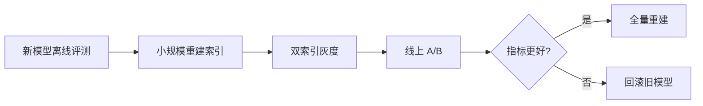

# Embedding模型选型

> [!abstract] 一句话总结
> Embedding 模型把文本映射成向量，决定语义检索能不能把“问法不同但意思相同”的内容找回来；生产选型必须用自己的评估集验证，而不是只看排行榜。

## 🎯 本节定位

- **本章第 5 课，决定“语义检索上限”的环节**。前置 [[04-文本切分策略]]（切分颗粒度直接影响向量质量）；本篇解决“用哪个模型、怎么验证、怎么升级”。
- **延伸阅读（本课不展开）**：检索侧见 [[06-向量检索与TopK]]，精确匹配兜底见 [[08-混合检索-Hybrid-Search]]，向量库实现见 [[13-Milvus入门]]、[[14-pgvector入门]]。

## 📌 这是什么

Embedding 不是生成模型，而是语义编码器。RAG 中通常对文档 chunk 和用户 query 使用同一个或兼容的 Embedding 模型，再通过向量相似度找候选资料。

## 🧩 选型维度

| 维度 | 关注点 | 面试表达 |
| ---- | ------ | -------- |
| 语言 | 中文、英文、多语言是否强 | 中文企业文档优先测中文召回 |
| 领域 | 通用、代码、法律、金融、医学 | 领域术语多时必须自建评估集 |
| 维度 | 存储、检索成本和表达能力 | 维度高不一定效果更好 |
| 上下文长度 | 能否编码较长 chunk | 长 chunk 可能稀释重点 |
| 部署 | 云 API、本地模型、私有化 | 看安全、成本、延迟和运维 |
| 成本 | 入库成本 + 查询成本 | 文档量大时入库成本明显 |
| 版本 | 模型升级和兼容性 | 换模型通常要重建索引 |

## 📊 模型对比口径

| 类型 | 优点 | 风险 | 适合场景 |
| ---- | ---- | ---- | -------- |
| 云厂商 Embedding | 接入简单、稳定、免运维 | 数据出域、成本、限流 | 非敏感业务、快速验证 |
| 开源 bge/e5/jina/text2vec | 可私有化、成本可控 | 部署和调优成本 | 企业私有知识库 |
| 多语言模型 | 跨语言检索能力好 | 单语言效果未必最优 | 中英混合文档 |
| 代码 Embedding | 对函数/类/API 更友好 | 普通文本未必强 | 代码知识库、研发助手 |
| 领域微调模型 | 领域效果可能更好 | 数据集和维护成本高 | 法律、医疗、金融等强领域 |

## 🧪 离线评测方法

不要只看 MTEB 排行榜，要用自己的业务问题评测。

评估集格式：

```json
{
  "question": "报销发票最晚什么时候提交？",
  "positive_chunk_ids": ["doc1#chunk12"],
  "negative_chunk_ids": ["doc2#chunk3"],
  "category": "制度问答"
}
```

核心指标：

| 指标 | 含义 |
| ---- | ---- |
| Recall@K | 正确 chunk 是否出现在 TopK |
| MRR | 正确 chunk 排名是否靠前 |
| nDCG | 多个相关资料时看排序质量 |
| Latency | 单次 query embedding + 检索耗时 |
| Cost | 文档入库和查询成本 |

## 🔁 Query Embedding 与 Document Embedding

- 普通 RAG 通常 query 和 document 使用同一个模型。
- 有些模型区分 query instruction 和 passage instruction，例如 E5 类模型需要不同前缀。
- 如果模型要求前缀，入库和查询时必须保持一致，否则召回效果会明显下降。

示例：

```text
query: 报销发票最晚什么时候提交？
passage: 财务制度规定，员工应在费用发生后30天内提交发票...
```

## 🔄 模型升级与索引重建

更换 Embedding 模型通常必须重建文档向量，因为向量空间变了。

推荐流程：



工程建议：

- chunk 表记录 `embedding_version`。
- 向量库 collection 或 partition 按版本隔离。
- 支持双写/双查灰度。
- 重建索引期间不要覆盖旧索引，避免无法回滚。

## 🔎 与 Hybrid Search 的组合

Embedding 擅长语义相似，但不擅长精确匹配：

- 错误码：`E1003`
- 订单号、合同号、型号
- API 名、类名、函数名
- 专有名词和缩写

因此企业 RAG 常用：

```text
向量检索 TopK + BM25/关键词 TopK -> 合并去重 -> Rerank -> TopN
```

## ⚙️ 相似度计算

| 方法 | 说明 | 注意点 |
| ---- | ---- | ------ |
| Cosine | 看方向，最常见 | 通常需要归一化 |
| Dot Product | 与向量长度有关 | 归一化后接近 cosine |
| L2 Distance | 欧氏距离 | 部分向量库默认支持 |

## ⚠️ 踩坑与注意事项

- 更换 Embedding 模型后必须重建文档向量。
- 文档和 query 不要混用不兼容模型。
- 长文本直接向量化可能稀释重点。
- 领域术语、编号、缩写要用混合检索兜底。
- 只看排行榜不看业务评估集，容易选错。
- 模型维度越高，向量存储和检索成本越高。
- chunk 策略变化也需要重新评估召回。

## 🎯 面试问题

> [!question] 高频问题
> - Q: Embedding 模型维度越高越好吗？
>   - A: 不一定。维度高会增加存储和检索成本，效果要看业务评估集。关键是 Recall@K、MRR、延迟和成本。
> - Q: 为什么向量检索找不到精确编号？
>   - A: Embedding 擅长语义相似，不擅长精确 token 匹配，所以编号、型号、代码要结合 BM25 或结构化过滤。
> - Q: 换 Embedding 模型要注意什么？
>   - A: 向量空间变了，通常要重建索引。生产上应记录 embedding_version，双索引灰度，指标确认后再切换。
> - Q: 怎么选择中文知识库 Embedding？
>   - A: 先筛选中文/多语言模型，再用自己的问答评估集测 Recall@K、MRR、延迟和成本，而不是只看通用榜单。

## 🎤 面试 3 层回答

### 30 秒版

Embedding 选型不能只看维度和排行榜，要用业务评估集看召回效果、延迟和成本。换模型通常要重建索引，编号和专有名词要用 Hybrid Search 兜底。

### 2 分钟版

我会先根据语言、领域、安全和部署方式筛模型，再用评估集测试 Recall@K、MRR、延迟和成本。中文企业知识库优先测中文制度、错误码、业务术语这些真实问题。上线时记录 embedding_version，支持双索引灰度。对于编号、型号、API 名这类问题，不能只依赖向量，要结合 BM25 和 metadata filter。

### 项目版

在企业知识库 RAG 项目里，我会把 document/chunk 记录 embedding_version，模型升级时新建 collection 或 partition，离线评估通过后小流量灰度，最后全量重建。这样可以避免换模型导致召回突然变差且无法回滚。

## 🔗 关联笔记

- [[06-向量检索与TopK]]
- [[08-混合检索-Hybrid-Search]]
- [[07-Rerank重排序]]
- [[13-Milvus入门]]
- [[14-pgvector入门]]
- [[../08-项目实战/03-项目-企业知识库RAG系统]]
- [[_index]]

## 📚 参考资料

- [MTEB Leaderboard](https://huggingface.co/spaces/mteb/leaderboard)
- [Sentence Transformers Documentation](https://www.sbert.net/)
- BGE / E5 / Jina Embeddings 文档
