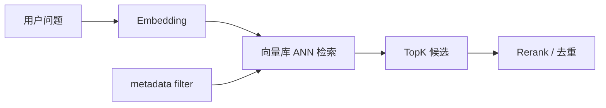

# 向量检索与TopK

> [!abstract] 一句话总结
> 向量检索用语义相似度找候选 chunk，TopK 决定一次召回多少条进入后续重排或生成。

## 🎯 本节定位

- **本章第 6 课，在线检索的核心参数与流程**。前置 [[05-Embedding模型选型]]（向量从哪来）；本篇讲 TopK、阈值、过滤与索引如何配合。
- **延伸阅读（本课不展开）**：粗召回后的精排见 [[07-Rerank重排序]]，向量库实现与索引参数见 [[13-Milvus入门]]、[[14-pgvector入门]]。

## 📌 这是什么

在线问答时，系统会把用户问题向量化，再从向量库里找最相似的 K 个 chunk。TopK 不是越大越好：太小容易漏召回，太大会引入噪声和成本。

## 🧩 基本参数

| 参数 | 含义 | 调优方向 |
| ---- | ---- | ---- |
| TopK | 返回候选数量 | 先召回多，再 Rerank 精排 |
| score threshold | 相似度阈值 | 过滤明显无关内容 |
| metadata filter | 元数据过滤 | 按租户、权限、文档类型过滤 |
| index type | 索引类型 | HNSW、IVF 等影响速度和召回 |

## 🎯 推荐起点

```text
无 Rerank：TopK = 3~8
有 Rerank：TopK = 20~50，再取前 3~8 生成
多文档问答：TopK 可更大，但要去重和限制每文档数量
```

## ⚙️ 检索流程



## ⚠️ 踩坑与注意事项

- [ ] 相似度最高不等于最能回答问题。
- [ ] TopK 太小会漏答案，TopK 太大会污染上下文。
- [ ] 先做权限过滤，避免召回无权内容后再泄漏。
- [ ] 对同一文档召回太多 chunk 时要去重或合并。

## 🎯 面试问题

> [!question] 高频问题
> - **Q: TopK 应该设置多少？**
>   - A: 看是否有 Rerank。没有 Rerank 取小一点；有 Rerank 可以先召回 20~50 再精排。
> - **Q: ANN 是什么？**
>   - A: Approximate Nearest Neighbor，近似最近邻检索，用少量精度损失换速度。

## 🔗 关联笔记

- [[05-Embedding模型选型]]
- [[07-Rerank重排序]]
- [[08-混合检索-Hybrid-Search]]
- [[13-Milvus入门]]
- [[14-pgvector入门]]
- [[_index]]

## 📚 参考资料

- [Spring AI Vector Databases](https://docs.spring.io/spring-ai/reference/api/vectordbs.html)
- [Milvus Similarity Metrics](https://milvus.io/docs/metric.md)
- [pgvector: Querying](https://github.com/pgvector/pgvector#querying)
