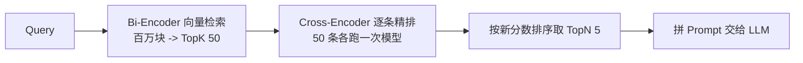

# Rerank重排序

> [!abstract] 一句话总结
> Rerank 是在向量粗召回之后，用更精细（也更慢）的 Cross-Encoder 模型对候选块逐条重新打分排序的环节——向量检索负责"多找一点"，Rerank 负责"排准一点"，两阶段配合让 LLM 只拿到真正能回答问题的少数几块。

## 🗣️ 白话版（先建立直觉）

Rerank 就像招聘流程。向量检索是 HR 筛简历：拿"岗位 JD"和几千份简历各自的"摘要卡片"快速比对，一分钟筛出 50 个候选人——快，但只看了摘要，难免混进"关键词都对但其实不合适"的人。Rerank 是面试官逐个面试：把 JD 和候选人放在一起当面盘问细节，每人半小时，最后只留 5 个——慢，但准。

你不可能让面试官面完全部几千人（太慢），也不敢只凭简历摘要直接发 offer（太粗）。所以先筛 50、再精面 5，这就是两阶段检索的全部逻辑。

## 📌 这是什么

Rerank（重排序）是 RAG 检索链路的第二阶段：第一阶段用向量检索（或混合检索）从海量文档块里粗召回 TopK（常见 20~50）条候选，第二阶段用一个专门的 Reranker 模型把 query 和每条候选**拼在一起**重新计算相关性分数，按新分数排序后只取 TopN（常见 3~8）条送给 LLM。生产 RAG 里它通常是"性价比最高的一次质量升级"——不动库、不动切分，加一层就能明显提升答案命中率。

## 🤔 解决什么问题 / 为什么需要

根源问题：**向量相似 ≠ 能回答问题**。Embedding 检索算的是"两段文本在语义空间里离得近不近"，而用户要的是"这段文本能不能回答我的问题"——这是两个相关但不相同的目标。没有 Rerank 时会发生：

1. **语义相近但答非所问的块占据前排**：问"退款多久到账"，召回的却是"如何申请退款"——都是退款主题，向量距离很近，但一个讲流程一个讲时效。
2. **多路召回分数不可比**：向量分数是余弦相似度（0~1），BM25 分数是另一个量纲，混合检索后两路结果没法直接排序，需要一个统一的裁判重新打分。
3. **TopK 噪声直接进 Prompt**：粗召回为保覆盖必然带进低相关块，不过滤就全塞给 LLM，稀释注意力、增加幻觉风险和 token 成本。

## 🧩 核心概念

| 概念 | 含义 | 备注 |
| ---- | ---- | ---- |
| Bi-Encoder（双编码器） | query 和文档**各自独立**编码成向量，再算余弦相似度 | 向量检索的架构，文档向量可预计算 |
| Cross-Encoder（交叉编码器） | query 和文档**拼接后一起**输入模型，直接输出相关分 | Reranker 的架构，无法预计算 |
| TopK → TopN | 粗召回条数（如 50）→ 精排后保留条数（如 5） | 两阶段检索的核心参数 |
| 词级交互 | Attention 让 query 的每个词与文档的每个词直接"对话" | Cross-Encoder 更准的根本原因 |
| 相关性分数 | Reranker 输出的 query-文档匹配度 | 只在同一次 query 内可比 |

## ⚙️ 工作原理 / 流程

### Bi-Encoder vs Cross-Encoder：结构差异是一切的根源

**Bi-Encoder（向量检索用的）**：query 和文档走两条完全独立的编码路径，各自压缩成一个固定长度向量（如 1024 维），相关性 = 两个向量的余弦相似度。关键特性：文档向量可以**离线预计算**存进向量库，线上只需编码 query 一次，再做一次近似最近邻搜索——百万级文档毫秒级出结果。代价：两段文本在编码时**互相看不见对方**，所有信息被迫压进一个向量，"退款到账时间"和"退款申请流程"压缩后都落在"退款"附近，细粒度差异被抹平。

**Cross-Encoder（Reranker 用的）**：把 query 和文档拼成一个输入序列 `[CLS] query [SEP] document [SEP]` 一起过 Transformer，模型内部的 Attention 让 query 的每个词能直接与文档的每个词做**词级交互**——"多久"这个词可以直接注意到文档里的"3~5 个工作日"，从而输出一个精确的相关分。代价：分数依赖 query 和文档的组合，**无法预计算**，每来一个 query 都要对每条候选完整跑一遍模型前向。100 万文档全量跑一遍要几小时，所以它只能出现在第二阶段处理几十条候选。

一句话总结因果链：**能不能预计算决定了快慢，有没有词级交互决定了准不准**——Bi-Encoder 用"看不见对方"换来了预计算的快，Cross-Encoder 用"逐对现算"换来了词级交互的准。

### 两阶段 TopK 50 → TopN 5 的设计逻辑

为什么是"50 进 5 出"这个形状？三个数字各有理由：

- **第一阶段取 50 而不是 5**：Bi-Encoder 排序不准，正确答案可能排在第 8、第 23 名。把网撒到 50，是用"宽进"保证正确答案**在候选池里**——第一阶段的 KPI 是召回率，不是排序。
- **第二阶段只处理 50 而不是全库**：Cross-Encoder 每条约 20~100ms，50 条并行推理延迟可控在几百毫秒；全库跑则完全不可行。50 是"召回充分"和"延迟可接受"的折中点。
- **最终只出 5 而不是 50**：LLM 上下文有限且对中部内容注意力弱，5 条高相关块比 50 条鱼龙混杂的块生成质量更高、成本更低——第二阶段的 KPI 是精确率。

两阶段本质是**用不同的模型干不同 KPI 的活**：召回阶段宁滥勿缺，精排阶段宁缺勿滥。

### 用一个具体例子走一遍打分

用户问："**平台退款多久到账？**" 向量检索从 10 万块中召回 Top5（余弦相似度）：

```text
排名  余弦分   内容摘要
 1    0.86    「退款申请流程：进入订单页，点击售后，选择退款原因并提交……」
 2    0.84    「退款政策总则：本平台支持 7 天无理由退款……」
 3    0.83    「常见问题：为什么我的退款申请被驳回？……」
 4    0.81    「退款到账时间：原路退回，银行卡 3~5 个工作日，余额实时到账。」
 5    0.79    「发票开具说明：退款完成后发票将自动作废……」
```

真正的答案在第 4 名——五条都在"退款"语义邻域里，Bi-Encoder 分数挤在 0.79~0.86 之间，根本区分不出"流程"和"时效"。若只取 Top3 给 LLM，答案直接被漏掉。

把这 5 条逐一与 query 拼接送入 Cross-Encoder（如 bge-reranker-v2-m3），词级交互让"多久""到账"直接对上"3~5 个工作日""实时到账"：

```text
重排后  Rerank分   原排名
  1      0.97       4     「退款到账时间：原路退回，银行卡 3~5 个工作日……」
  2      0.42       2     「退款政策总则……」
  3      0.31       1     「退款申请流程……」
  4      0.18       3     「退款被驳回……」
  5      0.05       5     「发票开具说明……」
```

注意两点：① 正确答案从 0.81（第 4）跃升到 0.97（第 1），且与第二名拉开 0.55 的断崖差距——Cross-Encoder 的分数区分度远大于余弦分的 0.01 级差距，这正是词级交互的价值；② 这些分数只在本次 query 内有意义，不能跨 query 比较或当作绝对阈值滥用。



### 常见 Rerank 方案对比

**Cohere Rerank（商业 API）**：调 REST 接口即用，多语言支持好，免运维，按调用量计费。适合快速上线、不想自己部署模型的团队；缺点是数据出境合规问题和持续成本。

**BGE-reranker（开源自部署）**：智源开源的 Cross-Encoder 系列（如 bge-reranker-v2-m3），中文效果好，可用 GPU 自部署（配合 TEI/vLLM 服务化）或走 SiliconFlow 等托管 API。适合中文场景、数据不能出内网的企业；缺点是要自己管推理服务和显存。

**LLM-as-Reranker（用大模型当裁判）**：把 query 和候选列表塞进 Prompt，让 GPT/Qwen 之类输出排序或逐条打分。理解力最强，能处理"需要推理才能判断相关性"的复杂 query；但延迟和成本比专用 Reranker 高一个数量级，输出格式还需解析兜底。适合离线评估、构造训练数据，或对少量高价值 query 精排。

选型速记：**快速上线选 Cohere，中文私有化选 BGE，离线评估选 LLM 裁判**；低延迟场景则压缩候选数（50→20）并缓存高频 query 的结果。

### 一个必须刻进脑子的边界：Rerank 救不了漏召回

Rerank 只能对第一阶段**捞上来的候选**重新排序——如果正确答案根本没进 TopK 50（切分切碎了、Embedding 模型不认识专有名词、query 与文档措辞差异太大），Rerank 面对的是"矮子里拔将军"，排得再准也是错的候选里选最不错的。所以线上答案质量差时先查召回：把 TopK 50 的原始列表打出来看答案在不在里面。**在而排不上→加/换 Rerank；根本不在→回去修切分、换 Embedding、上混合检索**，动 Rerank 没用。

## 🆚 从坏到好（对比案例）

**坏例子**：无 Rerank，向量检索 Top3 直接进 Prompt。用户问"退款多久到账"，进 Prompt 的是上面例子里的"申请流程 / 政策总则 / 驳回原因"三条——全是退款主题、没有一条讲时效。LLM 面对三块"相近但答非所问"的材料，要么老实说"资料中未提及"（体验差），要么从"7 天无理由"里强行编一个"7 天内到账"（幻觉，更糟）。

**为什么坏**：Bi-Encoder 把整段话压成一个向量，只能判断"主题近不近"，无法完成"query 问的是时间，这段讲的是流程"这种需要词级对齐的判断；候选之间 0.01 级的分差本质上是噪声，Top3 的截断线切在了噪声上。

**修好后**：TopK 从 3 放宽到 50（把第 4 名的正确答案捞进候选池），加一层 bge-reranker 精排取 Top3。进 Prompt 的变成"到账时间（0.97）/ 政策总则（0.42）/ 申请流程（0.31）"，第一条就是正确答案，LLM 稳定输出"银行卡 3~5 个工作日，余额实时到账"。链路只加了一层、延迟多了约 200ms，答案从"编造或拒答"变成"精准命中"。

## 💻 代码实践

Java/Spring 风格，用 `RestClient` 调用 Rerank API。以 SiliconFlow 托管的 BGE-reranker 为例（接口形态与 Cohere Rerank v2 基本一致，换 baseUrl 和模型名即可迁移）：

```java
import org.springframework.web.client.RestClient;
import java.util.List;
import java.util.Map;

public class RerankService {

    private final RestClient client = RestClient.builder()
            .baseUrl("https://api.siliconflow.cn/v1")   // Cohere 则为 https://api.cohere.com/v2
            .defaultHeader("Authorization", "Bearer " + System.getenv("RERANK_API_KEY"))
            .build();

    /** 对粗召回的候选文档重排，返回按相关性排序的前 topN 条 */
    public List<RerankResult> rerank(String query, List<String> documents, int topN) {
        Map<String, Object> body = Map.of(
                "model", "BAAI/bge-reranker-v2-m3",     // Cohere 则为 "rerank-v3.5"
                "query", query,
                "documents", documents,
                "top_n", topN
        );
        RerankResponse resp = client.post().uri("/rerank")
                .body(body)
                .retrieve()
                .body(RerankResponse.class);
        return resp.results();   // 已按 relevance_score 降序
    }

    // 响应结构：results[i] = {index: 原候选下标, relevance_score: 相关分}
    public record RerankResponse(List<RerankResult> results) {}
    public record RerankResult(int index, double relevance_score) {}
}
```

嵌入 RAG 检索链路（Spring AI，省略了 VectorStore 初始化与 Prompt 组装）：

```java
public List<Document> retrieve(String query) {
    List<Document> candidates = vectorStore.similaritySearch(     // 阶段一：粗召回
            SearchRequest.builder().query(query).topK(50).build());

    List<String> texts = candidates.stream().map(Document::getText).toList();
    List<RerankResult> ranked = rerankService.rerank(query, texts, 5);  // 阶段二：精排

    return ranked.stream()                                        // 按 index 映射回原文档
            .map(r -> candidates.get(r.index()))
            .toList();
}
```

> 完整代码见：[[03-项目-企业知识库RAG系统]]

## 🧪 最小验证（做一遍才算学会）

不用写服务，10 分钟用任一 Rerank API（SiliconFlow 的 bge-reranker 有免费额度）做一次"亲眼看见排序被修正"：

1. 构造 1 个 query（"退款多久到账"）和 5 条候选：4 条主题相近但答非所问 + 1 条真正含答案（可直接抄本文例子）。
2. 用 curl 或上面的 Java 代码调 `/rerank`，打印每条的 relevance_score。
3. 预期看到：含答案那条分数断崖式领先（如 0.9+ vs 0.4-），无论你把它放在候选列表第几位。
4. 加练：把含答案的那条从候选里**删掉**再调一次——观察 Reranker 只能在剩下的错误答案里选个"最高分"，分数普遍偏低但排序照常输出。这就是"Rerank 救不了漏召回"的直观体感。

## ⚠️ 踩坑与注意事项

- **拿 Rerank 补救漏召回**：现象是加了 Rerank 答案质量没变化。原因是正确块根本没进 TopK。排查时先打印粗召回原始列表确认答案在不在，不在就去修切分/Embedding/混合检索。
- **候选数贪多**：TopK 从 50 加到 200，延迟线性上涨到秒级，精度收益却很小。候选数按延迟预算定，50 上下通常够用。
- **把 Rerank 分数当全局阈值**：Cross-Encoder 分数只在同一次 query 的候选间可比，不同 query 的 0.6 含义不同；要设过滤阈值需在自己的数据上校准，别硬编码。
- **重排后不控总长度**：TopN 5 条如果每条 1500 字照样撑爆预算，Rerank 之后仍要按 token 预算截断拼 Prompt。

## 🧠 自测题（先自己答，再展开对答案）

> [!question]- Q1: 为什么 Cross-Encoder 比 Bi-Encoder 准，却不能直接用它做全库检索？
> 参考答案：准的原因——query 和文档拼接后一起过模型，Attention 实现词级交互（"多久"能直接对上"3~5 个工作日"），不像 Bi-Encoder 把全文压成一个向量、细粒度差异被抹平。不能全库用的原因——分数依赖 query+文档的组合，无法离线预计算，每个 query 都要对每篇文档跑一次完整前向，百万级文档延迟是小时级；而 Bi-Encoder 文档向量可预计算，线上只做 ANN 搜索，毫秒级。

> [!question]- Q2: 线上 RAG 答案经常不对，你怎么判断该修召回还是该加 Rerank？
> 参考答案：打印粗召回 TopK（如 50 条）的原始列表，检查正确答案块在不在其中。在但排名靠后（如第 15 名）、被 TopN 截断丢掉了——这是排序问题，加/换 Rerank 有效；根本不在 50 条里——这是召回问题，Rerank 无能为力，应回去修文本切分、更换 Embedding 模型、补充关键词检索（混合检索）或做 query 改写。先定位阶段，再对症下药。

> [!question]- Q3: TopK=50 和 TopN=5 这两个数字分别在优化什么指标？把 TopK 降到 5、或把 TopN 升到 50 各会发生什么？
> 参考答案：TopK=50 优化召回率（宁滥勿缺，保证答案进候选池），TopN=5 优化精确率（宁缺勿滥，只给 LLM 高相关块）。TopK 降到 5：Rerank 只能在 5 条里挑，Bi-Encoder 排序不准导致答案经常不在这 5 条里，Rerank 形同虚设。TopN 升到 50：噪声全部进 Prompt，token 成本暴涨、模型注意力被稀释、幻觉风险上升，等于退回没有精排的状态。

## 🎯 面试问题

> [!question] 高频问题
> - **Q: Rerank 和 Embedding 检索有什么区别？**
>   - A（30 秒）：架构不同——Embedding 检索是 Bi-Encoder，query 和文档独立编码算余弦，可预计算所以快，适合海量粗召回；Rerank 是 Cross-Encoder，两者拼接过模型做词级交互，准但逐对现算慢，只适合几十条候选的精排。生产上两者串联：TopK 50 粗召回 → Rerank → TopN 5。
>   - A（2 分钟展开）：① 结构——Bi-Encoder 双塔独立编码，编码时互相看不见，全文压进一个向量，只能度量"主题近不近"；Cross-Encoder 拼接输入，Attention 做词级交互，能判断"这段是否回答了这个问题"。② 性能——前者文档向量离线预计算 + ANN 搜索，百万级毫秒响应；后者无法预计算，每条候选一次前向，50 条约几百毫秒。③ 工程含义——两者不是替代关系而是流水线分工：召回阶段 KPI 是召回率（宽进），精排阶段 KPI 是精确率（严出）。④ 举例——"退款多久到账"vs"退款申请流程"，余弦分 0.81 vs 0.86 分不出来，Rerank 分 0.97 vs 0.31 断崖区分。
> - **Q: 为什么 Rerank 不能替代向量库？**
>   - A（30 秒）：Cross-Encoder 的分数依赖 query 和文档的组合，无法预计算索引，每个 query 都要对全库逐条推理，百万级文档延迟完全不可接受，所以必须先靠向量库毫秒级缩小候选范围。
>   - A（2 分钟展开）：① 算一笔账——单条推理约 20~100ms，100 万文档串行要数小时，就算大规模并行也远超在线服务预算；向量库 ANN（HNSW 等）是亚线性复杂度，毫秒级。② 根本原因——向量库的快来自"文档向量可离线预计算 + 建索引"，Cross-Encoder 恰恰因为要词级交互而放弃了可预计算性，快和准在这里是结构性互斥。③ 反过来也成立——向量库也替代不了 Rerank，粗排的余弦分区分度不够。④ 结论——两阶段架构是"漏斗"设计：便宜的模型处理大数据量，昂贵的模型处理小数据量，各干各的活。
> - **Q: 生产环境怎么选 Rerank 方案？**
>   - A（30 秒）：快速上线用 Cohere Rerank API；中文/私有化部署选 BGE-reranker 自建或托管 API；LLM-as-Reranker 太贵太慢，留给离线评估。上线前一定用自己的问题集实测，另外先确认瓶颈真的在排序而不是召回。
>   - A（2 分钟展开）：① 三方案画像——Cohere：免运维、多语言强、按量付费，但数据出境需评估；BGE-reranker：开源免费、中文强、数据不出内网，但要自管 GPU 推理服务；LLM 裁判：理解力最强、能推理复杂相关性，但延迟成本高一个数量级，适合离线评估和造训练数据。② 延迟优化——压候选数（50→20）、缓存高频 query、批量推理。③ 验证方法——构建自有评估集测 Hit Rate / MRR，加 Rerank 前后对比，而不是只信榜单。④ 边界——先打印粗召回确认答案在候选池里，漏召回问题 Rerank 救不了。

## 🪝 记忆钩子

**口诀："双塔快而粗，交叉慢而准；五十进五出，漏网救不回。"**
—— Bi-Encoder（双塔）独立编码可预计算所以快，Cross-Encoder（交叉）拼接词级交互所以准；TopK 50 保召回、TopN 5 保精确；答案没被捞进候选池，Rerank 神仙难救。
脑内画面：HR 筛简历（1 分钟 50 份，只看摘要）→ 面试官面试（半小时 1 人，当面盘问）→ 发 5 个 offer。面试官再厉害，也救不了"牛人简历压根没投进来"。

## 🔗 关联笔记

- [[06-向量检索与TopK]]（Rerank 的上游：粗召回决定了 Rerank 的候选池上限）
- [[08-混合检索-Hybrid-Search]]（多路召回分数不可比时，Rerank 充当统一裁判）
- [[04-文本切分策略]]（漏召回的常见根因之一：切分把答案切碎了）
- [[12-RAG评估-Ragas]]（用 Hit Rate / MRR 量化 Rerank 前后的收益）
- [[_index]]

## 📚 参考资料

- [Cohere Rerank](https://docs.cohere.com/docs/reranking)
- [Sentence Transformers Cross-Encoders](https://www.sbert.net/examples/cross_encoder/applications/README.html)
- [Jina AI Reranker](https://jina.ai/reranker/)
- [BAAI/bge-reranker-v2-m3 (Hugging Face)](https://huggingface.co/BAAI/bge-reranker-v2-m3)
