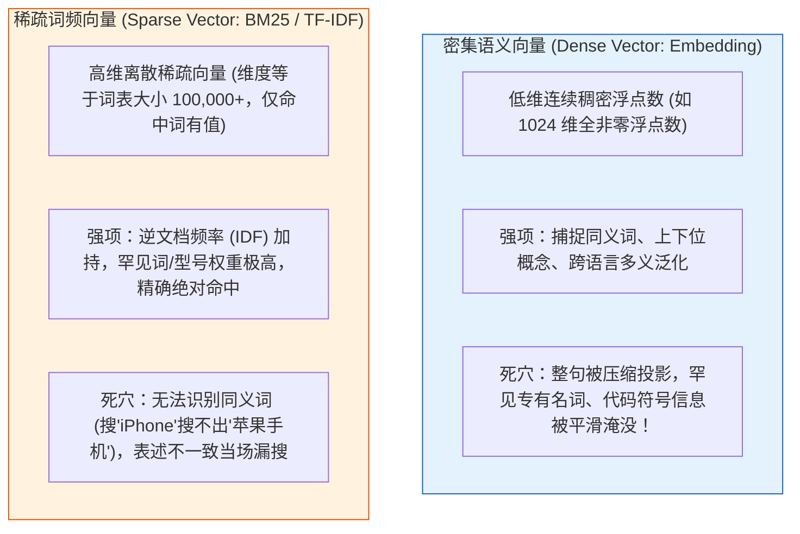
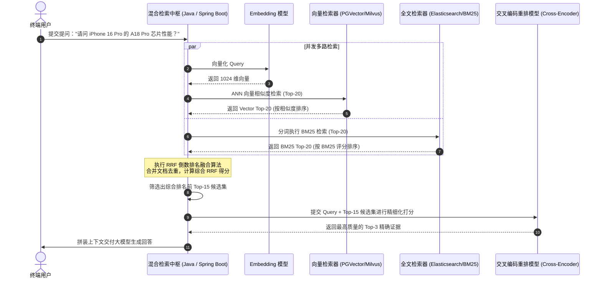
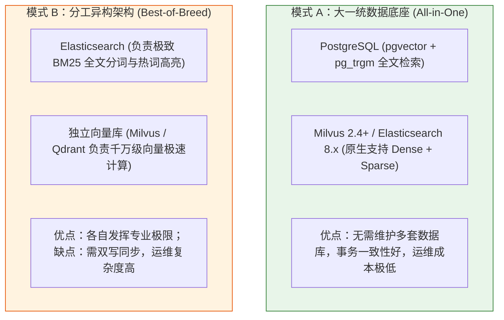

# 🔀 混合检索（Hybrid Search）：向量语义与精确匹配的双剑合璧

> [!abstract] 一句话总结
> 混合检索的核心第一性原理是**“取密集向量（Dense Vector）的语义泛化之长，补稀疏关键词（Sparse / BM25）的精确匹配之短”**，通过多路并行召回配合 **RRF（倒数排名融合算法）** 或 **Rerank 重排**，彻底根治专有名词、料号、错误码和人名的召回失效。

---

## 🗣️ 白话版（先建立直觉）

想象你去图书馆找一本关于**“苹果公司2024款 M4 芯片 MacBook Pro 发热问题”**的技术分析手册：
- **纯向量检索（Dense Retriever）像一个很有灵性但粗心大意的文艺青年**：
  他非常懂语义，知道“发热”和“温度过高”、“烫手”、“散热不良”是一个意思；但他眼神不好，经常把“M4 芯片的 MacBook”误抓成“M1、M2 芯片的 MacBook”或者“关于苹果水果保鲜的农业手册”。因为在他眼里，M1、M2、M4 都是几个字母加数字，向量距离太近了！
- **关键词检索（BM25 稀疏检索）像一个严谨呆板但眼神极佳的老图书管理员**：
  他完全不懂什么近义词，如果你写“电脑烫手”，他一本也找不到；但只要你在检索词里写了精准的 **`M4`**、**`MacBook Pro`**，他能瞬间把书架上所有带 `M4` 编码的书全部抽出来，一个不漏！

在真实业务场景中，用户的问题往往既包含**抽象意图**（“怎么排查...”），又包含**精准实体**（“订单号 `SO20260811`”、“错误码 `NullPointerException`”）。
**混合检索（Hybrid Search），就是让文艺青年和老管理员同时去书架上找书，然后把他们俩找到的候选书本汇总去重，选出最靠谱的给大模型！**

---

## 📌 第一性原理：为什么纯向量检索会致命翻车？

要理解混合检索，必须从 **密集向量（Dense Vector）** 与 **稀疏向量（Sparse Vector / BM25）** 的数学本质来看：



### 典型工业翻车案例
| 用户查询场景 | 纯向量检索（Dense Only）表现 | BM25 关键词检索表现 | 混合检索（Hybrid）表现 |
| :--- | :--- | :--- | :--- |
| **设备型号精准排障**<br>`"Switch-C9300-48P 重启原因"` | 召回一堆关于路由器交换机通用重启的文章，型号不一致 | 精确命中包含 `C9300-48P` 的特定勘误文档 | ✅ **精准锁定型号与重启原因** |
| **法律法条精准援引**<br>`"民法典第一千零六十四条"` | 召回关于夫妻共同财产的泛化科普，法条编号错乱 | 100% 精确命中第一千零六十四条正文 | ✅ **法条与案件意图完美契合** |
| **代码与异常排障**<br>`"Kafka CommitFailedException 根因"` | 召回 Kafka 消费超时的泛化文章，漏掉特定 Exception | 精确命中异常类的堆栈排查 SOP | ✅ **秒级匹配代码堆栈证据** |

---

## ⚙️ 多路召回融合核心算法：RRF（倒数排名融合）

当向量检索返回一组结果（带有余弦相似度分数，如 $0.85, 0.72$），BM25 返回一组结果（带有 Lucene BM25 评分，如 $14.2, 8.5$）时：
**绝不能直接把两个分数相加！** 两个系统的分数分布尺度、量纲完全不同！

工业界最优雅、最通用的融合算法是 **RRF（Reciprocal Rank Fusion，倒数排名融合算法）**：

### 1. RRF 数学公式
对于候选文档集中出现的任意文档 $d \in D$：
$$RRF\_Score(d) = \sum_{m \in M} \frac{1}{k + r_m(d)}$$

- $M$：检索器集合（例如 $M = \{\text{VectorRetriever}, \text{BM25Retriever}\}$）；
- $r_m(d)$：文档 $d$ 在检索器 $m$ 中的**排名位置（Rank，从 1 开始，1st, 2nd, 3rd...）**；
- $k$：常数平滑因子，**业界黄金标准通常固定为 $k = 60$**（源自 Cormack et al. 经典 SIGIR 论文）。

### 2. 为什么 RRF 不需要归一化分数？
- **只看排兵布阵，不看原始分数**：即使 BM25 跑出了 1000 分，余弦相似度最大只有 1 分，RRF 只提取“谁排第 1，谁排第 2”；
- **双路前列暴击奖励**：如果一篇文档在向量检索中排第 1，在 BM25 中也排第 1，其得分是 $\frac{1}{60+1} + \frac{1}{60+1} = \frac{2}{61} \approx 0.0328$；而仅在单路排第 1 的得分为 $\frac{1}{61} \approx 0.0164$。**两路都认可的文档，得分直接翻倍！**

---

## 🗺️ 混合检索全链路架构时序



---

## 💻 工业级代码实战：Java 手写高性能 RRF 融合引擎

```java
package com.example.ai.rag.hybrid;

import lombok.Builder;
import lombok.Data;
import org.springframework.stereotype.Component;

import java.util.*;

@Component
public class ReciprocalRankFusionEngine {

    // 工业界最佳经验平滑常数 k = 60
    private static final int DEFAULT_K = 60;

    @Data
    @Builder
    public static class ScoredDocument {
        private String docId;
        private String content;
        private double finalRrfScore;
        private Map<String, Object> metadata;
    }

    /**
     * 执行多路 RRF 倒数排名融合
     * @param rankedLists 多路检索结果列表（每路列表内元素已严格按相关性由高到低排序）
     * @param topN 最终返回的候选数量
     */
    public List<ScoredDocument> fuse(List<List<ScoredDocument>> rankedLists, int topN) {
        Map<String, Double> rrfScores = new HashMap<>();
        Map<String, ScoredDocument> docRegistry = new HashMap<>();

        for (List<ScoredDocument> singleList : rankedLists) {
            for (int rank = 0; rank < singleList.size(); rank++) {
                ScoredDocument doc = singleList.get(rank);
                String docId = doc.getDocId();
                docRegistry.putIfAbsent(docId, doc);

                // rank 从 0 开始，公式中加 1 表示第 1 名
                double score = 1.0 / (DEFAULT_K + (rank + 1));
                rrfScores.merge(docId, score, Double::sum);
            }
        }

        // 按累计 RRF 分数倒序排列
        List<ScoredDocument> fusedResult = new ArrayList<>();
        rrfScores.entrySet().stream()
                .sorted(Map.Entry.<String, Double>comparingByValue().reversed())
                .limit(topN)
                .forEach(entry -> {
                    ScoredDocument originalDoc = docRegistry.get(entry.getKey());
                    originalDoc.setFinalRrfScore(entry.getValue());
                    fusedResult.add(originalDoc);
                });

        return fusedResult;
    }
}
```

---

## ⚖️ 混合检索的两大主流工程落地模式

在企业级微服务选型中，实现混合检索有两种典型架构路线：



- **初创与中型企业首选**：**模式 A**。直接基于 **PostgreSQL (pgvector)** 或 **Elasticsearch 8.x**。单库搞定全文 + 向量，一条 SQL 完成两路召回，省去巨大的跨库同步与运维成本；
- **千万级以上海量数据超大厂**：**模式 B**。微服务在应用层并发异步检索 ES 与 Milvus，通过 Java RRF 引擎汇聚后送入 GPU Rerank 集群。

---

## ⚠️ 生产避坑指南与致命陷阱

### 1. 致命谬误：直接将 Cosine 分数与 BM25 分数做加权求和
- **灾难现场**：`finalScore = 0.5 * cosineScore + 0.5 * bm25Score`。
- **后果**：BM25 偶尔因为命中罕见词打出 25 分，而余弦相似度最高才 1 分！加权求和后，BM25 直接以 96% 的权重绝对统治了结果，向量语义完全形同虚设！
- **治理**：若想做线性加权，必须先对两路分数各自执行 **Min-Max 归一化**（$\frac{s - \min}{\max - \min}$）；或者直接采用不依赖绝对分数的 **RRF 算法**。

### 2. 忽略中文分词字典导致 BM25 漏词
- BM25 严重依赖底层分词器（IK、Jieba、Lucene SmartChinese）。如果新产品的专有名词（如“问界M9”、“黑神话悟空”）没有及时加入热更新词典，会被生生切成单字，导致 BM25 精确命中优势荡然无存。

---

## 🎯 大厂高频面试 30 秒绝杀

> [!question] 面试高频问题 3 连击
> 
> **Q1：为什么在生产级 RAG 架构中，仅靠向量检索是不够的？必须引入混合检索？**
> - **答（满分绝杀）**：
>   纯密集向量（Dense Vector）是将长文本降维映射到低维连续流形中，其强项在于语义泛化与同义理解；但降维过程不可避免会抹平特殊低频信息，对于**设备型号、订单号、代码类名、人名、缩写**等高度依赖字面精确匹配的场景极其迟钝，频繁引发关键事实漏召回。引入 BM25 稀疏检索能够利用逆文档频率（IDF）对罕见词建立确定性字面命中索引，两者互补能够将复杂业务场景下的综合召回率（Recall）从 70% 大幅提升至 95% 以上。
>
> **Q2：请推导 RRF（倒数排名融合）算法的计算原理，并解释常数 k 为什么通常设为 60？**
> - **答（满分绝杀）**：
>   RRF 的公式为 $\sum \frac{1}{k + r(d)}$，其中 $r(d)$ 为各路排名。它的核心思想在于**“只利用相对次序，规避不可比的绝对分数”**。常数 $k$ 充当平滑因子：如果 $k$ 过小（如 $k=1$），第 1 名（得分 0.5）与第 2 名（得分 0.33）的分差过大，会造成极端的马太效应；如果 $k$ 过大，不同排名的区分度又会被抹平。Cormack 团队在 TREC 大规模检索基准测试中证明，**$k=60$ 时能够最稳定地平衡多路排名的头部惩罚与长尾补偿**，对两路共同靠前的优质候选提供最稳健的置信跃迁。
>
> **Q3：混合检索（多路召回）之后，为什么通常还要再接一层 Cross-Encoder Rerank（重排）？**
> - **答（满分绝杀）**：
>   多路召回（向量 + BM25）的核心目标是**“保全召回率（High Recall），宁可多抓不可放过”**，通常各召回 20~50 条候选；但多路融合阶段使用的双塔模型或 RRF 无法深层次捕捉 Query 与每个文档之间细粒度的交互注意力。引入交叉编码器（Cross-Encoder Rerank）将 Query 和 Chunk 拼在一起输入深层 Transformer 做全注意力交叉计算，能够给出极高精度的绝对相关度分值，从粗排候选中提炼出最精准的 Top-3 核心证据送入大模型，兼顾了吞吐效率与上下文精度。

---

## 🪝 一分钟复盘记忆卡

```
┌────────────────────────────────────────────────────────┐
│               混合检索 Hybrid Search 极速通关卡         │
├────────────────────────────────────────────────────────┤
│  1. 架构本质：密集向量（泛化语义）+ 稀疏BM25（精准词） │
│  2. 痛点根治：消灭型号/人名/编码/法条编号的漏召回惨案 │
│  3. 融合算法：RRF 倒数排名融合（k=60，规避分数不可比）│
│  4. 生产范式：双路粗排（Top-30）+ Rerank 终审（Top-3）│
│  5. 架构选型：中小项目 PGVector/ES 单库搞定，超大厂双写│
└────────────────────────────────────────────────────────┘
```

---

## 🔗 关联笔记

- [[01-RAG基础与全链路]] - RAG 整体流程与向量检索基础
- [[07-Rerank重排序]] - 混合召回后接入 Cross-Encoder 精排实战
- [[14-pgvector入门]] - 在 PostgreSQL 中单表实现 pgvector + 全文检索
- [[15-向量库选型对比]] - 深度对比 ES、PGVector 与 Milvus 混合检索能力
- [[_index]] - 返回 RAG 专题索引
