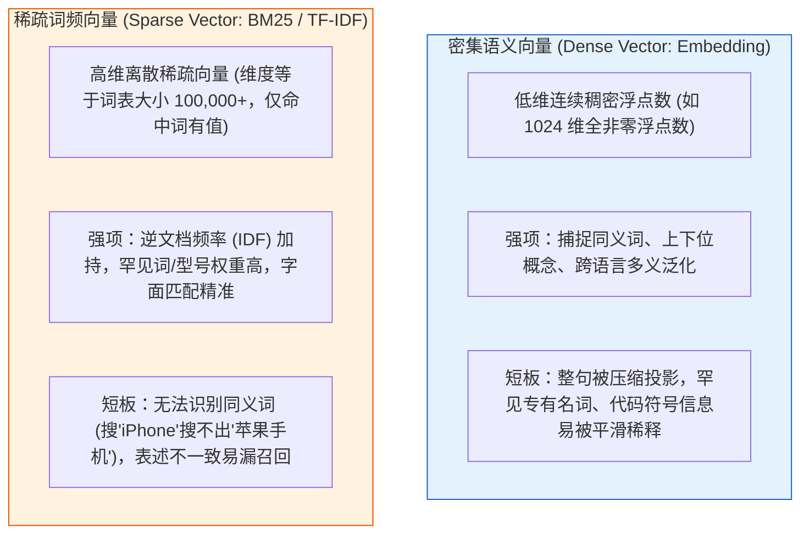
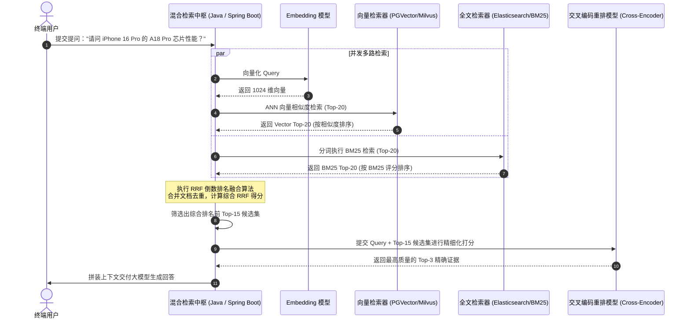
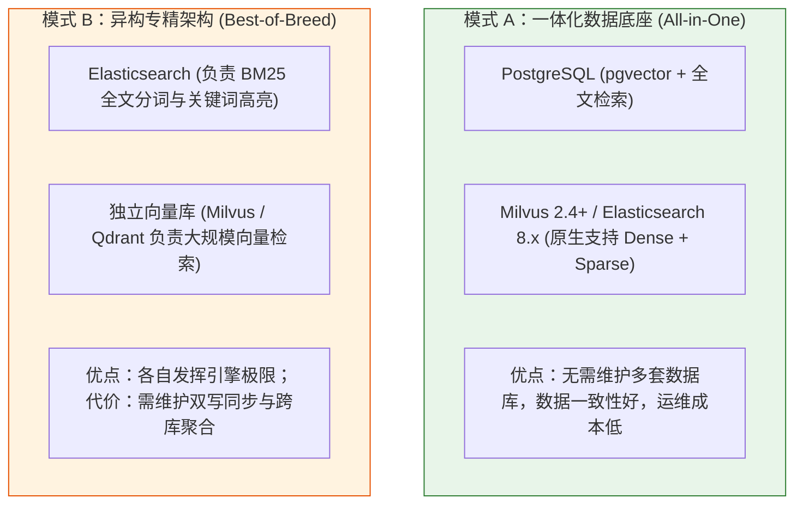

# 🔀 混合检索（Hybrid Search）：向量语义与精确匹配的双剑合璧

> [!abstract] 一句话总结
> 混合检索的核心第一性原理是**“取密集向量（Dense Vector）的语义泛化之长，补稀疏关键词（Sparse / BM25）的精确匹配之短”**，通过多路并行召回配合 **RRF（倒数排名融合算法）** 或 **Rerank 重排**，减少专有名词、料号、错误码和人名的漏召回。

---

## 🗣️ 白话版（先建立直觉）

向量检索擅长捕捉同义改写与语义相关性，而关键词检索（如 BM25）擅长匹配设备型号、错误码、法条编号等精确字面特征。混合检索通过并行执行两路召回，并对结果去重、融合排序，实现语义泛化与词项匹配的互补。在实际落地时，需配置适配业务领域的分词词典，并确保两路检索分支均执行一致的权限过滤。

---

## 📌 第一性原理：为什么纯向量检索会致命翻车？

要理解混合检索，必须从 **密集向量（Dense Vector）** 与 **稀疏向量（Sparse Vector / BM25）** 的数学本质来看：



### 典型工业场景对比
| 用户查询场景 | 纯向量检索（Dense Only）表现 | BM25 关键词检索表现 | 混合检索（Hybrid）表现 |
| :--- | :--- | :--- | :--- |
| **设备型号精准排障**<br>`"Switch-C9300-48P 重启原因"` | 召回一堆关于路由器交换机通用重启的文章，型号不一致 | 精确命中包含 `C9300-48P` 的特定勘误文档 | ✅ **精准锁定型号与重启原因** |
| **法律法条精准援引**<br>`"民法典第一千零六十四条"` | 召回关于夫妻共同财产的泛化科普，法条编号错乱 | 通过词项匹配精准命中含“第一千零六十四条”的法条原文 | ✅ **法条与案件意图紧密契合** |
| **代码与异常排障**<br>`"Kafka CommitFailedException 根因"` | 召回 Kafka 消费超时的泛化文章，漏掉特定 Exception | 精确命中异常类的堆栈排查 SOP | ✅ **精准匹配代码堆栈证据** |

---

## ⚙️ 多路召回融合核心算法：RRF（倒数排名融合）

当向量检索返回一组结果（带有余弦相似度分数，如 $0.85, 0.72$），BM25 返回一组结果（带有 Lucene BM25 评分，如 $14.2, 8.5$）时：
**不能直接将两个原始分数相加**，因为两个检索系统的分数分布尺度与量纲完全不同。

工业界最通用的无量纲融合算法是 **RRF（Reciprocal Rank Fusion，倒数排名融合算法）**：

### 1. RRF 数学公式
对于候选文档集中出现的任意文档 $d \in D$：
$$RRF\_Score(d) = \sum_{m \in M} \frac{1}{k + r_m(d)}$$

- $M$：检索器集合（例如 $M = \{\text{VectorRetriever}, \text{BM25Retriever}\}$）；
- $r_m(d)$：文档 $d$ 在检索器 $m$ 中的**排名位置（Rank，从 1 开始，1st, 2nd, 3rd...）**；
- $k$：常数平滑因子，**工程经验值通常设为 $k = 60$**（源自 Cormack et al. SIGIR 论文）。

### 2. 为什么 RRF 不需要归一化分数？
- **只看相对名次，不看原始分数**：即使 BM25 跑出了 1000 分，余弦相似度最大只有 1 分，RRF 只提取“谁排第 1，谁排第 2”；
- **多路共识增益**：如果一篇文档在向量检索中排第 1，在 BM25 中也排第 1，其得分是 $\frac{1}{60+1} + \frac{1}{60+1} = \frac{2}{61} \approx 0.0328$；而仅在单路排第 1 的得分为 $\frac{1}{61} \approx 0.0164$。**两路同时排在前列的文档，融合得分显著提升。**

---

## 🗺️ 混合检索全链路架构时序



---

## 💻 代码示例：Java 手写高性能 RRF 融合引擎

```java
package com.example.ai.rag.hybrid;

import lombok.Builder;
import lombok.Data;
import org.springframework.stereotype.Component;

import java.util.*;

@Component
public class ReciprocalRankFusionEngine {

    // 工业界常用经验平滑常数 k = 60
    private static final int DEFAULT_K = 60;

    @Data
    @Builder
    public static class ScoredDocument {
        private String docId;
        private String content;
        private double finalRrfScore;
        private Map<String, Object> metadata;
    }

    /**
     * 执行多路 RRF 倒数排名融合
     * @param rankedLists 多路检索结果列表（每路列表内元素已严格按相关性由高到低排序）
     * @param topN 最终返回的候选数量
     */
    public List<ScoredDocument> fuse(List<List<ScoredDocument>> rankedLists, int topN) {
        Map<String, Double> rrfScores = new HashMap<>();
        Map<String, ScoredDocument> docRegistry = new HashMap<>();

        for (List<ScoredDocument> singleList : rankedLists) {
            for (int rank = 0; rank < singleList.size(); rank++) {
                ScoredDocument doc = singleList.get(rank);
                String docId = doc.getDocId();
                docRegistry.putIfAbsent(docId, doc);

                // rank 从 0 开始，公式中加 1 表示第 1 名
                double score = 1.0 / (DEFAULT_K + (rank + 1));
                rrfScores.merge(docId, score, Double::sum);
            }
        }

        // 按累计 RRF 分数倒序排列
        List<ScoredDocument> fusedResult = new ArrayList<>();
        rrfScores.entrySet().stream()
                .sorted(Map.Entry.<String, Double>comparingByValue().reversed())
                .limit(topN)
                .forEach(entry -> {
                    ScoredDocument originalDoc = docRegistry.get(entry.getKey());
                    originalDoc.setFinalRrfScore(entry.getValue());
                    fusedResult.add(originalDoc);
                });

        return fusedResult;
    }
}
```

---

## ⚖️ 混合检索的两大主流工程落地模式

在企业级微服务选型中，实现混合检索有两种典型架构路线：



- **初创与中型团队首选**：**模式 A**。直接基于 **PostgreSQL (pgvector)**、**Milvus 2.4+** 或 **Elasticsearch 8.x**，单库完成全文与向量双路召回，省去跨库同步成本；
- **超大规模检索场景**：**模式 B**。微服务在应用层并发异步检索 ES 与独立向量库，通过 RRF 引擎汇聚后送入 Rerank 服务。

> [!NOTE] 混合检索工程实现细节
> 1. **统一标识与缺省处理**：执行 RRF 融合前，两路检索结果需对齐统一的 `chunk_id` 并完成单路去重；若某文档仅在单路召回中出现，则其在另一路的得分贡献记为 0。
> 2. **权限过滤一致性**：向量检索与全文检索两个分支必须下推完全一致的租户与角色权限过滤条件，防止任一分支绕过鉴权。
> 3. **精确等值过滤补充**：对于订单号、合同主键等严格等值定位需求，建议直接结合标量字段的精确匹配过滤（如 `keyword` 过滤），与 BM25 相关性检索配合使用。

---

## ⚠️ 常见问题与边界

### 1. 常见误区：直接将 Cosine 分数与 BM25 分数做加权求和
- **错误写法**：`finalScore = 0.5 * cosineScore + 0.5 * bm25Score`。
- **后果**：BM25 命中低频词时得分可达十余分甚至更高，而余弦相似度上限为 1.0。直接相加会导致数值较大的 BM25 评分完全主导最终排序，使向量检索失去作用。
- **治理**：若采用线性加权融合，需先对两路分数分别做尺度归一化（如 Min-Max 归一化，并处理最大最小值相等的边界情况）；在工程实践中，更推荐直接采用基于相对名次的 **RRF 算法**，规避跨系统分数尺度不一致的问题。

### 2. 忽略中文分词字典导致 BM25 漏词
- BM25 依赖底层分词器（IK、Jieba、Lucene SmartChinese）。如果业务专有名词（如新产品代号、内部系统名称）未及时加入自定义词典，会被切碎为单字，削弱 BM25 的精确匹配效果。

---

## 🎯 高频面试问题

> [!question] 面试高频问题 3 连击
> 
> **Q1：为什么在生产级 RAG 架构中，仅靠向量检索是不够的？为什么要引入混合检索？**
> - **答**：
>   密集向量（Dense Vector）将整段文本压缩映射为固定维度的连续向量，擅长捕捉同义词与上下文语义，但容易平滑掉低频的设备型号、错误码、专有名词等精确字符特征；而稀疏检索（BM25）基于词频与逆文档频率（IDF）计算权重，对罕见专有词项极其敏感，但在同义词泛化上表现较弱。引入“向量 + BM25”混合检索能够实现优势互补，再结合标量字段的精确过滤，可全面覆盖语义问答与精确符号查找场景。
>
> **Q2：请推导 RRF（倒数排名融合）算法的计算原理，并解释常数 k 为什么通常设为 60？**
> - **答**：
>   RRF 的公式为 $\sum \frac{1}{k + r(d)}$，其中 $r(d)$ 为各路排名。它的核心思想在于**“只利用相对次序，规避不可比的绝对分数”**。常数 $k$ 充当平滑因子：如果 $k$ 过小（如 $k=1$），第 1 名（得分 0.5）与第 2 名（得分 0.33）的分差过大，会造成极端的马太效应；如果 $k$ 过大，不同排名的区分度又会被抹平。Cormack 团队在 TREC 大规模检索基准测试中证明，**$k=60$ 时能够最稳定地平衡多路排名的头部惩罚与长尾补偿**，对两路共同靠前的优质候选提供最稳健的置信跃迁。
>
> **Q3：混合检索（多路召回）之后，为什么通常还要再接一层 Cross-Encoder Rerank（重排）？**
> - **答**：
>   多路召回（向量 + BM25）的核心目标是**“保全召回率（High Recall），宁可多抓不可放过”**，通常各召回 20~50 条候选；但多路融合阶段使用的双塔模型或 RRF 无法深层次捕捉 Query 与每个文档之间细粒度的交互注意力。引入交叉编码器（Cross-Encoder Rerank）将 Query 和 Chunk 拼在一起输入深层 Transformer 做全注意力交叉计算，能够给出极高精度的绝对相关度分值，从粗排候选中提炼出最精准的 Top-3 核心证据送入大模型，兼顾了吞吐效率与上下文精度。

---

## 🪝 一分钟复盘记忆卡

```
┌────────────────────────────────────────────────────────┐
│               混合检索 Hybrid Search 复盘卡         │
├────────────────────────────────────────────────────────┤
│  1. 架构本质：密集向量（泛化语义）+ 稀疏BM25（精准词） │
│  2. 痛点根治：消灭型号/人名/编码/法条编号的漏召回惨案 │
│  3. 融合算法：RRF 倒数排名融合（k=60，规避分数不可比）│
│  4. 生产范式：双路粗排（Top-30）+ Rerank 终审（Top-3）│
│  5. 架构选型：中小项目 PGVector/ES 单库搞定，超大厂双写│
└────────────────────────────────────────────────────────┘
```

---

## 🔗 关联笔记

- [[01-RAG基础与全链路]] - RAG 整体流程与向量检索基础
- [[07-Rerank重排序]] - 混合召回后接入 Cross-Encoder 精排实战
- [[14-pgvector入门]] - 在 PostgreSQL 中单表实现 pgvector + 全文检索
- [[15-向量库选型对比]] - 深度对比 ES、PGVector 与 Milvus 混合检索能力
- [[_index]] - 返回 RAG 专题索引
