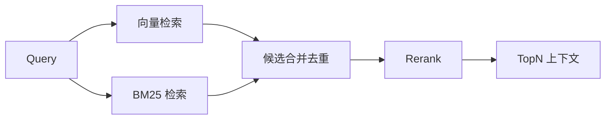

# 混合检索-Hybrid-Search

> [!abstract] 一句话总结
> 混合检索把向量语义检索和关键词检索结合起来，同时覆盖“语义相近”和“精确匹配”。

## 🎯 本节定位

- **本章第 8 课，召回增强：语义 + 精确双覆盖**。前置 [[05-Embedding模型选型]]、[[06-向量检索与TopK]]（单路召回的短板）；本篇讲多路召回与融合。
- **延伸阅读（本课不展开）**：多路分数不可比时交给 [[07-Rerank重排序]] 统一裁判；pgvector 上的实现见 [[14-pgvector入门]]。

## 📌 这是什么

向量检索擅长同义表达，BM25/关键词检索擅长精确词、编号、术语、代码。Hybrid Search 通常先多路召回，再融合分数或交给 Rerank。

## 🧩 典型场景

| 查询类型 | 单向量问题 | 混合检索收益 |
| ---- | ---- | ---- |
| 产品型号 | 语义相似但漏精确型号 | 关键词兜底 |
| 法条编号 | 编号不是语义 | 精确命中 |
| API 名称 | 大小写、符号重要 | 保留字面匹配 |
| 中文缩写 | Embedding 可能不稳定 | BM25 补召回 |

## ⚙️ 融合方式

```text
方式一：向量 TopK + BM25 TopK 合并去重，再 Rerank
方式二：归一化两个分数，加权求和
方式三：RRF（Reciprocal Rank Fusion）按排名融合
```

## 🎯 推荐流程



## ⚠️ 踩坑与注意事项

- [ ] 分数尺度不同，不能直接简单相加。
- [ ] BM25 需要分词，中文场景要注意词典和停用词。
- [ ] 合并后要去重，避免同一内容重复进入上下文。
- [ ] Hybrid 提升召回，但系统复杂度和延迟也会上升。

## 🎯 面试问题

> [!question] 高频问题
> - **Q: 为什么需要混合检索？**
>   - A: 向量检索不擅长精确匹配，关键词检索不擅长语义泛化，组合后召回更稳。
> - **Q: RRF 是什么？**
>   - A: 一种按排名融合多路检索结果的方法，不依赖不同检索器的原始分数可比。

## 🔗 关联笔记

- [[05-Embedding模型选型]]
- [[06-向量检索与TopK]]
- [[07-Rerank重排序]]
- [[14-pgvector入门]]
- [[_index]]

## 📚 参考资料

- [Elasticsearch Hybrid Search](https://www.elastic.co/guide/en/elasticsearch/reference/current/semantic-text-hybrid-search.html)
- [Weaviate Hybrid Search](https://weaviate.io/developers/weaviate/search/hybrid)
- [OpenSearch Neural Search](https://docs.opensearch.org/docs/latest/search-plugins/neural-search/)
