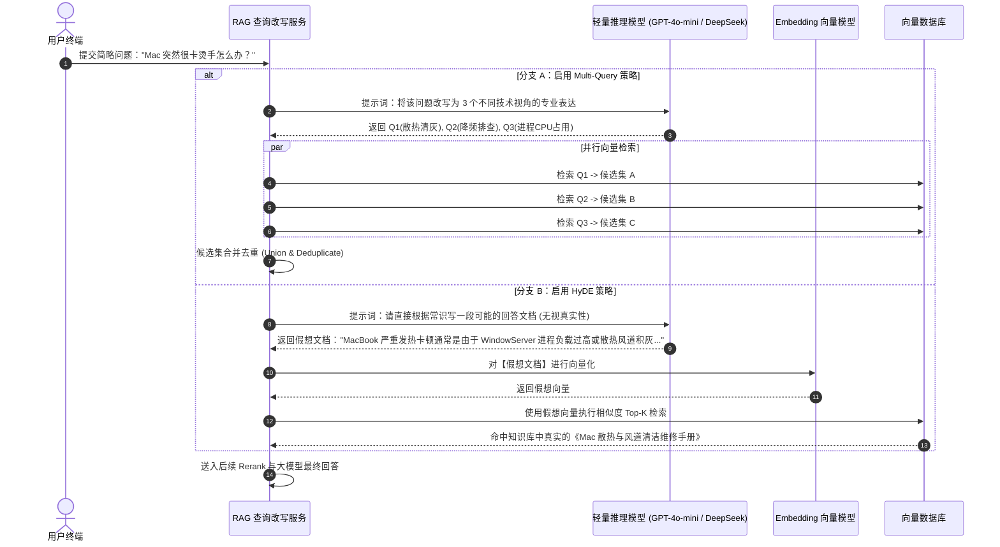

# 🔍 Multi-Query 与 HyDE：抹平“问答语义鸿沟”的高阶查询改写

> [!abstract] 一句话总结
> 用户原始提问往往存在**“口语简略与问答空间非对称”**两大死穴；**Multi-Query** 通过多角度同义改写扩大搜索截面，而 **HyDE（假设性文档嵌入）** 通过让模型先脑补伪答案，将非对称的“以问搜答（Query-to-Doc）”降维为对称的“以文搜文（Doc-to-Doc）”。

---

## 🗣️ 白话版（先建立直觉）

先思考一个很多人做 RAG 容易忽略的**致命物理矛盾**：
- 用户提问：“**退款几天能到账？**”（疑问句、口语化、只有 7 个字、充满不确定性）；
- 知识库里的标准文档：“**关于售后逆向资金流转的时效性规约：退款申请经风控核准后，原路返还工期一般为 3 至 5 个工作日...**”（陈述句、书面官方语调、专业术语密集）。

当你把这句话送到 Embedding 模型里计算向量时，疑问短句和陈述长句在多维空间里的坐标其实离得相当远！
这就是信息检索领域著名的——**非对称语义鸿沟（Asymmetric Semantic Gap）**！

怎么根治这个痛点？业界发明了两个绝妙招式：

### 招式一：Multi-Query（换好几种马甲一起搜）
用户问得太含糊或视角太窄，系统先让大模型把这个问题**从不同的业务视角“换皮改写”成 3 个等价问法**：
1. “退款原路返还的处理周期是多长？”
2. “售后审核通过后银行到账需要几个工作日？”
3. “用户发起退换货后的资金退还进度说明”。
然后把这 3 个问题同时发给向量库检索，把抓到的材料去重汇总。总有一种问法能踩中标准答案！

### 招式二：HyDE（先编个假答案，用假答案去搜真答案！）
这个更绝！用户问：“退款几天到账？”
系统先让大模型凭空脑补写一段假想回答（哪怕里面的具体天数是瞎编的）：
> *“假想答案：根据本商城售后政策，用户的退款在通过商家与客服审核后，系统将在 2-4 个工作日内将款项退回到您的原支付渠道（支付宝/微信/银行卡）...”*

大模型虽然可能编错具体天数，但这段假想回答的**“语气、用词习惯、法律文书感和关键词密集度”**，已经和知识库里的真实文档**一模一样**了！
系统拿着这段假想答案去向量库搜，瞬间就能把真实的《退款时效规约》精准吸出来！

---

## 📌 第一性原理：HyDE 的数学与几何映射本质

HyDE（Hypothetical Document Embeddings，由 Gao 等人在 2022 年经典论文提出）：


1. **信息密度的不对称**：
   用户提问的信息量通常极低（$H(Q) \ll H(Doc)$），且缺乏上下文背景词；
2. **流形一致性假设**：
   大模型生成的假设文档，充当了一个**从 Query 空间到 Document 空间的非线性解码器（Generative Decoder）**。即使事实有出入，它的向量表示（Embedding Vector）在高维语义空间中与真实文档处于**同一流形子空间（Manifold）**中，因此相似度计算极其坚固！

---

## ⚙️ Multi-Query 与 HyDE 全流程时序



---

## 💻 工业级代码实战：Spring AI 中的 HyDE 检索器实现

```java
package com.example.ai.rag.query;

import lombok.extern.slf4j.Slf4j;
import org.springframework.ai.chat.client.ChatClient;
import org.springframework.ai.document.Document;
import org.springframework.ai.vectorstore.SearchRequest;
import org.springframework.ai.vectorstore.VectorStore;
import org.springframework.stereotype.Service;

import java.util.List;

@Slf4j
@Service
public class HydeRetrievalService {

    private final ChatClient chatClient;
    private final VectorStore vectorStore;

    public HydeRetrievalService(ChatClient.Builder builder, VectorStore vectorStore) {
        this.chatClient = builder.build();
        this.vectorStore = vectorStore;
    }

    /**
     * 执行 HyDE 假设性文档增强检索
     */
    public List<Document> retrieveWithHyde(String userQuestion, int topK) {
        log.info("触发 HyDE 检索流程，原始提问: {}", userQuestion);

        // 1. 让轻量级大模型快速脑补生成一篇假设性答案（要求行文严谨、专业文档风）
        String hydePrompt = """
            请为以下问题写一段专业、详尽、如同官方知识库手册风格的解答文档。
            你可以假设任何合理的参数和规约，重点是行文规范、术语标准。
            
            问题：%s
            """.formatted(userQuestion);

        String hypotheticalDoc = chatClient.prompt()
                .user(hydePrompt)
                .call()
                .content();

        log.debug("HyDE 生成假想文档成功:\n{}", hypotheticalDoc);

        // 2. 关键跃迁：拿着【假想文档的内容】而不是【用户的短问题】去向量数据库检索！
        SearchRequest searchRequest = SearchRequest.builder()
                .query(hypotheticalDoc) // 重点：以文搜文
                .topK(topK)
                .similarityThreshold(0.65)
                .build();

        List<Document> trueDocuments = vectorStore.similaritySearch(searchRequest);
        log.info("HyDE 检索完成，成功召回 {} 篇真实知识文档", trueDocuments.size());

        return trueDocuments;
    }
}
```

---

## ⚖️ 技术选型对照：原生查询 vs Multi-Query vs HyDE

| 维度 | 原生查询 (Naive Query) | Multi-Query (多路改写) | HyDE (假设性文档) |
| :--- | :--- | :--- | :--- |
| **外部 LLM 调用开销** | 0 次（极速） | 1 次（要求生成 3 个短句） | 1 次（要求生成 200 字假想文档） |
| **首字延迟 (TTFT)** | **极快 (<100ms)** | 增加 300~600ms | 增加 500~1200ms |
| **最擅长解决的痛点** | 提问规范、表达精确的问题 | 口语化、模糊、同义词多的问题 | **问题极短、专业术语鸿沟大** 的问题 |
| **翻车风险** | 漏召回率高 | 几乎无副作用（仅增加耗时） | **若大模型产生严重幻想偏航，会把检索带偏！** |

---

## ⚠️ 生产避坑指南与反模式

### 1. 忌：在高度小众/未开源的私域领域滥用 HyDE
- **惨案案例**：如果用户问的是你们公司自研的内部框架专属错误码 `"ERR_X990_CORRUPT"`，基础大模型在预训练时根本没见过这个词。
- **翻车结果**：大模型开始胡思乱想，以为是某种数据库损坏，生成了一篇关于 Oracle 修复的假想文档，导致向量检索去抓了一堆 Oracle 的文章，把真正的内部排查 SOP 彻底漏掉！
- **铁律**：**HyDE 必须建立在大模型对该领域具备基础通识的前提下！对于冷门专有名词或特定工单编号，必须用 BM25 混合检索，严禁使用 HyDE！**

### 2. 忌：直接把“假想文档”当成事实喂给最终模型
- 很多新手在代码中手滑，把大模型脑补出来的 `hypotheticalDoc` 拼接到了给用户的最终 Prompt 里，导致用户看到了大模型自己捏造的荒谬事实。
- **铁律**：**假想文档只是“诱饵”！用完立刻丢弃，最终送入生成模型的，必须是向量库查出来的百分之百真实的知识库 Chunk！**

### 3. 成本与延迟权衡：采用轻量小模型执行改写
- 永远不要用昂贵的推理模型（如 o1、Claude 3.5 Opus）来做 HyDE 或 Multi-Query 的改写！
- 生产推荐使用小而快的模型（如 `GPT-4o-mini`, `DeepSeek-V3`, `Qwen-2.5-7B`），在 200 毫秒内完成改写，严格控制延迟与成本。

---

## 🎯 大厂高频面试 30 秒绝杀

> [!question] 面试高频问题 3 连击
> 
> **Q1：什么是检索中的“问答语义鸿沟（Asymmetric Semantic Gap）”？HyDE 是如何从数学几何层面解决它的？**
> - **答（满分绝杀）**：
>   用户提问通常是简短、口语化且充满不确定性的疑问句，而知识库中的文档是官方、严谨且信息密集的陈述句。两者在预训练嵌入空间中往往处于不同的流形子空间，导致以问搜答（Query-to-Doc）时余弦相似度不高甚至漏召。HyDE 利用大模型作为生成解码器，先针对 Query 生成一篇结构规范的假设性答案。虽然答案事实可能不准，但它的语体特征、术语分布已完全映射到 Document 空间中。以假想文档的向量去检索，实现了**同流形子空间下的“以文搜文（Doc-to-Doc）”**，从几何层面拉近了距离。
>
> **Q2：Multi-Query 策略的核心价值是什么？在工程落地时如何避免上下文冗余？**
> - **答（满分绝杀）**：
>   Multi-Query 核心在于**通过提示工程消除用户表达的偶发性与片面性**，利用大模型自回归发散出多条语义等价但侧重不同的查询表达式，并行检索以最大化召回边界（提高 Recall）。为了防止多个 Query 召回大量同质化 Chunk 撑爆上下文窗口，工程落地必须实施**两道过滤**：① **文档 ID 唯一去重**；② 接入 **Cross-Encoder Rerank 重排序**，从所有合并候选中仅保留置信度最高且语义互补的 Top-K 证据。
>
> **Q3：在生产级 RAG 架构中，什么场景下坚决不应该开启 HyDE？**
> - **答（满分绝杀）**：
>   两大禁忌场景：
>   1. **私有黑盒专有名词场景**：当查询涉及企业内部特有的暗号、冷门错误码、自研系统缩写时，通用大模型完全不具备先验知识，生成的假想文档必然产生严重幻觉，导致检索彻底南辕北辙；
>   2. **极端低延迟敏感场景**：HyDE 额外增加了一轮完整的 LLM 生成开销，使首字延迟（TTFT）增加至少 500ms~1s。对延迟要求在 1 秒以内的在线客服，应优先采用“轻量规则改写 + 混合检索”而非 HyDE。

---

## 🪝 一分钟复盘记忆卡

```
┌────────────────────────────────────────────────────────┐
│               Multi-Query 与 HyDE 极速通关卡            │
├────────────────────────────────────────────────────────┤
│  1. 根因痛点：短提问 vs 长文档的非对称语义鸿沟        │
│  2. Multi-Query：多套马甲并发搜，扩大召回面再去重     │
│  3. HyDE 魔法：先脑补假答案，用假答案搜真答案(Doc-Doc)│
│  4. 适用边界：通识常识库效果拔群，内部生僻专有名词禁用│
│  5. 架构红线：假想文档仅作检索诱饵，绝不作为事实证据  │
└────────────────────────────────────────────────────────┘
```

---

## 🔗 关联笔记

- [[01-RAG基础与全链路]] - RAG 基础流程与在线检索架构
- [[06-向量检索与TopK]] - 相似度检索与阈值过滤机制
- [[07-Rerank重排序]] - 接收 Multi-Query 合并候选集进行深度精排
- [[08-混合检索-Hybrid-Search]] - 当 HyDE 失效时依靠 BM25 兜底
- [[_index]] - 返回 RAG 专题索引
