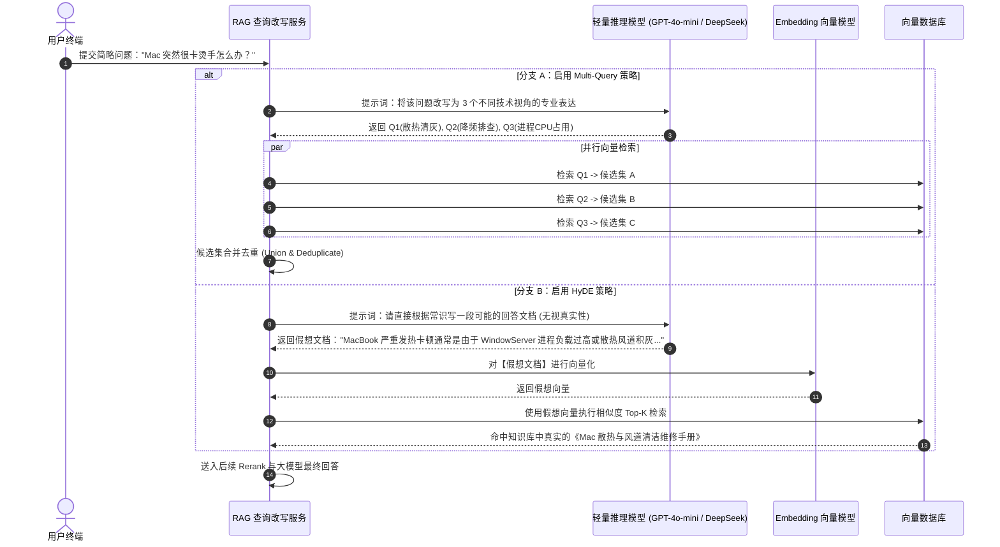

# 🔍 Multi-Query 与 HyDE：抹平“问答语义鸿沟”的高阶查询改写

> [!abstract] 一句话总结
> 用户原始提问往往存在**“口语简略与问答空间非对称”**两大死穴；**Multi-Query** 通过多角度同义改写扩大搜索截面，而 **HyDE（假设性文档嵌入）** 通过让模型先脑补伪答案，将非对称的“以问搜答（Query-to-Doc）”降维为对称的“以文搜文（Doc-to-Doc）”。

---

## 🗣️ 白话版（先建立直觉）

用户的日常口语提问往往简短模糊，与知识库中严谨的文档表述存在用词差异。Multi-Query 通过将原问题改写为多个不同视角的查询并行检索，扩大召回覆盖面；HyDE 则先由模型生成一段假设性解答文档，利用该假想文档的向量去检索真实资料，将“以问搜答”转化为“以文搜文”。工程应用中需注意控制改写带来的附加延迟，且 HyDE 生成的假想文档仅用于检索阶段计算向量，最终回答仍须严格依据检索命中的真实文档。

---

## 📌 第一性原理：HyDE 的数学与几何映射本质

HyDE（Hypothetical Document Embeddings，由 Gao 等人在 2022 年经典论文提出）：


1. **信息密度的不对称**：
   用户提问的信息量通常极低（$H(Q) \ll H(Doc)$），且缺乏上下文背景词；
2. **流形一致性假设**：
   大模型生成的假设文档，充当了一个**从 Query 空间到 Document 空间的非线性解码器（Generative Decoder）**。即使事实细节有偏差，它的向量表示（Embedding Vector）在高维语义空间中与真实文档处于**同一流形子空间（Manifold）**中，能够提升语义匹配稳定性。

---

## ⚙️ Multi-Query 与 HyDE 全流程时序



---

## 💻 代码示例：Spring AI 中的 HyDE 检索器实现

```java
package com.example.ai.rag.query;

import lombok.extern.slf4j.Slf4j;
import org.springframework.ai.chat.client.ChatClient;
import org.springframework.ai.document.Document;
import org.springframework.ai.vectorstore.SearchRequest;
import org.springframework.ai.vectorstore.VectorStore;
import org.springframework.stereotype.Service;

import java.util.List;

@Slf4j
@Service
public class HydeRetrievalService {

    private final ChatClient chatClient;
    private final VectorStore vectorStore;

    public HydeRetrievalService(ChatClient.Builder builder, VectorStore vectorStore) {
        this.chatClient = builder.build();
        this.vectorStore = vectorStore;
    }

    /**
     * 执行 HyDE 假设性文档增强检索
     */
    public List<Document> retrieveWithHyde(String userQuestion, int topK) {
        log.info("触发 HyDE 检索流程，原始提问: {}", userQuestion);

        // 1. 让轻量级大模型快速生成一篇假设性答案（要求行文严谨、专业文档风格）
        String hydePrompt = """
            请为以下问题写一段专业、详尽、如同官方知识库手册风格的解答文档。
            你可以假设合理的参数和规约，重点是行文规范、术语标准。
            
            问题：%s
            """.formatted(userQuestion);

        String hypotheticalDoc = chatClient.prompt()
                .user(hydePrompt)
                .call()
                .content();

        log.debug("HyDE 生成假想文档成功:\n{}", hypotheticalDoc);

        // 2. 关键步骤：使用【假想文档的内容】去向量数据库检索
        SearchRequest searchRequest = SearchRequest.builder()
                .query(hypotheticalDoc) // 重点：以文搜文
                .topK(topK)
                .similarityThreshold(0.65)
                .build();

        List<Document> trueDocuments = vectorStore.similaritySearch(searchRequest);
        log.info("HyDE 检索完成，成功召回 {} 篇真实知识文档", trueDocuments.size());

        return trueDocuments;
    }
}
```

---

## ⚖️ 技术选型对照：原生查询 vs Multi-Query vs HyDE

| 维度 | 原生查询 (Naive Query) | Multi-Query (多路改写) | HyDE (假设性文档) |
| :--- | :--- | :--- | :--- |
| **外部 LLM 调用开销** | 0 次（极速） | 1 次（生成 3 个改写短句） | 1 次（生成约 200 字假想文档） |
| **附加检索前开销** | 无改写调用 | 增加 1 次短文本生成耗时 | 增加 1 次段落级文本生成耗时 |
| **最擅长解决的痛点** | 提问规范、表达精确的问题 | 口语化、模糊、同义词多的问题 | **问题简短、专业术语差异大** 的问题 |
| **潜在风险与防范** | 复杂问法易漏召回 | 改写可能偏离原意，需保留原始 Query 一并检索 | **若模型对私域概念产生幻觉，易导致检索偏航** |

---

## ⚠️ 生产避坑指南与反模式

### 1. 忌：在高度小众/未公开的私域概念上滥用 HyDE
- **问题现象**：如果用户询问公司内部自研框架的专属错误码 `"ERR_X990_CORRUPT"`，基础大模型在预训练语料中从未见过该编码。
- **后果**：大模型可能将其误判为通用数据库损坏，生成一篇关于数据库修复的假想文档，导致向量检索召回无关文章，漏掉内部排查 SOP。
- **治理原则**：**HyDE 适用于大模型具备领域通识的场景；对于内部私有缩写、特定工单号或专属错误码，应采用 BM25 混合检索并保留原始 Query。**

### 2. 忌：把“假想文档”直接混入最终生成上下文
- 若不慎将模型生成的 `hypotheticalDoc` 拼接到最终回答的 Prompt 上下文中，会导致生成模型把虚构参数当作真实依据输出给用户。
- **治理原则**：**假想文档仅作为检索阶段的向量媒介，检索完成后即行丢弃；最终注入 Prompt 交由大模型生成答案的，必须是向量库中经权限过滤召回的真实原文切片。**

### 3. 成本与延迟权衡：采用轻量级模型执行查询改写
- 查询改写与假想文档生成对推理深度的要求低于最终综合问答，生产环境优先选用轻量级高吞吐模型（如 `GPT-4o-mini`、`DeepSeek-V3`、`Qwen-2.5-7B` 等），在保证改写质量的同时最小化首字延迟（TTFT）与调用成本。

---

## 🎯 高频面试问题

> [!question] 面试高频问题 3 连击
> 
> **Q1：什么是检索中的“问答语义鸿沟（Asymmetric Semantic Gap）”？HyDE 是如何从数学几何层面解决它的？**
> - **答**：
>   用户提问通常是简短、口语化且充满不确定性的疑问句，而知识库中的文档是官方、严谨且信息密集的陈述句。两者在预训练嵌入空间中往往处于不同的流形子空间，导致以问搜答（Query-to-Doc）时余弦相似度不高甚至漏召。HyDE 利用大模型作为生成解码器，先针对 Query 生成一篇结构规范的假设性答案。虽然答案事实可能不准，但它的语体特征、术语分布已映射到 Document 空间中。以假想文档的向量去检索，实现了**同流形子空间下的“以文搜文（Doc-to-Doc）”**，从几何层面拉近了距离。
>
> **Q2：Multi-Query 策略的核心价值是什么？在工程落地时如何避免上下文冗余？**
> - **答**：
>   Multi-Query 核心在于**通过提示工程消除用户表达的偶发性与片面性**，利用大模型发散出多条语义等价但侧重不同的查询表达式，并行检索以扩大召回覆盖面（提高 Recall）。为了防止多个 Query 召回大量重复 Chunk 占用上下文窗口，工程落地需实施**两道过滤**：① **文档 Chunk ID 唯一去重**；② 接入 **Cross-Encoder Rerank 重排序**，从所有合并候选中仅保留相关性最高且信息互补的 Top-K 证据。
>
> **Q3：在生产级 RAG 架构中，什么场景下不应该开启 HyDE？**
> - **答**：
>   两类典型场景：
>   1. **私有专有名词与编码查询场景**：当查询涉及企业内部特有的代号、冷门错误码、自研系统缩写时，通用大模型缺乏先验知识，生成的假想文档易偏离实际语义，导致检索方向偏移；
>   2. **低延迟严苛场景**：HyDE 在检索前额外增加了一轮 LLM 文本生成调用，会拉长端到端首字延迟（TTFT）。对延迟高度敏感的实时交互场景，优先采用“轻量同义扩展 + 混合检索”。

---

## 🪝 一分钟复盘记忆卡

```
┌────────────────────────────────────────────────────────┐
│               Multi-Query 与 HyDE 复盘卡            │
├────────────────────────────────────────────────────────┤
│  1. 根因痛点：短提问 vs 长文档的非对称语义鸿沟        │
│  2. Multi-Query：多视角同义改写并发搜，合并去重扩召回  │
│  3. HyDE 机制：先生成假想文档，以文搜文对齐语义流形   │
│  4. 适用边界：通用领域知识效果好，内部私有编码用 BM25 │
│  5. 架构规范：假想文档仅作检索媒介，绝不混入生成证据  │
└────────────────────────────────────────────────────────┘
```

---

## 🔗 关联笔记

- [[01-RAG基础与全链路]] - RAG 基础流程与在线检索架构
- [[06-向量检索与TopK]] - 相似度检索与阈值过滤机制
- [[07-Rerank重排序]] - 接收 Multi-Query 合并候选集进行深度精排
- [[08-混合检索-Hybrid-Search]] - 当 HyDE 失效时依靠 BM25 兜底
- [[_index]] - 返回 RAG 专题索引
