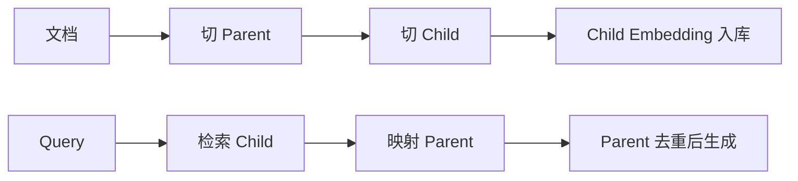

# 父子块策略

> [!abstract] 一句话总结
> 父子块策略是“小块用于检索，大块用于生成”，同时兼顾召回精度和上下文完整性。

## 🎯 本节定位

- **本章第 10 课，检索/生成颗粒度解耦**。前置 [[04-文本切分策略]]（单层 chunk 的折中）、[[06-向量检索与TopK]]；本篇是切分策略第五种方案的完整展开。
- **延伸阅读（本课不展开）**：命中子块后的引用与 metadata 见 [[11-引用溯源]]。

## 📌 这是什么

普通 RAG 只有一种 chunk 粒度。父子块会把文档切成两层：子块较小，适合精准检索；父块较大，保留完整段落或章节，用于交给 LLM 生成答案。

## 🧩 数据结构

| 层级 | 用途 | 例子 |
| ---- | ---- | ---- |
| Parent Chunk | 生成上下文 | 一个小节、一个条款组 |
| Child Chunk | 向量检索 | 小段落、几句话 |

```text
child.metadata.parent_id = parent.id
检索命中 child 后，回表取 parent 内容
```

## ⚙️ 工作流程



## 🎯 适用场景

- 法律条款：命中某一句，但回答需要整条规定。
- 技术文档：命中参数说明，但需要整个接口上下文。
- 长章节：小块召回准，大块保证语义完整。

## ⚠️ 踩坑与注意事项

- [ ] Parent 太大会浪费上下文。
- [ ] Child 太小会缺少可区分语义。
- [ ] 多个 child 命中同一个 parent 时要去重。
- [ ] parent_id、source、page 等 metadata 必须稳定。

## 🎯 面试问题

> [!question] 高频问题
> - **Q: 父子块解决什么问题？**
>   - A: 解决小块检索准但上下文不完整、大块上下文完整但检索不准的矛盾。
> - **Q: 父块和子块都要向量化吗？**
>   - A: 常见做法是只向量化子块，命中后取父块；也可以父子都建索引用于不同查询。

## 🔗 关联笔记

- [[04-文本切分策略]]
- [[06-向量检索与TopK]]
- [[11-引用溯源]]
- [[_index]]

## 📚 参考资料

- [LangChain ParentDocumentRetriever API](https://reference.langchain.com/python/langchain-classic/retrievers/parent_document_retriever/ParentDocumentRetriever)
- [LlamaIndex Recursive Retriever](https://docs.llamaindex.ai/en/stable/examples/query_engine/pdf_tables/recursive_retriever/)
- [Spring AI ETL Pipeline](https://docs.spring.io/spring-ai/reference/api/etl-pipeline.html)
