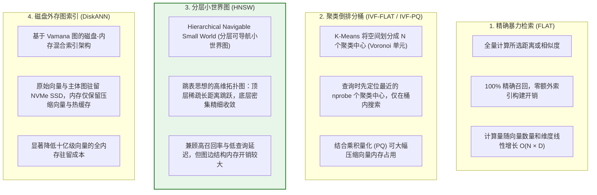
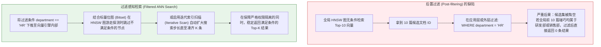
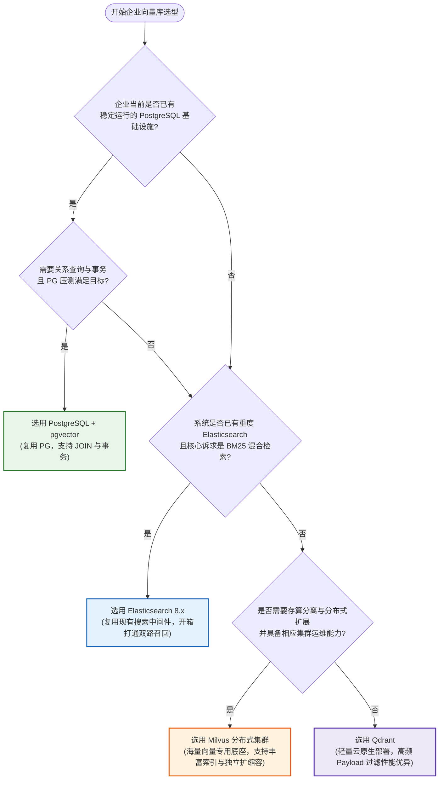

# 🗄️ 向量数据库深度选型对比与架构决策

> [!abstract] 一句话总结
> 向量数据库选型需综合权衡现有技术栈复用度、数据规模、标量过滤性能、事务一致性要求及团队运维能力，基于真实业务负载压测做出架构决策。

---

## 🗣️ 白话版（先建立直觉）

若业务已广泛使用 PostgreSQL，且强依赖关系表关联查询与事务一致性，可优先评估 pgvector 以降低架构复杂度；若面临大规模向量高并发检索、需要存算分离独立扩缩容，则适合评估 Milvus、Qdrant 等专用向量数据库；若已有 Elasticsearch 集群并强调全文与向量混合检索，可直接复用 ES 8.x 的原生混合检索能力。

---

## 📌 第一性原理：向量索引底层算法核心四门派

向量维度由 Embedding 模型决定。暴力检索对 $N$ 条 $D$ 维向量逐一计算距离，计算复杂度为 $O(N \cdot D)$。
ANN（Approximate Nearest Neighbor，近似最近邻搜索）通过构建空间划分或近邻图索引，以可控的极小召回率折中换取数量级的检索加速：



> [!TIP]
> HNSW 凭借优异的查询延迟与召回率表现，成为当前在线 RAG 系统最主流的内存图索引；但在超大规模向量场景下，需同步评估其图结构带来的内存开销与索引构建耗时，必要时结合标量量化（SQ/PQ）或 DiskANN 磁盘索引降低成本。

---

## 📊 四大主流向量引擎横向对比矩阵

| 评估维度 | PostgreSQL (pgvector) | Milvus (分布式专用) | Qdrant (云原生专用) | Elasticsearch 8.x |
| :--- | :--- | :--- | :--- | :--- |
| **底层开发语言** | C（Postgres 扩展插件） | Go (协调调度) + C++ (核心引擎) | **Rust**（内存安全与高并发） | Java (Lucene) |
| **架构定位** | 关系型数据库内嵌向量扩展 | 存算分离的云原生分布式向量库 | 轻量级高性能专用向量引擎 | 全文检索引擎扩展向量能力 |
| **核心适用场景** | 中小规模向量、强关系事务与业务表 JOIN 关联 | 千万至亿级大规模向量、高并发独立检索服务 | 中大规模向量、高频复杂 Payload 过滤与快速部署 | 重度依赖全文检索（BM25）与向量混合召回场景 |
| **事务与一致性** | 完整支持 ACID 关系型事务 | 支持可调一致性级别（Strong / Bounded / Eventually） | 支持可配置的副本写入与读一致性级别 | 近实时（NRT）索引可见，支持文档级原子更新 |
| **元数据过滤** | 标准 SQL 过滤与联合索引（0.8+ 支持迭代扫描） | 标量倒排索引与布尔表达式过滤 | 原生图与 Payload 索引深度耦合过滤 | Lucene 倒排布尔查询与 Filter 缓存 |
| **混合检索支持** | 支持（结合 PostgreSQL 全文检索 `tsvector`） | 原生支持（2.4+ 内置密集与稀疏向量） | 原生支持（Dense + Sparse 向量） | **原生支持 (BM25 + HNSW 向量 + RRF)** |
| **运维复杂度** | 低（直接复用现有 PG 备份、高可用与监控体系） | 较高（分布式集群包含多层协调与工作节点，支持 Lite/Standalone 简化部署） | 较低（单二进制文件无外部组件依赖，易于容器化扩展） | 中（复用现有 ES 运维栈，需规划分片与堆内存容量） |

---

## 🎯 核心工程问题：前置过滤 vs 后置过滤（标量过滤陷阱）

业务检索通常包含租户、权限、文档状态等过滤条件，例如：
> *“在 `department = 'HR'` 且 `status = 'PUBLISHED'` 的文档中，搜索与‘公积金比例’相似的内容。”*

若向量检索与标量过滤的执行顺序不当，容易引发召回为空的线上故障：



> [!CAUTION]
> 在多租户与权限隔离场景中，必须将标量过滤条件下推至向量引擎内部执行（如 Qdrant/Milvus 的 Filtered Search，或开启 pgvector 0.8+ 的 `hnsw.iterative_scan` 迭代扫描），避免在取得全局 Top-K 后再做后置裁剪导致结果集不足或为空。

---

## 🗺️ 企业级向量库选型决策树



---

## ⚠️ 生产避坑指南与注意事项

### 1. 避免脱离业务规模过早引入重型分布式架构
- 在知识库建设初期，若业务已使用 PostgreSQL 或 Elasticsearch，应优先基于现有存储底座验证与上线；当单机内存、写入吞吐或高并发检索延迟成为实际瓶颈时，再平滑演进至独立向量集群。

### 2. 保持向量维度与距离度量（Metric Type）的一致性
- 写入前若按余弦相似度规划，建索引与查询时必须配置一致的距离度量（如 Cosine / Inner Product），避免混用 L2 距离导致排序失真。
- 切换不同维度的 Embedding 模型（例如从 768 维升级至 1536 维）时，需新建独立表或 Collection 重新构建索引，避免维度冲突。

### 3. 准确评估向量索引的内存开销
- `float32` 原始向量的基础存储开销为 `数量 × 维度 × 4` 字节（例如 1000 万条 1536 维向量约占 61.44 GB），HNSW 图索引还需额外存储节点邻接边列表与元数据。
- 在千万级以上规模下，需提前实测内存水位，必要时开启标量量化（SQ8）、乘积量化（PQ）或采用磁盘混合索引（DiskANN / MMAP）。

---

## 🎯 高频面试问题

> [!question] 面试高频问题 3 连击
>
> **Q1：HNSW 与 IVF 索引的核心机制与工程取舍是什么？**
> - **答**：HNSW 基于分层可导航小世界图，查询时从顶层稀疏图快速跳步收敛到底层密集图，在高召回率下具备更低的查询延迟，但图边结构占用内存较大且构建耗时较长；IVF（倒排文件索引）通过 K-Means 聚类将向量空间划分为多个分桶，查询时仅搜索距离最近的 `nprobe` 个分桶，内存占用更小、构建更快，但桶边界处的向量容易漏召回，通常配合乘积量化（IVF-PQ）用于内存受限的大规模场景。
>
> **Q2：pgvector 与 Milvus / Qdrant 等专用向量库怎么选？**
> - **答**：选型核心看技术栈复用度与扩展性诉求：当团队已有成熟的 PostgreSQL 运维体系、数据规模适中且需要文档块与业务表共享 ACID 事务和复杂 SQL 关联时，首选 pgvector；当向量规模持续增长、检索并发高，或需要存算分离、独立水平扩缩容及丰富的量化与磁盘索引时，选用 Milvus 或 Qdrant 等专用向量库。
>
> **Q3：为什么带权限过滤的向量检索有时会返回空结果？如何解决？**
> - **答**：这是典型的“后置过滤（Post-filtering）”问题：若先在全库执行无过滤的 ANN 检索取出 Top-K，再按租户或部门条件剔除不合规记录，当目标部门文档占比较低时，Top-K 候选可能全部属于其他部门，过滤后直接返回空集。解决方案是将过滤条件下推至向量检索引擎内部，采用过滤感知图遍历（Filtered HNSW）或开启迭代扫描（Iterative Scan），在满足过滤条件的子空间内完成近邻搜索。

---

## 🪝 一分钟复盘记忆卡

```text
1. 索引权衡：HNSW 延迟低召回高但占内存；IVF-PQ 与 DiskANN 适合降内存成本。
2. pgvector：复用现有 PostgreSQL 事务、SQL 关联与运维体系。
3. 专用向量库：Milvus 强于存算分离大规模扩展，Qdrant 强于轻量部署与 Payload 过滤。
4. 搜索引擎：已有 Elasticsearch 8.x 时可直接复用其 BM25 + 向量原生混合检索。
5. 权限过滤：严禁全局 Top-K 后置裁剪，必须下推过滤条件并启用过滤感知检索或迭代扫描。
```

---

## 🔗 关联笔记

- [[01-RAG基础与全链路]] - 向量检索在 RAG 全链路中的调用定位
- [[06-向量检索与TopK]] - 深入 Top-K 与相似度阈值过滤算法
- [[08-混合检索-Hybrid-Search]] - 向量数据库与倒排全文检索的融合
- [[13-Milvus入门]] - 深入 Milvus 核心概念与 Collection 实践
- [[14-pgvector入门]] - 深入 PostgreSQL 插件安装、HNSW 索引创建与 SQL
- [[_index]] - 返回 RAG 专题索引

## 📚 参考资料

- [pgvector：索引与过滤](https://github.com/pgvector/pgvector#filtering)
- [Faiss：索引选型与取舍](https://github.com/facebookresearch/faiss)
