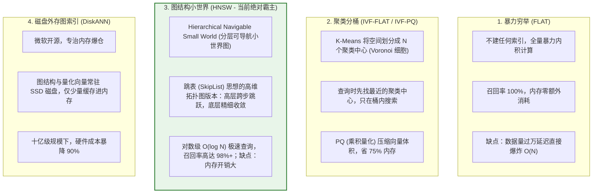
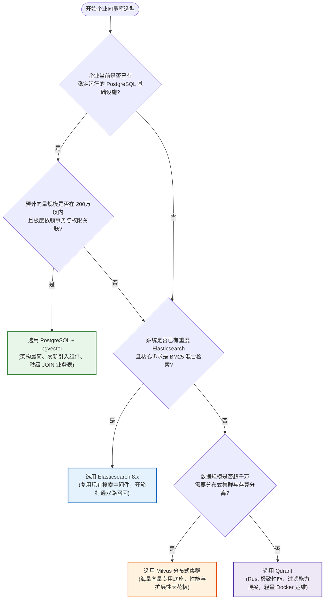

# 🗄️ 向量数据库深度选型对比与架构决策

> [!abstract] 一句话总结
> 向量库选型的第一性原理是**“在数据规模、查询吞吐、标量过滤能力与团队运维成本之间寻找最优帕累托平衡”**——小中规模（百万级以内）首选 **PostgreSQL (pgvector)** 保持极简架构，海量高并发（千万到十亿级）上专用 **Milvus / Qdrant**，强全文检索存量系统复用 **Elasticsearch**。

---

## 🗣️ 白话版（先建立直觉）

如果要在你的 Java 后端系统里引入向量存储：
- **方案 A：买一辆实用可靠的家用 SUV（PostgreSQL + pgvector）**：
  你家原本就有一辆车（关系型数据库），现在只要在后备箱装一个多功能收纳箱（安装 `pgvector` 扩展插件），它就能同时装载你原本的订单、用户、部门表，还能顺便装下几十万个文档向量。业务表与向量表可以在**同一条 SQL 里直接 `LEFT JOIN`**，天然支持严格事务（ACID）和行级权限！
- **方案 B：买一台专门下赛道的专业赛车（Milvus / Qdrant）**：
  如果你要在赛道上跑极速、同时容纳上千万乃至数亿个向量、要求几千 QPS 的并发检索，SUV 就会直接爆缸。这时你必须买一台纯粹为向量而生的超级赛车。它采用存算分离、分布式架构，连底层代码都是用 C++ 或 Rust 写的。但代价是：它非常挑路况（无法替代关系型数据库），需要专门的赛车养护团队（额外的分布式运维中间件成本）。

**技术选型绝不是盲目追求“谁最快”，而是看你的数据量级和团队承受力！**

---

## 📌 第一性原理：向量索引底层算法核心四门派

大模型向量的维度通常高达 768 到 1536 维。如果让电脑逐一遍历比对（暴力计算），时间复杂度为 $O(N \cdot D)$，数据量一旦超过 10 万，检索延迟就会飙到几秒！
为了实现毫秒级召回，向量数据库依赖 **ANN（Approximate Nearest Neighbor，近似最近邻搜索）** 索引算法：



> [!TIP]
> **HNSW（分层可导航小世界）** 是目前 pgvector、Milvus、Qdrant、ES 统一支持的行业事实标准算法，兼顾极致检索速度与极高召回率。

---

## 📊 四大主流选手横向硬核对比矩阵

| 评估维度 | PostgreSQL (pgvector) | Milvus (分布式专用) | Qdrant (云原生专用) | Elasticsearch 8.x |
| :--- | :--- | :--- | :--- | :--- |
| **底层开发语言** | C（Postgres 扩展插件） | Go (调度) + C++ (核心引擎) | **Rust**（内存安全极致并发） | Java (Lucene) |
| **架构定位** | 传统关系型关系数据库外挂 | 专为海量规模设计的分布式系统 | 轻量级高性能专用向量库 | 全文搜索引擎扩展向量能力 |
| **推荐数据规模** | **10 万 ~ 200 万** | **1000 万 ~ 10 亿+** | **100 万 ~ 5000 万** | **100 万 ~ 1000 万** |
| **事务与 ACID** | **完全支持 (强一致性)** | 弱支持（最终一致性） | 弱支持（Wal 保证持久性） | 准实时（Near Real-time） |
| **元数据过滤性能** | **极强**（支持 B 树、GIN、JSONB） | 优秀（支持表达式过滤） | **顶尖**（独创 Payload 单阶段过滤） | **极强**（Lucene 倒排标量过滤王者） |
| **混合检索支持** | 支持（结合 pg_trgm 全文检索） | 原生支持（2.4+ 内置稀疏向量） | 支持（Sparse 向量） | **天然原生混合检索 (BM25 + 向量)** |
| **运维复杂度** | **极低**（现有 PG 实例直接 `CREATE EXTENSION`） | **较高**（依赖 MinIO、etcd、Pulsar/Kafka） | **低**（单二进制文件或轻量 Docker） | 中等（成熟的 Java ES 运维体系） |

---

## 🎯 致命陷阱：前置过滤 vs 后置过滤（标量过滤灾难）

在真实业务中，几乎没有裸搜向量的场景，99% 都带有权限或业务过滤条件：
> *“在 `department = 'HR'` 且 `status = 'PUBLISHED'` 的文档中，搜索与‘公积金比例’相似的内容。”*

如果向量库的标量过滤机制设计不合理，就会引发**生产灾难**：


> [!CAUTION]
> 选型时必须确认向量库是否支持 **Single-stage Filtering（单阶段联合过滤）**。早期版本的某些插件采用后置过滤，在高选择性（如当前租户数据只占全库 1%）时，经常检索出完全为空的假结果！

---

## 🗺️ 企业级向量库选型决策树



---

## ⚠️ 生产避坑指南与致命陷阱

### 1. 致命过度设计：几十万数据无脑上 Milvus 分布式集群
- **现场惨案**：一个初创团队一共只有 5 万篇文档（切完大约 20 万个 Chunk），为了“先进性”在 K8s 上拉起了 Milvus 分布式全家桶（etcd + MinIO + Pulsar + Milvus proxy/datanode/querynode）。
- **后果**：光支撑这个向量库集群就耗费了 8 台 16G 节点，每月云资源账单几万块，日常维护 etcd 脑裂和 Pulsar 消息积压焦头烂额。实际上一个单机 PostgreSQL `CREATE EXTENSION vector;` 2 核 4G 机器跑得飞快！
- **准则**：**数据量在 100 万以内，坚决不要引入独立的分布式向量数据库集群！**

### 2. 忽略维度与距离度量（Metric Type）的一致性
- 写入时使用的是余弦距离（Cosine），建索引或查询时误配成了 L2 距离，导致距离得分完全混乱。
- 换了新的 Embedding 模型（例如从 768 维换到 1536 维），试图在同一张表里混合存储，导致底层直接报 `dimensions mismatch` 崩溃。

### 3. 内存容量预估不足导致 OOM 击穿
- HNSW 索引非常吃内存。经验公式：
  $$\text{内存需求} \approx \text{向量数量} \times (\text{维度} \times 4\text{字节} + M \times 8\text{字节}) \times 1.2$$
- 1000 万条 1536 维的向量，光纯向量数据就需要约 $60\text{ GB}$ 内存，加上 HNSW 图指针需要将近 $100\text{ GB}$ 物理内存！如果机器配置不足，会直接被操作系统的 OOM Killer 杀掉。大体量必须考虑 **量化（PQ/SQ）** 或 **DiskANN**。

---

## 🎯 大厂高频面试 30 秒绝杀

> [!question] 面试高频问题 3 连击
> 
> **Q1：为什么在常规千万级向量检索中，HNSW 算法能全面碾压传统聚类（IVF）算法？**
> - **答（满分绝杀）**：
>   HNSW（分层可导航小世界）从本质上是**跳表（Skip-List）思想在多维空间图拓扑中的实现**。它通过多层概率图结构，让搜索在高层（长边）实现大跨度的快速跃迁，底层（短边）执行精细收敛，将搜索时间复杂度硬生生压降至 $O(\log N)$；而 IVF（倒排分桶）依赖聚类中心划分，容易在边界区域（Voronoi 边缘）产生严重的最近邻漏判，为了保全召回必须大幅增大探测桶数（nprobe），导致延迟成倍上升。HNSW 在 98% 极高召回率下依然能保持数毫秒极低延迟，因此成为工业界事实标准。
>
> **Q2：PostgreSQL + pgvector 与专用向量数据库（如 Milvus）相比，各有什么优劣和适用边界？**
> - **答（满分绝杀）**：
>   - **pgvector 核心优势**在于**“极简架构与强事务业务融合”**：它天然继承了 PostgreSQL 完整的 ACID 事务、多租户 RBAC 权限与成熟运维体系，能够在单条 SQL 中直接与订单、用户等业务关系表进行 `JOIN`；其劣势在于并非存算分离架构，在数千万以上海量向量或超高并发写场景下，横向扩展能力受单机实例限制；
>   - **Milvus 核心优势**在于**“为亿级向量而生的云原生分布式吞吐”**：采用计算与存储分离架构（etcd + Pulsar + MinIO），支持微服务级水平扩缩容，原生具备极高的分布式并发查询性能；其劣势在于系统组件繁多、部署运维成本高，且无法承载传统业务的强事务关系。
>   - **界线**：百万级以内选 pgvector，千万级以上高吞吐上 Milvus。
>
> **Q3：在向量检索中，后置过滤（Post-filtering）为什么会导致严重的“假空结果”？工业界如何治理？**
> - **答（满分绝杀）**：
>   后置过滤是在全库向量无差别检索出全局最相似的 Top-K 条结果后，再对这 K 条记录按业务条件（如 `WHERE tenant_id = 99`）进行筛除。当该业务条件的满足率极低（如租户 99 只占全库 0.5% 数据）时，全局 Top-K 极大概率全被其他大租户的数据占满，后置过滤一滤即空，造成“明明库里有答案却返回空”的灾难。工业界彻底治愈的方案是采用 **单阶段联合过滤（Single-stage / In-graph Filtering）**：在 HNSW 图遍历（Graph Traversal）的每一步探索中，直接结合标量索引（Bitset/Payload）动态剔除非法节点，确保候选集从头到尾全部满足业务过滤边界。

---

## 🪝 一分钟复盘记忆卡

```
┌────────────────────────────────────────────────────────┐
│               向量数据库选型 极速通关卡                 │
├────────────────────────────────────────────────────────┤
│  1. 算法王道：HNSW 图索引是兼顾速度与召回的事实标准    │
│  2. 小中王者：pgvector 百万级内无敌，事务JOIN零成本    │
│  3. 海量天花板：Milvus 分布式存算分离，千万到十亿级霸主│
│  4. 搜索复用：Elasticsearch 8.x 原生打通 BM25 混合检索 │
│  5. 避坑红线：杜绝后置过滤灾难，必须用单阶段联合过滤   │
└────────────────────────────────────────────────────────┘
```

---

## 🔗 关联笔记

- [[01-RAG基础与全链路]] - 向量检索在 RAG 全链路中的调用定位
- [[06-向量检索与TopK]] - 深入 Top-K 与相似度阈值过滤算法
- [[08-混合检索-Hybrid-Search]] - 向量数据库与倒排全文检索的融合
- [[13-Milvus入门]] - 深入 Milvus 核心概念与 Collection 实践
- [[14-pgvector入门]] - 深入 PostgreSQL 插件安装、HNSW 索引创建与 SQL
- [[_index]] - 返回 RAG 专题索引
