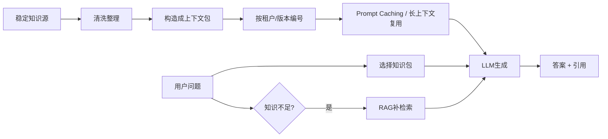

# CAG缓存增强生成

> [!abstract] 一句话总结
> CAG（Cache-Augmented Generation）把相对稳定、规模可控的知识预先整理成上下文包并重复复用，用缓存换掉部分实时检索链路，从而获得更低延迟和更简单架构。

## 📌 这是什么

CAG（Cache-Augmented Generation）不是“所有缓存都叫 CAG”，而是一个**知识接入架构**：

- 把相对稳定的知识整理成一份或多份上下文包。
- 通过长上下文、Prompt Caching 或底层缓存复用能力，避免每次都实时检索。
- 查询时直接复用这份“已准备好的知识上下文”生成答案。

它的核心思想是：**如果知识范围稳定、更新不频繁、问题重复度高，那与其每次 RAG 检索，不如提前准备并复用。**

## 🤔 解决什么问题 / 为什么需要

CAG 主要解决下面几个工程痛点：

- **检索链路太长**：RAG 需要解析、切分、Embedding、向量检索、Rerank。
- **查询延迟敏感**：FAQ、客服、产品手册问答不想每次都走检索。
- **知识范围相对固定**：知识基本是一套稳定手册，而不是持续变动的大库。
- **大量重复问题**：重复问同一知识域，缓存收益很高。

## 🧩 CAG / Prompt Caching / KV Cache / RAG 边界

| 概念 | 本质 | 主要解决什么 | 典型边界 |
| ---- | ---- | ---- | ---- |
| CAG | 应用层知识架构 | 让稳定知识“预加载并复用” | 适合稳定、小中规模知识域 |
| Prompt Caching | API / 平台层前缀缓存 | 降低重复长前缀的输入成本和延迟 | 只负责缓存，不负责选知识 |
| KV Cache | 模型推理层运行时缓存 | 复用历史 token 的计算状态 | 主要服务单次推理/续写，不是知识库架构 |
| RAG | 检索增强架构 | 从大规模、动态知识库里按需找证据 | 适合大规模、持续更新知识 |

一句话理解：

- **CAG 是“先准备知识再复用”的方法论。**
- **Prompt Caching 是实现 CAG 的常见加速器。**
- **KV Cache 是更底层的推理优化，不等于知识缓存。**
- **RAG 是“查出来再回答”，CAG 是“提前装进去再回答”。**

## 🎯 适用阈值 / 适用边界

### 适合的情况

- 单个知识包压缩后能稳定放进一次上下文窗口。
- 知识更新频率是**按天/周**，而不是按分钟/小时。
- 用户问题高度集中在同一知识域。
- 对查询延迟敏感，且愿意用更高输入 token 换更短链路。
- 能按租户、角色、产品线切成若干稳定知识包。

### 不适合的情况

- 知识总量远超窗口，且每次问题命中区域差异很大。
- 内容高频更新，缓存刚建好就失效。
- 强权限隔离，不能把多角色资料混装到同一包里。
- 需要精细增量更新，而不是整包重建。

> 一个经验判断：**如果知识包常驻上下文后还能留出足够空间给问题、工具结果和输出，而且更新频率不高，CAG 值得尝试；否则更偏向 RAG。**

## ⚙️ 架构流程

## 🧪 与 RAG 的混合架构

很多生产系统不是“纯 CAG”或“纯 RAG”，而是混合：

1. **热知识走 CAG**：产品手册、规则说明、FAQ、SOP。
2. **冷知识走 RAG**：历史工单、长尾文档、临时上传附件。
3. **先 CAG 后补 RAG**：先用稳定知识包回答，不足时再检索补充。

这类架构的优点是：

- 常见问题低延迟。
- 长尾问题不被上下文窗口限制。
- 可以把缓存成本集中在高频问题上。

## 📐 参数 / 成本 / 取舍

### 1. 关键参数

| 参数 | 影响 |
| ---- | ---- |
| 上下文包大小 | 越大越全，但输入成本和延迟更高 |
| 知识包切分粒度 | 越细越容易按需装载，但管理更复杂 |
| 更新频率 | 越高越容易频繁失效，缓存收益下降 |
| 命中率 | 命中率越高，CAG 越划算 |
| 租户数量 | 租户越多，缓存副本越多，管理成本越高 |

### 2. 成本视角

CAG 常见成本不是向量检索，而是：

- **长上下文输入 token 成本**
- **缓存写入 / 复用成本**
- **缓存失效后的重建成本**

如果同一份 100k token 的知识包被重复问很多次，CAG/Prompt Caching 可以摊薄成本；如果一份知识包只问一两次就更新，缓存收益会很差。

### 3. 一个务实取舍

- **高频稳定知识**：适合 CAG。
- **长尾稀疏知识**：适合 RAG。
- **高价值复杂问答**：可以 CAG + RAG 双保险。

## 🔄 缓存失效与更新策略

CAG 的难点不只是“怎么缓存”，更是“什么时候失效”。

常见策略：

- **版本号失效**：知识包按 `tenant + domain + version` 编号，版本变就重建。
- **整包重建**：适合小中型知识包，逻辑最简单。
- **冷热分层**：稳定内容放主包，频繁变化内容单独做小补丁包。
- **TTL + 主动失效**：定时过期，同时在文档更新事件触发失效。
- **引用校验**：答案引用必须标记知识包版本，避免旧缓存回答新规则。

一个工程建议：**先做整包重建，再做增量更新。** 很多团队一开始就想做精细 diff，复杂度会过高。

## 🔐 权限隔离

CAG 最大的生产风险之一是“缓存命中不等于鉴权通过”。

要点：

- 缓存键至少包含：**租户、角色、知识域、版本**。
- 不要把多租户或多权限级别资料放到同一上下文包里复用。
- Prompt Caching 命中后也不能跳过业务鉴权。
- 对涉密资料，优先按最小权限包构建，而不是先全量装载后在 Prompt 里约束“不许看”。

一句话：**权限要在进缓存前做，而不是回答时再赌模型会遵守。**

## 💻 工程落地

- 先找一类**稳定、高频、低更新**知识做试点，比如 FAQ、产品手册。
- 把知识整理成“可读上下文包”，包含目录、章节标题、编号、更新时间。
- 观察三个核心指标：缓存命中率、单问延迟、单位问答成本。
- 给知识包做版本管理，答案里带版本/引用信息。
- 遇到知识不足或长尾问题时，补一层 RAG fallback。

## ⚠️ 生产坑与注意事项

- [ ] 不要把 Prompt Caching 直接等同于 CAG，它只是实现手段之一。
- [ ] 不要把 KV Cache 当成业务缓存，它通常不是应用层可控资产。
- [ ] 知识一旦高频变化，CAG 的收益会迅速下降。
- [ ] 知识包越大，越容易出现 Lost in the Middle。
- [ ] 多租户系统若缓存键设计不全，最容易出权限串包事故。
- [ ] 纯 CAG 无法很好覆盖长尾问题，通常需要 RAG 兜底。

## 🎯 面试问题

> [!question] 高频问题
> - **Q: CAG 和 RAG 最大区别是什么？**
>   - A: RAG 是查询时实时找资料，CAG 是查询前把稳定知识准备好并复用。
> - **Q: CAG、Prompt Caching、KV Cache 是一个东西吗？**
>   - A: 不是。CAG 是知识架构，Prompt Caching 是前缀缓存能力，KV Cache 是模型推理层内部缓存。
> - **Q: 什么时候 CAG 比 RAG 更好？**
>   - A: 知识规模可控、更新少、问题重复度高、对延迟敏感时，CAG 更有优势。
> - **Q: CAG 最大生产风险是什么？**
>   - A: 缓存失效处理和权限隔离设计不好，容易答旧知识或串租户数据。

## 🗣️ 面试 3 层回答

> [!tip] 3 层回答模板
> - **初级回答**：CAG 就是把稳定知识预先放进上下文或缓存里，查询时直接复用，不必每次检索。
> - **中级回答**：它适合中小规模、低更新、高重复问题的知识域，常和 Prompt Caching 配合，但和底层 KV Cache 不是一回事。
> - **高级回答**：生产里我会把 CAG 当成热知识层，配合版本化失效、租户隔离和 RAG fallback，避免因为知识变动、权限复杂或长尾问题把系统做死。

## 🔗 关联笔记

- [[18-Long-Context长上下文]]
- [[01-RAG基础与全链路]]
- [[11-引用溯源]]
- [[17-LLM-Wiki知识库范式]]
- [[_index]]

## 📚 参考资料

- [Don't Do RAG: When Cache-Augmented Generation is All You Need for Knowledge Tasks](https://arxiv.org/abs/2412.15605)
- [Claude Prompt Caching](https://docs.anthropic.com/en/docs/build-with-claude/prompt-caching)
- [OpenAI Prompt Caching](https://platform.openai.com/docs/guides/prompt-caching)
