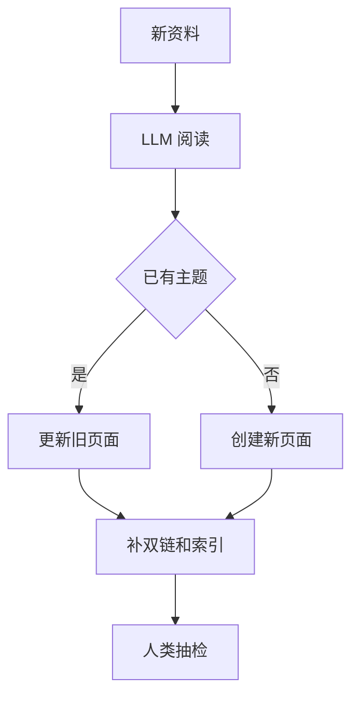

# LLM-Wiki知识库范式

> [!abstract] 一句话总结
> LLM Wiki 是让 LLM 把原始资料整理成可读、可链接、可维护的 Markdown 知识库，而不是每次查询都从原文里重新检索。

## 📌 这是什么

RAG 偏“查询时发现知识”，LLM Wiki 偏“写入时编译知识”。它适合个人学习库、团队知识库、项目文档这类需要人和 AI 一起长期维护的场景。

## 🧩 三层结构

```text
raw/      原始资料：网页、PDF、会议记录、聊天记录
wiki/     LLM 整理后的主题页面，互相链接
index.md  主题索引、入口、维护规则
```

## ⚙️ 工作流程



## 🎯 适用场景

- Obsidian 个人知识库。
- 团队 Wiki、项目 ADR、学习笔记。
- 资料不一定很大，但需要长期复用和人工阅读。
- 需要显式知识结构，而不是黑盒向量库。

## 🆚 与 RAG 的区别

| 维度 | RAG | LLM Wiki |
| ---- | ---- | ---- |
| 知识组织 | chunk + 向量 | Markdown 页面 + 双链 |
| 主要成本 | 查询时检索和生成 | 写入时整理和维护 |
| 人类可读性 | 向量库不可直接读 | 页面天然可读 |
| 适合规模 | 大规模动态文档 | 个人 / 小团队知识 |

## ⚠️ 踩坑与注意事项

- [ ] LLM 整理后的内容要保留原始来源。
- [ ] 需要定期合并重复页面、修复断链。
- [ ] 不适合强实时、大规模、权限复杂的企业搜索。
- [ ] Wiki 页面是知识编译结果，不应替代原始资料归档。

## 🎯 面试问题

> [!question] 高频问题
> - **Q: LLM Wiki 和 RAG 的区别？**
>   - A: RAG 在查询时检索原始 chunk；LLM Wiki 在写入时把资料整理成结构化页面，查询时读这些页面。
> - **Q: 为什么适合 Obsidian？**
>   - A: Obsidian 天然支持 Markdown、双链、索引和人工维护，正好符合 LLM Wiki 的形态。

## 🔗 关联笔记

- [[16-CAG缓存增强生成]]
- [[18-Long-Context长上下文]]
- [[01-RAG基础与全链路]]
- [[_index]]

## 📚 参考资料

- [Karpathy: LLM Wiki](https://gist.github.com/karpathy/442a6bf555914893e9891c11519de94f)
- [Obsidian Help: Internal links](https://help.obsidian.md/links)
- [Markdown Guide: Basic Syntax](https://www.markdownguide.org/basic-syntax/)
