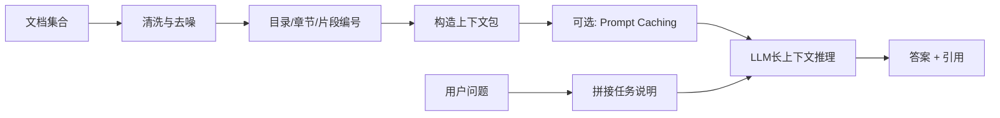

# Long-Context长上下文

> [!abstract] 一句话总结
> Long Context 是把资料直接组织进模型上下文窗口中完成理解、定位和生成，它常作为 RAG 的更简单基线，也在中小规模、低更新、强调不漏召回的任务里优于 RAG。

## 🎯 本节定位

- **本章第 18 课，RAG 的替代/进阶方案之一**。前置：[[01-RAG基础与全链路]] 讲清了 RAG 链路，本篇讨论“干脆不检索、直接全量进上下文”的另一条路。
- **延伸阅读（本课不展开）**：与 CAG 的关系见 [[16-CAG缓存增强生成]]；与 LLM Wiki 的对比见 [[17-LLM-Wiki知识库范式]]；引用编号与溯源做法见 [[11-引用溯源]]。

## 📌 这是什么

Long Context（长上下文）指的是：不先把知识切分后检索，而是把任务相关资料整体或半整体地放进模型上下文窗口，让模型在一次或少量几次调用中直接阅读、定位和回答。

它不是“无脑把文档全塞进去”，而是把**目录、结构、片段编号、任务说明、正文**按可读顺序组织进上下文，让模型像读一份有导航的材料包。

## 🤔 解决什么问题 / 为什么需要

Long Context 主要解决三类问题：

- **避免检索漏召回**：RAG 可能没召回到关键 chunk，Long Context 直接把资料放进去，不依赖检索链路。
- **降低系统复杂度**：不需要先上向量库、Embedding、Rerank、召回评估，原型阶段最省事。
- **增强跨段综合能力**：当问题需要跨章节、跨附件、跨长链条综合时，直接给全量上下文往往比“先检索几个块”更稳。

## 🧩 何时优于 RAG

| 场景 | Long Context 更优的原因 | RAG 何时更合适 |
| ---- | ---- | ---- |
| 文档规模中小，能放进上下文 | 省掉检索链路，开发最快 | 文档规模远超窗口时 |
| 材料范围已知，希望减少检索遗漏 | 全量装入消除了切分与检索阶段的漏召回风险 | 大规模文档库按需检索证据时 |
| 问题强依赖跨章节综合 | 模型可直接做全局阅读 | 问题主要是局部事实问答时 |
| 原型验证 / 质量上限对照 | 可快速验证“不经检索裁剪时模型直接阅读的效果” | 正式上线且需扩展到海量文档规模时 |
| 用户明确上传一组材料包 | 输入范围天然已知 | 企业大知识库、开放域知识库时 |

> 一个实用判断：**如果你已经知道“这次问答只围绕哪几份资料”，Long Context 往往先值得试；如果你连该读哪些资料都不知道，就更像 RAG 问题。**

## 🎯 适用边界

适合：

- 单篇论文、合同、研报、规范文档深度分析。
- 小型代码库、项目设计文档包、会议纪要包综合问答。
- 多附件一起总结、比对、抽取风险点。
- RAG 系统上线前，用于小样本全量上下文效果对照评测。

不适合：

- 企业级超大知识库、文档持续增长且远超窗口。
- 高频实时更新知识，如分钟级变更的商品、库存、日志、工单。
- 权限复杂、多租户、多角色强隔离场景。
- 大量简单查询但每次都重塞长文，成本和延迟会非常差。

## 🧱 上下文组织模板

Long Context 的关键不是“多”，而是“可导航”。推荐把上下文组织成下面这个顺序：

```text
[系统目标]
- 你要完成什么任务
- 输出格式与约束

[资料导航]
- 文档 1：标题 / 来源 / 时间 / 章节结构
- 文档 2：标题 / 来源 / 时间 / 章节结构

[阅读指引]
- 先看哪些章节
- 哪些问题需要跨文档综合
- 哪些段落优先作为证据

[正文片段]
[Doc1#S1] ...
[Doc1#S2] ...
[Doc2#S1] ...

[用户问题]
- 现在请回答……
- 引用时使用 [Doc#Section] 编号
```

实践要点：

- **目录先于正文**：先让模型知道材料结构。
- **片段要编号**：便于引用与定位。
- **关键内容前置**：摘要、结论、定义、限制条件优先放前面和结尾。
- **正文别完全平铺**：按章节边界、主题块、附件边界组织。

## ⚠️ Lost in the Middle

长上下文不是“所有位置同权重”。经典问题是 **Lost in the Middle**：模型往往更容易关注开头和结尾，而忽略中间的重要信息。

常见缓解方式：

- 把**任务说明**放在前面，把**关键约束/结论**放在前后都出现一次。
- 使用**目录 + 章节标题 + 片段编号**，让模型更容易回跳定位。
- 对超长正文先做**章节摘要**，再附原文片段。
- 对关键证据做**问题导向摘录**，不要只把大段原文平铺在中间。
- 如果上下文极长，可采用“**总览摘要 -> 重点章节 -> 原文片段**”三层结构。

## ⚙️ 架构流程



## 📐 参数 / 成本 / 延迟取舍

### 1. 核心取舍

| 维度 | Long Context 常见取舍 |
| ---- | ---- |
| 上下文长度 | 越长越不容易漏信息，但成本和延迟线性上升 |
| 材料完整度 | 全量更稳，但中间噪声和 Lost in the Middle 风险更高 |
| 结构化程度 | 目录、编号、摘要越好，模型利用率越高 |
| 输出长度 | 输出越长，整体耗时越高，容易占满 token 预算 |

### 2. 成本估算

长上下文的成本大头通常是**输入 token**。

可用通用公式估算：

```text
单次成本 ≈ 输入Token / 1,000,000 × 输入单价
        + 输出Token / 1,000,000 × 输出单价
```

例如：

- 上下文 200k token
- 问题和指令 2k token
- 输出 3k token

则单次调用的输入成本近似由 **202k token** 决定，远高于普通 RAG 一次只塞 5k~20k token 的情况。

### 3. 延迟估算

粗略上，Long Context 的延迟主要来自三部分：

- **长输入预填充时间**：上下文越长，模型读入越慢。
- **模型推理时间**：问题越复杂、思考越深，延迟越高。
- **输出生成时间**：答案越长越慢。

因此 Long Context 常见体验是：

- 首 token 等待时间更长。
- 资料包越长，延迟增长越明显。
- 多轮对话若每轮都重塞大上下文，整体会越来越贵、越来越慢。

### 4. 一个实用经验

- 若常驻背景超过可用窗口的大半，开始要警惕成本和质量下降。
- 若每轮都要重发同一大段稳定前缀，应结合 Prompt Caching。
- 若问题只需要极少局部证据，RAG 往往更便宜。

## 🧠 Prompt Caching 与 KV Cache 的区别

| 维度 | Prompt Caching | KV Cache |
| ---- | ---- | ---- |
| 所在层 | API / 平台层能力 | 模型推理运行时内部能力 |
| 目标 | 复用**相同前缀 prompt**，减少重复输入开销 | 复用已计算过的 attention key/value，加速续写 |
| 触发条件 | 前缀字节级一致，通常是 tools/system/messages 前缀一致 | 同一次会话/推理链路中继续生成或继续解码 |
| 对应用是否可见 | 通常可见，可看到 cache hit/read 指标 | 通常对应用不可见，由模型服务内部管理 |
| 典型价值 | 降低长上下文重复发送成本 | 降低生成阶段重复计算延迟 |
| 是否等于 CAG | 不是，Prompt Caching 只是 Long Context/CAG 的加速手段 | 不是，KV Cache 更底层，不是知识架构 |

一句话区分：

- **Prompt Caching**：你重复发同样的长前缀，平台帮你省钱省时。
- **KV Cache**：模型在继续生成时，不必重复算前面所有 token 的注意力状态。

## 💻 工程落地

- 先把 Long Context 当成 **RAG 的 baseline**，验证质量上限。
- 预处理文档时保留：标题层级、页码、来源、时间、附件边界。
- 为每个片段加稳定编号，如 `Doc1#2.3`、`SpecA#P12`。
- 对稳定不变的超长前缀使用 Prompt Caching。
- 对超长材料包先做一层“章节摘要索引”，再挂原文片段。
- 答案输出中强制要求引用片段编号，方便回溯。

## ⚠️ 生产坑与注意事项

- [ ] 不要把 Long Context 理解成“替代所有 RAG”。它只是某类场景下更优。
- [ ] 不要把几十万 token 的噪声文档无结构塞给模型，质量会明显下降。
- [ ] 中间关键信息容易被忽略，要显式做导航和重提。
- [ ] 多轮对话反复重塞大上下文，成本和延迟会非常高。
- [ ] 多租户资料不要混放到同一个上下文包，避免权限泄漏。
- [ ] 上下文窗口够大，不等于模型就能稳定利用全部内容。

## 🎯 面试问题

> [!question] 高频问题
> - **Q: Long Context 会替代 RAG 吗？**
>   - A: 不会完全替代。它会替代一部分中小规模、低更新、强调不漏召回的场景，但大规模、动态更新、权限复杂场景仍更适合 RAG。
> - **Q: Long Context 何时比 RAG 更好？**
>   - A: 当资料范围已知、规模可放入窗口、问题需要跨章节综合、不能接受漏召回时，Long Context 往往更稳。
> - **Q: Prompt Caching 和 KV Cache 一样吗？**
>   - A: 不一样。Prompt Caching 是平台层复用稳定前缀，KV Cache 是模型推理时内部复用历史状态。
> - **Q: Long Context 最大风险是什么？**
>   - A: 成本高、延迟高，以及 Lost in the Middle 导致中间关键信息被忽略。

## 🗣️ 面试 3 层回答

> [!tip] 3 层回答模板
> - **初级回答**：Long Context 就是把资料直接放进上下文，不走检索，优点是简单、少漏召回，缺点是贵且慢。
> - **中级回答**：它适合中小规模、低更新、强综合任务，关键不只是窗口大，而是要做目录、编号、摘要导航，否则会出现 Lost in the Middle。
> - **高级回答**：我会把 Long Context 当作 RAG 的质量上限基线，并结合 Prompt Caching 降低稳定前缀成本；如果知识规模、更新频率或权限复杂度上来，再切回 RAG 或混合架构。

## 🔗 关联笔记

- [[01-RAG基础与全链路]]
- [[16-CAG缓存增强生成]]
- [[11-引用溯源]]
- [[17-LLM-Wiki知识库范式]]
- [[_index]]

## 📚 参考资料

- [Lost in the Middle: How Language Models Use Long Contexts](https://arxiv.org/abs/2307.03172)
- [Claude Context Windows](https://docs.anthropic.com/en/docs/build-with-claude/context-windows)
- [Claude Prompt Caching](https://docs.anthropic.com/en/docs/build-with-claude/prompt-caching)
- [OpenAI Models](https://platform.openai.com/docs/models)
