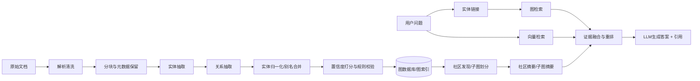

# GraphRAG图谱增强

> [!abstract] 一句话总结
> GraphRAG 用实体、关系、社区和子图摘要来组织知识，重点增强传统 RAG 在跨文档关系理解、全局问题回答和多跳推理上的能力。

## 🎯 本节定位

- **本章第 19 课，替代方案（四）：图谱增强**。前置 [[01-RAG基础与全链路]]、[[08-混合检索-Hybrid-Search]]（以 chunk 为单位的检索短板）；本篇讨论“以实体和关系为中心”的组织方式。
- **延伸阅读（本课不展开）**：多跳检索与动态编排见 [[20-Agentic-RAG智能体RAG]]，图证据的引用见 [[11-引用溯源]]。

## 📌 这是什么

GraphRAG 可以理解为“**以实体和关系为中心的 RAG**”。

传统 RAG 的基本单位通常是 chunk；GraphRAG 的基本单位则变成：

- **实体**：人、组织、系统、产品、概念、事件。
- **关系**：隶属、依赖、影响、调用、包含、发生于。
- **社区/主题簇**：一组高相关实体形成的局部知识子图。
- **图摘要**：对局部图或社区进行归纳，支持全局问答。

所以 GraphRAG 不是简单“加个知识图谱”，而是把**图检索 + 文本检索 + 生成**结合起来。

## 🤔 解决什么问题 / 为什么需要

GraphRAG 主要解决传统 RAG 的三类短板：

- **跨文档关系问题弱**：普通向量检索更擅长找相似文本，不擅长找“谁影响谁、谁依赖谁”。
- **多跳推理弱**：需要从 A 找到 B，再从 B 找到 C 的问题，普通 chunk 检索容易断链。
- **全局总结弱**：问“这个组织的核心主题有哪些”“某事件波及了哪些系统”时，单靠局部 chunk 难形成全局视角。

## 🎯 适用边界

适合：

- 企业组织、项目、系统、依赖关系复杂的知识域。
- 法律案例、金融风控、科研图谱、医疗知识、多跳问答。
- 用户高频提问“谁和谁有关”“根因链路是什么”“影响范围有哪些”。
- 需要把局部证据和全局结构一起交给模型的场景。

不适合：

- FAQ、静态手册、简单说明书问答。
- 没有明确实体关系结构的短文本集合。
- 数据更新太快、无法承受建图维护成本的场景。
- 团队没有抽取评估、图治理能力，只想“加图就变聪明”。

## 🧩 GraphRAG 到底增强了什么

| 能力 | 普通 RAG | GraphRAG |
| ---- | ---- | ---- |
| 局部语义相似检索 | 强 | 仍然需要 |
| 实体关系定位 | 弱 | 强 |
| 多跳推理支持 | 弱 | 更强 |
| 全局主题总结 | 弱 | 更强 |
| 系统复杂度 | 低 | 高 |
| 维护成本 | 低 | 高 |

GraphRAG 不是替代向量检索，而是更适合回答：

- 哪些系统与这个事故关联最强？
- 这个人的上下游关系链是什么？
- 一个政策变化会影响哪些部门和流程？
- 某概念在不同文档里是如何关联和演化的？

## 🏗️ 建图流水线

一个更现实的理解是：GraphRAG 至少有两条链路：

1. **离线建图链路**：把文档变成实体、边、社区、摘要。
2. **在线问答链路**：先识别问题里的实体与关系，再查图、查文本、最后融合生成。

## 🔍 图检索 + 向量检索如何配合

工程上最稳的方案通常不是纯图检索，而是混合：

### 图检索负责

- 找到问题涉及的实体节点。
- 沿着关系边做 1-hop / 2-hop / k-hop 扩展。
- 获取邻居、路径、社区摘要、影响范围。

### 向量检索负责

- 补充原文证据和自然语言上下文。
- 解决图里没有完整保留的细节描述。
- 给最终回答提供可引用的 chunk 证据。

### 融合原则

- **图给结构，向量给语义**。
- **图负责找链路，文本负责证实链路**。
- 最终回答尽量回到原文片段，而不是只基于抽象后的图节点。

## 🔧 实体关系抽取误差治理

GraphRAG 最大风险不是“查不到”，而是**图建错了还继续推理**。

常见误差：

- 实体抽错：把同名不同人、同名不同系统混为一体。
- 关系抽错：把“提到”误当“依赖”，把“可能影响”误当“确定因果”。
- 别名没合并：同一个实体分裂成多个节点。
- 本体漂移：不同批次抽取口径不一致，图越来越乱。

治理思路：

- **实体归一化**：名称标准化、别名字典、主键映射。
- **关系白名单**：先限制一小套高价值关系类型，不要一开始全开。
- **置信度阈值**：低置信边不直接入主图，可进待审区。
- **规则校验**：如“系统不能隶属于员工”“时间边不能反向”。
- **人工抽检**：对高价值实体、高频路径做抽样审查。
- **版本管理**：建图规则、抽取模型、词典都要可回滚。

## 🔁 多跳推理与评估

GraphRAG 的价值常体现在 2-hop、3-hop 问题，但也最容易“看起来会推理，实际在猜”。

### 多跳问题举例

- A 系统故障为什么会影响到 C 业务？
- 某员工离职会影响哪些项目、接口和审批链？
- 某条政策变化最终波及哪些组织单元？

### 评估不要只看最终答案

建议拆成四层指标：

| 层次 | 关注点 |
| ---- | ---- |
| 实体链接准确率 | 问题中的实体是否正确映射到图节点 |
| 路径命中率 | 关键 hop 路径有没有被找出来 |
| 支撑证据召回 | 最终回答是否拿到了正确文本证据 |
| 答案忠实度 | 回答是否真实基于图和原文，而不是脑补 |

如果只评“最后答案像不像对”，很容易掩盖图检索链路本身的问题。

## 📐 参数 / 成本 / 复杂度取舍

### 1. 关键参数

| 参数 | 影响 |
| ---- | ---- |
| 实体类型集合 | 越多覆盖越广，但抽取和治理更复杂 |
| 关系类型集合 | 越多表达力越强，但误差传播更严重 |
| hop 深度 | 越深越可能找到答案，也越容易引入噪声 |
| 邻居扩展 fanout | 越大召回越高，但子图膨胀更严重 |
| 社区粒度 | 太粗会泛化，太细会失去全局性 |

### 2. 成本构成

GraphRAG 的成本不只是一次推理成本，而是全链路成本：

- 文档解析与抽取成本。
- 实体归一化和图更新成本。
- 图数据库/索引存储成本。
- 社区发现与图摘要重算成本。
- 评估集建设与人工治理成本。

### 3. 维护复杂度

普通 RAG 的复杂度多在 chunk、检索、重排；GraphRAG 还要额外维护：

- 本体定义。
- 抽取规则。
- 别名词典。
- 图 schema 演化。
- 图与原文的同步更新。

所以 GraphRAG 更像一个**知识工程系统**，不只是一个检索插件。

## 💻 工程落地

- 先从**高价值实体 + 少量核心关系**起步，不要一口气建大而全图谱。
- 图中只保留对问答真正有价值的关系，不要把所有共现都变成边。
- 图检索结果一定回查原文，输出答案时保留文本证据引用。
- 线上先做**图检索 + 向量检索混合**，不要一开始做纯图问答。
- 建立多跳评估集，专门验证 1-hop、2-hop、3-hop 的真实效果差异。

## ⚠️ 生产坑与注意事项

- [ ] 建图不是一次性动作，后续治理和更新通常比首建更贵。
- [ ] 抽取错误会在多跳路径里被放大，错一条边可能整条链都错。
- [ ] 图越大、hop 越深，噪声路径越多，必须限制扩展深度和 fanout。
- [ ] 不要只看图上的路径是否通，还要看原文证据是否支持该路径解释。
- [ ] 对简单 FAQ 上 GraphRAG 往往是过度设计。
- [ ] 如果团队没有图治理能力，GraphRAG 很容易变成“昂贵但不稳定”的系统。

## 🎯 面试问题

> [!question] 高频问题
> - **Q: GraphRAG 解决传统 RAG 什么问题？**
>   - A: 它重点增强跨文档关系建模、多跳推理和全局问题回答能力。
> - **Q: GraphRAG 是不是只要上知识图谱就更强？**
>   - A: 不是。抽取、归一化、关系治理做不好，图会放大错误。
> - **Q: 图检索为什么还要配合向量检索？**
>   - A: 图擅长找结构链路，向量擅长找原文语义细节，最终回答还得回到文本证据。
> - **Q: GraphRAG 的最大代价是什么？**
>   - A: 建图、维护、评估和治理复杂度都显著高于普通 RAG。

## 🗣️ 面试 3 层回答

> [!tip] 3 层回答模板
> - **初级回答**：GraphRAG 就是在 RAG 上引入实体关系图谱，让模型更擅长回答多实体、多跳问题。
> - **中级回答**：它通常包含离线建图和在线图检索两条链路，实践里最好与向量检索混合，图负责链路，文本负责证据。
> - **高级回答**：GraphRAG 的难点不在“查图”，而在实体归一化、关系误差治理、社区摘要更新、多跳评估和持续维护成本；如果关系结构不强，普通 RAG 往往性价比更高。

## 🔗 关联笔记

- [[01-RAG基础与全链路]]
- [[08-混合检索-Hybrid-Search]]
- [[20-Agentic-RAG智能体RAG]]
- [[11-引用溯源]]
- [[_index]]

## 📚 参考资料

- [Microsoft GraphRAG Documentation](https://microsoft.github.io/graphrag/)
- [A Graph RAG Approach to Query-Focused Summarization](https://arxiv.org/abs/2404.16130)
- [Graph Retrieval-Augmented Generation: A Survey](https://arxiv.org/abs/2408.08921)
